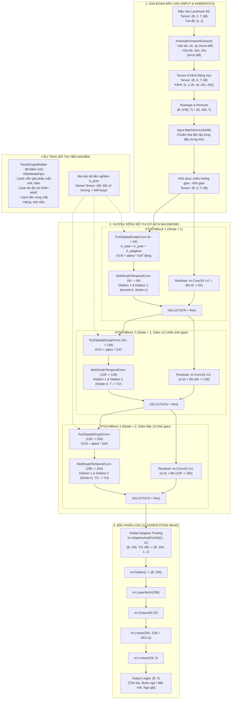

# KIẾN TRÚC VÀ CƠ CHẾ HOẠT ĐỘNG CỦA MÔ HÌNH DRIVERSTGCN

Tài liệu này phân tích chi tiết kiến trúc, luồng xử lý dữ liệu và nguyên lý hoạt động của mô hình **`DriverSTGCN`** trong file [`model.py`](file:///D:/Project/DATN/driver-guardian/ai/GCN/model.py), kết hợp với các khối thành phần xây dựng trong [`block.py`](file:///D:/Project/DATN/driver-guardian/ai/GCN/block.py).

---

## 1. TỔNG QUAN VỀ DRIVERSTGCN

**`DriverSTGCN`** (Driver Spatio-Temporal Graph Convolutional Network) là mô hình mạng nơ-ron đồ thị không - thời gian được thiết kế chuyên biệt cho bài toán **giám sát trạng thái tài xế** (Driver Drowsiness & Distraction Detection) từ chuỗi điểm mốc khuôn mặt (Facial Landmarks).

### Các đặc tính cốt lõi:
- **Siêu nhẹ (Lightweight)**: Toàn bộ mô hình chỉ có khoảng **~734,246 tham số** (~2.9 MB bộ nhớ float32), cực kỳ phù hợp để triển khai thời gian thực (Real-time) trên các thiết bị Edge AI (Raspberry Pi 4/5, Jetson Nano, camera hành trình thông minh, smartphone).
- **Đầu vào dạng chuỗi điểm mốc (Landmarks Sequence)**: Thay vì xử lý từng khung hình ảnh pixel thô (nặng nề và phụ thuộc vào điều kiện ánh sáng), mô hình chỉ xử lý chuỗi tọa độ của **68 điểm mốc khuôn mặt** theo thời gian.
- **Khai thác tri thức giải phẫu khuôn mặt**: Sử dụng đồ thị giải phẫu khuôn mặt kết hợp với các chỉ số sinh lý quan trọng (EAR - Eye Aspect Ratio, MAR - Mouth Aspect Ratio).
- **Học không - thời gian đa tỷ lệ (Multi-Scale Spatio-Temporal Learning)**: Vừa học quan hệ cơ mặt không gian (Spatial) giữa các điểm mốc, vừa trích xuất biến thiên động học ngắn hạn (chớp mắt) và dài hạn (ngáp, gật đầu).

---

## 2. SƠ ĐỒ KIẾN TRÚC TỔNG THỂ (ARCHITECTURE DIAGRAM)

### 2.1. Sơ đồ Luồng Dữ liệu Toàn diện (End-to-End Pipeline)

---

### 2.2. Chi tiết bên trong một khối STGCNBlock

Mỗi khối **`STGCNBlock`** là sự kết hợp tuần tự giữa xử lý không gian (Spatial), thời gian đa tỷ lệ (Temporal) và kết nối tắt (Residual):

```mermaid
flowchart LR
    subgraph IN["Input x"]
        X["x: (B, C_in, T_in, V)"]
    end

    subgraph SGCN_BOX["PyGSpatialGraphConv (Không Gian)"]
        ReshapeIn["Reshape -> (B*T, V, C_in)"]
        
        subgraph GCN_BRANCH["Nhánh 1: Tĩnh + Thích Ứng Toàn Cục"]
            AdjSum["A_total = A_prior + A_adaptive"]
            DenseGCN["DenseGCNConv<br/>(D^-1/2 * A_total * D^-1/2 * X * W)"]
        end
        
        subgraph GAT_BRANCH["Nhánh 2: Chú Ý Đồ Thị Động"]
            DenseGAT["DenseGATConv (4 Heads)<br/>Dynamic Attention Weight"]
            Alpha["Nhân trọng số alpha tự học"]
        end
        
        MergeS["Cộng đặc trưng:<br/>Out_GCN + alpha * Out_GAT"]
        BN_S["BatchNorm2d + GELU"]
        ReshapeOut["Reshape -> (B, C_out, T_in, V)"]
    end

    subgraph TGCN_BOX["MultiScaleTemporalConv (Thời Gian)"]
        subgraph T_B1["Nhánh TCN Tốc độ Cao"]
            ConvD1["Conv2d (k=5, d=1, s=stride)<br/>Bắt chuyển động nhanh (chớp mắt)"]
        end
        subgraph T_B2["Nhánh TCN Tốc độ Chậm"]
            ConvD2["Conv2d (k=5, d=2, s=stride)<br/>Bắt chuyển động dài (ngáp, gật)"]
        end
        ConcatT["torch.cat(dim=1)<br/>Tổng hợp đặc trưng đa thang đo"]
        BN_T["BatchNorm2d + Dropout(0.2)"]
    end

    subgraph RES_BOX["Residual Connection"]
        ResBranch["Identity (nếu C_in=C_out & s=1)<br/>hoặc Conv2d(1x1, s=stride) + BN"]
    end

    subgraph OUT_BOX["Output"]
        AddRes["Cộng dư: x_tgcn + x_res"]
        GELU_Final["GELU()"]
        Out["x_out: (B, C_out, T_out, V)"]
    end

    X --> ReshapeIn
    ReshapeIn --> DenseGCN
    AdjSum --> DenseGCN
    ReshapeIn --> DenseGAT --> Alpha
    DenseGCN --> MergeS
    Alpha --> MergeS
    MergeS --> BN_S --> ReshapeOut

    ReshapeOut --> ConvD1 --> ConcatT
    ReshapeOut --> ConvD2 --> ConcatT
    ConcatT --> BN_T

    X --> ResBranch

    BN_T --> AddRes
    ResBranch --> AddRes
    AddRes --> GELU_Final --> Out
```

---

## 3. GIẢI THÍCH CHI TIẾT CÁCH HOẠT ĐỘNG TỪNG THÀNH PHẦN

### 3.1. Đồ thị Tiên nghiệm Khuôn mặt (`FacialGraphBuilder`)

Mô hình không coi 68 điểm mốc như một tập hợp điểm rời rạc hoặc dạng ảnh lưới (grid) thông thường, mà xây dựng thành một **đồ thị liên kết có hướng dẫn sinh học**:

1. **Cạnh giải phẫu cơ mặt (Anatomical Contours)**:
   - Viền xương hàm (Điểm 0 – 16)
   - Lông mày trái (17 – 21) & Lông mày phải (22 – 26)
   - Sống mũi (27 – 30) & Cánh mũi (31 – 35)
   - Viền mắt trái (36 – 41) & Viền mắt phải (42 – 47) (vòng khép kín)
   - Môi ngoài (48 – 59) & Môi trong (60 – 67) (vòng khép kín)
2. **Cạnh đo trực tiếp độ mở Mắt (EAR) và Miệng (MAR)**:
   - Mí mắt trên - dưới: Cặp [37, 41], [38, 40], [43, 47], [44, 46].
   - Môi trên - dưới: Cặp [50, 58], [51, 57], [52, 56], [61, 67], [62, 66], [63, 65].
   - *Tác dụng*: Giúp thông tin biến dạng co/giãn của mí mắt (chớp mắt, sụp mi) và miệng (ngáp) được truyền thẳng giữa hai bờ đối diện ngay từ lớp GCN đầu tiên.
3. **Cạnh liên vùng (Cross-region pairs)**:
   - Mắt $\leftrightarrow$ Miệng: [37, 48], [41, 48], [44, 54],...
   - Mũi $\leftrightarrow$ Cằm & Đuôi mắt: [30, 8], [27, 8],...
   - *Tác dụng*: Liên kết biểu cảm tổng thể khuôn mặt (khi ngáp to, lông mày và mí mắt thường nheo lại; khi ngủ gật, cằm có xu hướng chúc xuống).
4. **Chuẩn hóa đồ thị**:
   - Chuyển thành đồ thị vô hướng (`to_undirected`) để truyền tin hai chiều.
   - Thêm vòng tự lặp (`add_self_loops`) để mỗi đỉnh giữ lại thông tin đặc trưng của chính nó.
   - Xuất ra ma trận kề dạng dày **$A_{prior} \in \mathbb{R}^{68 \times 68}$**.

---

### 3.2. Trích xuất Động học Tức thời (`KinematicFeatureExtractor`)

Khi phát hiện tài xế ngủ gật, **tốc độ thay đổi** quan trọng hơn tọa độ tĩnh:
- Người bình thường chớp mắt: Mí mắt khép lại rất nhanh và mở ra ngay lập tức ($0.1 - 0.2$ giây).
- Người ngủ gật: Mí mắt sụp xuống từ từ, tốc độ khép mí chậm, mí mắt nhắm nghiền trong thời gian dài.

Khối `KinematicFeatureExtractor` giải quyết bài toán này:
- Nếu đầu vào $x$ chỉ có 2 kênh tọa độ $(x, y)$, khối tự động tính toán vi phân cấp 1 và cấp 2 dọc theo trục thời gian $T$:
  $$\text{Vận tốc (Velocity): } v_t = \frac{\Delta x_t}{\Delta t} = x_t - x_{t-1}$$
  $$\text{Gia tốc (Acceleration): } a_t = \frac{\Delta v_t}{\Delta t} = v_t - v_{t-1}$$
- Sử dụng hàm vector hóa `torch.diff(..., dim=2)` của PyTorch và cơ chế đệm biên (`F.pad(..., mode='replicate')`) ở frame đầu tiên để giữ nguyên độ dài thời gian $T$.
- Nối ghép (Concatenate) thành tensor 6 chiều:
  $$\mathbf{X}_{kinematic} = [x, y, dx, dy, d^2x, d^2y] \in \mathbb{R}^{B \times 6 \times T \times 68}$$

---

### 3.3. Chuẩn hóa Đầu vào Từng Điểm Mốc (`input_bn`)

- Dữ liệu được biến đổi chiều:
  $$(B, C=6, T, V=68) \xrightarrow{\text{permute}} (B, C, V, T) \xrightarrow{\text{view}} (B, C \times V = 408, T)$$
- Áp dụng `nn.BatchNorm1d(408)`: Chuẩn hóa độc lập trên từng kênh của từng điểm mốc xuyên suốt chuỗi thời gian $T$.
- **Lợi ích**:
  - Triệt tiêu sai lệch về kích thước khuôn mặt (người ngồi gần camera vs người ngồi xa).
  - Triệt tiêu góc quay đầu tĩnh (nghiêng trái/phải), tập trung hoàn toàn vào dao động tương đối.
  - Sau đó khôi phục lại tensor chuẩn $(B, 6, T, 68)$.

---

### 3.4. Khối Tích chập Không gian - Thời gian (`STGCNBlock`)

Mỗi khối bao gồm ba thành phần phối hợp chặt chẽ:

#### A. Tích chập Không gian PyGSpatialGraphConv (Spatial Phase)
Tận dụng các lớp tối ưu hóa hiệu năng cao của thư viện **PyTorch Geometric (PyG)**:
1. **$A_{prior}$ (Ma trận kề tiên nghiệm)**: Cố định theo tri thức giải phẫu, lưu trong `register_buffer`.
2. **$A_{adaptive}$ (Ma trận kề tự học toàn cục)**: Là một tham số có thể huấn luyện (`nn.Parameter` kích thước $68 \times 68$, khởi tạo giá trị rất nhỏ $10^{-5}$). Nó học các mối tương quan tiềm ẩn giữa bất kỳ cặp điểm mốc nào mà đồ thị giải phẫu ban đầu chưa kết nối.
3. **Nhánh GCN tĩnh + thích ứng**:
   $$\mathbf{H}_{GCN} = \text{DenseGCNConv}(\mathbf{X}, A_{prior} + A_{adaptive})$$
   PyG tự động thực hiện phép chuẩn hóa ma trận đối xứng: $\tilde{D}^{-1/2} \tilde{A} \tilde{D}^{-1/2}$.
4. **Nhánh GAT động (Graph Attention Network)**:
   $$\mathbf{H}_{GAT} = \text{DenseGATConv}(\mathbf{X}, A_{prior}, \text{heads}=4)$$
   Tính toán ma trận chú ý (Attention Matrix) động theo từng mẫu cụ thể dựa trên mức độ tương đồng đặc trưng của các nút tại thời điểm đó.
5. **Hòa trộn đặc trưng linh hoạt**:
   $$\mathbf{H}_{spatial} = \mathbf{H}_{GCN} + \alpha \cdot \mathbf{H}_{GAT}$$
   Tham số $\alpha$ được khởi tạo bằng $0$. Giai đoạn đầu mô hình dựa hoàn toàn vào mạng GCN ổn định, sau đó học dần cách tận dụng cơ chế Attention để tăng độ chính xác.
6. Áp dụng `BatchNorm2d` và hàm kích hoạt `GELU()`.

#### B. Tích chập Thời gian Đa tỷ lệ MultiScaleTemporalConv (Temporal Phase)
Thay vì sử dụng một cửa sổ thời gian cố định, mô hình chia kênh làm 2 nhánh tích chập với **Dilation** khác nhau:
- **Nhánh 1 ($Dilation = 1$, $Kernel = 5 \times 1$)**:
  - Trường tiếp nhận (Receptive field) = 5 khung hình liên tiếp.
  - Chuyên trách bắt các vi biến đổi nhanh: Chớp mắt tức thời, nhíu mày giật cục.
- **Nhánh 2 ($Dilation = 2$, $Kernel = 5 \times 1$)**:
  - Trường tiếp nhận hiệu dụng = $1 + (5 - 1) \times 2 = 9$ khung hình.
  - Quan sát bước nhảy thưa hơn, chuyên trách nhận dạng các chuyển động có quán tính chậm: Mí mắt rũ xuống dần, há miệng ngáp kéo dài, đầu gục xuống từ từ.
- Ghép kênh $\text{Concat}(\text{Branch}_1, \text{Branch}_2)$ $\to$ `BatchNorm2d` $\to$ `Dropout(0.2)`.

#### C. Đường tắt Residual Connection & Kích hoạt
- Nếu `in_channels == out_channels` và `stride == 1`: Áp dụng `nn.Identity()`.
- Nếu có sự thay đổi kích thước kênh hoặc lấy mẫu giảm thời gian ($stride = 2$): Sử dụng `nn.Conv2d(kernel_size=1, stride=(stride, 1)) + BatchNorm2d`.
- Kết quả đầu ra:
  $$\mathbf{X}_{out} = \text{GELU}(\mathbf{X}_{temporal} + \mathbf{X}_{residual})$$

---

### 3.5. Cấu hình Chuỗi Backbone 3 Tầng

Mô hình thiết lập 3 tầng `STGCNBlock` theo nguyên lý giảm dần chiều thời gian và tăng dần độ sâu kênh ngữ nghĩa:

| Tầng | In Channels | Out Channels | Stride Thời Gian | Kích thước Tensor Thời Gian ($T$) | Ngữ nghĩa Trích xuất |
| :--- | :---: | :---: | :---: | :---: | :--- |
| **Block 1** | 6 | 64 | 1 | $T$ (Giữ nguyên) | Đặc trưng mốc cục bộ, vận tốc ban đầu |
| **Block 2** | 64 | 128 | 2 | $T / 2$ (Giảm 1/2) | Tương quan chuyển động giữa các bộ phận |
| **Block 3** | 128 | 256 | 2 | $T / 4$ (Giảm tiếp 1/2) | Chuỗi hành vi cấp cao (Ngáp, Gật đầu) |

---

### 3.6. Đầu Phân loại (Classification Head)

Sau chuỗi Backbone, tensor đặc trưng có kích thước $(B, 256, T/4, 68)$. Đầu phân loại thực hiện:
1. **Adaptive Average Pooling 2D**:
   $$\text{nn.AdaptiveAvgPool2d}((1, 1)) \to (B, 256, 1, 1)$$
   Gộp trung bình toàn bộ $68$ đỉnh khuôn mặt và toàn bộ các frame thời gian còn lại thành 1 vector biểu diễn đại diện duy nhất cho toàn bộ video clip.
2. **MLP Classifier**:
   - `Flatten()` $\to (B, 256)$
   - `LayerNorm(256)`: Ổn định phân phối đặc trưng trước các lớp tuyến tính.
   - `Dropout(0.25)`: Chống Overfitting.
   - `Linear(256, 128)` + hàm kích hoạt phi tuyến `GELU()`.
   - `Linear(128, num_classes=3)` $\to (B, 3)$ chứa Logits dự đoán của 3 trạng thái.

---

## 4. BẢNG THEO DÕI BIẾN ĐỔI CHIỀU TENSOR (TENSOR SHAPE TRACKING)

Giả sử mô hình nhận vào một batch kiểm thử gồm **$B = 4$** mẫu clip, mỗi clip dài **$T = 60$** frame (~2 giây ở tốc độ 30 FPS), với **$V = 68$** mốc khuôn mặt, đầu vào chỉ có tọa độ $(x, y)$:

| Bước / Tầng | Tên Module / Hàm | Kích thước Đầu vào (Input Shape) | Kích thước Đầu ra (Output Shape) | Ghi chú |
| :---: | :--- | :---: | :---: | :--- |
| **0** | **Raw Input** | - | `(4, 2, 60, 68)` | Tọa độ chuẩn hóa $[x, y]$ |
| **1** | `KinematicFeatureExtractor` | `(4, 2, 60, 68)` | `(4, 6, 60, 68)` | Bổ sung $[dx, dy, d^2x, d^2y]$ |
| **2** | Reshape cho BN | `(4, 6, 60, 68)` | `(4, 408, 60)` | $408 = 6 \text{ kênh} \times 68 \text{ đỉnh}$ |
| **3** | `input_bn (BatchNorm1d)` | `(4, 408, 60)` | `(4, 408, 60)` | Chuẩn hóa độc lập theo thời gian |
| **4** | Restore Shape | `(4, 408, 60)` | `(4, 6, 60, 68)` | Chuẩn bị vào Backbone |
| **5** | **STGCNBlock 1** (s=1) | `(4, 6, 60, 68)` | `(4, 64, 60, 68)` | Trích xuất đặc trưng cơ bản |
| **6** | **STGCNBlock 2** (s=2) | `(4, 64, 60, 68)` | `(4, 128, 30, 68)` | Downsampling thời gian $60 \to 30$ |
| **7** | **STGCNBlock 3** (s=2) | `(4, 128, 30, 68)` | `(4, 256, 15, 68)` | Downsampling thời gian $30 \to 15$ |
| **8** | `global_pool` (AdaptiveAvgPool) | `(4, 256, 15, 68)` | `(4, 256, 1, 1)` | Gom toàn bộ không gian và thời gian |
| **9** | `Flatten` + `LayerNorm` | `(4, 256, 1, 1)` | `(4, 256)` | Vector đặc trưng ngữ nghĩa clip |
| **10**| `Linear(256 -> 128)` + `GELU` | `(4, 256)` | `(4, 128)` | Tầng ẩn phân loại trung gian |
| **11**| `Linear(128 -> 3)` | `(4, 128)` | **`(4, 3)`** | **Logits của 3 lớp trạng thái** |

---

## 5. TỔNG KẾT ƯU ĐIỂM KỸ THUẬT CỦA MÔ HÌNH

1. **Kháng nhiễu ngoại cảnh & Bảo vệ quyền riêng tư**:
   - Dữ liệu đưa vào mạng là tọa độ các điểm mốc hình học đã được chuẩn hóa, loại bỏ hoàn toàn thông tin nhận diện khuôn mặt cá nhân cũng như các yếu tố gây nhiễu môi trường (ánh sáng ngược, ban đêm, màu da, nền cabin xe).
2. **Cơ chế mô hình hóa đồ thị 3 tầng (Tri-Level Graph Representation)**:
   - *Tầng 1 (Cố định)*: Ma trận tiên nghiệm $A_{prior}$ cung cấp tri thức giải phẫu khuôn mặt và chỉ số EAR/MAR.
   - *Tầng 2 (Thích ứng toàn cục)*: Ma trận tham số tự học $A_{adaptive}$ phát hiện mối quan hệ liên kết ngầm giữa các vùng cơ mặt.
   - *Tầng 3 (Động theo mẫu)*: Lớp $GAT$ điều chỉnh trọng số liên kết phụ thuộc vào biểu cảm riêng biệt của từng tài xế trong từng khung hình.
3. **Hiệu quả tính toán vượt trội trên Edge AI**:
   - Số lượng tham số chỉ **~734K**, kích thước mô hình siêu nhỏ, có thể chạy mượt mà ở tốc độ **>60 FPS** trên CPU hoặc vi xử lý nhúng mà không bắt buộc phải có GPU rời đắt tiền.
