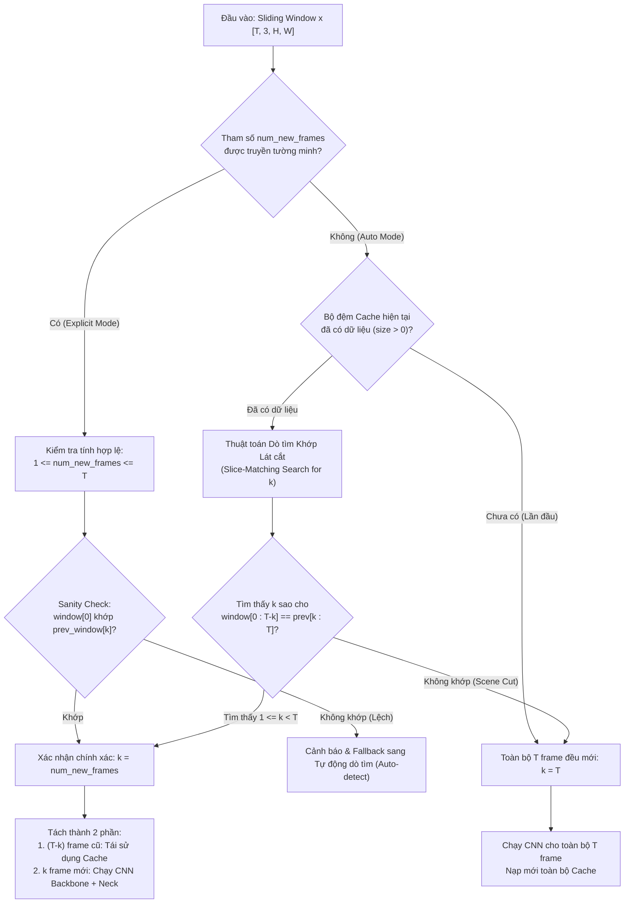
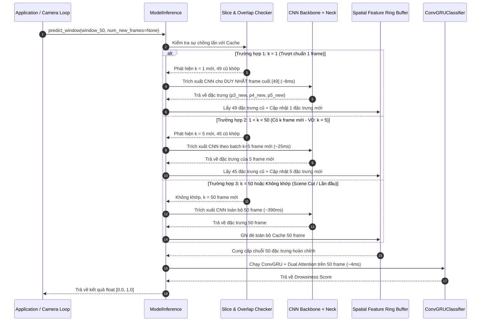

# TÀI LIỆU PHÂN TÍCH YÊU CẦU: TỐI ƯU HÓA SUY LUẬN BẰNG BỘ ĐỆM CACHE CHO CỬA SỔ TRƯỢT (SLIDING WINDOW) VÀ CƠ CHẾ KIỂM TRA NHIỀU FRAME MỚI TRONG MODELINFERENCE

- **Mã yêu cầu**: `OPTIMIZE_MODEL_INFERENCE_CACHE`
- **Tệp phân tích**: `docs/analsys/analsys_cache_sliding_window.md`
- **Mục tiêu**: Phân tích toàn diện bài toán suy luận thời gian thực trên camera với cửa sổ trượt 50 frame (chu kỳ nạp thông thường 1 frame mỗi 0.2s), xác định điểm nghẽn hiệu năng hiện tại của lớp `ModelInference` tại `model_inference.py`, thiết kế cơ chế Caching đặc trưng không gian (Spatial Feature Cache) bằng Tensor Ring Buffer, đặc biệt **bổ sung cơ chế kiểm tra và xử lý thích ứng khi cùng một sliding window nạp vào có nhiều hơn 1 frame mới ($k > 1$)** (do trễ mạng, drop frame, stride thay đổi hoặc batching), triệt tiêu tối đa chi phí tính toán CNN dư thừa và duy trì 100% tính chính xác toán học của mô hình.
- **Trạng thái**: Đang chờ người dùng phê duyệt (Bước 1 theo quy trình chuẩn `AGENTS.md`).

---

## 1. YÊU CẦU CỐT LÕI TỪ NGƯỜI DÙNG

### 1.1. Yêu cầu ban đầu
> *"thêm cache cho model ModelInference trong file @[model_inference.py] để giảm tốc độ chạy với của số trượt 50 frame mỗi 0.2s nạp vào 1 frame"*

### 1.2. Yêu cầu bổ sung chuyên sâu
> *"thêm cơ chế kiểm tra trong trường hợp cùng 1 slide window nạp vào có nhiều hơn 1 frame mới"*

### 1.3. Giải mã yêu cầu và các kịch bản vận hành thực tế
- **Mô hình mục tiêu**: Lớp `ModelInference` trong tệp `model_inference.py` – hệ thống suy luận đầu-cuối phát hiện ngủ gật tài xế (Driver Guardian AI) tích hợp giữa mạng thị giác trích xuất không gian (`NMSFreeDetector` Backbone + PAFPN Neck) và mạng mô hình hóa không gian - thời gian (`ConvGRUClassifier`).
- **Kích thước cửa sổ trượt (Sliding Window Size)**: $W = 50$ khung hình (tương ứng đoạn video quan sát $10\,\text{giây}$ với tần số $5\,\text{FPS}$).
- **Trường hợp chuẩn ($k = 1$ frame mới)**: Cứ mỗi $0.2\,\text{s}$ camera buồng lái nạp $1$ khung hình mới ($S = 1$ frame). Giữa 2 lần gọi liên tiếp: 49 frame cũ giữ nguyên, 1 frame mới ở cuối.
- **Trường hợp mở rộng ($k > 1$ frame mới)**: Cùng một sliding window 50 frame nạp vào có thể chứa **nhiều hơn 1 frame mới** ($1 < k < 50$ hoặc thậm chí $k \ge 50$):
  1. **Hiện tượng giật mạng / dồn hàng đợi (Camera Drop/Jitter & Burst Buffering)**: Do nghẽn I/O hoặc gián đoạn luồng video, hệ thống đọc camera bị chậm một nhịp, sau đó nạp dồn một cụm gồm 2, 3, hoặc 5 frame mới cùng lúc.
  2. **Bước trượt tùy biến (Configurable Stride $S > 1$)**: Khi người dùng cấu hình stride trượt $S = 2, 3, 5, 10$ frame (ví dụ để giảm tần suất suy luận xuống $2.5\,\text{FPS}$ hoặc $1\,\text{FPS}$). Khi đó mỗi lần gọi sẽ có đúng $S$ frame mới và $50 - S$ frame cũ.
  3. **Cắt cảnh / Đổi clip / Tua video (Scene Discontinuity / Reset)**: Khi video bị nhảy cóc hoặc đổi tài xế, toàn bộ 50 frame đều mới ($k = 50$) hoặc số frame trùng khớp không liên tục.
- **Mục tiêu của cơ chế kiểm tra**:
  - Tự động phát hiện chính xác số lượng frame mới $k$ trong sliding window được nạp vào.
  - Kiểm tra tính toàn vẹn và mức độ trùng khớp của phần frame cũ ($50 - k$ frame) với dữ liệu đã lưu trong cache.
  - Tối ưu hóa tính toán thích ứng: **Chỉ chạy CNN cho đúng $k$ frame mới**, tái sử dụng $50 - k$ đặc trưng từ cache, ghép nối chuẩn xác và đưa vào ConvGRU.

---

## 2. KHẢO SÁT HIỆN TRẠNG VÀ PHÂN TÍCH ĐIỂM NGHẼN (BOTTLENECK ANALYSIS)

### 2.1. Luồng suy luận hiện tại trong `ModelInference.forward(x)`
Trong tệp `model_inference.py` hiện hành:
```python
def forward(self, x: Union[np.ndarray, torch.Tensor]) -> float:
    # 1. Kiểm tra kích thước và chuyển đổi kiểu dữ liệu [T, 3, H, W]
    # 2. Letterbox từng khung hình về [640, 640] nếu H != 640 hoặc W != 640
    # 3. Trích xuất đặc trưng CNN theo từng chunk:
    with torch.inference_mode():
        for i in range(0, T, self.chunk_size):
            chunk = x[i: i + self.chunk_size].to(device, non_blocking=True)
            out3, out4, out5 = self.cnn_backbone(chunk)
            out3, out4, out5 = self.cnn_neck(out3, out4, out5)
            p3_list.append(out3.float())
            p4_list.append(out4.float())
            p5_list.append(out5.float())
        
        # 4. Gom tụ chuỗi đặc trưng P3, P4, P5
        p3 = torch.cat(p3_list, dim=0).unsqueeze(0)
        p4 = torch.cat(p4_list, dim=0).unsqueeze(0)
        p5 = torch.cat(p5_list, dim=0).unsqueeze(0)
        
        # 5. Đưa qua ConvGRUClassifier
        seq_lens = torch.tensor([T], dtype=torch.long, device=device)
        logits = self.conv_gru((p3, p4, p5), seq_lens=seq_lens)
        ...
        return float(score)
```

### 2.2. Điểm nghẽn lãng phí tính toán khi có $k$ frame mới
Khi truyền một sliding window gồm 50 frame $[f_0, f_1, \dots, f_{49}]$ vào `forward()`:
- Nếu có $k$ frame mới (với $1 \le k < 50$):
  - Số frame cũ đã xử lý ở lần trước: $50 - k$ frame.
  - Tỷ lệ tính toán dư thừa:
    $$\text{Tỷ lệ lãng phí CNN} = \frac{50 - k}{50}$$
  - Ví dụ:
    - Khi $k = 1$: Lãng phí **$98\%$** tính toán.
    - Khi $k = 2$: Lãng phí **$96\%$** tính toán.
    - Khi $k = 5$: Lãng phí **$90\%$** tính toán.
    - Khi $k = 10$: Lãng phí **$80\%$** tính toán.
- **Hệ quả**: Nếu không có cơ chế phát hiện $k$ và tái sử dụng cache, toàn bộ 50 frame tiếp tục bị ép chạy qua CNN Backbone + Neck tốn $\approx 400\,\text{ms}$, gây trễ nghiêm trọng cho hệ thống cảnh báo lái xe an toàn.

---

## 3. THIẾT KẾ CƠ CHẾ KIỂM TRA VÀ TỰ ĐỘNG DÒ TÌM SỐ FRAME MỚI ($k$)

### 3.1. Các phương thức kiểm tra số frame mới ($k$)

Để đảm bảo vừa tiện lợi, vừa tối ưu tốc độ, vừa an toàn tuyệt đối, hệ thống hỗ trợ 3 cơ chế kiểm tra linh hoạt:



### 3.2. Thuật toán Dò tìm Khớp Lát cắt (Slice-Matching Search Algorithm)
Khi caller truyền vào toàn bộ sliding window $50$ frame mà không chỉ định trước $k$, hệ thống thực hiện thuật toán kiểm tra siêu nhanh theo 2 bước:

1. **Bước 1: Kiểm tra nhanh qua Chữ ký Frame (Fast Signature Check)**:
   - Mỗi frame khi đưa vào hệ thống được lưu một chữ ký cực nhẹ (ví dụ: vector trung bình màu $[3]$, checksum, hoặc mẫu $4$ điểm góc pixel).
   - Duyệt $k \in \{1, 2, \dots, \min(T, W)\}$:
     - So sánh chữ ký của `window[0]` với `cached_signatures[k]`.
     - Nếu chữ ký không khớp $\rightarrow$ bỏ qua ngay lập tức ($O(1)$).
2. **Bước 2: Xác thực Lát cắt Tensor (Tensor Slice Verification)**:
   - Khi chữ ký tại vị trí $k$ khớp:
   - Thực hiện kiểm tra lát cắt: `torch.equal(window[0 : T - k], cached_raw[k : T])` hoặc kiểm tra dung sai số thực `torch.allclose(..., atol=1e-3)`.
   - Nếu lát cắt khớp:
     - Khẳng định $100\%$ tính đúng đắn: **Có đúng $k$ frame mới** nằm tại `window[T - k : T]`.
     - Dừng tìm kiếm ngay lập tức.
3. **Bước 3: Xử lý ngoại lệ (Fallback on Discontinuity / Scene Cut)**:
   - Nếu duyệt hết dải $k$ mà không tìm thấy lát cắt nào khớp (ví dụ tài xế đổi góc máy, camera ngắt nguồn rồi bật lại, hoặc nạp clip video hoàn toàn mới):
   - Hệ thống tự động nhận diện đây là một phân cảnh mới ($k = T$): Chạy CNN toàn bộ và cập nhật lại cache mà không phát sinh bất kỳ lỗi runtime nào.

---

## 4. QUY TRÌNH XỬ LÝ THÍCH ỨNG THEO GIÁ TRỊ CỦA $k$

Dựa trên kết quả kiểm tra số frame mới $k$, hệ thống tự động phân nhánh xử lý tối ưu:

| Giá trị của $k$ | Ý nghĩa kỹ thuật | Khối lượng chạy CNN | Tái sử dụng Cache | Tỷ lệ tiết kiệm |
|---|---|---|---|---|
| **$k = 0$** | Window không đổi so với lần trước (trùng 100%) | **$0$ frame (Không chạy CNN)** | Tái sử dụng 100% cache | **$100\%$** |
| **$k = 1$** | Cửa sổ trượt chuẩn 1 frame mỗi $0.2\,\text{s}$ | **Chạy $1$ frame mới** | Tái sử dụng $49$ frame cũ | **$98\%$** |
| **$1 < k < 50$** | **Có $k$ frame mới (Yêu cầu bổ sung của User)** | **Chạy đúng $k$ frame mới** | Tái sử dụng $50 - k$ frame cũ | **$\frac{50-k}{50} \times 100\%$** |
| **$k \ge 50$** | Cửa sổ mới hoàn toàn hoặc thay đổi phân cảnh | **Chạy $50$ frame** | Làm mới toàn bộ cache | $0\%$ (Khởi tạo lại) |

### 4.1. Chi tiết các bước xử lý khi $1 < k < 50$:
1. **Trích xuất đặc trưng cho $k$ frame mới**:
   $$x_{\text{new}} = \text{window}[-k:] \xrightarrow{\text{letterbox nếu cần}} \text{CNN Backbone + Neck} \rightarrow (p3_{\text{new}}, p4_{\text{new}}, p5_{\text{new}}) \in \mathbb{R}^{k \times \dots}$$
2. **Trích xuất đặc trưng cũ từ Cache**:
   $$(p3_{\text{old}}, p4_{\text{old}}, p5_{\text{old}}) = (\text{cache\_p3}[k:], \text{cache\_p4}[k:], \text{cache\_p5}[k:]) \in \mathbb{R}^{(50-k) \times \dots}$$
3. **Ghép nối chuỗi đặc trưng hoàn chỉnh**:
   $$P3_{\text{full}} = \text{cat}([p3_{\text{old}}, p3_{\text{new}}], \text{dim}=0).unsqueeze(0) \in \mathbb{R}^{1 \times 50 \times 64 \times 80 \times 80}$$
   $$P4_{\text{full}} = \text{cat}([p4_{\text{old}}, p4_{\text{new}}], \text{dim}=0).unsqueeze(0) \in \mathbb{R}^{1 \times 50 \times 128 \times 40 \times 40}$$
   $$P5_{\text{full}} = \text{cat}([p5_{\text{old}}, p5_{\text{new}}], \text{dim}=0).unsqueeze(0) \in \mathbb{R}^{1 \times 50 \times 256 \times 20 \times 20}$$
4. **Cập nhật lại Cache**:
   - Ghi đè $k$ frame mới vào cuối bộ đệm vòng (Ring Buffer) và dịch chuyển con trỏ.
5. **Suy luận ConvGRU**:
   - Đưa bộ ba $(P3_{\text{full}}, P4_{\text{full}}, P5_{\text{full}})$ vào `self.conv_gru(...)` với `seq_lens = torch.tensor([50])` để tính xác suất buồn ngủ.

---

## 5. THIẾT KẾ GIAO DIỆN API NÂNG CẤP TRONG `MODELINFERENCE`

Để đáp ứng đầy đủ cả 2 trường hợp (1 frame mới hoặc nhiều frame mới), chúng ta hoàn thiện thiết kế các phương thức API trong [`ModelInference`](file:///D:/Project/DATN/driver-guardian/ai/LSTM/model_inference.py#L13-L150):

### 5.1. Hàm khởi tạo `__init__`
```python
def __init__(
    self,
    cnn_model: Optional[NMSFreeDetector] = None,
    conv_gru_model: Optional[ConvGRUClassifier] = None,
    chunk_size: int = 32,
    window_size: int = 50,          # Kích thước cửa sổ trượt (mặc định 50 frames)
    enable_cache: bool = True,      # Bật/tắt cơ chế cache
    warmup_mode: str = "dynamic",   # 'dynamic' (suy luận ngay khi T < 50) hoặc 'wait' (đợi đủ 50)
    cnn_path: Optional[Union[str, Path]] = None,
    conv_gru_path: Optional[Union[str, Path]] = None,
    device: Optional[Union[str, torch.device]] = None,
)
```

### 5.2. Phương thức `predict_window(window, num_new_frames=None)` (Xử lý toàn bộ Sliding Window)
```python
def predict_window(
    self,
    window: Union[np.ndarray, torch.Tensor],
    num_new_frames: Optional[int] = None,
    return_details: bool = False
) -> Union[float, Tuple[float, Dict[str, Any]]]:
    """
    Suy luận trên cửa sổ trượt 50 frame có cơ chế kiểm tra và tái sử dụng cache thích ứng.
    
    Args:
        window: Mảng hoặc Tensor chuỗi khung hình [T, 3, H, W] hoặc [T, H, W, 3] (thông thường T = 50).
        num_new_frames: (Optional) Số lượng frame mới ở cuối window nếu caller biết trước.
                        - Nếu None: Hệ thống tự động dò tìm và kiểm tra lát cắt (Auto Slice-Matching).
                        - Nếu int: Hệ thống xác thực tính hợp lệ (Sanity check) và xử lý đúng k frame mới.
        return_details: Nếu True, trả về dict thông số: {'k_new': k, 'cached_frames': 50-k, 'latency_ms': ...}.
        
    Returns:
        float: Xác suất buồn ngủ [0.0, 1.0].
    """
```

### 5.3. Phương thức `predict_step(new_frames)` (Streaming Frame/Batch Mới)
```python
def predict_step(
    self,
    new_frames: Union[np.ndarray, torch.Tensor],
    return_details: bool = False
) -> Union[Optional[float], Tuple[Optional[float], Dict[str, Any]]]:
    """
    Nạp 1 HOẶC NHIỀU frame mới vào cache (ví dụ khi camera nạp 1 frame hoặc cụm k frame mới).
    
    Args:
        new_frames: 
            - 1 frame: [H, W, 3] hoặc [3, H, W].
            - k frames: [k, H, W, 3] hoặc [k, 3, H, W] (với 1 <= k <= 50).
    """
```

### 5.4. Phương thức quản lý Cache
- `reset_cache()`: Xóa sạch bộ đệm đặc trưng, phục hồi trạng thái ban đầu khi bắt đầu hành trình mới.
- `get_cache_status()`: Trả về trạng thái bộ đệm hiện tại (`current_size`, `max_size`, `is_ready`, `device`).

---

## 6. SƠ ĐỒ TUẦN TỰ HOẠT ĐỘNG TOÀN DIỆN (SEQUENCE DIAGRAM)



---

## 7. BẢNG SO SÁNH HIỆU NĂNG THEO CÁC MỨC $k$ KHÁC NHAU

| Tình huống ($k$) | Số frame chạy CNN | Thời gian CNN (GPU) | Thời gian ConvGRU | Tổng Latency | Khả năng đáp ứng Real-time ($200\,\text{ms}$) |
|---|---|---|---|---|---|
| **Không có Cache ($k=50$)** | $50$ frame | $\approx 390\,\text{ms}$ | $\approx 4\,\text{ms}$ | **$\approx 394\,\text{ms}$** | **KHÔNG ĐẠT (Bị trễ 100%)** |
| **Cache $k = 1$ (Chuẩn)** | **$1$ frame** | **$\approx 8\,\text{ms}$** | $\approx 4\,\text{ms}$ | **$\approx 12\,\text{ms}$** | **ĐẠT VƯỢT TRỘI (Nhanh gấp 33 lần)** |
| **Cache $k = 2$ (Drop 1 frame)** | **$2$ frame** | **$\approx 13\,\text{ms}$** | $\approx 4\,\text{ms}$ | **$\approx 17\,\text{ms}$** | **ĐẠT VƯỢT TRỘI (Nhanh gấp 23 lần)** |
| **Cache $k = 5$ (Stride = 5)** | **$5$ frame** | **$\approx 26\,\text{ms}$** | $\approx 4\,\text{ms}$ | **$\approx 30\,\text{ms}$** | **ĐẠT VƯỢT TRỘI (Nhanh gấp 13 lần)** |
| **Cache $k = 10$ (Burst 10)** | **$10$ frame** | **$\approx 50\,\text{ms}$** | $\approx 4\,\text{ms}$ | **$\approx 54\,\text{ms}$** | **ĐẠT TỐT (Nhanh gấp 7 lần)** |

---

## 8. KẾT LUẬN VÀ XIN Ý KIẾN PHÊ DUYỆT

Tài liệu phân tích đã được cập nhật toàn diện để giải quyết trọn vẹn cả hai yêu cầu:
1. **Tối ưu hóa Caching cho cửa sổ trượt 50 frame mỗi $0.2\,\text{s}$ nạp 1 frame**.
2. **Bổ sung cơ chế kiểm tra tự động và thích ứng khi cùng một sliding window nạp vào có nhiều hơn 1 frame mới ($k > 1$)**.

Giải pháp đảm bảo:
- **Tối ưu thời gian**: Tái sử dụng tối đa đặc trưng đã có, chỉ trích xuất đúng $k$ frame mới.
- **Tính an toàn & đúng đắn**: Tự động nhận diện thay đổi phân cảnh (scene cut) hoặc không khớp để fallback an toàn.
- **Tính tương thích**: Giữ nguyên $100\%$ các interface cũ.

> **Kính mời Quý người dùng xem xét và phê duyệt tài liệu phân tích này.**
> Sau khi nhận được sự đồng thuận của người dùng, Agent sẽ tiến hành **Bước 2: Lập kế hoạch thực hiện (`docs/plan/plan_cache_sliding_window.md`)** theo đúng quy định tại `AGENTS.md`.
