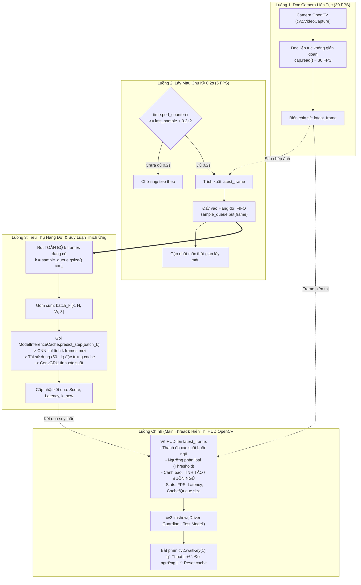

# TÀI LIỆU PHÂN TÍCH YÊU CẦU: XÂY DỰNG TEST_MODEL.PY CHẠY SUY LUẬN REAL-TIME VỚI MODELINFERENCECACHE TỪ CAMERA OPENCV

- **Mã yêu cầu**: `REALTIME_CAMERA_TEST_MODEL`
- **Tệp phân tích**: `docs/analsys/analsys_test_model.md`
- **Tệp đích thực thi**: `test_model.py`
- **Mục tiêu**: Phân tích toàn diện kiến trúc hệ thống, cơ chế đa luồng (Multi-threading Producer-Consumer), chiến lược lấy mẫu định kỳ 0.2s (5 FPS) vào hàng đợi không chặn (Non-blocking Queue), tích hợp mô hình suy luận có bộ đệm `ModelInferenceCache` với cửa sổ trượt $W = 50$, và thiết kế giao diện hiển thị đồ họa trực quan (HUD Overlay) bằng OpenCV hiển thị ngưỡng, xác suất dự đoán và trạng thái cảnh báo buồn ngủ của tài xế.
- **Trạng thái**: Đang chờ người dùng phê duyệt (Bước 1 theo quy trình chuẩn `AGENTS.md`).

---

## 1. YÊU CẦU CỐT LÕI TỪ NGƯỜI DÙNG

### 1.1. Nội dung yêu cầu nguyên bản
> *"tạo file @test_model.py thực hiện chạy model ModelInferenceCache trong file @[model_inference_cache.py] với nguồn là camera đọc từ opencv, giao diện dùng của opencv hiển thị ngưỡng và dữ đoán của model, windowslide = 50, tốc độ lấy mẫu là 0.2s và lấy mẫu liên tục vào hàng chờ nếu model không xử lý kịp thì vẫn tiếp tục lấy mẫu"*

### 1.2. Phân rã mục tiêu kỹ thuật & Tham số vận hành
1. **Đối tượng mô hình**: Lớp `ModelInferenceCache` từ tệp `model_inference_cache.py` (tích hợp `NMSFreeDetector` CNN Backbone + PAFPN Neck và `ConvGRUClassifier`).
2. **Nguồn video đầu vào**: Camera đọc trực tiếp thông qua OpenCV (`cv2.VideoCapture`). Hỗ trợ camera mặc định (webcam index 0/1/...) và linh hoạt chuyển đổi đường dẫn video file/RTSP phục vụ kiểm thử.
3. **Cửa sổ trượt (Sliding Window Size)**: `window_size = 50` khung hình (tương ứng đoạn video quan sát $50 \times 0.2\,\text{s} = 10\,\text{giây}$).
4. **Tốc độ lấy mẫu (Sampling Rate)**: $T_{\text{sample}} = 0.2\,\text{giây}$ (tần số $f = 5\,\text{Hz}$).
5. **Cơ chế hàng đợi bất đồng bộ (Continuous Sampling Queue)**:
   - Hệ thống phải lấy mẫu liên tục vào hàng chờ.
   - Nếu mô hình suy luận không kịp (độ trễ inference $> 0.2\,\text{s}$ do nghẽn GPU/CPU), luồng lấy mẫu **vẫn tiếp tục lấy mẫu đúng chu kỳ 0.2s mà không bị dừng hay block**.
   - Khi mô hình rảnh rỗi hoặc bước vào lượt suy luận kế tiếp, mô hình sẽ tiêu thụ cụm $k$ frames tích lũy trong hàng chờ ($k \ge 1$), tận dụng tính năng xử lý thích ứng $k$ frame mới cực nhanh của `ModelInferenceCache` (tiết kiệm đến $98\%$ chi phí CNN).
6. **Giao diện hiển thị (OpenCV GUI / HUD)**:
   - Cửa sổ hiển thị OpenCV (`cv2.imshow`).
   - Hiển thị trực quan:
     - Ngưỡng phân loại (Decision Threshold, mặc định 0.5, cho phép tinh chỉnh tương tác).
     - Xác suất dự đoán ngủ gật của model ($[0.0, 1.0]$).
     - Nhãn trạng thái tài xế (Tỉnh táo / Buồn ngủ / Đang khởi động bộ đệm Warmup) kèm màu sắc cảnh báo trực quan (Xanh / Vàng / Đỏ).
     - Các chỉ số hiệu năng thời gian thực: FPS Camera, FPS Inference, Độ trễ (Inference Latency ms), Số frame trong cache ($N / 50$), Số frame tích lũy trong hàng đợi ($k$ queue size).

---

## 2. KHẢO SÁT KIẾN TRÚC HIỆN TẠI VÀ KHẢ NĂNG TƯƠNG THÍCH

### 2.1. Động cơ suy luận `ModelInferenceCache` trong `model_inference_cache.py`
Lớp `ModelInferenceCache` đã được hoàn thiện với các đặc tính tối ưu:
- **Bộ đệm Tensor Ring Buffer (`SlidingWindowFeatureCache`)**: Lưu trữ đặc trưng không gian $P3, P4, P5$ trên VRAM GPU/CPU cho $50$ frame.
- **Phương thức `predict_step(new_frames, return_details=True)`**:
  - Nhận vào $1$ frame đơn lẻ `[H, W, 3]` hoặc một cụm $k$ frames mới `[K, H, W, 3]`.
  - Chỉ trích xuất CNN qua Backbone + Neck cho đúng $k$ frames mới.
  - Tự động đẩy $k$ frame vào cache, dịch chuyển các đặc trưng cũ.
  - Lấy chuỗi đặc trưng $50$ frame từ cache nạp vào `ConvGRUClassifier` để ra xác suất `score`.
  - Hỗ trợ chế độ Warmup: `warmup_mode='dynamic'` (suy luận ngay trên số frame hiện có trong cache) hoặc `warmup_mode='wait'` (chờ đủ 50 frame mới bắt đầu tính điểm).
- **Phương thức `predict_window(window, num_new_frames=k)`**:
  - Nhận mảng 50 frame, tự động nhận diện hoặc nhận chỉ định tường minh số frame mới $k$.

### 2.2. Checkpoint khả dụng trong hệ thống
Qua khảo sát thực tế trên máy:
- **CNN Detector Checkpoint**:
  `D:\Project\DATN\driver-guardian\ai\checkpoints\model_cnn\best.pt` (65.8 MB, kiến trúc `NMSFreeDetector` 2.6M).
- **ConvGRU Classifier Checkpoint**:
  - `D:\Project\DATN\driver-guardian\ai\checkpoints\model_convgru\best.pt` (7.6 MB)
  - Hoặc `D:\Project\DATN\driver-guardian\ai\LSTM\checkpoints\1m9\best.pt` (22.9 MB, checkpoint ConvGRU đã huấn luyện 12 epoch).

---

## 3. PHÂN TÍCH CÁC THÁCH THỨC KỸ THUẬT VÀ GIẢI PHÁP THIẾT KẾ

### 3.1. Thách thức 1: Đồng bộ hóa tốc độ Camera (30 FPS) và Tốc độ Lấy mẫu (5 FPS / 0.2s)
- **Vấn đề**: Camera webcam thông thường ghi nhận khung hình ở tốc độ $30\,\text{FPS}$ (~$33.3\,\text{ms/frame}$). Nếu chỉ đọc camera mỗi 0.2s (`time.sleep(0.2)` rồi mới `cap.read()`), bộ đệm phần cứng nội bộ của OpenCV/OS sẽ giữ lại các frame cũ (bị đọng frame), dẫn đến hình ảnh bị trễ pha (lag thực tế vài giây so với bên ngoài).
- **Giải pháp**:
  - Luồng đọc camera (Camera Capture Worker) liên tục đọc camera ở tốc độ gốc $30\,\text{FPS}$ bằng `cap.read()`, luôn duy trì frame mới nhất trong bộ nhớ (`latest_frame`).
  - Bộ lấy mẫu (Sampler) sử dụng đồng hồ bấm giờ độ chính xác cao (`time.perf_counter()`). Cứ mỗi $0.2\,\text{s}$ ($\pm \epsilon$), bộ lấy mẫu sẽ lấy `latest_frame` hiện tại, gán nhãn thời gian, và đẩy vào hàng đợi suy luận (`inference_queue`).

### 3.2. Thách thức 2: Mô hình xử lý chậm hơn 0.2s và Hiện tượng ứ đọng hàng đợi (Queue Backpressure)
- **Vấn đề người dùng đặt ra**: *"lấy mẫu liên tục vào hàng chờ nếu model không xử lý kịp thì vẫn tiếp tục lấy mẫu"*.
  - Nếu bước suy luận CNN + ConvGRU tốn $250\,\text{ms} - 350\,\text{ms}$ (trên CPU hoặc GPU tầm trung khi nạp batch), chu kỳ lấy mẫu 0.2s vẫn diễn ra, dẫn đến trong hàng đợi có $k = 2, 3$ frames mới đang chờ.
- **Giải pháp xử lý thích ứng đa frame ($k > 1$)**:
  - Hàng đợi `sample_queue` sử dụng cơ chế Thread-Safe FIFO (`queue.Queue`). Luồng Sampler liên tục `put()` frame vào queue mỗi 0.2s không bị khóa (`block=False`).
  - Khi luồng suy luận (Inference Worker) hoàn tất một lượt chạy:
    1. Thay vì chỉ rút $1$ frame, luồng suy luận sẽ **rút toàn bộ tất cả các frame hiện có trong `sample_queue`** (tổng cộng $k$ frames mới, $k \ge 1$).
    2. Đóng gói $k$ frames này thành mảng numpy `[k, H, W, 3]`.
    3. Truyền trực tiếp vào `model.predict_step(batch_k_frames, return_details=True)`.
    4. Mô hình `ModelInferenceCache` chỉ chạy CNN Backbone + Neck cho đúng $k$ frames mới (ví dụ $k=2$ chỉ tính 2 frame thay vì 50 frame), nạp vào cache và chạy ConvGRU một lần duy nhất.
    5. Kết quả: Hệ thống vừa không bị mất frame (đảm bảo tính liên tục của chuỗi thời gian), vừa bắt kịp thời gian thực ngay ở bước tiếp theo!



### 3.3. Thách thức 3: Trải nghiệm giao diện hiển thị không bị giật lag (Decoupled UI)
- Nếu đặt lệnh `cv2.imshow` trong cùng vòng lặp với `model.forward()`, mỗi khi model chạy tốn $50 - 150\,\text{ms}$, hình ảnh camera trên màn hình sẽ bị khựng lại (FPS hiển thị sụt xuống 5 FPS - 10 FPS).
- **Giải pháp**: Luồng chính (Main Thread) chạy vòng lặp render giao diện ở tốc độ cao ($30 - 60\,\text{FPS}$), liên tục vẽ frame camera mới nhất cùng thông tin dự đoán mới nhất được cập nhật từ luồng suy luận. Trải nghiệm người dùng sẽ cực kỳ mượt mà, thời gian thực không hề có cảm giác giật khựng.

### 3.4. Thách thức 4: Thiết kế giao diện trực quan OpenCV HUD
Giao diện `test_model.py` sẽ được trang bị hệ thống hiển thị chuyên nghiệp bao gồm:
1. **Khung tiêu đề (Header Banner)**:
   - Tên hệ thống: `DRIVER GUARDIAN AI - DROWSINESS MONITORING`
   - Chế độ suy luận: `ModelInferenceCache (Sliding Window W=50, Stride=0.2s)`
2. **Khu vực Trạng thái Lái xe (Driver State Card)**:
   - Trạng thái `ALERT (TỈNH TÁO)` (Màu xanh lá `#00FF00`): Khi `score < threshold`.
   - Trạng thái `DROWSY (BUỒN NGỦ - CẢNH BÁO!)` (Màu đỏ `#0000FF`): Khi `score >= threshold` kèm hiệu ứng nhấp nháy viền đỏ cảnh báo nguy hiểm.
   - Trạng thái `WARMING UP` (Màu vàng cam): Khi bộ đệm cache đang nạp những frame đầu tiên ($N < 50$).
3. **Thanh đo Xác suất Trực quan (Confidence Probability Bar)**:
   - Thanh tiến trình ngang thể hiện mức độ buồn ngủ từ $0\%$ đến $100\%$.
   - Vạch kẻ đánh dấu ngưỡng phân loại hiện tại (ví dụ vị trí $50\%$).
   - Đổi màu động theo mức độ nghiêm trọng (Xanh -> Vàng -> Đỏ).
4. **Bảng Điều khiển Chỉ số Kỹ thuật (Telemetry Metrics)**:
   - `Camera FPS`: Tốc độ đọc camera thực tế (ví dụ: $30.0\,\text{FPS}$).
   - `Sampling Rate`: $0.20\,\text{s}$ ($5.0\,\text{Hz}$).
   - `Inference FPS` & `Latency`: Thời gian tính toán từng bước (ví dụ: $32.4\,\text{ms}$).
   - `Cache Window`: Hiển thị số frame hiện tại trong cache (ví dụ: `50/50 [FULL]`).
   - `Queue Backlog (k)`: Số lượng frame mới nạp mỗi bước (ví dụ: `k = 1 [Optimal]` hoặc `k = 3 [Catch-up]`).
   - `Threshold`: Ngưỡng quyết định hiện hành (ví dụ: `0.50`).
5. **Hướng dẫn phím tắt (Hotkey Guide)**:
   - `[Q / ESC]`: Thoát chương trình.
   - `[+ / -]`: Tăng / giảm ngưỡng cảnh báo.
   - `[R]`: Reset toàn bộ bộ đệm cache.
   - `[SPACE]`: Tạm dừng / Tiếp tục luồng camera.

---

## 4. BẢNG ĐẶC TẢ THAM SỐ CẤU HÌNH (CLI ARGUMENTS)

Tệp `test_model.py` sẽ hỗ trợ đầy đủ các tham số dòng lệnh thông qua `argparse` để người dùng có thể linh hoạt điều chỉnh khi chạy:

| Tham số | Kiểu dữ liệu | Giá trị mặc định | Mô tả chi tiết |
| :--- | :---: | :---: | :--- |
| `--source` / `-s` | `str` | `"0"` | Nguồn video: camera index (0, 1, ...) hoặc đường dẫn tệp video (`.mp4`, `.avi`), hoặc luồng RTSP |
| `--cnn-path` | `str` | `checkpoints/model_cnn/best.pt` | Đường dẫn tệp trọng số mô hình CNN (`NMSFreeDetector`) |
| `--convgru-path` | `str` | `checkpoints/model_convgru/best.pt` | Đường dẫn tệp trọng số mô hình ConvGRU (`ConvGRUClassifier`) |
| `--window-size` / `-w` | `int` | `50` | Kích thước cửa sổ trượt bộ đệm (Sliding window size = 50) |
| `--sample-interval` | `float` | `0.2` | Tốc độ lấy mẫu khung hình định kỳ (giây) |
| `--threshold` / `-t` | `float` | `0.5` | Ngưỡng xác suất kích hoạt cảnh báo ngủ gật (0.0 đến 1.0) |
| `--device` | `str` | `"cuda"` hoặc `"cpu"` | Thiết bị tính toán (tự động phát hiện GPU khả dụng) |
| `--chunk-size` | `int` | `32` | Kích thước chunk tối đa khi trích xuất CNN để tránh tràn VRAM |
| `--warmup-mode` | `str` | `"dynamic"` | Chế độ khởi động cache: `"dynamic"` (dự đoán ngay) hoặc `"wait"` (đợi đủ 50 frame) |
| `--width` | `int` | `1280` | Độ phân giải chiều rộng mong muốn khi mở camera |
| `--height` | `int` | `720` | Độ phân giải chiều cao mong muốn khi mở camera |

---

## 5. THIẾT KẾ CẤU TRÚC MÃ NGUỒN `test_model.py`

Cấu trúc file `test_model.py` dự kiến được tổ chức theo module sạch, tuân thủ nghiêm ngặt chuẩn code `AGENTS.md`:

```text
test_model.py
│
├── 1. Imports & Path Resolver (OpenCV, Torch, NumPy, Threading, Queue)
├── 2. Cấu hình & Trình phân tích dòng lệnh (parse_args)
├── 3. Lớp CameraReader (Thread an toàn đọc camera liên tục 30 FPS)
├── 4. Lớp FrameSampler (Quản lý timer 0.2s và đẩy frame vào hàng đợi)
├── 5. Lớp ModelInferenceWorker (Worker thread tiêu thụ k frame từ queue và chạy ModelInferenceCache)
├── 6. Module HUD Visualizer (Vẽ overlay chuyên nghiệp: Card, Thanh đo, Metrics, Cảnh báo)
└── 7. Hàm main() (Khởi tạo pipeline, điều phối vòng lặp hiển thị, bắt phím nóng và giải phóng tài nguyên)
```

---

## 6. TIÊU CHÍ CHẤT LƯỢNG & KỊCH BẢN KIỂM THỬ (ACCEPTANCE CRITERIA)

| STT | Hạng mục kiểm thử | Tiêu chí đạt |
| :---: | :--- | :--- |
| **1** | **Khởi tạo và nạp trọng số** | Khởi tạo thành công `ModelInferenceCache` trên thiết bị chỉ định (`cuda` hoặc `cpu`), không phát sinh lỗi thiếu checkpoint. |
| **2** | **Nguồn Camera OpenCV** | Mở thành công camera (`cv2.VideoCapture`), tự động kiểm tra nếu không tìm thấy camera 0 thì thông báo rõ ràng và hỗ trợ fallback sang video test. |
| **3** | **Đúng chu kỳ lấy mẫu 0.2s** | Bộ lấy mẫu trích xuất trung bình 5 frame mỗi giây ($\approx 0.2\,\text{s} \pm 0.02\,\text{s}$). |
| **4** | **Cơ chế hàng đợi không chặn** | Khi giả lập độ trễ suy luận lớn hơn 0.2s (ví dụ 350ms), hàng đợi vẫn tiếp tục nhận frame, không làm đứng luồng camera; lượt tiếp theo xử lý chính xác $k > 1$ frame mới. |
| **5** | **Giao diện hiển thị trực quan** | Cửa sổ OpenCV hiển thị sắc nét: điểm số xác suất, ngưỡng threshold, trạng thái Alert/Drowsy và các chỉ số thống kê. |
| **6** | **Tương tác phím nóng** | Phím `q` thoát an toàn không treo máy; phím `+`/`-` tăng giảm ngưỡng tức thì; phím `r` reset cache thành công. |
| **7** | **Giải phóng tài nguyên** | Khi kết thúc, tất cả các thread ngắt mượt mà, camera được `release()`, cửa sổ OpenCV được đóng hoàn toàn. |

---

## 7. BƯỚC TIẾP THEO

Theo đúng quy trình 5 bước trong **`AGENTS.md`**:
- Bước 1: Hoàn thành tài liệu phân tích `docs/analsys/analsys_test_model.md` và xin ý kiến phê duyệt từ người dùng.
- Sau khi người dùng phản hồi **đồng ý/chấp nhận**, Agent sẽ tiến hành **Bước 2: Lập kế hoạch chi tiết (`docs/plan/plan_test_model.md`)**.
