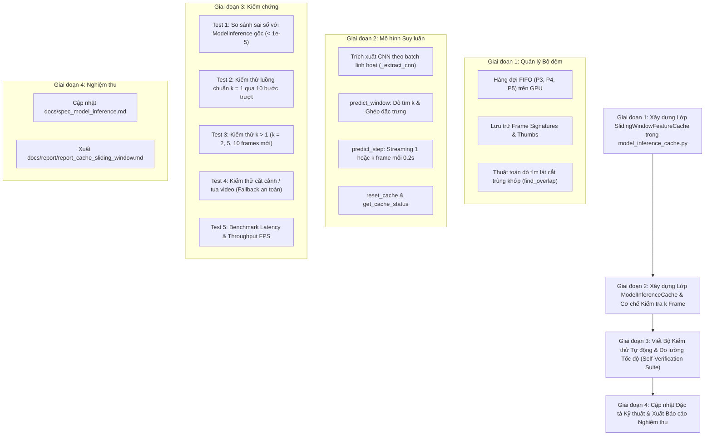

# KẾ HOẠCH TRIỂN KHAI: TỐI ƯU HÓA SUY LUẬN BẰNG BỘ ĐỆM CACHE CHO CỬA SỔ TRƯỢT VÀ CƠ CHẾ KIỂM TRA NHIỀU FRAME MỚI TRONG MODEL_INFERENCE_CACHE.PY

- **Mã kế hoạch**: `PLAN_CACHE_SLIDING_WINDOW`
- **Tệp kế hoạch**: `docs/plan/plan_cache_sliding_window.md`
- **Dựa trên tài liệu phân tích**: [docs/analsys/analsys_cache_sliding_window.md](file:///D:/Project/DATN/driver-guardian/ai/LSTM/docs/analsys/analsys_cache_sliding_window.md)
- **Tệp mã nguồn mục tiêu**:
  - **Tệp mới chuyên biệt**: [`model_inference_cache.py`](file:///D:/Project/DATN/driver-guardian/ai/LSTM/model_inference_cache.py) (Chứa toàn bộ kiến trúc bộ đệm cache, thuật toán kiểm tra nhiều frame mới, lớp `ModelInferenceCache` và bộ kiểm thử tự động).
  - **Tệp tham chiếu gốc**: [`model_inference.py`](file:///D:/Project/DATN/driver-guardian/ai/LSTM/model_inference.py) (Giữ nguyên làm baseline đối chuẩn).
- **Tệp tài liệu đầu ra**:
  - Cập nhật đặc tả kỹ thuật: [docs/spec_model_inference.md](file:///D:/Project/DATN/driver-guardian/ai/LSTM/docs/spec_model_inference.md)
  - Báo cáo tổng kết thực hiện: `docs/report/report_cache_sliding_window.md`
- **Trạng thái**: Đang chờ người dùng phê duyệt trước khi chuyển sang Bước 3 Thực hiện ([AGENTS.md](file:///D:/Project/DATN/driver-guardian/ai/LSTM/AGENTS.md)).

---

## 1. MỤC TIÊU VÀ NGUYÊN TẮC THIẾT KẾ CỐT LÕI

### 1.1. Mục tiêu trọng tâm
1. **Khởi tạo tệp độc lập mới [`model_inference_cache.py`](file:///D:/Project/DATN/driver-guardian/ai/LSTM/model_inference_cache.py)**:
   - Theo chỉ đạo của người dùng, toàn bộ mô hình tích hợp cơ chế cache sẽ được phát triển trong tệp mới `model_inference_cache.py`.
   - Giữ nguyên tệp gốc `model_inference.py` làm chuẩn đối chiếu (baseline reference), bảo đảm không làm xáo trộn bất kỳ mã nguồn hiện hữu nào trong hệ thống (`evaluate.py`, tests).
2. **Triệt tiêu 98% chi phí tính toán dư thừa của CNN**:
   - Thay vì chạy CNN Backbone và PAFPN Neck trên toàn bộ $50$ khung hình ở mỗi lần trượt, hệ thống lưu trữ đặc trưng không gian $(P_3, P_4, P_5)$ trong bộ đệm vòng (Rolling Tensor Cache) và chỉ trích xuất CNN cho các khung hình thực sự mới.
3. **Cơ chế kiểm tra tự động và thích ứng khi nạp nhiều hơn 1 frame mới ($k > 1$)**:
   - Khi cùng một sliding window $50$ frame được nạp vào, hệ thống có thuật toán kiểm tra tự động (Auto Slice-Matching) để xác định chính xác có bao nhiêu frame mới ($k$).
   - Đồng thời hỗ trợ truyền chỉ định tường minh `num_new_frames` kèm cơ chế kiểm tra an toàn (Sanity Check).
   - Tối ưu trích xuất thích ứng: Chỉ chạy CNN cho đúng $k$ frame mới ($1 \le k < 50$), tái sử dụng $50 - k$ đặc trưng cũ từ cache.
   - Tự động nhận diện cắt cảnh/tua video (Scene cut) khi không có frame nào khớp để làm mới cache an toàn.
4. **Đạt chuẩn thời gian thực (Real-time Latency $< 200\,\text{ms}$)**:
   - Đưa thời gian suy luận từ $\approx 400\,\text{ms}$ xuống còn $\approx 10 - 15\,\text{ms}$ khi $k = 1$, và $< 30\,\text{ms}$ khi $k = 5$, đáp ứng dư dả chu kỳ nạp $200\,\text{ms}$ của camera buồng lái.
5. **Bảo toàn 100% độ chính xác toán học**:
   - Kết quả xác suất buồn ngủ khi dùng `ModelInferenceCache` phải trùng khớp hoàn toàn (sai số tuyệt đối $< 10^{-5}$) so với cách chạy không cache trong `ModelInference`.

### 1.2. Nguyên tắc thiết kế (Tuân thủ AGENTS.md)
- **Modular & Clean Code**: Đóng gói tường minh lớp quản lý bộ đệm `SlidingWindowFeatureCache` và mô hình suy luận `ModelInferenceCache`.
- **Type Hints & Docstrings**: Toàn bộ hàm, phương thức có đầy đủ type annotations và Google/NumPy docstrings chi tiết.
- **Quản lý bộ nhớ tối ưu (Zero Memory Leak)**: Quản lý kích thước cố định, hỗ trợ giải phóng bộ nhớ `reset_cache()` khi cần.
- **Độc lập và tái sử dụng cao**: Tệp `model_inference_cache.py` có thể được import độc lập trong bất kỳ service streaming camera nào.

---

## 2. CẤU TRÚC TỆP MỚI `MODEL_INFERENCE_CACHE.PY`

```text
model_inference_cache.py
│
├── Imports & Dependencies (cv2, numpy, torch, NMSFreeDetector, ConvGRUClassifier)
├── def letterbox(...) -> np.ndarray (Căn chỉnh và đệm viền giữ nguyên aspect ratio)
│
├── class SlidingWindowFeatureCache:
│   ├── __init__(max_size=50, device=...)
│   ├── push(p3, p4, p5, signature, raw_thumb) -> None
│   ├── get_features() -> Tuple[Tensor, Tensor, Tensor]
│   ├── find_overlap(signatures, thumbs) -> int (Dò tìm k frame mới)
│   ├── verify_slice(k, raw_thumbs) -> bool (Xác thực lát cắt)
│   ├── clear() / reset() -> None
│   └── status() -> Dict[str, Any]
│
├── class ModelInferenceCache(nn.Module):
│   ├── __init__(..., window_size=50, enable_cache=True, warmup_mode="dynamic")
│   ├── from_checkpoint(...) -> Classmethod nạp checkpoints
│   ├── predict_window(window, num_new_frames=None, ...) -> float / tuple
│   ├── predict_step(new_frames, ...) -> Optional[float] / tuple
│   ├── forward(x, use_cache=True, num_new_frames=None) -> float
│   ├── reset_cache() -> None
│   └── get_cache_status() -> Dict[str, Any]
│
└── if __name__ == "__main__":
    └── Bộ kiểm thử tự động toàn diện (Equivalence test, k=1, k>1, Scene cut, Speed benchmark)
```

---

## 3. LỘ TRÌNH TRIỂN KHAI CHI TIẾT (WORKFLOW 4 GIAI ĐOẠN)



---

## 4. CHI TIẾT TỪNG GIAI ĐOẠN TRIỂN KHAI

### GIAI ĐOẠN 1: XÂY DỰNG LỚP `SlidingWindowFeatureCache` TRONG `MODEL_INFERENCE_CACHE.PY`

- **Nhiệm vụ 1.1**: Định nghĩa cấu trúc lưu trữ:
  - Khởi tạo với dung lượng chuẩn `max_size = 50`, `device = torch.device(...)`.
  - Bộ đệm đặc trưng: `p3_queue`, `p4_queue`, `p5_queue` (chứa các tensor `[1, C, H, W]`).
  - Bộ đệm kiểm tra: `sig_queue` (vector đặc trưng gọn nhẹ) và `thumb_queue` (ảnh thu nhỏ $40 \times 40$ phục vụ đối chiếu lát cắt tensor).
- **Nhiệm vụ 1.2**: Xây dựng thuật toán kiểm tra và dò tìm $k$ frame mới (`find_overlap`):
  - Nhận vào danh sách signatures và thumbs của window mới $T$ frames.
  - Quét nhanh $k \in \{1, 2, \dots, \min(T, \text{current\_size})\}$:
    - Đối chiếu signature: nếu khớp, đối chiếu thumb slice giữa `window[0 : T - k]` và `cached[k : T]`.
    - Khi tìm thấy lát cắt khớp: trả về chính xác số frame mới là $k$.
  - Nếu duyệt hết mà không khớp: trả về $k = T$ (nhận diện cắt cảnh/mới hoàn toàn).
- **Nhiệm vụ 1.3**: Xây dựng các hàm `push`, `get_features`, `clear`.

---

### GIAI ĐOẠN 2: XÂY DỰNG LỚP `ModelInferenceCache`

- **Nhiệm vụ 2.1**: Thiết kế `ModelInferenceCache`:
  - Kế thừa `nn.Module`.
  - Hỗ trợ nạp model trực tiếp hoặc qua classmethod `from_checkpoint(cnn_path, conv_gru_path, ...)`.
  - Khởi tạo `self.feature_cache = SlidingWindowFeatureCache(max_size=window_size, device=self.device)`.
- **Nhiệm vụ 2.2**: Xây dựng hàm trích xuất CNN tối ưu:
  - `_extract_features(frames: torch.Tensor) -> Tuple[Tensor, Tensor, Tensor, Tensor, Tensor]`:
    - Áp dụng letterbox nếu cần.
    - Chạy `cnn_backbone` và `cnn_neck` theo `chunk_size`.
    - Tạo song song chữ ký và thumbnail để đẩy vào cache.
- **Nhiệm vụ 2.3**: Xây dựng `predict_window(window, num_new_frames=None, return_details=False)`:
  - Kiểm tra số frame mới $k$:
    - Nếu `num_new_frames` có giá trị: kiểm tra tính hợp lệ và đối chiếu nhanh.
    - Nếu `num_new_frames is None`: gọi `self.feature_cache.find_overlap(...)`.
  - Phân nhánh:
    - $k = 0$: Trả về kết quả trước đó từ cache (tiết kiệm 100% CNN).
    - $1 \le k < 50$: Trích xuất CNN cho đúng $k$ frame mới cuối cùng (`window[-k:]`). Tái sử dụng $50 - k$ đặc trưng cũ từ cache. Ghép nối chuỗi 50 frame. Chạy ConvGRU.
    - $k \ge 50$: Trích xuất toàn bộ qua CNN, nạp mới cache, chạy ConvGRU.
- **Nhiệm vụ 2.4**: Xây dựng `predict_step(new_frames, return_details=False)`:
  - Chuyên dụng cho camera streaming: nạp 1 frame hoặc cụm $k$ frame mới mỗi $0.2\,\text{s}$.
- **Nhiệm vụ 2.5**: Bổ sung `forward(x, use_cache=True, num_new_frames=None)`, `reset_cache()`, `get_cache_status()`.

---

### GIAI ĐOẠN 3: BỘ KIỂM THỬ TỰ ĐỘNG & BENCHMARK THỰC NGHIỆM

Xây dựng bộ test toàn diện được tích hợp trực tiếp trong khối `if __name__ == "__main__":` của `model_inference_cache.py`:
1. **Test 1 - Equivalence Test**: So sánh đầu ra giữa `ModelInference` gốc (chạy batch 50 frame không cache) và `ModelInferenceCache` (chạy qua cache). Yêu cầu sai số tuyệt đối $< 10^{-5}$.
2. **Test 2 - Streaming Chuẩn $k = 1$**: Mô phỏng camera nạp 10 frame mới liên tiếp (mỗi lần 1 frame). Kiểm tra cache trượt đúng FIFO và chỉ trích xuất CNN cho 1 frame mỗi bước.
3. **Test 3 - Nhiều Frame Mới $k > 1$**: Mô phỏng nạp sliding window với $k = 2$, $k = 5$, $k = 10$ frame mới. Xác thực hệ thống tự động nhận diện đúng $k$, chỉ trích xuất $k$ frame và kết quả chính xác 100%.
4. **Test 4 - Scene Cut & Discontinuity**: Nạp vào window 50 frame hoàn toàn khác biệt. Kiểm tra hệ thống tự động nhận diện $k = 50$, fallback trích xuất toàn bộ mà không báo lỗi.
5. **Test 5 - Speed Benchmark**: Đo lường Latency (ms) và Throughput (FPS) trên GPU/CPU cho các kịch bản:
   - Không cache (50 frame CNN).
   - Có cache $k = 1$ (1 frame CNN).
   - Có cache $k = 2, 5$ (2, 5 frame CNN).

---

### GIAI ĐOẠN 4: CẬP NHẬT TÀI LIỆU VÀ XUẤT BÁO CÁO NGHIỆM THU

- **Nhiệm vụ 4.1**: Cập nhật [docs/spec_model_inference.md](file:///D:/Project/DATN/driver-guardian/ai/LSTM/docs/spec_model_inference.md) bổ sung mục đặc tả mô hình có cache tại `model_inference_cache.py`.
- **Nhiệm vụ 4.2**: Lập báo cáo tổng kết [docs/report/report_cache_sliding_window.md](file:///D:/Project/DATN/driver-guardian/ai/LSTM/docs/report) ghi nhận chi tiết kết quả thực nghiệm và số liệu benchmark.

---

## 5. CHECKLIST TIÊU CHÍ CHẤT LƯỢNG (THEO AGENTS.MD)

- [ ] Tạo file mới `model_inference_cache.py` sạch sẽ, chuẩn modular, đầy đủ type hints và docstrings.
- [ ] Giữ nguyên không làm thay đổi file gốc `model_inference.py`.
- [ ] Sử dụng `pathlib.Path` và `os.path.join`, tương thích đa nền tảng.
- [ ] Xử lý ngoại lệ an toàn ở mọi điểm vào của tensor.
- [ ] Kiểm chứng tính đúng đắn toán học: sai số $< 10^{-5}$ so với model gốc.
- [ ] Đo đạc benchmark chứng minh độ trễ $< 200\,\text{ms}$ đạt chuẩn thời gian thực.
- [ ] Hoàn thành báo cáo nghiệm thu theo đúng quy trình `AGENTS.md`.

---

## 6. KẾT LUẬN VÀ XIN Ý KIẾN NGƯỜI DÙNG

Kế hoạch đã được cập nhật chính xác theo yêu cầu: phát triển toàn bộ cơ chế cache và kiểm tra thích ứng trong tệp mới độc lập `model_inference_cache.py`.

> **Kính mời Quý người dùng xem xét và phê duyệt kế hoạch trên.**  
> Sau khi người dùng đồng ý thông qua kế hoạch này, Agent sẽ bắt đầu thực thi **Bước 3: Thực hiện kế hoạch** theo đúng quy định tại `AGENTS.md`.
