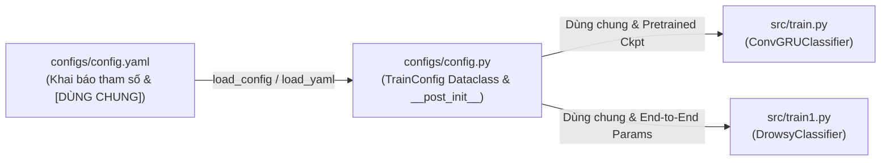

# KẾ HOẠCH TRIỂN KHAI: CẬP NHẬT THAM SỐ CẤU HÌNH CHO MODEL DROWSYCLASSIFIER (CONFIG.PY, CONFIG.YAML & SRC/TRAIN1.PY)

- **Mã kế hoạch**: `PLAN_CONFIG_DROWSY_CLASSIFIER`
- **Tệp kế hoạch**: `docs/plan/plan_config_drowsy.md`
- **Dựa trên tài liệu phân tích**: [`docs/analsys/analsys_config_drowsy.md`](file:///D:/Project/DATN/driver-guardian/ai/LSTM/docs/analsys/analsys_config_drowsy.md)
- **Tệp mục tiêu thực hiện**:
  - [`configs/config.py`](file:///D:/Project/DATN/driver-guardian/ai/LSTM/configs/config.py)
  - [`configs/config.yaml`](file:///D:/Project/DATN/driver-guardian/ai/LSTM/configs/config.yaml)
  - [`src/train1.py`](file:///D:/Project/DATN/driver-guardian/ai/LSTM/src/train1.py)
- **Tệp báo cáo nghiệm thu đầu ra**: `docs/report/report_config_drowsy.md`
- **Quy chuẩn áp dụng**: [`AGENTS.md`](file:///D:/Project/DATN/driver-guardian/ai/LSTM/AGENTS.md) — **Bước 2: Lên kế hoạch thực hiện**
- **Trạng thái**: Đang chờ người dùng phê duyệt trước khi chuyển sang Bước 3 (Thực hiện).

---

## 1. MỤC TIÊU VÀ PHẠM VI TRIỂN KHAI

### 1.1. Mục tiêu
1. **Bổ sung trọn vẹn các tham số cấu hình của mô hình `DrowsyClassifier`** (`backbone_w`, `backbone_n`, `neck_n`, `target_size`, `gradient_checkpointing`, `freeze_bn`) vào [`configs/config.py`](file:///D:/Project/DATN/driver-guardian/ai/LSTM/configs/config.py) và [`configs/config.yaml`](file:///D:/Project/DATN/driver-guardian/ai/LSTM/configs/config.yaml).
2. **Ghi chú minh bạch**: Đánh dấu rõ ràng nhãn **`[DÙNG CHUNG]`** cho tất cả các tham số dùng chung giữa hai mô hình (`ConvGRUClassifier` và `DrowsyClassifier`) và hai luồng huấn luyện (`src/train.py` và `src/train1.py`). Đồng thời ghi chú rõ các tham số dành riêng cho từng mô hình/luồng.
3. **Đồng bộ hóa [`src/train1.py`](file:///D:/Project/DATN/driver-guardian/ai/LSTM/src/train1.py)**: Khi khởi tạo `DrowsyClassifier`, nạp trực tiếp các tham số `backbone_w`, `backbone_n`, `neck_n`, `target_size`, `gradient_checkpointing`, `freeze_bn` từ `self.cfg`.
4. **Bảo toàn 100% tính tương thích ngược**: Không làm ảnh hưởng đến luồng hoạt động của [`src/train.py`](file:///D:/Project/DATN/driver-guardian/ai/LSTM/src/train.py) và [`src/models.py`](file:///D:/Project/DATN/driver-guardian/ai/LSTM/src/models.py).

### 1.2. Luồng cấu hình tổng thể

---

## 2. KẾ HOẠCH TRIỂN KHAI CHI TIẾT TỪNG BƯỚC

### Giai đoạn 1: Cập nhật `configs/config.py`
- **Nhiệm vụ 1.1**: Thêm các thuộc tính mới vào Dataclass `TrainConfig`:
  - `backbone_w: Tuple[int, ...] = (16, 32, 64, 128, 256)`
  - `backbone_n: Tuple[int, ...] = (1, 2, 2, 1)`
  - `neck_n: int = 1`
  - `target_size: Tuple[int, int] = (14, 14)`
  - `gradient_checkpointing: bool = True`
  - `freeze_bn: bool = False`
- **Nhiệm vụ 1.2**: Rà soát và gắn comment **`[DÙNG CHUNG]`** cho tất cả các tham số chung trong toàn bộ các section của `TrainConfig` (Model, Dataset, DataLoader, Loss, Optimizer, Logging, Runtime).
- **Nhiệm vụ 1.3**: Bổ sung kiểm tra hợp lệ trong `TrainConfig.__post_init__`:
  - Kiểm tra `target_size` có độ dài 2 và các phần tử `> 0`.
  - Kiểm tra `backbone_w` và `backbone_n` có các phần tử `> 0`.
  - Kiểm tra `neck_n >= 1`.
  - Hỗ trợ `hidden_dim` có thể là `int` hoặc `tuple`/`list`.
- **Nhiệm vụ 1.4**: Cập nhật phương thức `load_yaml` và `load_json`:
  - Bổ sung `backbone_w`, `backbone_n`, `target_size` vào `tuple_fields` để tự động chuyển từ `list` sang `tuple`.

### Giai đoạn 2: Cập nhật `configs/config.yaml`
- **Nhiệm vụ 2.1**: Cấu trúc lại section `model:` thành 3 phân khu rõ ràng:
  1. *Các tham số DÙNG CHUNG* (kèm comment `# [DÙNG CHUNG]`).
  2. *Các tham số DÀNH RIÊNG cho `DrowsyClassifier`* (`backbone_w`, `backbone_n`, `neck_n`, `gradient_checkpointing`, `freeze_bn`).
  3. *Các tham số DÀNH RIÊNG cho `ConvGRUClassifier`* (`cnn_neck_channels`, `adapter_dropout`).
- **Nhiệm vụ 2.2**: Bổ sung chú thích **`[DÙNG CHUNG]`** vào các tham số ở các section khác (`dataset`, `dataloader`, `loss`, `optimizer`, `logging`, `runtime`), chú thích rõ các tham số tách rời chỉ dùng cho `train.py` (`backbone_neck_checkpoint`, `chunk_size`).

### Giai đoạn 3: Đồng bộ `src/train1.py`
- **Nhiệm vụ 3.1**: Cập nhật hàm khởi tạo `Trainer.__init__` trong `src/train1.py`:
  - Đọc `backbone_w = getattr(self.cfg, "backbone_w", (16, 32, 64, 128, 256))`
  - Đọc `backbone_n = getattr(self.cfg, "backbone_n", (1, 2, 2, 1))`
  - Đọc `neck_n = getattr(self.cfg, "neck_n", 1)`
  - Truyền đầy đủ các tham số này vào `DrowsyClassifier(...)` cùng với `num_classes`, `input_dim`, `hidden_dim`, `target_size`, `supervision_mode`, `gradient_checkpointing`, `freeze_bn`.

### Giai đoạn 4: Kiểm thử, Xác thực & Lập báo cáo
- **Nhiệm vụ 4.1**: Chạy test kiểm tra nạp file `config.yaml` và `config.py` bằng Python script kiểm thử độc lập:
  - Kiểm tra kiểu dữ liệu sau nạp: `backbone_w`, `backbone_n`, `target_size` là kiểu `tuple`.
  - Kiểm tra tính hợp lệ của `TrainConfig.to_dict()`, `TrainConfig.save_json()`.
- **Nhiệm vụ 4.2**: Kiểm tra khả năng khởi tạo mô hình của `src/train1.py` và `src/models1.py` từ cấu hình đã nạp.
- **Nhiệm vụ 4.3**: Tạo tệp báo cáo tổng kết nghiệm thu [`docs/report/report_config_drowsy.md`](file:///D:/Project/DATN/driver-guardian/ai/LSTM/docs/report/report_config_drowsy.md) theo chuẩn **Bước 3** của [`AGENTS.md`](file:///D:/Project/DATN/driver-guardian/ai/LSTM/AGENTS.md).

---

## 3. CHECKLIST TIÊU CHÍ NGHIỆM THU (ACCEPTANCE CRITERIA)

- [ ] `configs/config.py` định nghĩa đầy đủ 6 tham số mới của `DrowsyClassifier`.
- [ ] `configs/config.yaml` chứa đầy đủ 6 tham số mới và phân nhóm rõ ràng.
- [ ] Mọi tham số dùng chung được gắn comment rõ ràng `[DÙNG CHUNG]`.
- [ ] `tuple_fields` trong `load_yaml` và `load_json` chuyển đổi chính xác `backbone_w`, `backbone_n`, `target_size` thành `tuple`.
- [ ] `src/train1.py` truyền đầy đủ `backbone_w`, `backbone_n`, `neck_n`, `target_size`, `gradient_checkpointing`, `freeze_bn` vào `DrowsyClassifier`.
- [ ] Không gây lỗi cú pháp, tương thích hoàn toàn với các tệp hiện có.
- [ ] Tạo file báo cáo kết quả `docs/report/report_config_drowsy.md`.

---

## 4. KẾT LUẬN & TRẠNG THÁI HIỆN TẠI

Kế hoạch đã được xây dựng hoàn chỉnh theo đúng chuẩn **Bước 2: Lên kế hoạch thực hiện** của [`AGENTS.md`](file:///D:/Project/DATN/driver-guardian/ai/LSTM/AGENTS.md).
Kính mời người dùng xem xét và xác nhận để Agent tiến hành **Bước 3: Thực hiện kế hoạch**.
