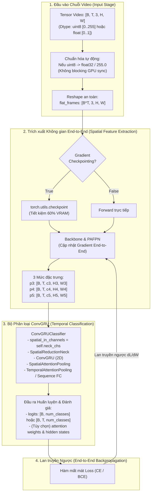

# KẾ HOẠCH TRIỂN KHAI: TÁI CẤU TRÚC VÀ TỐI ƯU HÓA MÔ HÌNH HUẤN LUYỆN END-TO-END DROWSYCLASSIFIER (SRC/MODELS1.PY)

- **Mã kế hoạch**: `PLAN_DROWSY_CLASSIFIER_END_TO_END`
- **Tệp kế hoạch**: `docs/plan/plan_drowsy_classifier.md`
- **Dựa trên tài liệu phân tích**: [docs/analsys/analsys_drowsy_classifier.md](file:///D:/Project/DATN/driver-guardian/ai/LSTM/docs/analsys/analsys_drowsy_classifier.md)
- **Ghi chú yêu cầu từ người dùng**:
  1. *Bỏ qua Critical 1.1* (Giữ nguyên kích thước hình học `target_size` hiện tại của mô hình, không can thiệp điều chỉnh).
  2. *Mô hình huấn luyện End-to-End* (Toàn bộ pipeline Backbone + PAFPN + ConvGRUClassifier được kết nối và huấn luyện đồng thời, lan truyền gradient xuyên suốt từ đầu đến cuối).
- **Tệp mã nguồn mục tiêu**: [`src/models1.py`](file:///D:/Project/DATN/driver-guardian/ai/LSTM/src/models1.py)
- **Tệp báo cáo đầu ra**: `docs/report/report_drowsy_classifier.md`
- **Trạng thái**: Đang chờ người dùng phê duyệt trước khi chuyển sang Bước 3 Thực hiện ([AGENTS.md](file:///D:/Project/DATN/driver-guardian/ai/LSTM/AGENTS.md)).

---

## 1. MỤC TIÊU VÀ NGUYÊN TẮC THIẾT KẾ CỐT LÕI

### 1.1. Mục tiêu kỹ thuật
1. **Khắc phục triệt để các lỗi Crash và Nghẽn cổ chai trong quá trình huấn luyện End-to-End**:
   - Tự động chuyển đổi `torch.uint8` sang `float32 / 255.0` để bảo đảm `nn.Conv2d` nhận đúng kiểu dữ liệu float và tính được gradient (`requires_grad`).
   - Loại bỏ hoàn toàn các phép kiểm tra giá trị min/max/finite gây đồng bộ GPU-CPU (blocking synchronization) trên từng batch, khôi phục 100% tốc độ luồng xử lý trên GPU.
   - Xóa bỏ import rác `from anyio.lowlevel import D` để đảm bảo môi trường độc lập, sạch sẽ.
2. **Bảo toàn và Tối ưu hóa Luồng Gradient End-to-End**:
   - Thay thế `.view()` bằng `.reshape()` ở mọi vị trí định hình lại tensor để ngăn chặn lỗi `RuntimeError: view size is not compatible with input tensor's size and stride` khi dữ liệu áp dụng data augmentation.
   - Kết nối chuẩn xác số kênh `spatial_in_channels=self.neck_chs` từ PAFPN sang `ConvGRUClassifier`, loại bỏ nguy cơ lệch số kênh.
   - Bổ sung tùy chọn **Gradient Checkpointing** (`gradient_checkpointing: bool = False`) cho Backbone/PAFPN nhằm tiết kiệm từ 50-60% VRAM khi huấn luyện batch lớn trên các GPU có bộ nhớ giới hạn mà vẫn bảo toàn 100% gradient lan truyền ngược.
   - Hỗ trợ cơ chế **Freeze BatchNorm** (`freeze_bn: bool = False`), cho phép giữ cố định `running_mean` và `running_var` của Backbone/PAFPN khi huấn luyện chuỗi video có khung hình tương quan cao hoặc zero-padding.
3. **Chuẩn hóa chữ ký hàm và Interface phục vụ Huấn luyện & Triển khai**:
   - Loại bỏ các tham số rác từ YOLO Detection Head (`nc=80`, `reg_max=16`, `strides=(8, 16, 32)`).
   - Bổ sung tham số chuẩn `num_classes: int = 2` và chuyển tiếp trực tiếp vào bộ phân loại.
   - Kế thừa toàn bộ các cờ điều khiển cao cấp của `ConvGRUClassifier`: `supervision_mode`, `return_sequence`, `return_weights`, `return_state`, `hidden_state`.
4. **Hỗ trợ nạp trọng số Pretrained Backbone**:
   - Bổ sung hàm `load_pretrained_backbone(checkpoint_path: str | Path)` giúp mô hình dễ dàng nạp trọng số đã huấn luyện từ mô hình 2.6M Detector có sẵn của dự án, đẩy nhanh tốc độ hội tụ khi fine-tune End-to-End.

---

## 2. KIẾN TRÚC MÔ HÌNH HUẤN LUYỆN END-TO-END (ARCHITECTURE OVERVIEW)



---

## 3. KẾ HOẠCH TRIỂN KHAI CHI TIẾT THEO CÁC PHA (PHASED WORKFLOW)

### Pha 1: Dọn dẹp mã nguồn, Chuẩn hóa Import và Interface khởi tạo `__init__`
1. **Dọn dẹp Import**:
   - Xóa `from anyio.lowlevel import D`.
   - Bổ sung import an toàn: `typing.Union, typing.Dict, typing.Any, pathlib.Path`.
2. **Tái cấu trúc danh sách tham số `__init__`**:
   - **Xóa**: `nc: int = 80`, `reg_max: int = 16`, `strides: tuple = (8, 16, 32)`, `img_size: int = 640`.
   - **Bổ sung**:
     - `num_classes: int = 2`: Số lớp phân loại.
     - `supervision_mode: str = "attention_pooling"`: Chế độ giám sát ('attention_pooling' cho clip-level, 'sequence' cho frame-level).
     - `gradient_checkpointing: bool = False`: Kỹ thuật tiết kiệm VRAM cho end-to-end training.
     - `freeze_bn: bool = False`: Khóa thống kê BatchNorm khi fine-tune chuỗi dài.
   - **Bảo toàn**: `target_size: Tuple[int, int] = (14, 14)` (theo đúng yêu cầu của người dùng).
3. **Khởi tạo liên kết đúng số kênh**:
   - Truyền `spatial_in_channels=self.neck_chs` và `num_classes=self.num_classes` sang `ConvGRUClassifier`.

### Pha 2: Tối ưu hóa Luồng Thực thi `forward()` cho Huấn luyện End-to-End
1. **Tiền xử lý kiểu dữ liệu không gây nghẽn GPU**:
   - Kiểm tra kiểu dữ liệu:
     ```python
     if x.dtype == torch.uint8:
         x = x.float().div_(255.0)
     ```
   - Loại bỏ hoàn toàn `.min()`, `.max()`, `.all()`, không gây dừng pipeline tính toán của CUDA.
2. **Định hình lại Tensor an toàn (Contiguous-Safe Reshaping)**:
   - Dùng `x.reshape(B * T, C, H, W)` thay vì `.view()`.
   - Dùng `.reshape(B, T, *out.shape[1:])` cho `p3, p4, p5`.
3. **Hỗ trợ Gradient Checkpointing**:
   - Nếu `self.gradient_checkpointing and self.training`:
     Sử dụng `torch.utils.checkpoint.checkpoint` khi forward qua Backbone và PAFPN để giải phóng activation maps trung gian, triệt tiêu nguy cơ CUDA OOM khi batch size lớn.
4. **Hỗ trợ Freeze BatchNorm (Tùy chọn)**:
   - Nếu `freeze_bn=True`, tự động chuyển các lớp BatchNorm trong Backbone và PAFPN sang chế độ `eval()` ngay trong lúc model ở chế độ `train()`.
5. **Chuyển tiếp đầy đủ tham số điều khiển sang `self.conv_gru`**:
   - Hỗ trợ các tham số: `seq_lens`, `hidden_state`, `return_sequence`, `return_weights`, `return_state`.

### Pha 3: Bổ sung các Tiện ích Hỗ trợ Huấn luyện & Quản lý Trọng số
1. **Xây dựng phương thức nạp trọng số Pretrained Detector**:
   - Thêm phương thức `load_pretrained_backbone(self, checkpoint_path: Union[str, Path], strict: bool = False) -> None`.
   - Tự động lọc và nạp các trọng số có tiền tố `backbone.` và `neck.` từ checkpoint detector 2.6M có sẵn trong dự án.
2. **Xây dựng khối thực thi mẫu `if __name__ == '__main__':`**:
   - Kiểm tra toàn diện luồng huấn luyện End-to-End: Forward, Backward (`loss.backward()`), kiểm tra gradient của cả Backbone, PAFPN và ConvGRU.
   - Kiểm tra tương thích cả đầu vào `torch.uint8` và `torch.float32`.

---

## 4. BẢNG KIỂM SOÁT CHẤT LƯỢNG (VERIFICATION CHECKLIST)

Sau khi hoàn thành Bước 3 (Thực hiện), các tiêu chí kiểm tra sau phải vượt qua 100%:

- [ ] **Import Cleanliness**: Không còn import `anyio`, mã nguồn tự động tương thích và chạy độc lập.
- [ ] **Dtype Compatibility**: Nhận cả `torch.uint8` và `torch.float32` mà không gây crash `Conv2d`.
- [ ] **Gradient Continuity**: Lan truyền ngược `loss.backward()` thành công, kiểm tra gradient khác None trên cả:
  - `self.backbone.stem.conv.weight.grad`
  - `self.neck.c2f_p4.cv1.conv.weight.grad`
  - `self.conv_gru.convgru.cells[0].conv_gates.weight.grad`
  - `self.conv_gru.fc_out[1].weight.grad`
- [ ] **GPU Efficiency**: Không có bất kỳ lệnh đồng bộ CPU-GPU nào trong `forward()`.
- [ ] **Reshape Safety**: Thử nghiệm với tensor đầu vào bị cắt lát non-contiguous (`x[:, :, :, ::2, ::2]`) không phát sinh lỗi `.view()`.
- [ ] **Advanced Features**: Hoạt động chính xác khi truyền `seq_lens`, `return_weights=True`, `return_sequence=True`.

---

## 5. KẾT LUẬN & ĐỀ NGHỊ BƯỚC TIẾP THEO

Bản kế hoạch trên đã kết hợp đầy đủ:
- Yêu cầu của người dùng: **Bỏ qua Critical 1.1** (giữ nguyên cấu hình `target_size`), và **thiết kế thuần túy cho mô hình End-to-End**.
- Đảm bảo tính toàn vẹn của đồ thị đạo hàm, tiết kiệm bộ nhớ VRAM, tối ưu hóa thông lượng GPU.

Theo đúng quy trình 5 bước của **`AGENTS.md`**:
- **Bước 2 (Hiện tại)**: Đã hoàn thành lập kế hoạch chi tiết trong `docs/plan/plan_drowsy_classifier.md`.
- **Bước 3 (Tiếp theo)**: Sau khi người dùng xem xét và phê duyệt kế hoạch này, chúng tôi sẽ tiến hành cập nhật trực tiếp tệp [`src/models1.py`](file:///D:/Project/DATN/driver-guardian/ai/LSTM/src/models1.py), chạy kiểm thử nghiệm thu toàn bộ tiêu chí và tạo tệp báo cáo tổng hợp `docs/report/report_drowsy_classifier.md`.

*Kính đề nghị người dùng phê duyệt kế hoạch để bắt đầu triển khai Bước 3.*
