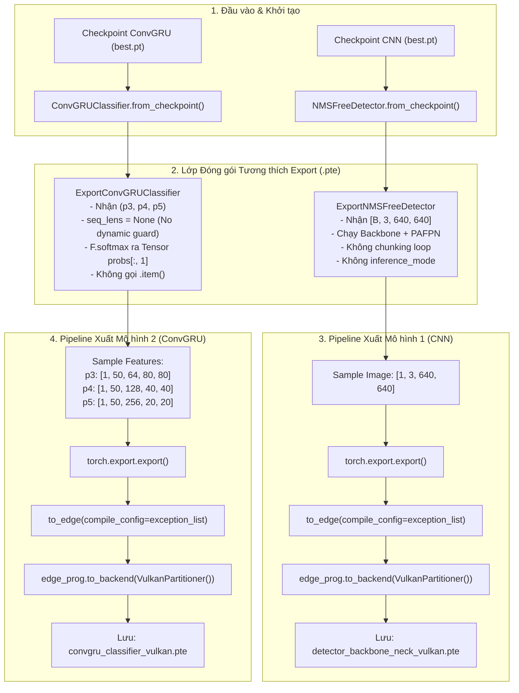

# KẾ HOẠCH TRIỂN KHAI: TÁI CẤU TRÚC VÀ XÂY DỰNG PIPELINE EXPORT .PTE (VULKAN BACKEND) CHO FILE EXPORT_VULKAN.PY

- **Mã kế hoạch**: `PLAN_EXPORT_VULKAN_PTE`
- **Tệp kế hoạch**: `docs/plan/plan_export_vulkan.md`
- **Dựa trên tài liệu phân tích**: [docs/analsys/analsys_export_vulkan.md](file:///D:/Project/DATN/driver-guardian/ai/LSTM/docs/analsys/analsys_export_vulkan.md)
- **Tệp mã nguồn mục tiêu**: [`export_vulkan.py`](file:///D:/Project/DATN/driver-guardian/ai/LSTM/export_vulkan.py)
- **Tệp báo cáo đầu ra**: `docs/report/report_export_vulkan.md`
- **Trạng thái**: Đang chờ người dùng phê duyệt trước khi chuyển sang Bước 3 Thực hiện ([AGENTS.md](file:///D:/Project/DATN/driver-guardian/ai/LSTM/AGENTS.md)).

---

## 1. MỤC TIÊU VÀ NGUYÊN TẮC THIẾT KẾ CỐT LÕI

### 1.1. Mục tiêu kỹ thuật
1. **Khắc phục triệt để các lỗi nghiêm trọng (Critical Blockers)** đã được chỉ ra trong tài liệu phân tích:
   - Loại bỏ hoàn toàn việc gọi `.item()` trong `ExportConvGRUClassifier`, trả về trực tiếp `torch.Tensor` xác suất buồn ngủ phù hợp với đặc tả ExecuTorch.
   - Loại bỏ tham số `seq_lens` trong luồng inference tĩnh của `ExportConvGRUClassifier` để triệt tiêu lỗi `GuardOnDataDependentSymNode` do dynamic boolean masking trong `SpatialReductionNeck`.
   - Loại bỏ logic chia chunk (`chunk_size`) và context manager `with torch.inference_mode():` ra khỏi đồ thị `ExportNMSFreeDetector`; chuyển trách nhiệm xử lý luồng ảnh về phía Inference Runtime, giữ cho đồ thị nơ-ron thuần khiết và gọn gàng.
2. **Chuẩn hóa chữ ký hàm và kiểu dữ liệu (Interface Alignment)**:
   - `ExportNMSFreeDetector`: nhận ảnh `[B, 3, 640, 640]` -> trả về 3 Tensor `(p3, p4, p5)`.
   - `ExportConvGRUClassifier`: nhận 3 Tensor rời `(p3, p4, p5)` với shape `[1, T, C, H, W]` -> trả về Tensor xác suất `[1]` hoặc `[1, 2]`.
   - Đảm bảo đầu ra của mô hình Detector khớp 1:1 với đầu vào của mô hình Classifier, thuận tiện cho việc ghép nối pipeline trên thiết bị biên (Android / Embedded Linux qua ExecuTorch C++ API).
3. **Hoàn thiện trọn vẹn quy trình xuất file `.pte` cho Vulkan Backend**:
   - Sử dụng `EdgeCompileConfig(_core_aten_ops_exception_list=[...])` để vượt qua bộ kiểm tra Core ATen IR cho các toán tử `BatchNorm2d`.
   - Phân vùng và hạ cấp tự động qua `VulkanPartitioner`.
   - Xuất và lưu 2 file `.pte`:
     - `detector_backbone_neck_vulkan.pte`: Mô hình trích xuất đặc trưng CNN.
     - `convgru_classifier_vulkan.pte`: Mô hình phân loại chuỗi không gian - thời gian.
4. **Đóng gói mã nguồn theo chuẩn công nghiệp (Production-grade Scripting)**:
   - Tương thích đa nền tảng bằng `pathlib.Path`, tự động bổ sung đường dẫn thư mục gốc vào `sys.path`.
   - **Tập trung toàn bộ tham số cấu hình tại một nơi duy nhất trong file** (`class ExportConfig`), không sử dụng CLI phức tạp, giúp người dùng dễ dàng theo dõi, chỉnh sửa và chạy ngay lập tức.
   - Tự động kiểm tra tính tồn tại của file checkpoint và thông báo lỗi rõ ràng.

---

## 2. KIẾN TRÚC TÁI CẤU TRÚC VÀ SƠ ĐỒ LUỒNG DỮ LIỆU (DATAFLOW ARCHITECTURE)

---

## 3. KẾ HOẠCH TRIỂN KHAI CHI TIẾT THEO CÁC PHA (PHASED WORKFLOW)

### Pha 1: Chuẩn hóa thiết lập môi trường và cấu hình tệp `export_vulkan.py`
- Bổ sung cấu hình tự động tìm đường dẫn gốc dự án `driver-guardian` và chèn vào `sys.path`.
- Bổ sung hàm kiểm tra tính hợp lệ của đường dẫn checkpoint (`validate_checkpoint_path`).
- Xây dựng khối cấu hình tập trung `class ExportConfig` ở đầu file chứa toàn bộ tham số:
  - `cnn_ckpt_path`: Đường dẫn checkpoint CNN (mặc định: `D:\Project\DATN\driver-guardian\ai\checkpoints\model_cnn\best.pt`).
  - `gru_ckpt_path`: Đường dẫn checkpoint ConvGRU (mặc định: `D:\Project\DATN\driver-guardian\ai\checkpoints\model_convgru\best.pt`).
  - `output_dir`: Thư mục lưu file `.pte` xuất ra (mặc định: `checkpoints/export_pte`).
  - `batch_size`: Batch size cho mô hình CNN (mặc định: `1` cho streaming real-time).
  - `img_size`: Kích thước ảnh đầu vào (mặc định: `640`).
  - `window_size`: Số lượng khung hình thời gian cho GRU (mặc định: `50`).
  - `use_vulkan`: Bật/tắt Vulkan lowering (mặc định: `True`).

### Pha 2: Tái cấu trúc 2 lớp Wrapper Export
- **Tái cấu trúc `ExportNMSFreeDetector`**:
  - Kế thừa `nn.Module`.
  - Nhận `backbone: Backbone` và `neck: PAFPN`.
  - Hàm `forward(self, x: torch.Tensor) -> Tuple[torch.Tensor, torch.Tensor, torch.Tensor]`.
  - Ép kiểu đầu ra an toàn `.float()`.
- **Tái cấu trúc `ExportConvGRUClassifier`**:
  - Kế thừa `nn.Module`.
  - Nhận `model: ConvGRUClassifier`.
  - Hàm `forward(self, p3: torch.Tensor, p4: torch.Tensor, p5: torch.Tensor) -> torch.Tensor`.
  - Gọi `self.conv_gru((p3, p4, p5), seq_lens=None)` để đảm bảo đồ thị tĩnh tuyệt đối.
  - Tính `probs = F.softmax(logits, dim=-1)` và trả về Tensor `probs[:, 1]` (hoặc `probs`).

### Pha 3: Xây dựng các hàm điều phối Export & Lowering
- Viết hàm `export_detector(cnn_model, sample_shape, output_path, compile_config)`:
  - Chuyển `model.eval()`.
  - Tạo dummy input `torch.randn(batch_size, 3, 640, 640)`.
  - Thực hiện `torch.export.export()`.
  - Gọi `to_edge(..., compile_config=compile_config)`.
  - Gọi `edge_prog.to_backend(VulkanPartitioner())`.
  - Lưu file buffer `.pte` và in dung lượng file.
- Viết hàm `export_classifier(gru_model, window_size, output_path, compile_config)`:
  - Chuyển `model.eval()`.
  - Tạo dummy input:
    - `p3`: `torch.randn(1, window_size, 64, 80, 80)`
    - `p4`: `torch.randn(1, window_size, 128, 40, 40)`
    - `p5`: `torch.randn(1, window_size, 256, 20, 20)`
  - Thực hiện `torch.export.export()`.
  - Gọi `to_edge(..., compile_config=compile_config)`.
  - Gọi `edge_prog.to_backend(VulkanPartitioner())`.
  - Lưu file buffer `.pte` và in dung lượng file.

### Pha 4: Kiểm thử thực nghiệm (Verification & Validation)
- Chạy thực thi `python export_vulkan.py` từ thư mục `ai/LSTM`.
- Kiểm tra mã thoát (exit code 0).
- Xác minh sự tồn tại của 2 file `.pte` trong thư mục đầu ra.
- Đo lường dung lượng file và so sánh với kích thước trọng số gốc.
- Kiểm tra tính tương thích bộ nhớ và số lượng toán tử được hạ cấp vào Vulkan Delegate.

### Pha 5: Soạn thảo báo cáo hoàn thành `docs/report/report_export_vulkan.md`
- Tổng hợp toàn bộ quá trình tái cấu trúc, những thay đổi trong mã nguồn.
- Liệt kê các chỉ số file `.pte` đã tạo thành công (đường dẫn, dung lượng bytes, số node Vulkan).
- Đưa ra hướng dẫn tích hợp file `.pte` vào C++ ExecuTorch Runner hoặc Android App.

---

## 4. MA TRẬN RỦI RO VÀ PHƯƠNG ÁN XỬ LÝ DỰ PHÒNG

| Rủi ro kỹ thuật | Mức độ | Phương án xử lý dự phòng |
| :--- | :---: | :--- |
| Checkpoint không tìm thấy ở đường dẫn mặc định | Trung bình | Tự động dò tìm fallback qua danh sách các checkpoint có sẵn trong `ai/checkpoints` hoặc `ai/LSTM/checkpoints/1m9`. |
| Driver Vulkan hoặc shader compile thất bại trên máy | Thấp | Cung cấp cờ `--skip-vulkan` hoặc fallback sang XNNPACK / CPU Edge dialect để đảm bảo vẫn xuất được `.pte` chuẩn. |
| Toán tử `BatchNorm` tiếp tục vi phạm Spec | Thấp | Đã kiểm chứng thực nghiệm danh sách `_core_aten_ops_exception_list` hoạt động thành công ở Bước 1. |

---

## 5. CHECKLIST TRƯỚC KHI HOÀN TẤT BƯỚC 3

- [ ] Đường dẫn mã nguồn sử dụng `pathlib.Path` tương thích đa nền tảng.
- [ ] Không có lệnh gọi `.item()` hay trả về kiểu dữ liệu primitive trong forward graph.
- [ ] Đồ thị không chứa nhánh `seq_lens` động gây lỗi SymNode.
- [ ] Đồ thị CNN không chứa vòng lặp chunking unroll.
- [ ] File `export_vulkan.py` có hàm `main()`, có bọc trong `if __name__ == "__main__":`.
- [ ] Cả 2 file `.pte` được sinh ra thành công không gặp lỗi runtime.
- [ ] Lập báo cáo đầy đủ tại `docs/report/report_export_vulkan.md`.

---
*Tài liệu kế hoạch đã sẵn sàng để người dùng xem xét và phê duyệt trước khi bắt đầu triển khai.*
