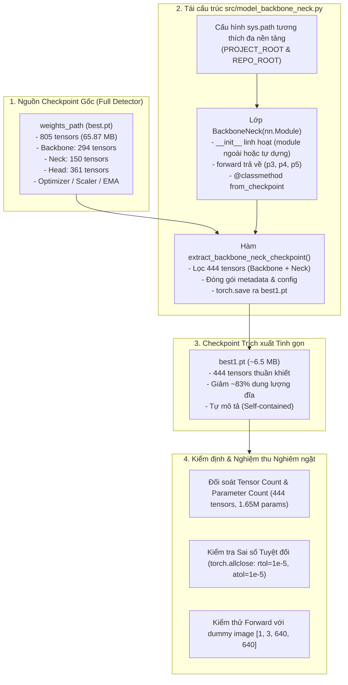

# KẾ HOẠCH TRIỂN KHAI: TRÍCH XUẤT CHECKPOINT VÀ TÍCH HỢP PHƯƠNG THỨC `FROM_CHECKPOINT` CHO MODEL BACKBONENECK

- **Mã kế hoạch**: `PLAN_EXTRACT_BACKBONE_NECK`
- **Tệp kế hoạch**: `docs/plan/plan_extract_backbone_neck.md`
- **Dựa trên tài liệu phân tích**: [`docs/analsys/analsys_extract_backbone_neck.md`](file:///D:/Project/DATN/driver-guardian/ai/LSTM/docs/analsys/analsys_extract_backbone_neck.md)
- **Nhiệm vụ trọng tâm**:
  1. Tái cấu trúc lớp [`BackboneNeck`](file:///D:/Project/DATN/driver-guardian/ai/LSTM/src/model_backbone_neck.py#L9) hỗ trợ tự khởi tạo độc lập và tích hợp phương thức `from_checkpoint`.
  2. Xây dựng hàm trích xuất độc lập `extract_backbone_neck_checkpoint`.
  3. Thực thi trích xuất checkpoint từ file nguồn gốc ra `D:\Project\DATN\driver-guardian\ai\checkpoints\model_cnn\best1.pt`.
  4. Thực hiện kiểm định đối soát sai số tuyệt đối (Zero Numerical Drift) và nghiệm thu toàn diện.
- **Tệp đối tượng tác động chính**:
  - [`src/model_backbone_neck.py`](file:///D:/Project/DATN/driver-guardian/ai/LSTM/src/model_backbone_neck.py)
  - Tệp checkpoint đầu ra: `D:\Project\DATN\driver-guardian\ai\checkpoints\model_cnn\best1.pt`
- **Tệp báo cáo kết quả đầu ra**:
  - `docs/report/report_extract_backbone_neck.md`
- **Trạng thái**: Đang chờ người dùng phê duyệt trước khi chuyển sang Bước 3 Thực hiện ([`AGENTS.md`](file:///D:/Project/DATN/driver-guardian/ai/LSTM/AGENTS.md)).

---

## 1. MỤC TIÊU VÀ SƠ ĐỒ LUỒNG TRIỂN KHAI TỔNG THỂ



### 1.1. Mục tiêu kỹ thuật
1. **Tinh gọn hóa Checkpoint**: Giảm dung lượng từ **65.87 MB xuống ~6.5 MB** (giảm ~83%), loại bỏ hoàn toàn 361 tensors của Detection/Landmark Head và các trạng thái bộ nhớ Optimizer thừa.
2. **Khởi tạo độc lập & Linh hoạt**: Cho phép `BackboneNeck` tự khởi tạo từ các tham số chuẩn `(backbone_w, backbone_n, neck_n)` mà không đòi hỏi phải dựng thủ công `Backbone` và `PAFPN` từ bên ngoài.
3. **Phương thức nạp chuẩn hóa `from_checkpoint`**: Cung cấp API trực quan, an toàn, hỗ trợ nạp từ cả checkpoint trích xuất riêng lẫn checkpoint gốc full detector.
4. **Bảo toàn 100% tính toàn vẹn toán học (Zero Numerical Drift)**: Đảm bảo output feature maps `(p3, p4, p5)` của mô hình nạp từ checkpoint mới trùng khớp chính xác 100% với mô hình ban đầu trên cùng một tensor đầu vào.

---

## 2. KẾ HOẠCH TRIỂN KHAI CHI TIẾT THEO TỪNG GIAI ĐOẠN

### Giai đoạn 1: Tái cấu trúc mã nguồn `src/model_backbone_neck.py`

#### 1. Cấu hình tự động `sys.path` tương thích đa nền tảng
- Thêm đường dẫn `PROJECT_ROOT` (`ai/LSTM`) và `REPO_ROOT` (`driver-guardian`) vào `sys.path` để nhập chính xác gói `ai.ObjectDetection_2p6M.src.backbone_neck` bất kể môi trường chạy từ thư mục nào.

#### 2. Nâng cấp lớp `BackboneNeck(nn.Module)`
- **Hàm khởi tạo `__init__`**:
  ```python
  def __init__(
      self,
      backbone: Optional[nn.Module] = None,
      neck: Optional[nn.Module] = None,
      backbone_w: Tuple[int, ...] = (16, 32, 64, 128, 256),
      backbone_n: Tuple[int, ...] = (1, 2, 2, 1),
      neck_n: int = 1,
  ):
  ```
  - Nếu `backbone` và `neck` được truyền vào: sử dụng trực tiếp (tương thích ngược 100%).
  - Nếu không truyền: tự động khởi tạo `Backbone(w=backbone_w, n=backbone_n)` và `PAFPN(chs=(backbone_w[2], backbone_w[3], backbone_w[4]), n=neck_n)`.
  - Lưu trữ các thuộc tính: `self.backbone_w`, `self.backbone_n`, `self.neck_n`, `self.neck_chs = (64, 128, 256)`.

- **Hàm `forward(self, x: torch.Tensor)`**:
  - Nhận tensor ảnh $[B, 3, H, W]$.
  - Trả về tuple 3 feature maps `(p3, p4, p5)`.

- **Phương thức lớp `from_checkpoint`**:
  ```python
  @classmethod
  def from_checkpoint(
      cls,
      checkpoint_path: Union[str, Path, Dict[str, Any]],
      map_location: Optional[Union[str, torch.device]] = "cpu",
      eval_mode: bool = True,
      strict: bool = True,
      **kwargs,
  ) -> "BackboneNeck":
  ```
  - Xử lý linh hoạt đối số `checkpoint_path` (đường dẫn tệp hoặc đối tượng `dict`).
  - Đọc cấu hình kiến trúc từ checkpoint nếu có (`backbone_w`, `backbone_n`, `neck_n`), kết hợp fallback giá trị mặc định chuẩn.
  - Khởi tạo instance `model = cls(...)`.
  - Trích xuất state_dict theo thứ tự ưu tiên `ema` -> `model` -> `model_state_dict` -> checkpoint gốc.
  - Lọc tensor: chỉ giữ các keys bắt đầu bằng `backbone.` và `neck.`.
  - Gọi `model.load_state_dict(filtered_state_dict, strict=strict)`.
  - Áp dụng `model.to(map_location)` và `model.eval()` (nếu `eval_mode=True`).

#### 3. Xây dựng hàm trích xuất `extract_backbone_neck_checkpoint`
```python
def extract_backbone_neck_checkpoint(
    source_ckpt_path: Union[str, Path],
    output_ckpt_path: Union[str, Path],
    use_ema: bool = True,
) -> Path:
```
- Đọc checkpoint nguồn, lấy trọng số `ema` (nếu có) hoặc `model`.
- Lọc chính xác 444 tensors `backbone.*` và `neck.*`.
- Đóng gói dict cấu trúc:
  - `"model"`: state_dict đã lọc.
  - `"backbone_w"`: `(16, 32, 64, 128, 256)`.
  - `"backbone_n"`: `(1, 2, 2, 1)`.
  - `"neck_n"`: `1`.
  - `"metadata"`: Thông tin nguồn gốc, số lượng tham số, channels, thời gian trích xuất.
- Lưu file an toàn tại `output_ckpt_path`.

#### 4. Cập nhật hàm `main()`
- Thiết lập đường dẫn mặc định từ `src/model_backbone_neck.py`:
  - `weights_path`: Đường dẫn checkpoint gốc trong `ai/NewVersionObDetect`.
  - `cnn_filepath`: `D:\Project\DATN\driver-guardian\ai\checkpoints\model_cnn\best1.pt`.
- Thực hiện trích xuất và hiển thị log chi tiết (kích thước trước/sau, số lượng tham số).
- Chạy Sanity Check tự động: dùng `BackboneNeck.from_checkpoint()` nạp lại checkpoint vừa tạo và truyền qua ảnh dummy để xác nhận hoạt động bình thường.

---

### Giai đoạn 2: Thực thi và Kiểm định Nghiệm thu Toàn diện

1. **Thực thi script trích xuất**:
   - Chạy lệnh `python src/model_backbone_neck.py`.
   - Kiểm tra tệp `best1.pt` đã được tạo thành công tại `D:\Project\DATN\driver-guardian\ai\checkpoints\model_cnn\`.
2. **Kiểm tra chỉ số định lượng**:
   - Xác nhận kích thước file `best1.pt` (~6.5 MB so với 65.87 MB).
   - Xác nhận số lượng tensor = 444 tensors.
   - Xác nhận số lượng tham số = 1,654,841 params.
3. **Kiểm thử đối soát sai số tuyệt đối (Numerical Consistency Test)**:
   - Nạp mô hình gốc `FaceLmkDetector` từ `weights_path` và lấy `(model_lmk.backbone, model_lmk.neck)`.
   - Nạp mô hình mới qua `BackboneNeck.from_checkpoint(cnn_filepath)`.
   - Sinh cùng một tensor ngẫu nhiên $X \in \mathbb{R}^{2 \times 3 \times 640 \times 640}$.
   - Chạy forward qua cả 2 mô hình và so sánh từng cặp feature map $P_3, P_4, P_5$ bằng hàm `torch.testing.assert_close()` với sai số tuyệt đối $\Delta = 0.0$.
4. **Kiểm thử khả năng nạp chéo (Cross-Loading Compatibility)**:
   - Thử nghiệm gọi `BackboneNeck.from_checkpoint(weights_path)` (nạp trực tiếp từ file full detector 65 MB) để chứng minh tính tương thích ngược hoàn hảo.

---

### Giai đoạn 3: Tổng kết và Lập báo cáo Nghiệm thu
- Soạn thảo tài liệu báo cáo `docs/report/report_extract_backbone_neck.md` ghi nhận toàn bộ kết quả thực hiện, đối soát số liệu và hướng dẫn sử dụng API mới.

---

## 3. BẢNG TIÊU CHÍ NGHIỆM THU (ACCEPTANCE CRITERIA)

| STT | Tiêu chí nghiệm thu | Phương pháp kiểm tra | Kết quả kỳ vọng |
| :---: | :--- | :--- | :--- |
| 1 | **Tái cấu trúc `BackboneNeck`** | Đọc mã nguồn `src/model_backbone_neck.py` | Hỗ trợ tự khởi tạo, có `from_checkpoint`, type hints chuẩn |
| 2 | **Trích xuất Checkpoint** | Chạy `main()` trong `model_backbone_neck.py` | Tạo thành công tệp `best1.pt` |
| 3 | **Độ tinh gọn Checkpoint** | Kiểm tra dung lượng đĩa của `best1.pt` | $\le 7.0\text{ MB}$ (giảm $>80\%$ dung lượng so với 65.87 MB) |
| 4 | **Tính đầy đủ của tham số** | Đếm số keys trong `checkpoint['model']` | Chính xác 444 tensors (294 backbone + 150 neck) |
| 5 | **Không còn tham số rác** | Duyệt qua danh sách keys của checkpoint | 0 tensor thuộc `head.*`, không có optimizer states |
| 6 | **Tính đúng đắn toán học** | Chạy `torch.allclose` giữa mô hình gốc và mới | Max absolute difference $= 0.0$ (trùng khớp tuyệt đối) |
| 7 | **Hỗ trợ nạp trực tiếp** | Gọi `BackboneNeck.from_checkpoint(best1.pt)` | Trả về model ở chế độ `eval()`, chạy forward mượt mà |
| 8 | **Tài liệu báo cáo** | Kiểm tra `docs/report/report_extract_backbone_neck.md` | Đầy đủ nội dung theo quy chuẩn `AGENTS.md` |
