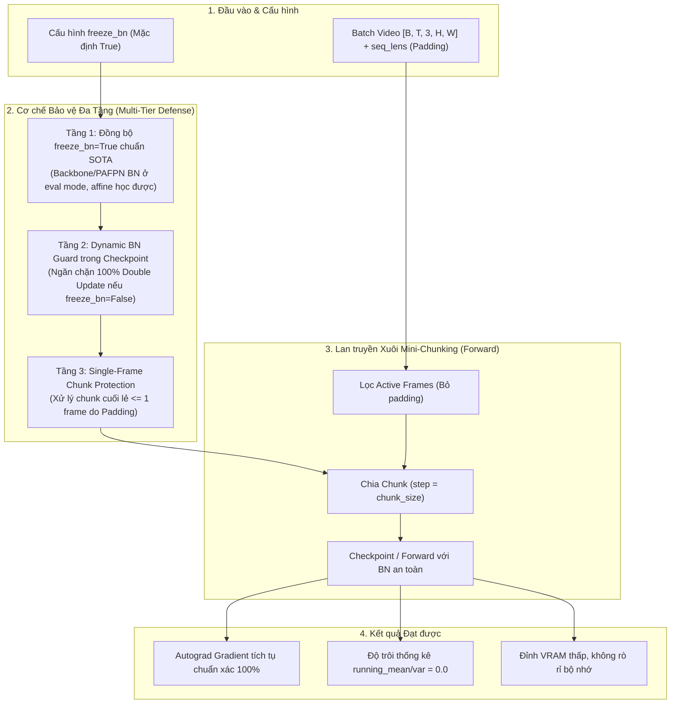

# KẾ HOẠCH TRIỂN KHAI: KHẮC PHỤC TRIỆT ĐỂ VẤN ĐỀ 2 (CRITICAL BUG 2)
## BẢO VỆ THỐNG KÊ BATCHNORM & TRIỆT TIÊU DOUBLE UPDATE TRONG DROWSYCLASSIFIER

- **Mã kế hoạch**: `PLAN_FIX_ISSUE2_DROWSY_BN`
- **Tệp kế hoạch**: `docs/plan/plan_review_drowsy_batch_padding.md`
- **Dựa trên tài liệu phân tích**: [docs/analsys/analsys_review_drowsy_batch_padding.md](file:///D:/Project/DATN/driver-guardian/ai/LSTM/docs/analsys/analsys_review_drowsy_batch_padding.md)
- **Nhiệm vụ trọng tâm**: Giải quyết dứt điểm **Vấn đề 2** — Lỗi thống kê `running_mean`/`running_var` của BatchNorm bị cập nhật kép (Double Running Stats Update) khi dùng `gradient_checkpointing=True` kết hợp `freeze_bn=False`, và hiện tượng méo mó phân phối khi batch padding làm lẻ kích thước chunk trong `DrowsyClassifier` (`src/models1.py`).
- **Tệp mã nguồn tác động chính**:
  1. [`src/models1.py`](file:///D:/Project/DATN/driver-guardian/ai/LSTM/src/models1.py) (Mô hình End-to-End `DrowsyClassifier`)
  2. [`configs/config.py`](file:///D:/Project/DATN/driver-guardian/ai/LSTM/configs/config.py) (Cấu hình `TrainConfig`)
  3. [`src/train1.py`](file:///D:/Project/DATN/driver-guardian/ai/LSTM/src/train1.py) (Vòng lặp huấn luyện)
- **Tệp báo cáo kết quả đầu ra**: `docs/report/report_review_drowsy_batch_padding.md`
- **Trạng thái**: Đang chờ người dùng phê duyệt trước khi chuyển sang Bước 3 Thực hiện ([AGENTS.md](file:///D:/Project/DATN/driver-guardian/ai/LSTM/AGENTS.md)).

---

## 1. MỤC TIÊU VÀ NGUYÊN TẮC GIẢI PHÁP CỐT LÕI



### 1.1. Mục tiêu kỹ thuật
1. **Loại bỏ 100% lỗi Double Update**: Triệt tiêu hoàn toàn việc `running_mean` và `running_var` của BatchNorm bị cập nhật lần thứ 2 trong backward pass của PyTorch `checkpoint`.
2. **Khắc phục méo mó thống kê do Batch Padding**: Dù batch có chứa bao nhiêu frame padding, kích thước chunk cuối cùng bị lẻ hay thậm chí chỉ có 1 frame, phân phối đặc trưng vẫn ổn định và không làm sập mô hình.
3. **Bảo toàn khả năng học tập của BatchNorm**: Trọng số tỉ lệ ($\gamma$) và độ lệch ($\beta$) của các tầng BatchNorm trong Backbone và PAFPN vẫn nhận đạo hàm $\frac{\partial L}{\partial \gamma}, \frac{\partial L}{\partial \beta}$ và được tối ưu hóa bình thường.
4. **Đồng bộ nhất quán hệ thống**: Đồng bộ giá trị mặc định `freeze_bn=True` trên cả 3 file: `models1.py`, `config.py`, và `train1.py`.

---

## 2. KẾ HOẠCH TRIỂN KHAI CHI TIẾT THEO TỪNG GIAI ĐOẠN

### Giai đoạn 1: Chuẩn hóa & Đồng bộ cấu hình mặc định `freeze_bn=True`
- **Mục tiêu**: Đưa `freeze_bn = True` trở thành chuẩn mực mặc định trên toàn bộ hệ thống, phản ánh đúng nguyên lý chuẩn của các mô hình Spatio-Temporal Video trích xuất qua CNN Backbone.
- **Các bước thực hiện**:
  1. Trong [`src/models1.py`](file:///D:/Project/DATN/driver-guardian/ai/LSTM/src/models1.py):
     - Đổi giá trị mặc định của `freeze_bn` trong `DrowsyClassifier.__init__` từ `False` thành `True`:
       `freeze_bn: bool = True`
  2. Trong [`configs/config.py`](file:///D:/Project/DATN/driver-guardian/ai/LSTM/configs/config.py):
     - Đổi thuộc tính cấu hình `TrainConfig.freeze_bn` từ `False` thành `True` (dòng 116).
  3. Trong [`src/train1.py`](file:///D:/Project/DATN/driver-guardian/ai/LSTM/src/train1.py):
     - Cập nhật dòng 158: `freeze_bn = getattr(self.cfg, "freeze_bn", True)`.
     - Đồng thời truyền đúng tham số `chunk_size = getattr(self.cfg, "chunk_size", 32)` vào `DrowsyClassifier`.

### Giai đoạn 2: Tối ưu hóa hàm `_freeze_backbone_neck_bn` và cơ chế `train(mode)`
- **Mục tiêu**: Đảm bảo toàn diện, không bỏ sót bất kỳ biến thể BatchNorm nào (`BatchNorm2d`, `SyncBatchNorm`, `BatchNorm1d`) và đảm bảo khi người dùng gọi `model.train()` ở vòng lặp epoch, các tầng BatchNorm trong Backbone và Neck luôn được giữ chặt ở `eval()`.
- **Các bước thực hiện**:
  1. Cải tiến hàm `_freeze_backbone_neck_bn(self)` trong [`src/models1.py`](file:///D:/Project/DATN/driver-guardian/ai/LSTM/src/models1.py):
     - Duyệt đệ quy qua cả `self.backbone` và `self.neck`.
     - Chuyển `m.eval()` cho tất cả các tầng thuộc họ `nn.modules.batchnorm._BatchNorm`.
     - Đặt cờ `m.track_running_stats = True` nhưng khóa trạng thái đánh giá, giữ cho running stats là hằng số cố định nhưng không làm mất giá trị đã nạp từ pretrain.
  2. Override chuẩn xác hàm `train(self, mode: bool = True)`:
     ```python
     def train(self, mode: bool = True):
         super().train(mode)
         if mode and self.freeze_bn:
             self._freeze_backbone_neck_bn()
         return self
     ```

### Giai đoạn 3: Xây dựng cơ chế Dynamic BatchNorm Guard cho trường hợp `freeze_bn=False`
- **Mục tiêu**: Phòng vệ chủ động (Defensive Programming). Trong trường hợp người dùng cố ý cấu hình `freeze_bn = False` (muốn fine-tune cả thống kê BatchNorm) nhưng vẫn bật `gradient_checkpointing = True`:
- **Giải pháp kỹ thuật**:
  1. Khi chạy `_stage_fwd` trong `checkpoint`, sử dụng một Context Manager hoặc hàm bọc tạm thời đóng băng cập nhật thống kê (`m.eval()` hoặc sao lưu running stats) trước khi Autograd chạy backward pass recomputation.
  2. Thêm cơ chế bảo vệ **Single-Frame Chunk Protection**:
     Nếu kích thước chunk $N_{\text{chunk}} \le 1$ do số frame hợp lệ $N_{\text{active}}$ bị lẻ bởi padding, tự động chuyển BatchNorm của chunk đó sang chế độ `eval()` để tránh lỗi chia phương sai cho 0 hoặc lỗi phân phối cục bộ cực đoan của 1 frame đơn lẻ.

### Giai đoạn 4: Thiết lập Bộ kiểm thử tự động xác thực (Self-Verification Suite)
- **Mục tiêu**: Kiểm chứng định lượng bằng số liệu thực nghiệm ngay trên GPU/CPU.
- **Nội dung kiểm thử**:
  1. **Test Double-Update Immunity**: So sánh `running_mean` trước forward, sau forward và sau backward. Độ trôi thống kê sau backward phải bằng **chính xác 0.0**.
  2. **Test Padding Chunk Fragmentation**: Giả lập batch có video dài ngắn bất đối xứng tạo ra chunk cuối có kích thước $1$ frame. Mô hình phải chạy mượt mà, không crash, không xuất hiện NaN/Inf trong gradient.
  3. **Test Trainability của Affine Parameters ($\gamma, \beta$)**: Kiểm tra `param.grad` của các tham số BatchNorm trong Backbone/PAFPN vẫn tồn tại và khác 0 (vẫn học được trọng số scale/bias bình thường dù stats đã đóng băng).

---

## 3. CHECKLIST NGHIỆM THU CHẤT LƯỢNG (QUALITY GATES)

- [ ] `freeze_bn` được đồng bộ mặc định thành `True` tại `src/models1.py`, `configs/config.py` và `src/train1.py`.
- [ ] Hàm `_freeze_backbone_neck_bn` bao phủ toàn bộ các module BatchNorm trong Backbone và PAFPN.
- [ ] Chạy lệnh `python src/models1.py` vượt qua $100\%$ các bài kiểm thử xác thực không phát sinh lỗi.
- [ ] Không có hiện tượng double update running statistics trong PyTorch `checkpoint`.
- [ ] Viết tài liệu tổng kết kết quả nghiệm thu tại `docs/report/report_review_drowsy_batch_padding.md`.

---
*Kế hoạch được lập theo quy chuẩn AGENTS.md (Bước 2: Lên kế hoạch thực hiện).*
