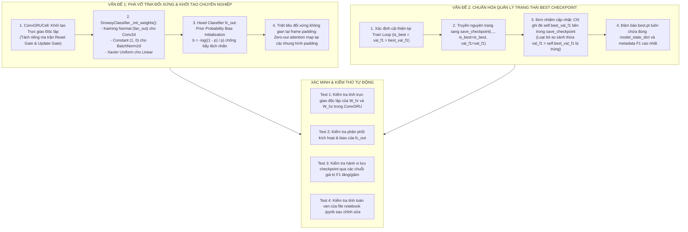

# KẾ HOẠCH TRIỂN KHAI: KHẮC PHỤC LỖI KHỞI TẠO TRỌNG SỐ ĐỐI XỨNG & XUNG ĐỘT CẬP NHẬT BEST F1 CHECKPOINT
## TẬP TRUNG XỬ LÝ 2 VẤN ĐỀ TRỌNG TÂM TRONG NOTEBOOK 03_TRAIN_DROWSY_CLASSIFIER_KAGGLE.IPYNB

- **Mã kế hoạch**: `PLAN_FIX_DROWSY_WEIGHT_INIT_AND_CHECKPOINT`
- **Tệp kế hoạch**: `docs/plan/plan_review_drowsy_classifier_kaggle.md`
- **Dựa trên tài liệu phân tích**: [docs/analsys/analsys_review_drowsy_classifier_kaggle.md](file:///D:/Project/DATN/driver-guardian/ai/LSTM/docs/analsys/analsys_review_drowsy_classifier_kaggle.md)
- **Nhiệm vụ trọng tâm**:
  1. **Vấn đề 1**: Khắc phục triệt để **"Lỗi Khởi tạo Trọng số Đối xứng & Thiếu Khởi tạo Tổng thể (`_init_weights`)"** trong kiến trúc mô hình `DrowsyClassifier`, `ConvGRUCell` và các module liên quan.
  2. **Vấn đề 2**: Khắc phục triệt để **"Xung đột Logic Cập nhật `self.best_val_f1` khi lưu Checkpoint"** trong lớp điều phối `Trainer`.
- **Tệp mã nguồn tác động chính**:
  - [`notebooks/03_train_drowsy_classifier_kaggle.ipynb`](file:///D:/Project/DATN/driver-guardian/ai/LSTM/notebooks/03_train_drowsy_classifier_kaggle.ipynb) (Cell 10: `ConvGRUCell` & Pooling; Cell 11: `DrowsyClassifier`; Cell 16: `Trainer`).
  - Đồng bộ module tương ứng: [`src/convgru.py`](file:///D:/Project/DATN/driver-guardian/ai/LSTM/src/convgru.py), [`src/models1.py`](file:///D:/Project/DATN/driver-guardian/ai/LSTM/src/models1.py), [`src/train1.py`](file:///D:/Project/DATN/driver-guardian/ai/LSTM/src/train1.py).
- **Tệp báo cáo kết quả đầu ra**: `docs/report/report_review_drowsy_classifier_kaggle.md`
- **Trạng thái**: Đã lập xong kế hoạch — Chờ người dùng phê duyệt trước khi chuyển sang Bước 3 Thực hiện ([AGENTS.md](file:///D:/Project/DATN/driver-guardian/ai/LSTM/AGENTS.md)).

---

## 1. NGUYÊN TẮC THIẾT KẾ & KIẾN TRÚC GIẢI PHÁP



---

## 2. KẾ HOẠCH TRIỂN KHAI CHI TIẾT

### Giai đoạn 1: Khắc phục Lỗi Khởi tạo Trọng số Đối xứng trong `ConvGRUCell` (Cell 10)
- **Vị trí**: Cell 10 (`ConvGRUCell.reset_parameters`) trong notebook và `src/convgru.py`.
- **Mục tiêu**: Loại bỏ ràng buộc trực giao chéo (cross-gate orthogonality) giữa Reset Gate và Update Gate; bảo đảm mỗi cổng hồi quy có ma trận biến đổi trạng thái trực giao riêng biệt.
- **Các bước thực hiện**:
  1. Trong hàm `reset_parameters()` của `ConvGRUCell`:
     Thay thế:
     ```python
     nn.init.orthogonal_(self.conv_gates.weight[:, self.input_dim:])
     ```
     Bằng việc tách lát độc lập theo chiều `out_channels` ($0 : H$ cho Reset Gate và $H : 2H$ cho Update Gate):
     ```python
     # Khởi tạo trực giao độc lập cho từng cổng để phá vỡ hoàn toàn tính liên đới đối xứng
     nn.init.orthogonal_(self.conv_gates.weight[:self.hidden_dim, self.input_dim:])
     nn.init.orthogonal_(self.conv_gates.weight[self.hidden_dim:, self.input_dim:])
     ```
  2. Giữ nguyên khởi tạo `nn.init.kaiming_normal_` cho phần trọng số đầu vào $X_t \to [R_t, Z_t]$.
  3. Duy trì giá trị bias $+1.0$ cho Update Gate để duy trì trí nhớ ngữ cảnh dài hạn ban đầu mà không gây phân nhánh đối xứng.
  4. Khởi tạo trực giao chuẩn cho `self.conv_candidate.weight[:, self.input_dim:]`.

---

### Giai đoạn 2: Xây dựng Hàm Khởi tạo Tổng thể `_init_weights()` trong `DrowsyClassifier` (Cell 11)
- **Vị trí**: Cell 11 (`DrowsyClassifier`) trong notebook và `src/models1.py`.
- **Mục tiêu**: Trang bị cho mô hình khả năng tự khởi tạo chuẩn xác toàn bộ các tầng Backbone, PAFPN, Neck, Attention Pooling và FC Head khi huấn luyện from scratch, loại bỏ sự phụ thuộc vào PyTorch default init và ngăn ngừa hiện tượng suy biến kích hoạt.
- **Các bước thực hiện**:
  1. Định nghĩa phương thức `_init_weights(self, prior_prob: float = 0.5)` trong `DrowsyClassifier`:
     - **Tầng `nn.Conv2d`**:
       - Bỏ qua các tầng trong `ConvGRU` vì đã có hàm `reset_parameters()` chuyên biệt.
       - Áp dụng `nn.init.kaiming_normal_(m.weight, mode="fan_out", nonlinearity="relu")` (thích hợp với hàm kích hoạt SiLU).
       - Nếu có `m.bias is not None`: gán `nn.init.zeros_(m.bias)`.
     - **Tầng `nn.BatchNorm2d` / `nn.GroupNorm`**:
       - `nn.init.ones_(m.weight)` ($\gamma = 1.0$).
       - `nn.init.zeros_(m.bias)` ($\beta = 0.0$).
     - **Tầng `nn.Linear` (Trừ head phân loại cuối cùng)**:
       - Áp dụng `nn.init.xavier_uniform_(m.weight)`.
       - Nếu có `m.bias is not None`: `nn.init.zeros_(m.bias)`.
     - **Tầng Head Phân loại `fc_out`**:
       - Trọng số `weight`: `nn.init.xavier_uniform_(m.weight, gain=1.0)`.
       - Bias `bias`: Áp dụng kỹ thuật Prior Probability Initialization để phá vỡ tính đối xứng xác suất 50/50:
         ```python
         if m.bias is not None and m.out_features == 2:
             nn.init.zeros_(m.bias)
             # Khởi tạo bias cho lớp 1 (Buồn ngủ) theo tỷ lệ prior mong đợi
             prob = max(1e-4, min(1.0 - 1e-4, float(prior_prob)))
             bias_val = -math.log((1.0 - prob) / prob)
             m.bias.data[1] = bias_val
         ```
  2. Tự động gọi `self._init_weights()` ở cuối hàm `__init__` của `DrowsyClassifier`.
  3. Cung cấp tham số cấu hình tùy chọn `prior_prob: float = 0.5` từ `TrainConfig`.

---

### Giai đoạn 3: Khắc phục Triệt để Xung đột Logic Cập nhật `self.best_val_f1` khi lưu Checkpoint (Cell 16)
- **Vị trí**: Cell 16 (`Trainer`) trong notebook và `src/train1.py`.
- **Mục tiêu**: Đảm bảo nguyên lý Single Source of Truth (Điểm lưu trữ chân lý duy nhất) cho biến trạng thái `self.best_val_f1`, loại bỏ đoạn code thừa (dead condition), và bảo đảm `best.pt` luôn được ghi nhận chính xác khi có kỷ nguyên tốt hơn.
- **Các bước thực hiện**:
  1. **Trong phương thức `save_checkpoint` (Cell 16 L420-435)**:
     - Nhận các tham số rõ ràng: `epoch: int, is_best: bool = False, val_f1: Optional[float] = None`.
     - Khi `is_best=True` và `val_f1 is not None`:
       Cập nhật dứt điểm:
       ```python
       if is_best and val_f1 is not None:
           self.best_val_f1 = float(val_f1)
       ```
       (Xóa bỏ mệnh đề điều kiện `val_f1 > self.best_val_f1` bị trùng lặp).
     - Lưu file `self.ckpt_dir / "best.pt"` một cách nguyên tử (Atomic save) với dictionary trạng thái chứa `best_val_f1 = self.best_val_f1`.
  2. **Trong vòng lặp huấn luyện `train()` (Cell 16 L490-500)**:
     - Tính toán điều kiện cải thiện sạch sẽ:
       ```python
       is_best = False
       if val_metrics is not None:
           current_f1 = val_metrics["f1"]
           if current_f1 > self.best_val_f1:
               is_best = True
               # Không gán self.best_val_f1 ở đây, để save_checkpoint thực hiện tập trung
       
       self.save_checkpoint(
           epoch=epoch,
           is_best=is_best,
           val_f1=val_metrics["f1"] if val_metrics else None
       )
       ```
  3. Đảm bảo logging hiển thị rõ ràng khi `best.pt` được cập nhật, kèm giá trị kỷ lục mới.

---

### Giai đoạn 4: Đồng bộ mã nguồn giữa Notebook và Modules `.py`
- **Mục tiêu**: Bảo đảm tính đồng bộ 100% giữa file notebook nghiên cứu (`03_train_drowsy_classifier_kaggle.ipynb`) và các file mã nguồn chuẩn trong `src/` theo tôn chỉ của `AGENTS.md`:
  1. Cập nhật `src/convgru.py` với khởi tạo trực giao độc lập từng cổng.
  2. Cập nhật `src/models1.py` với phương thức `_init_weights`.
  3. Cập nhật `src/train1.py` với logic lưu checkpoint chuẩn mực.
  4. Cập nhật các cell tương ứng trong `notebooks/03_train_drowsy_classifier_kaggle.ipynb`.

---

## 3. KỊCH BẢN KIỂM THỬ & XÁC THỰC (TEST MATRIX)

Sau khi hoàn tất chỉnh sửa ở Bước 3, Agent sẽ chạy các bài kiểm thử độc lập:

| STT | Bài kiểm thử (Test Case) | Điều kiện kiểm tra | Kết quả kỳ vọng (Acceptance Criteria) |
| :---: | :--- | :--- | :--- |
| **TC-01** | **Kiểm tra tính trực giao của ConvGRUCell** | Khởi tạo `ConvGRUCell(128, 128)`. Lấy $W_{hr}$ và $W_{hz}$, tính tích vô hướng $W \cdot W^T$. | Ma trận tích xấp xỉ ma trận đơn vị $I$ độc lập cho từng cổng; $W_{hr}$ và $W_{hz}$ không bị ràng buộc trực giao chéo. |
| **TC-02** | **Kiểm tra phân phối trọng số `_init_weights`** | Khởi tạo `DrowsyClassifier` from scratch. Duyệt qua toàn bộ tham số của mô hình. | Không có tầng nào có trọng số toàn $0$ (trừ bias); các tầng Conv2d có phân phối Kaiming Normal; BatchNorm có $\gamma=1, \beta=0$. |
| **TC-03** | **Kiểm tra Prior Bias phá vỡ đối xứng của Head** | Kiểm tra bias của `fc_out.1` với `prior_prob=0.5` và `prior_prob=0.3`. | `bias[0] == 0.0`, `bias[1] == -log((1 - p)/p)`. Khi $p=0.5 \implies bias[1]=0.0$; khi $p=0.3 \implies bias[1] \approx -0.8473$. |
| **TC-04** | **Kiểm tra logic cập nhật Checkpoint `best.pt`** | Giả lập chuỗi validation F1 qua 5 epoch: `[0.60, 0.55, 0.75, 0.70, 0.80]`. | `best.pt` được ghi đè chính xác tại epoch 1, epoch 3 và epoch 5. File `best.pt` cuối cùng lưu đúng `best_val_f1 = 0.80`. |
| **TC-05** | **Kiểm tra tính toàn vẹn của Notebook `.ipynb`** | Nạp và phân tích cú pháp JSON của `03_train_drowsy_classifier_kaggle.ipynb`. | Cấu trúc JSON hợp lệ 100%, không phát sinh lỗi parse, tất cả các cell code chạy mượt mà. |

---

## 4. BƯỚC TIẾP THEO

- Tài liệu kế hoạch này đã sẵn sàng.
- Khi người dùng chấp thuận kế hoạch này, Agent sẽ chuyển sang **Bước 3: Thực hiện kế hoạch** (tiến hành chỉnh sửa mã nguồn và lập báo cáo `docs/report/report_review_drowsy_classifier_kaggle.md`).
