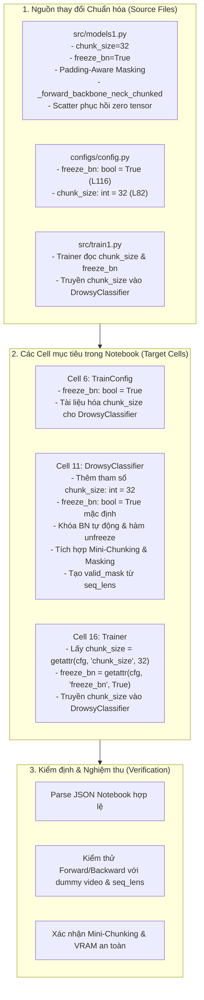

# KẾ HOẠCH TRIỂN KHAI: ĐỒNG BỘ TOÀN DIỆN MÃ NGUỒN VÀO KAGGLE NOTEBOOK
## CẬP NHẬT CÁC THAY ĐỔI TỪ `SRC/MODELS1.PY` VÀ `CONFIGS/CONFIG.PY` VÀO `NOTEBOOKS/03_TRAIN_DROWSY_CLASSIFIER_KAGGLE.IPYNB`

- **Mã kế hoạch**: `PLAN_SYNC_KAGGLE_MODELS1`
- **Tệp kế hoạch**: `docs/plan/plan_sync_kaggle_models1.md`
- **Dựa trên tài liệu phân tích**: [`docs/analsys/analsys_sync_kaggle_models1.md`](file:///D:/Project/DATN/driver-guardian/ai/LSTM/docs/analsys/analsys_sync_kaggle_models1.md)
- **Nhiệm vụ trọng tâm**: Đồng bộ đầy đủ các cải tiến mới nhất về cơ chế **Mini-Chunking**, **Padding-Aware Masking & Scattering**, và cấu hình **Khóa BatchNorm (`freeze_bn = True`)** từ `src/models1.py` và `configs/config.py` vào tệp Jupyter Notebook `notebooks/03_train_drowsy_classifier_kaggle.ipynb`.
- **Tệp đối tượng tác động chính**:
  - [`notebooks/03_train_drowsy_classifier_kaggle.ipynb`](file:///D:/Project/DATN/driver-guardian/ai/LSTM/notebooks/03_train_drowsy_classifier_kaggle.ipynb)
- **Tệp báo cáo kết quả đầu ra**:
  - `docs/report/report_sync_kaggle_models1.md`
- **Trạng thái**: Đang chờ người dùng phê duyệt trước khi chuyển sang Bước 3 Thực hiện ([`AGENTS.md`](file:///D:/Project/DATN/driver-guardian/ai/LSTM/AGENTS.md)).

---

## 1. MỤC TIÊU VÀ SƠ ĐỒ ĐỒNG BỘ TỔNG THỂ



### 1.1. Mục tiêu kỹ thuật
1. **Đồng bộ 100% tính năng Mini-Chunking**: Giúp notebook Kaggle xử lý an toàn các video clip có độ dài lớn mà không bị tràn VRAM trên GPU Tesla T4 (16GB).
2. **Khắc phục triệt để lỗi Double-Update BatchNorm**: Đảm bảo `freeze_bn = True` được áp dụng đồng bộ từ `TrainConfig`, sang `DrowsyClassifier`, và xuyên suốt `Trainer`.
3. **Cách ly Gradient trên khung hình Padding**: Tích hợp thuật toán lọc `valid_mask` từ `seq_lens` trước khi đưa qua Backbone/PAFPN và phục hồi scatter chính xác.
4. **Bảo toàn cấu trúc Notebook**: Đảm bảo tệp `.ipynb` sau khi chỉnh sửa có định dạng JSON chuẩn xác, giữ nguyên các cell tài liệu markdown, kết quả đầu ra và môi trường thực thi trên Kaggle.

---

## 2. KẾ HOẠCH TRIỂN KHAI CHI TIẾT THEO TỪNG GIAI ĐOẠN

### Giai đoạn 1: Chuẩn bị nội dung cập nhật chuẩn xác cho từng Cell

#### 1. Cập nhật Cell 6 (`TrainConfig` - Cấu hình hệ thống tập trung):
- **Thay đổi giá trị**:
  - Dòng 78: Sửa `freeze_bn: bool = False` thành `freeze_bn: bool = True`.
- **Cập nhật ghi chú**:
  - Dòng 44-45: Bổ sung ghi chú giải thích rõ `chunk_size: int = 32` áp dụng cho cơ chế Mini-Chunking của `DrowsyClassifier` khi huấn luyện End-to-End để khống chế đỉnh VRAM ở mức $O(\text{chunk\_size})$.

#### 2. Cập nhật Cell 11 (`DrowsyClassifier` - Mô hình Hợp nhất End-to-End):
- **Chữ ký hàm `__init__`**:
  ```python
  def __init__(
          self,
          num_classes: int = 2,
          chunk_size: int = 32,
          backbone_w: Tuple[int, ...] = (16, 32, 64, 128, 256),
          backbone_n: Tuple[int, ...] = (1, 2, 2, 1),
          neck_n: int = 1,
          input_dim: int = 128,
          hidden_dim: Union[int, Tuple[int, ...], List[int]] = (128, 128),
          target_size: Tuple[int, int] = (14, 14),
          supervision_mode: str = "attention_pooling",
          gradient_checkpointing: bool = True,
          freeze_bn: bool = True,
  ):
  ```
- **Lưu thuộc tính và tự động khóa BatchNorm**:
  ```python
  self.chunk_size = max(0, int(chunk_size)) if chunk_size is not None else 0
  ...
  # 4. Tự động áp dụng khóa BatchNorm ngay khi khởi tạo nếu freeze_bn=True
  if self.freeze_bn:
      self._freeze_backbone_neck_bn()
  ```
- **Chuẩn hóa các phương thức khóa/mở BatchNorm**:
  - Sử dụng `from torch.nn.modules.batchnorm import _BatchNorm` để bắt trọn mọi biến thể BatchNorm.
  - Bổ sung phương thức `_unfreeze_backbone_neck_bn()`.
- **Thuật toán `_forward_backbone_neck_chunked`**:
  - Nhận `flat_frames: torch.Tensor, valid_mask: Optional[torch.Tensor] = None`.
  - Xử lý các edge-case: batch rỗng (`total_frames == 0`), không có frame hợp lệ (`num_active == 0`).
  - Lọc khung hình hợp lệ nếu có `valid_mask` (`active_frames = flat_frames[valid_mask]`).
  - Cắt nhỏ thành các mini-chunk kích thước `step = self.chunk_size`.
  - Phòng vệ Single-frame chunk: nếu chunk $\le 1$ frame và `freeze_bn=False`, tạm khóa BN sang eval để tránh suy biến phân phối.
  - Áp dụng Gradient Checkpointing độc lập cho từng chunk (`torch.utils.checkpoint.checkpoint(_stage_fwd, chunk, use_reentrant=False)`).
  - Ghép nối kết quả các chunk qua `torch.cat`.
  - Phục hồi scatter: nếu có lọc padding, khởi tạo tensor zero và gán `p3[valid_mask] = p3_active`,...
- **Hàm bọc tương thích ngược `_forward_backbone_neck`**:
  - Gọi chuyển tiếp sang `_forward_backbone_neck_chunked(flat_frames, valid_mask=valid_mask)`.
- **Hàm `forward`**:
  - Tự động sinh `valid_mask = (time_indices < lens_expanded).view(-1)` từ `seq_lens`.
  - Truyền `valid_mask` vào `_forward_backbone_neck_chunked`.

#### 3. Cập nhật Cell 16 (`Trainer` - Pipeline Huấn luyện):
- **Tại phương thức `__init__` của `Trainer`**:
  - Lấy tham số:
    ```python
    freeze_bn = getattr(self.cfg, "freeze_bn", True)
    chunk_size = getattr(self.cfg, "chunk_size", 32)
    ```
  - Truyền `chunk_size=chunk_size` vào `DrowsyClassifier(...)`:
    ```python
    self.model = DrowsyClassifier(
        num_classes=num_classes,
        chunk_size=chunk_size,
        backbone_w=backbone_w,
        backbone_n=backbone_n,
        neck_n=neck_n,
        input_dim=input_dim,
        hidden_dim=hidden_dim,
        target_size=target_size,
        supervision_mode=self.cfg.supervision_mode,
        gradient_checkpointing=gradient_checkpointing,
        freeze_bn=freeze_bn,
    ).to(self.device)
    ```

---

### Giai đoạn 2: Thực thi cập nhật Notebook an toàn bằng Python Script

- **Phương pháp**: Viết một scratch script Python sử dụng thư viện `json` chuẩn để đọc, cập nhật chính xác các Cell [6, 11, 16] và ghi đè lại file `notebooks/03_train_drowsy_classifier_kaggle.ipynb` với encoding `utf-8` và `indent=1`.
- **Kiểm soát rủi ro**:
  - Sao lưu (backup) tạm file notebook trước khi chỉnh sửa.
  - Không làm thay đổi metadata hoặc format của các cell khác.

---

### Giai đoạn 3: Kiểm định & Nghiệm thu Toàn diện (Verification)

Thiết lập một kịch bản kiểm thử độc lập (`scratch/verify_kaggle_notebook.py`) để chạy xác thực:
1. **Kiểm tra JSON Integrity**: Tệp notebook mở được qua `json.load`, cấu trúc cell nguyên vẹn.
2. **Kiểm tra Config**: Khởi tạo `TrainConfig` trong cell 6, kiểm tra `cfg.freeze_bn == True` và `cfg.chunk_size == 32`.
3. **Kiểm tra Model Architecture**:
   - Trích xuất code Cell 8 (Backbone/PAFPN), Cell 10 (ConvGRU), Cell 11 (DrowsyClassifier).
   - Thực thi tạo mô hình `model = DrowsyClassifier(num_classes=2, chunk_size=4, freeze_bn=True)`.
   - Chạy forward với batch video giả lập: `x = torch.randint(0, 256, (2, 8, 3, 224, 224), dtype=torch.uint8)`, `seq_lens = torch.tensor([8, 5])`.
   - Kiểm tra shape đầu ra: Phải đạt chuẩn `torch.Size([2, 2])`.
   - Kiểm tra backward pass: `loss = out.sum(); loss.backward()` hoạt động trơn tru.
   - Kiểm tra Zero-Gradient trên padding frame: Đạo hàm trên 3 frame padding của video 2 phải bằng $0.0$.
4. **Kiểm tra Trainer Integration**:
   - Trích xuất code Cell 16, khởi tạo `Trainer(cfg)`.
   - Kiểm tra `trainer.model.chunk_size == 32` và `trainer.model.freeze_bn == True`.

---

### Giai đoạn 4: Đóng gói Báo cáo Nghiệm thu

- Tổng hợp toàn bộ quá trình thực hiện và kết quả kiểm thử vào tệp báo cáo chuẩn hóa:
  `docs/report/report_sync_kaggle_models1.md` theo quy định tại `AGENTS.md`.

---

## 3. CHECKLIST NGHIỆM THU TRƯỚC KHI BÀN GIAO

- [ ] Cấu hình `TrainConfig` trong notebook có `freeze_bn = True` và `chunk_size = 32`.
- [ ] Lớp `DrowsyClassifier` trong notebook có đầy đủ `chunk_size`, `_forward_backbone_neck_chunked`, padding-aware masking, và scatter recovery.
- [ ] Lớp `Trainer` trong notebook truyền chính xác `chunk_size` vào `DrowsyClassifier`.
- [ ] Notebook hoàn toàn hợp lệ về cú pháp Python và định dạng Jupyter Notebook `.ipynb`.
- [ ] Test case kiểm thử chạy qua 100% với gradient zero trên padding frame.
- [ ] Tệp báo cáo `report_sync_kaggle_models1.md` được tạo đầy đủ.

---

> [!IMPORTANT]
> **HÀNH ĐỘNG TIẾP THEO**: Kế hoạch thực hiện đã sẵn sàng. Kính mời người dùng xem xét và phê duyệt kế hoạch này để Agent tiến hành thực thi cập nhật mã nguồn (Bước 3).
