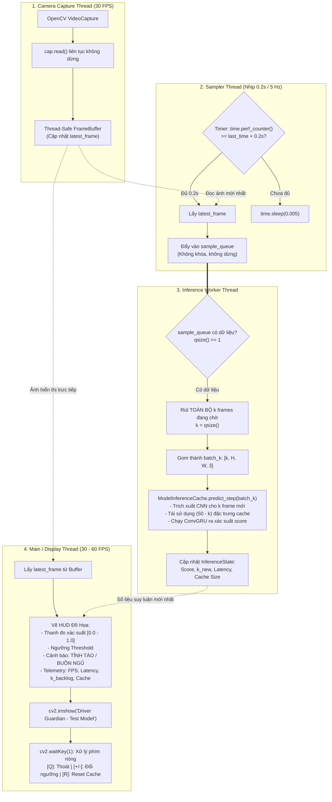
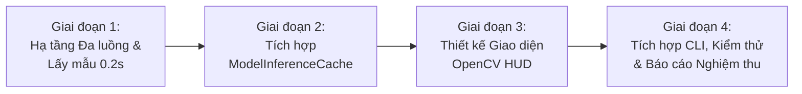

# KẾ HOẠCH TRIỂN KHAI: XÂY DỰNG TEST_MODEL.PY CHẠY SUY LUẬN CAMERA REAL-TIME VỚI MODELINFERENCECACHE VÀ HÀNG ĐỢI LẤY MẪU BẤT ĐỒNG BỘ 0.2S

- **Mã kế hoạch**: `PLAN_REALTIME_CAMERA_TEST_MODEL`
- **Tệp kế hoạch**: `docs/plan/plan_test_model.md`
- **Dựa trên tài liệu phân tích**: [docs/analsys/analsys_test_model.md](file:///D:/Project/DATN/driver-guardian/ai/LSTM/docs/analsys/analsys_test_model.md)
- **Tệp mã nguồn mục tiêu**: [`test_model.py`](file:///D:/Project/DATN/driver-guardian/ai/LSTM/test_model.py)
- **Tệp phụ thuộc cốt lõi**: [`model_inference_cache.py`](file:///D:/Project/DATN/driver-guardian/ai/LSTM/model_inference_cache.py)
- **Tệp tài liệu đầu ra**: `docs/report/report_test_model.md`
- **Trạng thái**: Đang chờ người dùng phê duyệt trước khi chuyển sang Bước 3 Thực hiện ([AGENTS.md](file:///D:/Project/DATN/driver-guardian/ai/LSTM/AGENTS.md)).

---

## 1. MỤC TIÊU VÀ NGUYÊN TẮC THIẾT KẾ CỐT LÕI

### 1.1. Mục tiêu trọng tâm
1. **Triển khai tệp chạy thực nghiệm [`test_model.py`](file:///D:/Project/DATN/driver-guardian/ai/LSTM/test_model.py)**:
   - Đọc trực tiếp từ camera bằng OpenCV (`cv2.VideoCapture`), linh hoạt hỗ trợ webcam thiết bị (index 0, 1) hoặc đường dẫn file video/RTSP cho mục đích kiểm thử.
   - Sử dụng mô hình tối ưu `ModelInferenceCache` từ [`model_inference_cache.py`](file:///D:/Project/DATN/driver-guardian/ai/LSTM/model_inference_cache.py) với kích thước cửa sổ trượt `window_size = 50` khung hình ($10\,\text{s}$).
2. **Cơ chế lấy mẫu định kỳ 0.2s vào hàng chờ liên tục (Non-blocking Sampling Queue)**:
   - Tần số lấy mẫu: $T_{\text{sample}} = 0.2\,\text{giây}$ ($5\,\text{Hz}$).
   - Tách biệt hoàn toàn luồng đọc camera (30 FPS), luồng lấy mẫu (5 FPS) và luồng suy luận mô hình.
   - Nếu mô hình suy luận xử lý không kịp (độ trễ $> 0.2\,\text{s}$), luồng lấy mẫu **vẫn tiếp tục lấy mẫu định kỳ vào hàng đợi mà không bị chặn (non-blocking)**.
3. **Cơ chế xử lý thích ứng cụm $k$ frames mới dồn trong hàng chờ**:
   - Khi mô hình hoàn tất bước trước, worker sẽ rút toàn bộ $k$ frames mới đang tích lũy trong hàng chờ ($k \ge 1$).
   - Nạp cụm $k$ frames vào `model.predict_step(batch_k, return_details=True)`: Chỉ chạy CNN cho đúng $k$ frame mới, tái sử dụng $50 - k$ đặc trưng cũ từ cache, đảm bảo không mất frame và tức thời bắt kịp thời gian thực.
4. **Giao diện đồ họa OpenCV HUD trực quan, mượt mà**:
   - Luồng hiển thị chính không bị phụ thuộc vào thời gian suy luận (hiển thị mượt mà $30 - 60\,\text{FPS}$).
   - Hiển thị trực quan: Ngưỡng quyết định (Threshold), Điểm xác suất ngủ gật (Drowsiness Probability $[0.0, 1.0]$), Thanh đo tiến trình (Progress Bar), Nhãn trạng thái cảnh báo phân màu (Xanh: Alert, Vàng: Warning/Warmup, Đỏ: Drowsy Alert).
   - Bảng chỉ số kỹ thuật: Camera FPS, Inference FPS, Latency (ms), Cache status ($N/50$), Queue backlog ($k$ new frames).
5. **Tương tác phím nóng tiện lợi**:
   - Thoát an toàn (`Q` / `ESC`), tăng giảm ngưỡng (`+` / `-`), reset cache (`R`), tạm dừng/tiếp tục (`SPACE`).

### 1.2. Nguyên tắc thiết kế kỹ thuật (Tuân thủ AGENTS.md)
- **Độc lập và An toàn luồng (Thread-safety)**: Sử dụng các cấu trúc dữ liệu thread-safe (`queue.Queue`, `threading.Lock`, `threading.Event`) để tránh triệt để race conditions và memory leaks.
- **Tương thích đa nền tảng**: Xử lý đường dẫn bằng `pathlib.Path`, tương thích Windows/Linux.
- **Xử lý ngoại lệ toàn diện (Robust Exception Handling)**: Bắt lỗi khi không mở được camera, tự động thử các backend camera phù hợp (`cv2.CAP_DSHOW` trên Windows), giải phóng tài nguyên mượt mà khi người dùng dừng chương trình.
- **Clean Code & Type Hints**: Đầy đủ type annotations và Google-style docstrings.

---

## 2. KIẾN TRÚC ĐA LUỒNG CHI TIẾT (THREAD PIPELINE ARCHITECTURE)

Hệ thống được tổ chức thành 4 thành phần chạy song song độc lập:



---

## 3. THIẾT KẾ CẤU TRÚC MÃ NGUỒN `TEST_MODEL.PY`

```text
test_model.py
│
├── 1. Imports, Platform Encoding & Module Paths
├── 2. Lớp cấu hình & Phân tích tham số dòng lệnh (parse_args)
├── 3. Lớp Thread-Safe SharedState & InferenceResult (Chứa kết quả suy luận chia sẻ)
├── 4. Lớp CameraReader (Thread chụp camera liên tục, loại bỏ hoàn toàn đọng frame)
├── 5. Lớp FrameSampler (Thread lấy mẫu chu kỳ 0.2s không chặn vào queue)
├── 6. Lớp InferenceWorker (Thread tiêu thụ k frame từ queue & nạp ModelInferenceCache)
├── 7. Lớp HUDVisualizer (Bộ vẽ giao diện OpenCV HUD chuyên nghiệp):
│      ├── _draw_header_banner()
│      ├── _draw_status_card() (ALERT / DROWSY / WARMUP)
│      ├── _draw_probability_bar() (Thanh đo trực quan kèm vạch ngưỡng)
│      ├── _draw_telemetry_panel() (FPS, Latency, Cache, Queue)
│      └── _draw_hotkey_help()
└── 8. Hàm main() & Quản lý vòng đời (Lifecycle: Startup -> Run Loop -> Graceful Shutdown)
```

---

## 4. LỘ TRÌNH TRIỂN KHAI 4 GIAI ĐOẠN (DETAILED WORKFLOW)



### Giai đoạn 1: Xây dựng Hạ tầng Đa luồng & Hàng đợi Lấy mẫu Bất đồng bộ 0.2s
- **Nhiệm vụ 1.1**: Khởi tạo cấu trúc luồng `CameraReader` đọc `cv2.VideoCapture` liên tục ở $30\,\text{FPS}$. Hỗ trợ mở webcam mặc định (thử `cv2.CAP_DSHOW` trên Windows để khởi động nhanh) hoặc fallback tệp video.
- **Nhiệm vụ 1.2**: Triển khai `FrameSampler` dùng `time.perf_counter()`. Mỗi $0.2\,\text{s}$ trích xuất frame mới nhất từ `CameraReader` và `put()` vào `sample_queue` (Thread-safe Queue).
- **Nhiệm vụ 1.3**: Xây dựng cơ chế hàng đợi không chặn: nếu consumer chưa lấy, queue sẽ tiếp tục chứa các frame mới theo đúng chuỗi thời gian, kèm cờ thông báo số lượng dồn ứ ($k$).

### Giai đoạn 2: Tích hợp `ModelInferenceCache` và Xử lý Thích ứng Cụm $k$ Frame
- **Nhiệm vụ 2.1**: Tự động tìm kiếm và nạp checkpoint mặc định của hệ thống:
  - CNN Backbone/Neck: `checkpoints/model_cnn/best.pt`
  - ConvGRU Classifier: `checkpoints/model_convgru/best.pt` (hoặc `checkpoints/1m9/best.pt`)
  - Tự động nhận diện thiết bị GPU CUDA hoặc CPU.
- **Nhiệm vụ 2.2**: Khởi tạo mô hình `ModelInferenceCache(window_size=50, chunk_size=32, enable_cache=True, warmup_mode='dynamic')`.
- **Nhiệm vụ 2.3**: Xây dựng `InferenceWorker`:
  - Kiểm tra `sample_queue`: Khi có frame mới, rút toàn bộ $k$ frames hiện có trong queue (`k = queue.qsize()`).
  - Xếp thành khối numpy `[k, H, W, 3]`.
  - Gọi `model.predict_step(batch_k, return_details=True)`.
  - Đo đạc chính xác thời gian suy luận (latency ms) và cập nhật kết quả vào `SharedState`.

### Giai đoạn 3: Thiết kế Giao diện Đồ họa OpenCV HUD Trực Quan
- **Nhiệm vụ 3.1**: Thiết kế bảng màu và phong cách đồ họa chuyên nghiệp (HUD phong cách buồng lái thông minh):
  - Màu xanh lục `#00FF00` (Tỉnh táo / An toàn).
  - Màu vàng cam `#00D7FF` (Cảnh báo chú ý / Đang warmup nạp cache).
  - Màu đỏ tươi `#0000FF` (Cảnh báo buồn ngủ nguy hiểm).
- **Nhiệm vụ 3.2**: Vẽ thẻ trạng thái tài xế (Driver Status Card): Hiển thị to, rõ ràng trạng thái `ALERT` hoặc `DROWSY` kèm viền đỏ nhấp nháy cảnh báo khi phát hiện nguy cơ.
- **Nhiệm vụ 3.3**: Vẽ thanh đo xác suất (Confidence Progress Bar):
  - Hiển thị tỷ lệ phần trăm $[0\% - 100\%]$.
  - Vẽ vạch phân cách trực quan tại vị trí ngưỡng (Threshold Marker).
- **Nhiệm vụ 3.4**: Vẽ bảng thông số vận hành (Telemetry Panel):
  - `Cam FPS` (thực tế từ camera).
  - `Sampling Rate`: $0.20\,\text{s}$ ($5.0\,\text{Hz}$).
  - `Infer Latency`: Độ trễ tính toán từng bước ($ms$).
  - `Cache Size`: Số frame hiện có trong cửa sổ trượt (ví dụ: `50/50 [FULL]`).
  - `Queue Backlog (k)`: Số frame mới được xử lý ở bước này (ví dụ: `k = 1 [Optimal]` hoặc `k = 3 [Burst]`).
  - `Threshold`: Ngưỡng quyết định (ví dụ: `0.50`).

### Giai đoạn 4: Hoàn thiện CLI, Xử lý Tương tác, Kiểm thử & Xuất Báo cáo
- **Nhiệm vụ 4.1**: Tích hợp các tùy chọn dòng lệnh đầy đủ qua `argparse` (`--source`, `--threshold`, `--window-size`, `--sample-interval`, `--cnn-path`, `--convgru-path`, `--device`, v.v.).
- **Nhiệm vụ 4.2**: Xử lý bắt phím nóng trong luồng giao diện (`cv2.waitKey(1)`):
  - `Q` / `ESC`: Thoát an toàn.
  - `+` / `-`: Tăng / giảm ngưỡng phân loại theo bước $0.05$.
  - `R`: Reset cache (`model.reset_cache()`).
  - `SPACE`: Tạm dừng / tiếp tục stream.
- **Nhiệm vụ 4.3**: Kiểm thử thực tế:
  - Kiểm thử với camera hoặc video kiểm thử có sẵn trong thư mục.
  - Kiểm thử khả năng chịu tải khi model xử lý chậm và chứng minh hàng đợi vẫn nhận mẫu liên tục, không làm đứng chương trình.
- **Nhiệm vụ 4.4**: Tạo tệp báo cáo tổng kết nghiệm thu `docs/report/report_test_model.md`.

---

## 5. MA TRẬN KIỂM THỬ VÀ TIÊU CHÍ NGHIỆM THU (TEST MATRIX & CRITERIA)

| Mã kiểm thử | Tên kịch bản | Thao tác thực hiện | Tiêu chí đạt chuẩn |
| :---: | :--- | :--- | :--- |
| **TC-01** | **Khởi động và nạp Model** | Khởi chạy script với checkpoint mặc định | `ModelInferenceCache` khởi tạo thành công trên GPU/CPU, VRAM ổn định, không lỗi import. |
| **TC-02** | **Nguồn Camera / Video** | Mở webcam thiết bị (hoặc fallback video MP4 có sẵn) | Khung hình mở mượt mà, FPS camera đạt chuẩn ($30\,\text{FPS}$), không bị đọng trễ hình. |
| **TC-03** | **Chu kỳ lấy mẫu 0.2s** | Theo dõi số frame nạp vào queue theo thời gian | Trung bình cứ mỗi $0.2\,\text{s}$ ($\pm 0.02\,\text{s}$) có 1 frame được trích xuất đẩy vào hàng đợi. |
| **TC-04** | **Hàng đợi không chặn khi trễ** | Giả lập bước suy luận tốn $0.4\,\text{s}$ | Luồng lấy mẫu vẫn hoạt động liên tục; hàng đợi tích lũy $k = 2$ frame; lượt suy luận tiếp theo xử lý trọn vẹn cụm 2 frame này. |
| **TC-05** | **Hiển thị trực quan HUD** | Quan sát cửa sổ OpenCV | Đầy đủ thanh đo xác suất, ngưỡng threshold, bảng chỉ số Telemetry và nhãn trạng thái cảnh báo rõ ràng. |
| **TC-06** | **Tương tác phím nóng** | Bấm `+`, `-`, `R`, `Q` | Ngưỡng thay đổi tức thì trên màn hình; bấm `R` cache xóa về 0; bấm `Q` tắt an toàn không treo máy. |
| **TC-07** | **Giải phóng tài nguyên** | Thoát ứng dụng | Các thread dừng hoàn toàn, camera được giải phóng (`cap.release()`), hủy toàn bộ cửa sổ (`destroyAllWindows()`). |

---

## 6. HÀNH ĐỘNG TIẾP THEO

Theo đúng quy trình 5 bước trong **`AGENTS.md`**:
- Kế hoạch chi tiết đã được lập tại tệp: `docs/plan/plan_test_model.md`.
- Khi người dùng xem xét và xác nhận **đồng ý / phê duyệt kế hoạch**, Agent sẽ lập tức tiến hành **Bước 3: Thực hiện kế hoạch** (viết mã nguồn [`test_model.py`](file:///D:/Project/DATN/driver-guardian/ai/LSTM/test_model.py), kiểm thử thực thi và xuất báo cáo `docs/report/report_test_model.md`).
