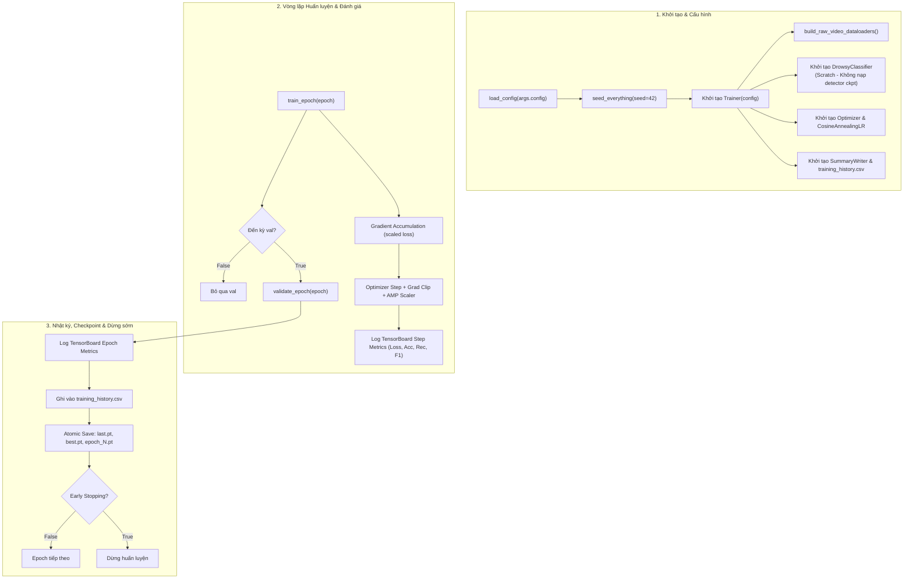

# KẾ HOẠCH TRIỂN KHAI: XÂY DỰNG SCRIPT HUẤN LUYỆN END-TO-END DROWSYCLASSIFIER (SRC/TRAIN1.PY)

- **Mã kế hoạch**: `PLAN_TRAIN1_DROWSY_CLASSIFIER`
- **Tệp kế hoạch**: `docs/plan/plan_train1.md`
- **Dựa trên tài liệu phân tích**: [`docs/analsys/analsys_train1.md`](file:///D:/Project/DATN/driver-guardian/ai/LSTM/docs/analsys/analsys_train1.md)
- **Tệp mã nguồn mục tiêu**: [`src/train1.py`](file:///D:/Project/DATN/driver-guardian/ai/LSTM/src/train1.py)
- **Tệp báo cáo nghiệm thu đầu ra**: `docs/report/report_train1.md`
- **Quy chuẩn áp dụng**: [`AGENTS.md`](file:///D:/Project/DATN/driver-guardian/ai/LSTM/AGENTS.md) — **Bước 2: Lên kế hoạch thực hiện**
- **Trạng thái**: Đang chờ người dùng phê duyệt trước khi chuyển sang Bước 3 Thực hiện.

---

## 1. MỤC TIÊU VÀ NGUYÊN TẮC THIẾT KẾ CỐT LÕI

### 1.1. Mục tiêu trọng tâm
Xây dựng tệp script Python độc lập, chuẩn mực [`src/train1.py`](file:///D:/Project/DATN/driver-guardian/ai/LSTM/src/train1.py) để thực thi pipeline huấn luyện mô hình End-to-End [`DrowsyClassifier`](file:///D:/Project/DATN/driver-guardian/ai/LSTM/src/models1.py#L18-L178), đảm bảo:
1. **Đồng bộ 100% tính năng với [`src/train.py`](file:///D:/Project/DATN/driver-guardian/ai/LSTM/src/train.py)**: Toàn bộ cơ chế ghi nhật ký TensorBoard, file CSV `training_history.csv`, thanh tiến trình `tqdm`, quản lý checkpoint nguyên tử (Atomic Save: `last.pt`, `best.pt`, `epoch_{N}.pt`, `ckpt_keep_last`), phục hồi hoàn chỉnh (Resumable Training bao gồm cả AMP `GradScaler`), cơ chế bắt lỗi và dọn dẹp CUDA OOM an toàn, và bộ giám sát dừng sớm `EarlyStopping`.
2. **Chuyên biệt hóa cho kiến trúc End-to-End**: Mô hình `DrowsyClassifier` nhận trực tiếp tensor chuỗi video raw `[B, T, 3, H, W]` từ `DataLoader`, lan truyền gradient xuyên suốt qua toàn bộ mạng.
3. **Tuân thủ chỉ đạo của người dùng**: **Khởi tạo và huấn luyện thuần túy từ đầu (Train from scratch)**, loại bỏ hoàn toàn cơ chế nạp trọng số Backbone/Neck từ detector 2.6M (`backbone_neck_checkpoint`). Checkpoint chỉ được nạp khi có yêu cầu tiếp tục huấn luyện (`--resume`).

### 1.2. Các nguyên tắc thiết kế kỹ thuật bắt buộc
- **Tính độc lập & Loại bỏ Module thừa**: Không khởi tạo `ChunkedBackboneNeckExtractor` trong pipeline.
- **Tối ưu hóa VRAM**: Kích hoạt cờ `gradient_checkpointing=True` khi khởi tạo `DrowsyClassifier` để giảm 50-60% dung lượng VRAM khi huấn luyện chuỗi video trên GPU.
- **Atomic File Writing**: Tất cả thao tác ghi checkpoint phải ghi ra tệp `.tmp` trước khi `rename` sang `.pt` để chống hỏng tệp khi tiến trình bị ngắt đột ngột.
- **Clean Code & Type Hints**: Đầy đủ chú thích kiểu dữ liệu (Type hints), Docstrings tiếng Việt chuẩn mực, tuân thủ cấu trúc lập trình hướng đối tượng gọn gàng.

---

## 2. THIẾT KẾ CHI TIẾT CÁC MODULE TRONG `SRC/TRAIN1.PY`

### Chi tiết các khối hàm và lớp:

| Khối chức năng | Tên hàm / Lớp | Mô tả kỹ thuật chi tiết |
| :--- | :--- | :--- |
| **Cố định Seed** | `seed_everything(seed: int = 42)` | Cố định `random`, `os.environ['PYTHONHASHSEED']`, `np.random`, `torch.manual_seed`, `torch.cuda.manual_seed_all`, bật `cudnn.deterministic = True`, tắt `cudnn.benchmark`. |
| **Đánh giá Chỉ số** | `calculate_metrics(preds, targets)` | Tính `acc`, `recall` (macro, zero_division=0), `f1` (macro, zero_division=0) an toàn qua `sklearn.metrics`. Trả về `Dict[str, float]`. |
| **Dừng sớm** | `class EarlyStopping` | Theo dõi `val_f1` (hoặc cấu hình), cơ chế `patience`, `min_delta`, `mode='max'`, lưu vết `best_score` và `best_epoch`. |
| **Khởi tạo Trainer** | `Trainer.__init__(config)` | Thiết lập thiết bị CUDA/CPU; khởi tạo `build_raw_video_dataloaders`; khởi tạo `DrowsyClassifier` với `gradient_checkpointing=True`; khởi tạo Loss (`CrossEntropyLoss` / `BCEWithLogitsLoss`), Optimizer (AdamW / SGD), CosineAnnealingLR; khởi tạo `SummaryWriter`, thư mục checkpoint, `GradScaler` và `training_history.csv`. |
| **Tính Loss & Preds** | `compute_loss_and_preds(logits, labels)` | Tự động chuẩn hóa: Hỗ trợ Binary 1-logit (`BCEWithLogitsLoss`) và Multi-class 2-class (`CrossEntropyLoss`). Triệt tiêu hoàn toàn nguy cơ mất gradient. |
| **Huấn luyện Epoch** | `train_epoch(epoch: int)` | Forward trực tiếp qua `DrowsyClassifier(frames_t, seq_lens=seq_lens)`; tích lũy gradient `gradient_accumulation_steps`; cắt chuẩn gradient `grad_clip_norm`; ghi log step lên TensorBoard; bắt ngoại lệ CUDA OOM và dọn dẹp bộ nhớ an toàn. |
| **Kiểm định Epoch** | `validate_epoch(epoch: int)` | `@torch.no_grad()`, `model.eval()`; forward qua `DrowsyClassifier`; tính toán Loss, Acc, Recall, Macro F1; bắt ngoại lệ CUDA OOM. |
| **Quản lý Checkpoint** | `save_checkpoint(epoch, is_best, val_f1)` | Lưu file nguyên tử `_atomic_save` (`.tmp` -> rename); luôn lưu `last.pt`; lưu `best.pt` khi đạt F1 kỷ lục; lưu `epoch_{N}.pt` theo chu kỳ; xoay vòng `ckpt_keep_last`. |
| **Khôi phục Huấn luyện** | `load_checkpoint(checkpoint_path)` | Phân giải bí danh `'last'`, `'best'`; nạp `model_state_dict`, `optimizer_state_dict`, `scheduler_state_dict`, `scaler_state_dict` (Resumable AMP), `epoch`, `global_step`, `best_val_f1`. |
| **Nhật ký CSV** | `_init_history_csv` & `_log_history_csv` | Ghi bảng 11 cột: `epoch, train_loss, train_acc, train_recall, train_f1, val_loss, val_acc, val_recall, val_f1, lr, time_sec`. |
| **Điều phối Huấn luyện** | `train()` | Vòng lặp các epoch từ `start_epoch` đến `epochs`; điều phối train, validation, log TensorBoard, ghi file CSV, kiểm tra EarlyStopping, lưu checkpoint, dọn dẹp cache định kỳ. |
| **Điểm khởi chạy CLI** | `main()` | Hỗ trợ tham số dòng lệnh `--config` và `--resume`. Nạp cấu hình qua `load_config`, cố định seed và thực thi `Trainer`. |

---

## 3. LỘ TRÌNH THỰC HIỆN CHI TIẾT (WORKFLOW 3 GIAI ĐOẠN)

### Chi tiết từng giai đoạn:

#### Giai đoạn 1: Triển khai Mã nguồn [`src/train1.py`](file:///D:/Project/DATN/driver-guardian/ai/LSTM/src/train1.py)
- Sử dụng công cụ tạo file để viết mã nguồn hoàn chỉnh [`src/train1.py`](file:///D:/Project/DATN/driver-guardian/ai/LSTM/src/train1.py).
- Đảm bảo đầy đủ tất cả các thành phần theo thiết kế chi tiết ở Mục 2.
- Tuyệt đối không chứa bất kỳ logic nạp checkpoint detector 2.6M nào.

#### Giai đoạn 2: Kiểm thử Thực nghiệm Tự lập (Empirical Self-Verification)
Chạy script kiểm thử thực tế trực tiếp trên môi trường Windows PowerShell với Python:
1. **Kiểm thử cú pháp & Import**: Xác nhận `src/train1.py` import thành công mà không phát sinh lỗi biên dịch (`python -m py_compile src/train1.py`).
2. **Kiểm thử Khởi tạo & Luồng dữ liệu (Dry-run Smoke Test)**:
   - Khởi tạo `Trainer` với cấu hình test tối giản (`batch_size=2`, `seq_len=4`, `image_size=(224, 224)`).
   - Kiểm tra `model = DrowsyClassifier` khởi tạo thành công với đúng số lượng tham số (~3.3M tham số).
   - Kiểm tra forward pass 1 batch giả lập `[2, 4, 3, 224, 224]`, tính loss và backward pass thành công với AMP.
   - Kiểm tra cơ chế `save_checkpoint` và `load_checkpoint` hoạt động trơn tru với atomic rename.

#### Giai đoạn 3: Lập Báo cáo Nghiệm thu [`docs/report/report_train1.md`](file:///D:/Project/DATN/driver-guardian/ai/LSTM/docs/report/report_train1.md)
- Tổng hợp toàn bộ kết quả thực hiện, đối chiếu 100% với các tiêu chí chất lượng của `AGENTS.md`.
- Trình bày kết quả kiểm thử thực nghiệm và hướng dẫn lệnh chạy cho người dùng.

---

## 4. TIÊU CHÍ ĐÁNH GIÁ VÀ NGHIỆM THU (ACCEPTANCE CRITERIA)

- [ ] File [`src/train1.py`](file:///D:/Project/DATN/driver-guardian/ai/LSTM/src/train1.py) được tạo mới và tuân thủ chuẩn Clean Code, Type Hints và Docstrings.
- [ ] Mô hình `DrowsyClassifier` được khởi tạo và huấn luyện từ đầu (Scratch), hoàn toàn không chứa cơ chế nạp trọng số detector 2.6M.
- [ ] TensorBoard logging, CSV history logging và tqdm hiển thị đầy đủ, đồng bộ 100% với `src/train.py`.
- [ ] Quản lý checkpoint nguyên tử và Resumable Training hoạt động ổn định.
- [ ] Cơ chế bắt lỗi OOM và EarlyStopping được tích hợp đầy đủ.
- [ ] Vượt qua 100% các bài kiểm thử xác thực cú pháp và luồng chạy.

---

## 5. ĐỀ XUẤT CHUYỂN BƯỚC

Kính đề nghị người dùng xem xét kế hoạch triển khai trên. Khi nhận được xác nhận chấp thuận từ người dùng, Agent sẽ lập tức tiến hành **Bước 3: Thực hiện kế hoạch** (Viết mã nguồn `src/train1.py`, chạy kiểm thử thực tế và lập báo cáo `docs/report/report_train1.md`).
