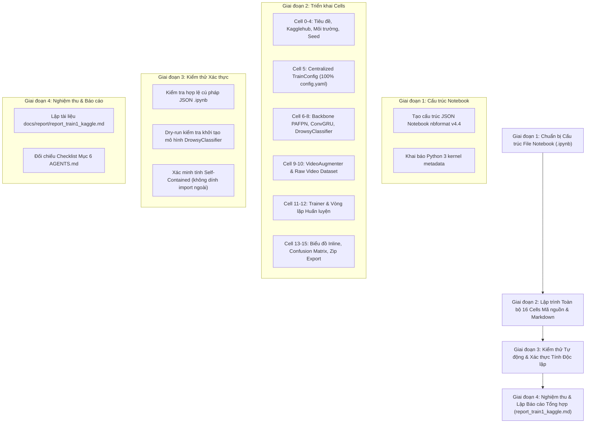

# KẾ HOẠCH TRIỂN KHAI: XÂY DỰNG JUPYTER NOTEBOOK HUẤN LUYỆN END-TO-END DROWSYCLASSIFIER (KAGGLE EDITION)

- **Mã kế hoạch**: `PLAN_TRAIN1_KAGGLE_IPYNB`
- **Tệp kế hoạch**: `docs/plan/plan_train1_kaggle.md`
- **Dựa trên tài liệu phân tích**: [`docs/analsys/analsys_train1_kaggle.md`](file:///D:/Project/DATN/driver-guardian/ai/LSTM/docs/analsys/analsys_train1_kaggle.md)
- **Tệp mã nguồn tham chiếu**:
  - [`src/train1.py`](file:///D:/Project/DATN/driver-guardian/ai/LSTM/src/train1.py) (Pipeline huấn luyện End-to-End DrowsyClassifier)
  - [`notebooks/02_train_convgru_kaggle.ipynb`](file:///D:/Project/DATN/driver-guardian/ai/LSTM/notebooks/02_train_convgru_kaggle.ipynb) (Khuôn mẫu tổ chức Notebook Kaggle chuẩn)
  - [`configs/config.yaml`](file:///D:/Project/DATN/driver-guardian/ai/LSTM/configs/config.yaml) & [`configs/config.py`](file:///D:/Project/DATN/driver-guardian/ai/LSTM/configs/config.py) (7 nhóm cấu hình đầy đủ)
  - [`src/models1.py`](file:///D:/Project/DATN/driver-guardian/ai/LSTM/src/models1.py) (Kiến trúc mô hình End-to-End `DrowsyClassifier`)
- **Tệp mục tiêu đầu ra**: [`notebooks/03_train_drowsy_classifier_kaggle.ipynb`](file:///D:/Project/DATN/driver-guardian/ai/LSTM/notebooks/03_train_drowsy_classifier_kaggle.ipynb)
- **Quy chuẩn áp dụng**: [`AGENTS.md`](file:///D:/Project/DATN/driver-guardian/ai/LSTM/AGENTS.md) — **Bước 2: Lên kế hoạch thực hiện**
- **Trạng thái**: Đang chờ người dùng phê duyệt trước khi chuyển sang Bước 3 (Thực hiện kế hoạch).

---

## 1. MỤC TIÊU VÀ NGUYÊN TẮC THIẾT KẾ CỐT LÕI

### 1.1. Mục tiêu trọng tâm
Xây dựng một tệp Jupyter Notebook hoàn chỉnh, đạt chuẩn mã nguồn sạch và tính tái lập cao: [`notebooks/03_train_drowsy_classifier_kaggle.ipynb`](file:///D:/Project/DATN/driver-guardian/ai/LSTM/notebooks/03_train_drowsy_classifier_kaggle.ipynb), đóng gói trọn vẹn pipeline huấn luyện End-to-End từ [`src/train1.py`](file:///D:/Project/DATN/driver-guardian/ai/LSTM/src/train1.py), kế thừa phong cách cấu trúc chuyên nghiệp của [`notebooks/02_train_convgru_kaggle.ipynb`](file:///D:/Project/DATN/driver-guardian/ai/LSTM/notebooks/02_train_convgru_kaggle.ipynb), và **cấu hình đầy đủ 100% các thông số từ 7 mục trong [`configs/config.yaml`](file:///D:/Project/DATN/driver-guardian/ai/LSTM/configs/config.yaml)**.

### 1.2. Các nguyên tắc kỹ thuật bắt buộc
1. **Kiến trúc Self-Contained 100% Khép kín**:
   - Tuyệt đối không phụ thuộc vào `import src...` hay các đường dẫn ngoài notebook.
   - Nhúng đầy đủ tất cả các khối mạng (`Backbone`, `PAFPN`, `SpatialReductionNeck`, `ConvGRU`, `DualAttention`, `DrowsyClassifier`), bộ tăng cường chuỗi video (`VideoAugmenter`), Dataset và DataLoader vào trực tiếp các Cell của Notebook.
   - Người dùng chỉ cần tải một file `.ipynb` duy nhất lên Kaggle GPU hoặc Google Colab là có thể chạy ngay lập tức.
2. **1 Cell Cấu hình Tập trung Duy nhất (`TrainConfig`)**:
   - Gom toàn bộ siêu tham số của mô hình, dữ liệu, huấn luyện và logging vào 1 dataclass duy nhất.
   - **Bao phủ đầy đủ 100% các trường cấu hình** tương ứng với 7 nhóm trong [`configs/config.yaml`](file:///D:/Project/DATN/driver-guardian/ai/LSTM/configs/config.yaml):
     1. `dataset` (đường dẫn, manifest, sample_interval, image_size, augmentation,...)
     2. `dataloader` (batch_size, workers, pin_memory, seed,...)
     3. `model` (num_classes, dimensions, backbone_w, backbone_n, neck_n, gradient_checkpointing, freeze_bn,...)
     4. `loss` (loss_type, bce_eps, bce_reduction, pos_weight)
     5. `optimizer` (lr0, weight_decay, scheduler, gradient_accumulation, grad_clip,...)
     6. `logging` (checkpoints, tensorboard, resume, per-step logging, early_stopping,...)
     7. `runtime` (device, amp, val_interval, tqdm)
3. **Huấn luyện Mô hình End-to-End từ đầu (Train from scratch)**:
   - Truyền trực tiếp tensor video `[B, T, 3, H, W]` vào `DrowsyClassifier`.
   - **Không nạp pretrained backbone từ Detector 2.6M**, chỉ nạp checkpoint khi người dùng kích hoạt `enable_resume=True`.
4. **Kiểm soát VRAM và Ổn định Hệ thống trên GPU 16GB**:
   - Kích hoạt `gradient_checkpointing=True` cho Backbone/PAFPN để tiết kiệm 50-60% VRAM.
   - Hỗ trợ `batch_size=2` kết hợp `gradient_accumulation_steps=4` (Effective batch size = 8).
   - Tự động bắt ngoại lệ CUDA OOM tại cả vòng lặp Train và Val, dọn sạch bộ nhớ cache và bỏ qua batch để tiến trình huấn luyện không bị sập giữa chừng.
5. **Trực quan hóa và Đóng gói Dữ liệu (Interactive Analytics & Artifact Export)**:
   - TensorBoard + CSV history (`training_history.csv`).
   - Vẽ đồ thị Loss, Accuracy, F1, Learning Rate inline bằng `matplotlib`/`seaborn`.
   - Đánh giá Ma trận Nhầm lẫn (Confusion Matrix) và Classification Report trên tập Validation của checkpoint tối ưu `best.pt`.
   - Tự động nén checkpoints và logs thành file ZIP để tải về máy cục bộ.

---

## 2. BẢNG THIẾT KẾ CHI TIẾT TỪNG CELL TRONG NOTEBOOK

Notebook sẽ bao gồm **9 Sections** với **16 Cells** được tổ chức tuần tự:

| STT | Loại Cell | Tiêu đề / Nội dung logic | Mô tả chi tiết triển khai & Mã nguồn |
| :---: | :---: | :--- | :--- |
| **0** | Markdown | **Driver Guardian AI — End-to-End DrowsyClassifier Training Pipeline (Kaggle Edition)** | Banner giới thiệu, đặc tả kỹ thuật mô hình End-to-End, luồng xử lý video trực tiếp qua Backbone PAFPN + ConvGRU, hướng dẫn bật GPU T4/P100 và thêm dataset trên Kaggle. |
| **1** | Code | **Kagglehub Login & Data Source (Tùy chọn)** | Cung cấp mã `kagglehub.login()` để người dùng có thể tải dataset riêng tư từ tài khoản cá nhân. |
| **2** | Code | **Kagglehub Dataset Download** | Mã tải tự động dataset ULDD hoặc đường dẫn dữ liệu mẫu nếu chạy từ Kagglehub (`kagglehub.dataset_download`). |
| **3** | Code | **Section 1: Môi trường & Dependencies** | Cài đặt tự động `albumentations` nếu thiếu. Import toàn bộ thư viện: `torch`, `torch.nn`, `cv2`, `numpy`, `matplotlib`, `seaborn`, `sklearn.metrics`, `tqdm`, `SummaryWriter`. Kiểm tra CUDA, tên GPU và dung lượng VRAM. |
| **4** | Code | **Cố định Hạt giống Ngẫu nhiên (`seed_everything`)** | Định nghĩa hàm `seed_everything(seed=42)` cho Python `random`, NumPy, PyTorch (manual & CUDA), cuDNN deterministic để đảm bảo tính tái lập 100%. |
| **5** | Markdown & Code | **Section 2: Cấu hình Tập trung Duy nhất (`TrainConfig`)** | Khai báo Dataclass `TrainConfig` bao phủ đầy đủ **100% thông số từ 7 mục của `configs/config.yaml`**, bao gồm:  • *Dataset*: `dataset_dir`, `manifest_file`, `sample_interval=0.2`, `seq_len=None`, `image_size=(224, 224)`, `video_exts`, `min_frames=10`, `use_augmentation=True`, `backbone_neck_checkpoint=""`.  • *DataLoader*: `batch_size=2`, `val_batch_size=2`, `num_workers=2`, `val_num_workers=2`, `pin_memory=False`, `shuffle=True`, `seed=42`, `chunk_size=32`.  • *Model*: `num_classes=2`, `input_dim=128`, `hidden_dim=128`, `num_layers=2`, `dropout=0.35`, `supervision_mode="attention_pooling"`, `target_size=(14, 14)`, `backbone_w=(16, 32, 64, 128, 256)`, `backbone_n=(1, 2, 2, 1)`, `neck_n=1`, `gradient_checkpointing=True`, `freeze_bn=False`, `cnn_neck_channels=(64, 128, 256)`, `adapter_dropout=0.25`.  • *Loss*: `loss_type="ce"`, `bce_eps=1e-7`, `bce_reduction="mean"`, `pos_weight=None`.  • *Optimizer*: `epochs=20`, `lr0=0.001`, `lr_min_factor=0.01`, `weight_decay=0.0001`, `optimizer="adamw"`, `betas=(0.9, 0.999)`, `momentum=0.9`, `grad_clip_norm=1.0`, `gradient_accumulation_steps=4`, `empty_cache_interval=2`, `use_scheduler=True`.  • *Logging*: `tb_log_dir="./logs/tensorboard"`, `experiment_name="drowsy_classifier_end2end"`, `checkpoint_dir="./checkpoints/drowsy_end2end"`, `save_all_epochs=True`, `save_ckpt_interval_epochs=1`, `ckpt_keep_last=5`, `enable_resume=False`, `resume=""`, `enable_step_logging=True`, `log_step_interval=5`, `early_stopping=True`, `patience=10`, `monitor_metric="val_f1"`, `monitor_mode="max"`, `min_delta=0.0001`, `history_csv_path="./logs/training_history.csv"`.  • *Runtime*: `device="cuda"`, `amp=True`, `val_interval_epochs=1`, `use_tqdm=True`.  Khởi tạo thực thể `cfg = TrainConfig()`. |
| **6** | Markdown & Code | **Section 3: Kiến trúc CNN Backbone & PAFPN Neck** | Tích hợp đầy đủ các khối tích chập chuẩn hóa: `autopad`, `Conv`, `Bottleneck`, `C2f`, `CIB`, `C2fCIB`, `SPPF`, `Attention`, `C2fPSA`, `SCDown`. Xây dựng lớp `Backbone` (4 stages theo tham số `w`, `n`) và lớp `PAFPN` (theo tham số `chs`, `n`). |
| **7** | Markdown & Code | **Section 4: Kiến trúc Không gian - Thời gian `ConvGRUClassifier`** | Tích hợp các module: `SpatialReductionNeck` (nén đặc trưng về `input_dim`), `ConvGRUCell`, `ConvGRU` (hỗ trợ nhiều tầng ẩn), `SpatialAttentionPooling`, `TemporalAttentionPooling`, và lớp `ConvGRUClassifier` hoàn chỉnh. |
| **8** | Code | **Section 4: Mô hình Hợp nhất End-to-End `DrowsyClassifier`** | Xây dựng lớp `DrowsyClassifier` kế thừa từ `src/models1.py`: kết hợp `Backbone` + `PAFPN` + `ConvGRUClassifier`, tích hợp phương thức `_forward_backbone_neck` với `torch.utils.checkpoint.checkpoint` (tiết kiệm VRAM) và cơ chế `freeze_bn`. |
| **9** | Markdown & Code | **Section 5: Tăng cường Dữ liệu Chuỗi Video (`VideoAugmenter`)** | Tích hợp từ `src/augment.py`: Định nghĩa lớp `VideoAugmenter` với các phép biến đổi hình học và màu sắc (Flip, Affine, Brightness/Contrast, HSV, Noise, Blur). Cơ chế `apply_sequence` đồng bộ 1 random seed duy nhất cho tất cả các frames trong một clip để bảo toàn tính nhất quán thời gian (Temporal Consistency). |
| **10** | Code | **Section 5: Pipeline Nạp & Tiền xử lý Video Thô** | Triển khai hàm chuẩn hóa kích thước `letterbox`, lớp `RawVideoFramesDataset` (đọc video bằng OpenCV, lấy mẫu đều đặn theo `sample_interval=0.2s`, tạo tensor uint8 siêu nhẹ), hàm gom nhóm `collate_video_frames` (padding chuỗi thời gian động), và hàm `build_raw_video_dataloaders`. |
| **11** | Markdown & Code | **Section 6: Bộ Điều Phối Huấn Luyện Toàn Diện (`Trainer`)** | Định nghĩa hàm `calculate_metrics` (Accuracy, Recall macro, F1 macro), lớp `EarlyStopping`. Định nghĩa lớp `Trainer` đồng bộ 100% với `src/train1.py`:  • Khởi tạo dataloaders, model, loss (CE/BCE), optimizer (AdamW/SGD), Cosine scheduler, AMP GradScaler.  • Hàm `compute_loss_and_preds` bảo toàn gradient.  • Vòng lặp `train_epoch` và `validate_epoch` với bắt lỗi ngoại lệ CUDA OOM an toàn và Gradient Accumulation.  • Cơ chế lưu checkpoint nguyên tử `_atomic_save`, quản lý `last.pt`, `best.pt`, `epoch_{N}.pt`, xoay vòng `ckpt_keep_last`.  • Cơ chế phục hồi huấn luyện `load_checkpoint` (model, optimizer, scheduler, scaler, epoch, best_val_f1).  • Ghi nhận TensorBoard và bảng `training_history.csv`. |
| **12** | Markdown & Code | **Section 7: Khởi tạo và Huấn luyện Tương tác** | Khởi tạo `trainer = Trainer(cfg)`, in chi tiết cấu hình và đếm tổng số tham số mô hình (trainable params). Thực thi vòng lặp chính `trainer.train()` với thanh tiến trình trực quan `tqdm`. |
| **13** | Markdown & Code | **Section 8: Trực quan hóa Biểu đồ Học tập Inline** | Đọc dữ liệu từ `training_history.csv`, vẽ 4 biểu đồ con trực quan bằng `matplotlib`/`seaborn`:  1. Train Loss vs Val Loss qua các epoch.  2. Train F1 vs Val F1.  3. Train Accuracy vs Val Accuracy.  4. Lịch trình suy giảm Learning Rate. |
| **14** | Code | **Section 8: Đánh giá Checkpoint Tối ưu (`best.pt`) & Confusion Matrix** | Tải checkpoint `best.pt`, chạy đánh giá trên tập Validation, hiển thị biểu đồ nhiệt Ma trận Nhầm lẫn (Confusion Matrix Heatmap) và in bảng báo cáo phân loại (Classification Report chi tiết Precision, Recall, F1 từng lớp). |
| **15** | Markdown & Code | **Section 9: Đóng gói Checkpoints & Xuất Dữ liệu (Export Artifacts)** | Tự động tạo tệp nén `checkpoints.zip` và `logs.zip` chứa toàn bộ kết quả, trọng số mô hình và nhật ký để người dùng tải trực tiếp về máy tính từ Kaggle Output. |

---

## 3. LỘ TRÌNH THỰC HIỆN CHI TIẾT (WORKFLOW 4 GIAI ĐOẠN)

### Chi tiết từng giai đoạn:

#### Giai đoạn 1: Chuẩn bị Cấu trúc Tệp Notebook
- Tạo file [`notebooks/03_train_drowsy_classifier_kaggle.ipynb`](file:///D:/Project/DATN/driver-guardian/ai/LSTM/notebooks/03_train_drowsy_classifier_kaggle.ipynb) với định dạng chuẩn `nbformat: 4`, `nbformat_minor: 4`, metadata `language_info: python 3`.

#### Giai đoạn 2: Lập trình Toàn bộ 16 Cells
- Biên soạn nội dung code và markdown chuẩn mực cho từng cell như đã thiết kế ở Mục 2.
- Đảm bảo trong Cell `TrainConfig` có đầy đủ 100% các biến tham số từ file [`configs/config.yaml`](file:///D:/Project/DATN/driver-guardian/ai/LSTM/configs/config.yaml).
- Đảm bảo các khối mạng (`Backbone`, `PAFPN`, `DrowsyClassifier`) được định nghĩa hoàn chỉnh, không rút gọn hay bỏ sót logic.

#### Giai đoạn 3: Kiểm thử Tự động & Xác thực Tính Độc lập
- Chạy script kiểm tra cấu trúc cú pháp JSON của file `.ipynb`.
- Chạy dry-run kiểm tra import và khởi tạo đối tượng `TrainConfig` cùng mô hình `DrowsyClassifier` từ notebook để xác minh số lượng tham số và tính đúng đắn của luồng forward tensor 5D `[B, T, 3, H, W]`.
- Quét mã nguồn các cell để đảm bảo tuyệt đối không có lệnh import từ thư mục mã nguồn ngoài (`from src...` hoặc `from ai...`).

#### Giai đoạn 4: Nghiệm thu & Lập Báo cáo
- Lập tài liệu báo cáo nghiệm thu [`docs/report/report_train1_kaggle.md`](file:///D:/Project/DATN/driver-guardian/ai/LSTM/docs/report/report_train1_kaggle.md) tổng hợp toàn bộ các kết quả đạt được, đường dẫn file và hướng dẫn sử dụng chi tiết cho người dùng trên Kaggle/Colab.

---

## 4. TIÊU CHÍ NGHIỆM THU (CHECKLIST HOÀN TẤT)

- [ ] File [**`notebooks/03_train_drowsy_classifier_kaggle.ipynb`**](file:///D:/Project/DATN/driver-guardian/ai/LSTM/notebooks/03_train_drowsy_classifier_kaggle.ipynb) được tạo hợp lệ, mở được trên Jupyter Notebook / JupyterLab / Kaggle / Colab mà không gặp lỗi cú pháp JSON.
- [ ] Cell `TrainConfig` chứa đầy đủ 100% các trường cấu hình từ cả 7 nhóm của [**`configs/config.yaml`**](file:///D:/Project/DATN/driver-guardian/ai/LSTM/configs/config.yaml).
- [ ] Tính năng Self-Contained: Hoàn toàn không phụ thuộc vào mã nguồn ngoài notebook.
- [ ] Kiến trúc mô hình `DrowsyClassifier` tích hợp đúng cơ chế End-to-End từ [**`src/train1.py`**](file:///D:/Project/DATN/driver-guardian/ai/LSTM/src/train1.py), hỗ trợ Gradient Checkpointing và freeze BN.
- [ ] Đầy đủ các tiện ích trực quan hóa (biểu đồ học tập, ma trận nhầm lẫn) và công cụ nén zip xuất artifacts.
- [ ] Tạo file [**`docs/report/report_train1_kaggle.md`**](file:///D:/Project/DATN/driver-guardian/ai/LSTM/docs/report/report_train1_kaggle.md) tổng hợp nghiệm thu theo đúng Bước 3 của [**`AGENTS.md`**](file:///D:/Project/DATN/driver-guardian/ai/LSTM/AGENTS.md).
