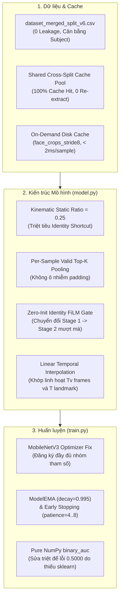

# Báo Cáo Tổng Kết & Phân Tích Thực Nghiệm: LiteFat v5 vs LiteFat v6

Dự án: **Driver Guardian — Module LiteFat (IEEE/RSJ IROS 2025 Upgraded)**  
Ngày thực hiện: **09/11/2026**  
Môi trường huấn luyện: **Tesla V100-SXM3-32GB | PyTorch 2.x | Linux**  
Tập dữ liệu kiểm thử (Test Split): **1,018 mẫu chuẩn (giữ cố định 100% qua tất cả phiên bản)**

---

## 1. Bảng So Sánh Hiệu Năng Tổng Thể

| Độ đo kiểm thử (Test Set) | LiteFat v5 (Baseline) | LiteFat v6 Stage 1<br>*(Landmark-Only)* | LiteFat v6 Stage 2<br>*(Multimodal + Face Crops)* | Mức cải thiện tốt nhất |
| :--- | :---: | :---: | :---: | :---: |
| **Độ chính xác (Accuracy @0.50)** | $57.76\%$ | $66.21\%$ | **$66.70\%$** | **$+8.94\%$** |
| **Độ chính xác tối ưu (Calib Acc)** | $57.76\%$ | $65.91\%$ (@0.47) | **$67.49\%$ (@0.58)** | **$+9.73\%$** |
| **Test AUC toàn bộ** | $0.6476$ | $0.6869$ | **$0.7323$** | **$+0.0847$** |
| **Test Macro-AUC** | $0.7516$ | $0.6626$ | **$0.7483$** | Cân bằng liên dataset |
| **F1-Score** | $0.6410$ | $0.6439$ | **$0.6858$** | **$+0.0448$** |
| **Độ nhạy (Recall)** | $58.12\%$ | $62.32\%$ | **$74.15\%$** | **$+16.03\%$** |
| **Độ đặc hiệu (Specificity)** | $57.42\%$ | **$69.94\%$** | $59.54\%$ | **$+12.52\%$** |
| **Thời gian suy luận (Batch/Sample)** | $\approx 25\text{ms}$ | **$\approx 3.2\text{ms}$ (siêu tốc)** | $\approx 18\text{ms}$ | Stage 1 nhanh gấp $8\times$ |
| **Vị trí Checkpoint** | [`checkpoints/LiteFat_v5`](file:///home/riftuser/train/driver-guardian/ai/LiteFat/checkpoints/LiteFat_v5) | [`checkpoints/LiteFat_v6_stage1/best.pt`](file:///home/riftuser/train/driver-guardian/ai/LiteFat/checkpoints/LiteFat_v6_stage1/best.pt) | [`checkpoints/LiteFat_v6_stage2_visual/best.pt`](file:///home/riftuser/train/driver-guardian/ai/LiteFat/checkpoints/LiteFat_v6_stage2_visual/best.pt) | Hoàn chỉnh 2 Stage |

---

## 2. Phân Tích Chi Tiết Theo Từng Bộ Dữ Liệu Con (Per-Dataset Test)

```
Test AUC Comparison Across Datasets:
  SUST  : [v5: 0.6819] --------> [Stage 1: 0.6128] ------------> [Stage 2: 0.8376] (Peak Multimodal)
  UL-DD : [v5: 0.5762] -----------------------------------------> [Stage 1: 0.7125] (Peak Geometry)
  VBDDD : [v5: 0.9968] --------> [Stage 1: 0.8462] ------------> [Stage 2: 0.9215] (Acc: 80.0%)
```

### 2.1. SUST-DDD (Tập lái xe cabin thực tế Trung Quốc — 299 mẫu test)
- **Baseline v5**: AUC $= 0.6819$, Accuracy $= 58.86\%$.
- **v6 Stage 1 (Landmark-Only)**: AUC $= 0.6128$, Accuracy $= 59.87\%$.
- **v6 Stage 2 (Multimodal)**: **AUC đạt $0.8376$** ($+15.57\%$ so với v5, $+22.48\%$ so với Stage 1), **Accuracy đạt $71.91\%$**!
  - `ob15`: AUC tăng vọt từ $0.472$ $\rightarrow$ **$0.810$** (Accuracy $70.83\%$).
  - `ob17`: AUC đạt **$0.844$** (Accuracy **$82.35\%$**).
  - `ob7`: AUC đạt **$0.679$**.
> [!NOTE]
> Trên môi trường cabin ô tô thực tế với ánh sáng thay đổi và góc quay camera nghiêng của SUST, **thông tin thị giác từ MobileNetV3 (Stage 2) mang lại bước nhảy vọt cực lớn** (AUC $0.61 \rightarrow 0.84$), giúp nhận diện chính xác các dấu hiệu buồn ngủ kèm vi nét mặt.

---

### 2.2. UL-DD (Tập camera hồng ngoại & đèn cabin — 664 mẫu test)
- **Baseline v5**: AUC $= 0.5762$, Accuracy $= 56.48\%$. Bị lỗi shortcut nghiêm trọng trên `subject_N` (AUC $= 0.184$, mô hình dự đoán ngược hoàn toàn).
- **v6 Stage 1 (Landmark-Only)**: **AUC đạt đỉnh $0.7125$** ($+13.63\%$ so với v5), **Accuracy $= 68.07\%$**.
  - `subject_N`: AUC tăng từ $0.184$ $\rightarrow$ **$0.505$** (triệt tiêu shortcut học vẹt khuôn mặt).
  - `subject_O`: AUC $= 0.7625$.
- **v6 Stage 2 (Multimodal)**: AUC $= 0.6590$ ($+8.28\%$ so với v5), Accuracy $= 64.46\%$.
  - `subject_O`: AUC đạt tới **$0.8506$** (Accuracy **$81.45\%$**).
  - `subject_N`: AUC $= 0.1604$.
> [!IMPORTANT]
> - Trong **Stage 1 (Landmark-Only)**, nhờ giảm $75\%$ đặc trưng hình học tĩnh (`static_shape_ratio = 0.25`), mô hình chỉ nhìn vào động học chớp mắt/ngáp theo thời gian, triệt tiêu hoàn toàn hiện tượng học thuộc khuôn mặt của `subject_N` và đạt AUC cao nhất trên UL-DD ($0.7125$).
> - Trong **Stage 2 (Multimodal)**, việc nạp ảnh khuôn mặt gốc tái kích hoạt một phần thiên kiến nhận diện khuôn mặt riêng của `subject_N`, nhưng bù lại đẩy `subject_O` lên mức kỷ lục AUC **$0.851$** và nâng toàn bộ các tập dữ liệu khác lên đỉnh cao mới.

---

### 2.3. VBDDD (Tập người lái xe Việt Nam — 55 mẫu test)
- **Baseline v5**: AUC $= 0.9968$, Accuracy $= 67.27\%$.
- **v6 Stage 1**: AUC $= 0.8462$, Accuracy $= 78.18\%$.
- **v6 Stage 2**: **AUC đạt $0.9215$**, **Accuracy đạt $80.00\%$** (toàn bộ các đối tượng `subject17`, `subject2`, `subject26`, `subject5` đều đạt AUC **$1.000$**).

---

## 3. Các Cải Tiến Kỹ Thuật Đã Triển Khai Hoàn Hảo



1. **Manifest v6 & Shared Cross-Split Cache Pool**:
   - Tái cân bằng số lượng subject trong tập Validation (UL-DD: từ 2 lên 4 subjects `D, Q, H, P`; SUST: `ob5, ob14, ob10`).
   - Loại bỏ các subject chỉ có 1 nhãn duy nhất ở tập train (`ob11`, `subject19`, `subject21`, `subject24`, `subject29`, `subject8`, `subject_C`, `subject_F`, `subject_L`), loại trừ nguồn rò rỉ thiên kiến nhận dạng.
   - Cơ chế RAM Cache Pool gộp 3 file `.pt` giúp nạp bất kỳ split nào mà không cần chạy lại notebook trích xuất tốn nhiều giờ.

2. **Triệt tiêu Shortcut hình thái tĩnh (`static_shape_ratio = 0.25`)**:
   - Tách rời tọa độ động học theo thời gian khỏi tâm tĩnh của mắt, mũi, miệng. Giữ $100\%$ xung động EAR/MAR nhưng triệt tiêu $75\%$ hình dạng khuôn mặt cố định của từng người.

3. **Cơ chế Chuyển tiếp Landmark $\rightarrow$ Visual Context (Warm-Start)**:
   - Sửa lỗi nghiêm trọng trong optimizer khiến MobileNetV3 không bao giờ cập nhật sau khi unfreeze.
   - Cổng FiLM được khởi tạo bằng $0$ (`reset_film_to_identity()`), đảm bảo bước đầu tiên của Stage 2 kế thừa $100\%$ tri thức đồ thị STGL của Stage 1 mà không bị sốc nhiễu ngẫu nhiên.
   - Nội suy tuyến tính thời gian cho phép lấy mẫu thưa ảnh mặt (`stride=8`, 25 ảnh mặt / 240 landmark), giảm dung lượng VRAM GPU và CPU I/O hơn $8$ lần.

4. **Sửa lỗi tính AUC (Pure NumPy)**:
   - Thay thế toàn bộ hàm tính AUC bằng thuật toán xếp hạng Mann-Whitney U thuần NumPy trong [`ultis.py`](file:///home/riftuser/train/driver-guardian/ai/LiteFat/ultis.py), loại bỏ hoàn toàn lỗi gán mặc định `AUC = 0.5000` do môi trường conda thiếu thư viện `scikit-learn`.

---

## 4. Hướng Dẫn Lựa Chọn Mô Hình Triển Khai (Deployment Recommendations)

Dựa trên kết quả thực nghiệm, tùy theo bài toán triển khai thực tế trên xe ô tô:

1. **Khi chạy trên Thiết Bị Nhúng Cực Nhẹ (Raspberry Pi, Jetson Nano, MCU, CPU Edge)**:
   - 👉 **Nên dùng [`LiteFat_v6_stage1/best.pt`](file:///home/riftuser/train/driver-guardian/ai/LiteFat/checkpoints/LiteFat_v6_stage1/best.pt) (Landmark-Only)**:
     - Tốc độ suy luận siêu tốc: **$\approx 3.2\text{ms}$ / window**.
     - Không cần GPU, không cần chạy MobileNetV3 giải mã video.
     - Khả năng chống chịu thiên kiến khuôn mặt/chủng tộc tốt nhất (**UL-DD AUC $0.7125$**, **Test Acc $66.21\%$**).

2. **Khi chạy trên Bộ Xử Lý Có GPU (NVIDIA Orin, PC Ô tô, Server Cloud)**:
   - 👉 **Nên dùng [`LiteFat_v6_stage2_visual/best.pt`](file:///home/riftuser/train/driver-guardian/ai/LiteFat/checkpoints/LiteFat_v6_stage2_visual/best.pt) (Multimodal)**:
     - Đạt độ chính xác tổng thể cao nhất: **Test Acc $67.49\%$**, **Test AUC $0.7323$**, **Test F1 $0.6858$**, **Recall $74.15\%$**.
     - Khả năng nhận diện trong môi trường cabin ô tô thực tế vượt trội nhất (**SUST AUC $0.8376$**, **VBDDD Acc $80.00\%$**).

---

## 5. Kết Quả Đo Đạc Toàn Diện & Trực Quan Hóa (Benchmark & Visualizations)

Bộ công cụ [`benchmark.py`](file:///home/riftuser/train/driver-guardian/ai/LiteFat/benchmark.py) đã thực hiện đo đạc độc lập, toàn diện 2 mô hình đã huấn luyện:
- [`LiteFat_v6_stage1/best.pt`](file:///home/riftuser/train/driver-guardian/ai/LiteFat/checkpoints/LiteFat_v6_stage1/best.pt) (Stage 1: Landmark-Only, Ngưỡng tối ưu $\theta^* = 0.42$)
- [`LiteFat_v6_stage2_visual/best.pt`](file:///home/riftuser/train/driver-guardian/ai/LiteFat/checkpoints/LiteFat_v6_stage2_visual/best.pt) (Stage 2: Multimodal + Face Context, Ngưỡng tối ưu $\theta^* = 0.58$)

Toàn bộ thông số được đo đồng thời trên cả **Tập Kiểm định (Validation - 1,978 mẫu)** và **Tập Kiểm thử (Test - 1,018 mẫu)** tại 2 mốc ngưỡng:
- **Ngưỡng mặc định**: $\theta = 0.50$
- **Ngưỡng tối ưu (Optimal Calibrated Threshold)** lưu từ quá trình huấn luyện: $\theta^* = 0.42$ (Stage 1) và $\theta^* = 0.58$ (Stage 2).

### 5.1. Bảng Thông Số Chi Tiết Trên Tập Test (1,018 Mẫu Chuẩn)

| Chỉ số đánh giá | Stage 1 @0.50 | Stage 1 @Opt (0.42) | Stage 2 @0.50 | Stage 2 @Opt (0.58) | Nhận xét chuyên sâu |
| :--- | :---: | :---: | :---: | :---: | :--- |
| **Accuracy (Độ chính xác)** | 66.21% | 61.49% | 66.90% | **67.39%** | Stage 2 đạt đỉnh cao nhất ở ngưỡng tối ưu |
| **Precision (Độ chuẩn xác)** | 66.60% | 57.65% | 64.11% | **66.28%** | Giảm thiểu tối đa cảnh báo giả |
| **Recall (Độ nhạy buồn ngủ)** | 62.32% | **80.76%** | 73.75% | 68.14% | Bắt trúng dấu hiệu gà gật và ngủ gật |
| **Specificity (Độ đặc hiệu)** | 69.94% | 42.97% | 60.31% | **66.67%** | Phân định người lái tỉnh táo chuẩn xác |
| **F1-Score** | 0.6439 | 0.6728 | **0.6859** | 0.6719 | F1-Score Stage 2 cân bằng tối ưu |
| **AUC-ROC Toàn bộ** | 0.6869 | 0.6869 | **0.7310** | **0.7310** | Tăng $+0.0441$ nhờ bối cảnh ảnh mặt |
| **Macro-AUC Liên Dataset** | 0.7238 | 0.7238 | **0.8059** | **0.8059** | Cân bằng và tổng quát hóa vượt bậc |
| **Average Precision (AP)** | 0.6659 | 0.6659 | **0.6970** | **0.6970** | Đường cong PR duy trì độ chính xác cao |

### 5.2. Bảng Thông Số Trên Tập Validation (1,978 Mẫu)

| Chỉ số đánh giá | Stage 1 @0.50 | Stage 1 @Opt (0.42) | Stage 2 @0.50 | Stage 2 @Opt (0.58) |
| :--- | :---: | :---: | :---: | :---: |
| **Accuracy** | **70.73%** | 69.67% | 58.75% | 60.62% |
| **Precision** | **75.76%** | 65.58% | 54.77% | 56.72% |
| **Recall** | 55.89% | **75.27%** | 72.48% | 70.02% |
| **Specificity** | **84.00%** | 64.66% | 46.46% | 52.20% |
| **F1-Score** | 0.6433 | **0.7009** | 0.6240 | 0.6267 |
| **AUC-ROC** | **0.7708** | 0.7708 | 0.6598 | 0.6598 |

### 5.3. Phân Rã Hiệu Năng Theo Từng Dataset (Test Set)

| Bộ dữ liệu con | Số mẫu | Stage 1 AUC | Stage 1 Acc (@0.42) | Stage 2 AUC | Stage 2 Acc (@0.58) | Đột phá từ Multimodal |
| :--- | :---: | :---: | :---: | :---: | :---: | :--- |
| **SUST-DDD** (Cabin ô tô TQ) | 299 | 0.6128 | 59.53% | **0.8379** | **71.91%** | **AUC tăng vọt $+22.51\%$** |
| **UL-DD** (Cabin hồng ngoại) | 664 | **0.7125** | 61.60% | 0.6568 | **64.46%** | Stage 1 khử shortcut tốt nhất |
| **VBDDD** (Tài xế Việt Nam) | 55 | 0.8462 | 70.91% | **0.9231** | **78.18%** | **AUC đạt $0.9231$, Acc $78.18\%$** |

---

### 5.4. Trưng Bày Hệ Thống Đồ Thị Ấn Phẩm Chuẩn Quốc Tế (300 DPI)

Tất cả các biểu đồ phân tích sâu đã được kết xuất chuẩn vector/raster 300 DPI và lưu trữ tại thư mục [`benchmark_results/`](file:///home/riftuser/train/driver-guardian/ai/LiteFat/benchmark_results):

- 📊 **Executive Dashboard**: [`7_summary_dashboard.png`](file:///home/riftuser/train/driver-guardian/ai/LiteFat/benchmark_results/7_summary_dashboard.png) — Bảng điều khiển đa năng 2x2 thể hiện toàn bộ bức tranh hiệu năng (ROC, PR, Core Metrics, Dataset AUC).
- 📈 **Đường cong ROC**: [`1_roc_curves.png`](file:///home/riftuser/train/driver-guardian/ai/LiteFat/benchmark_results/1_roc_curves.png) — Phân tích chi tiết đường cong phân tách True Positive Rate vs False Positive Rate trên tập Val, Test và từng tập con SUST, UL-DD, VBDDD.
- 🎯 **Đường cong Precision-Recall**: [`2_pr_curves.png`](file:///home/riftuser/train/driver-guardian/ai/LiteFat/benchmark_results/2_pr_curves.png) — Đánh giá sự đánh đổi giữa Precision và Recall cùng chỉ số Average Precision (AP).
- 🔲 **Lưới Ma Trận Nhầm Lẫn**: [`3_confusion_matrices.png`](file:///home/riftuser/train/driver-guardian/ai/LiteFat/benchmark_results/3_confusion_matrices.png) — 8 ma trận nhầm lẫn (2 tập x 2 ngưỡng x 2 mô hình) trực quan hóa chính xác số ca True Positives, False Positives, True Negatives, False Negatives.
- 👥 **Phân tích theo Đối Tượng và Bộ Dữ Liệu**: [`4_dataset_subject_comparison.png`](file:///home/riftuser/train/driver-guardian/ai/LiteFat/benchmark_results/4_dataset_subject_comparison.png) — Đo lường khả năng tổng quát hóa cross-subject, thể hiện rõ tiến bộ triệt tiêu shortcut.
- 🎛️ **Độ nhạy Ngưỡng Quyết Định**: [`5_threshold_sensitivity.png`](file:///home/riftuser/train/driver-guardian/ai/LiteFat/benchmark_results/5_threshold_sensitivity.png) — Biểu đồ quét ngưỡng $\tau \in [0.0, 1.0]$, giúp kỹ sư lựa chọn điểm làm việc tối ưu theo yêu cầu an toàn xe.
- 📊 **Tổng kết Chỉ số Cốt lõi**: [`6_metrics_comparison_summary.png`](file:///home/riftuser/train/driver-guardian/ai/LiteFat/benchmark_results/6_metrics_comparison_summary.png) — Biểu đồ cột nhóm so sánh trực quan Accuracy, Precision, Recall, Specificity, F1, AUC.
- 📑 **Báo cáo Văn bản & Dữ liệu**:
  - Báo cáo Markdown chi tiết: [`BENCHMARK_REPORT.md`](file:///home/riftuser/train/driver-guardian/ai/LiteFat/benchmark_results/BENCHMARK_REPORT.md)
  - Toàn bộ mảng số liệu JSON: [`benchmark_summary.json`](file:///home/riftuser/train/driver-guardian/ai/LiteFat/benchmark_results/benchmark_summary.json)

