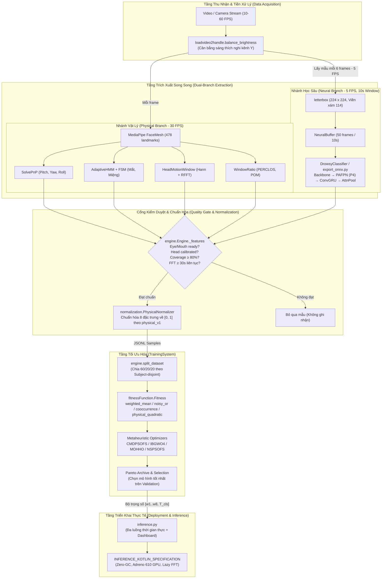

# Báo Cáo Phân Tích Kỹ Thuật Toàn Diện Module `OptimalAlgorithsm`

> **Tài liệu tham khảo kỹ thuật chuyên sâu phục vụ Đồ án tốt nghiệp (DATN)**  
> **Dự án**: Driver Guardian — Hệ thống giám sát và cảnh báo tài xế buồn ngủ đa phương thức  
> **Module**: `ai/OptimalAlgorithsm`  
> **Phiên bản chuẩn hóa**: `physical_v1`  
> **Ngày lập**: 10/11/2026  

---

## Mục Lục

1. [Tổng Quan Kiến Trúc & Sứ Mệnh Hệ Thống](#1-tổng-quan-kiến-trúc--sứ-mệnh-hệ-thống)
   - [1.1. Sứ mệnh của module OptimalAlgorithsm](#11-sứ-mệnh-của-module-optimalalgorithsm)
   - [1.2. Sơ đồ kiến trúc tổng thể](#12-sơ-đồ-kiến-trúc-tổng-thể)
   - [1.3. Cây cấu trúc thư mục](#13-cây-cấu-trúc-thư-mục)
2. [Phân Tích Chi Tiết Tầng Gốc & Triển Khai (Root Files)](#2-phân-tích-chi-tiết-tầng-gốc--triển-khai-root-files)
   - [2.1. `inference.py` — Hệ thống suy luận thời gian thực đa luồng](#21-inferencepy--hệ-thống-suy-luận-thời-gian-thực-đa-luồng)
   - [2.2. `export_onnx.py` — Đóng gói mô hình ONNX & Bộ đệm đặc trưng P4](#22-export_onnxpy--đóng-gói-mô-hình-onnx--bộ-đệm-đặc-trưng-p4)
   - [2.3. `convertor.py` — Tiện ích trích lọc cửa sổ dữ liệu](#23-convertorpy--tiện-ích-trích-lọc-cửa-sổ-dữ-liệu)
   - [2.4. `evaluation_neuralnetwork.py` — Đánh giá ngưỡng độc lập mạng nơ-ron](#24-evaluation_neuralnetworkpy--đánh-giá-ngưỡng-độc-lập-mạng-nơ-ron)
   - [2.5. Các tài liệu đặc tả Android & Kiểm chứng (`INFERENCE_KOTLIN_SPECIFICATION*.md`, `snapdragon_680_v2.md`, `VERIFICATION.md`)](#25-các-tài-liệu-đặc-tả-android--kiểm-chứng)
3. [Phân Tích Chi Tiết Hệ Thống Trích Xuất Dữ Liệu (`DataSystem`)](#3-phân-tích-chi-tiết-hệ-thống-trích-xuất-dữ-liệu-datasystem)
   - [3.1. `config.py` — Cấu hình kế thừa & Thông số cửa sổ trượt](#31-configpy--cấu-hình-kế-thừa--thông-số-cửa-sổ-trượt)
   - [3.2. `loadvideo2handle.py` — Giải mã video & Cân bằng sáng thích nghi](#32-loadvideo2handlepy--giải-mã-video--cân-bằng-sáng-thích-nghi)
   - [3.3. `normalization.py` — Chuẩn hóa đặc trưng theo cận bộ đo `physical_v1`](#33-normalizationpy--chuẩn-hóa-đặc-trưng-theo-cận-bộ-đo-physical_v1)
   - [3.4. `neuralnetwork.py` — Nạp & Suy luận DrowsyClassifier](#34-neuralnetworkpy--nạp--suy-luận-drowsyclassifier)
   - [3.5. `physicalbranch.py` — Giao diện đóng gói nhánh vật lý](#35-physicalbranchpy--giao-diện-đóng-gói-nhánh-vật-lý)
   - [3.6. `engine.py` — Bộ điều phối trung tâm & Cổng kiểm duyệt chất lượng](#36-enginepy--bộ-điều-phối-trung-tâm--cổng-kiểm-duyệt-chất-lượng)
   - [3.7. Bộ kiểm thử đơn vị `DataSystem/tests/`](#37-bộ-kiểm-thử-đơn-vị-datasystemtests)
4. [Phân Tích Chi Tiết Hệ Thống Huấn Luyện & Tối Ưu (`TrainingSystem`)](#4-phân-tích-chi-tiết-hệ-thống-huấn-luyện--tối-ưu-trainingsystem)
   - [4.1. `fitnessFunction.py` — 4 Hàm hợp nhất & Mục tiêu đa tiêu chí](#41-fitnessfunctionpy--4-hàm-hợp-nhất--mục-tiêu-đa-tiêu-chí)
   - [4.2. `engine.py` — Phân chia Subject độc lập & Đánh giá khách quan](#42-enginepy--phân-chia-subject-độc-lập--đánh-giá-khách-quan)
   - [4.3. `cmdpsofs.py` — Thuật toán Competitive Multi-objective PSO](#43-cmdpofspy--thuật-toán-competitive-multi-objective-pso)
   - [4.4. `IBGWO4.py` — Thuật toán Improved Grey Wolf Optimizer v4](#44-ibgwo4py--thuật-toán-improved-grey-wolf-optimizer-v4)
   - [4.5. `MOHHO.py` — Thuật toán Multi-Objective Harris Hawks Optimization](#45-mohhopy--thuật-toán-multi-objective-harris-hawks-optimization)
   - [4.6. `NSPSOFS.py` — Thuật toán Non-dominated Sorting PSO](#46-nspsofspy--thuật-toán-non-dominated-sorting-pso)
   - [4.7. `metaheuristic.py` — Hiện trạng & Cấu trúc kế thừa](#47-metaheuristicpy--hiện-trạng--cấu-trúc-kế-thừa)
   - [4.8. `visualize_summary.py` — Trực quan hóa kết quả đa thuật toán](#48-visualize_summarypy--trực-quan-hóa-kết-quả-đa-thuật-toán)
   - [4.9. Bộ kiểm thử đơn vị `TrainingSystem/tests/`](#49-bộ-kiểm-thử-đơn-vị-trainingsystemtests)
5. [Bảng Tra Cứu Công Thức Toán Học & Bảng Ánh Xạ Đặc Trưng](#5-bảng-tra-cứu-công-thức-toán-học--bảng-ánh-xạ-đặc-trưng)
6. [Đánh Giá Tổng Kết & Điểm Nổi Bật Về Kỹ Thuật Hệ Thống](#6-đánh-giá-tổng-kết--điểm-nổi-bật-về-kỹ-thuật-hệ-thống)

---

## 1. Tổng Quan Kiến Trúc & Sứ Mệnh Hệ Thống

### 1.1. Sứ mệnh của module OptimalAlgorithsm
Trong các hệ thống giám sát sự tỉnh táo của tài xế (DMS - Driver Monitoring System), việc chỉ dựa vào một mô hình học sâu (Deep Learning) từ ảnh thuần túy thường gặp phải hiện tượng "hộp đen", nhạy cảm với điều kiện ánh sáng thay đổi và khó suy luận thời gian thực liên tục trên phần cứng nhúng. Ngược lại, nếu chỉ dựa vào các chỉ số hình thái học truyền thống (EAR, MAR, góc nghiêng đầu) thì thường có tỷ lệ báo động giả (False Positive) cao do thói quen tự nhiên của người lái (nói chuyện, ngâm nga theo nhạc, cử động đầu khi quan sát gương).

Module `OptimalAlgorithsm` được thiết kế nhằm giải quyết bài toán cốt lõi này bằng phương pháp **Hợp nhất đa phương thức (Multimodal Decision Fusion)**:
1. **Thu thập tín hiệu song song**: Kết hợp thông tin sinh trắc học thời gian thực (7 đặc trưng vật lý từ mắt, miệng, đầu) với xác suất biểu cảm buồn ngủ từ mạng học sâu Spatio-temporal (`CNN-ConvGRU`).
2. **Chuẩn hóa không thiên vị (`physical_v1`)**: Loại bỏ các thang đo rủi ro chủ quan; toàn bộ đặc trưng được chuẩn hóa tuyến tính dựa trên cận vật lý thực tế của bộ phát hiện (detector bounds).
3. **Tối ưu hóa đa mục tiêu bằng giải thuật siêu nghiệm (Metaheuristics)**: Thay vì gán trọng số thủ công, hệ thống sử dụng các thuật toán bầy đàn/tiến hóa (`CMDPSOFS`, `IBGWO4`, `MOHHO`, `NSPSOFS`) để tìm kiếm nghiệm Pareto tối ưu hóa đồng thời độ nhạy ($1 - \text{recall}$) và độ chính xác ($1 - \text{precision}$) trên tập dữ liệu được cô lập hoàn toàn theo người lái (Subject-disjoint).
4. **Triển khai hiệu năng cao**: Hỗ trợ chuyển giao mô hình sang ONNX với bộ đệm đặc trưng P4 tăng dần (`p4_old`) và đặc tả chi tiết cho nền tảng Android Snapdragon 680 với nguyên lý Zero-GC và Lock-Free.

---

### 1.2. Sơ đồ kiến trúc tổng thể



---

### 1.3. Cây cấu trúc thư mục

```text
ai/OptimalAlgorithsm/
├── ARCHITECTURE_AND_COMPONENTS_ANALYSIS.md   # [Tài liệu hiện tại] Báo cáo phân tích chuyên sâu
├── convertor.py                              # Tiện ích trích lọc cửa sổ 60s từ bước 10s
├── evaluation_neuralnetwork.py               # Quét ngưỡng đánh giá độc lập mạng CNN-ConvGRU
├── export_onnx.py                            # Xuất mô hình sang ONNX FP32/FP16/INT8 kèm cache p4_old
├── inference.py                              # Pipeline suy luận thời gian thực webcam + OpenCV dashboard
├── INFERENCE_KOTLIN_SPECIFICATION.md         # Đặc tả kỹ thuật chi tiết chuyển giao sang Android Kotlin
├── INFERENCE_KOTLIN_SPECIFICATION_v1.md      # Đặc tả kỹ thuật phiên bản v1
├── snapdragon_680_v2.md                      # Đặc tả tối ưu hóa phần cứng Snapdragon 680 (Zero-GC, Lazy FFT)
├── VERIFICATION.md                           # Báo cáo kết quả kiểm thử & xác minh toàn hệ thống
│
├── DataSystem/                               # Phân hệ trích xuất & tạo tập dữ liệu mẫu
│   ├── config.py                             # Cấu hình kế thừa PhysicalConfig, tham số mạng & đường dẫn
│   ├── engine.py                             # Bộ điều phối trích xuất, cửa sổ trượt và cổng kiểm duyệt
│   ├── loadvideo2handle.py                   # Đọc video OpenCV, cân bằng sáng YCrCb, chuẩn hóa 30 FPS
│   ├── neuralnetwork.py                      # Lớp bọc DrowsyClassifier, nạp checkpoint v1, letterbox
│   ├── normalization.py                      # PhysicalNormalizer: tính cận trên U, sinh SHA-256 ID
│   ├── NORMALIZATION.md                      # Cơ sở lý thuyết và công thức toán học chuẩn hóa physical_v1
│   ├── physicalbranch.py                     # Lớp bọc VideoMetrics cho CameraMetrics
│   ├── README.md                             # Hướng dẫn chi tiết sử dụng DataSystem
│   └── tests/                                # 7 tệp kiểm thử đơn vị cho DataSystem
│       ├── test_brightness.py                # Kiểm thử cân bằng sáng và bảng LUT
│       ├── test_camera_inference.py          # Kiểm thử luồng tích hợp Camera
│       ├── test_data_regressions.py          # Kiểm thử hồi quy dữ liệu
│       ├── test_data_system.py               # Kiểm thử trích xuất và cửa sổ trượt
│       ├── test_neuralnetwork.py             # Kiểm thử suy luận và shape ảnh đầu vào
│       ├── test_normalization.py             # Kiểm thử cận trên U và miền giá trị [0, 1]
│       └── test_pipeline_integration.py      # Kiểm thử tích hợp toàn diện từ video đến JSONL
│
└── TrainingSystem/                           # Phân hệ tối ưu hóa trọng số đa mục tiêu
    ├── cmdpsofs.py                           # Competitive Multi-objective PSO for Feature Selection
    ├── IBGWO4.py                             # Improved Continuous Grey Wolf Optimizer (Variant 4)
    ├── MOHHO.py                              # Multi-Objective Harris Hawks Optimization
    ├── NSPSOFS.py                            # Non-dominated Sorting Particle Swarm Optimization
    ├── metaheuristic.py                      # Tệp cấu trúc kế thừa (hiện trạng placeholder 0 byte)
    ├── fitnessFunction.py                    # Định nghĩa 4 hàm hợp nhất, chỉ số phân loại, Pareto
    ├── engine.py                             # Chia tách Subject-disjoint, quản lý vòng đời thực nghiệm
    ├── README.md                             # Hướng dẫn sử dụng TrainingSystem
    ├── output/                               # Thư mục chứa kết quả thực nghiệm và trực quan hóa
    │   └── summary/visualize_summary.py      # Vẽ biểu đồ SVG/PNG so sánh hiệu năng các thuật toán
    └── tests/
        └── test_training_system.py           # Bộ kiểm thử đơn vị toàn diện cho TrainingSystem
```

---

## 2. Phân Tích Chi Tiết Tầng Gốc & Triển Khai (Root Files)

### 2.1. `inference.py` — Hệ thống suy luận thời gian thực đa luồng

#### Vai trò & Chức năng
`inference.py` là điểm thực thi chính (Entrypoint) cho quá trình chạy thử nghiệm trực tiếp trên webcam máy tính hoặc camera ngoài. Tệp kết hợp toàn bộ các phân hệ: xử lý hình ảnh trực tiếp, trích xuất đặc trưng vật lý, chạy mạng học sâu bất đồng bộ, chuẩn hóa đặc trưng và hiển thị giao diện bảng điều khiển (Dashboard) trực quan bằng OpenCV.

#### Các thành phần chính
1. **Lớp dữ liệu `CameraConfig`**:
   - `camera`: ID camera (mặc định `0`) hoặc đường dẫn tệp video.
   - `checkpoint`: Đường dẫn tệp trọng số PyTorch `best.pt` của DrowsyClassifier.
   - `device`: Thiết bị tính toán (`cuda` hoặc `cpu`).
   - `interval`: Chu kỳ đưa ra dự đoán buồn ngủ trên cửa sổ trượt (mặc định `1.0s`).
   - `primary_fusion`: Phương pháp hợp nhất chính hiển thị trên nhãn lớn (`cooccurrence`, `weighted_mean` hoặc `noisy_or`).
2. **Bảng trọng số `FUSION_CANDIDATES`**:
   - Chứa vector trọng số 9 chiều $[w_1, w_2, \dots, w_8, T_{\text{cls}}]$ cho 3 thuật toán hợp nhất.
   - Trọng số cho `cooccurrence` được trích xuất từ nghiệm tối ưu tốt nhất trên tập validation của `CMDPSOFS`.
3. **Cơ chế nạp báo cáo thực nghiệm `load_fusion`**:
   - Đọc tệp `evaluation.json` do `TrainingSystem` xuất ra.
   - **Xác thực Schema nghiêm ngặt**: So sánh khóa `features`, `feature_encoding` và `normalization_scales` trong báo cáo với cấu hình `physical_v1` của `PhysicalNormalizer` hiện tại. Nếu có bất kỳ sự sai lệch nào về thứ tự hoặc cận trên, hệ thống chủ động ném lỗi `ValueError` để ngăn chặn suy luận sai lệch.
4. **Hàm vẽ giao diện `draw_dashboard`**:
   - Tạo một canvas đồ họa kích thước $(H, W + 660)$ với nền màu xám đen (`rgb(24, 24, 24)`).
   - Hiển thị song song: Luồng video trực tiếp, các chỉ số vật lý thời gian thực (EAR, MAR, PERCLOS %, tần số chớp mắt/ngáp/gật đầu, góc đầu pitch/yaw/roll, tần số chuyển động đầu Hz, thời gian quan sát coverage s), trạng thái sẵn sàng của các bộ lọc (READY/WAIT), nhãn khuôn mặt (FACE / NO FACE) và kết quả phân loại từ 3 mô hình hợp nhất kèm thanh điểm xác suất.
5. **Vòng lặp chính `run_inference` & Kiến trúc đa luồng**:
   - Sử dụng `ThreadPoolExecutor(max_workers=1)` để chạy mạng học sâu trên luồng nền (Worker Thread), giúp luồng thu nhận hình ảnh (Capture Thread) không bao giờ bị nghẽn (blocking).
   - Duy trì hàng đợi `deque` lưu trữ các sự kiện chớp mắt và gật đầu trong phạm vi 60 giây gần nhất.
   - Cơ chế quản lý trạng thái thời gian thực: Trong 60 giây đầu tiên hiển thị `WARMING UP` (tích lũy dữ liệu FFT và khởi tạo HMM). Sau 60 giây, kiểm tra tính tươi mới của kết quả (`age <= interval * 2`); nếu cửa sổ quá cũ do mất khuôn mặt, chuyển sang trạng thái cảnh báo `STALE`.

---

### 2.2. `export_onnx.py` — Đóng gói mô hình ONNX & Bộ đệm đặc trưng P4

#### Vai trò & Chức năng
`export_onnx.py` chịu trách nhiệm chuyển đổi mô hình huấn luyện PyTorch `DrowsyClassifier` sang định dạng chuẩn công nghiệp ONNX (Open Neural Network Exchange), phục vụ triển khai suy luận tốc độ cao trên phần cứng biên (Android, nhúng, TensorRT, ONNX Runtime).

#### Điểm đột phá về kiến trúc: Cơ chế Đệm đặc trưng tăng dần (`p4_old`)
Trong kiến trúc gốc, mỗi chu kỳ 1 giây, mạng phải nhận 50 khung hình ảnh (10 giây @ 5 FPS) và chạy toàn bộ qua Backbone (ConvNeXt) để trích xuất đặc trưng không gian. Tuy nhiên, giữa hai cửa sổ trượt cách nhau 1 giây, có tới **45 khung hình bị trùng lặp** (chỉ có 5 khung hình mới xuất hiện).
`export_onnx.py` tái cấu trúc mô hình thành `ExportDrowsyClassifier` với 2 đầu vào:
1. `video`: Tensor khung hình mới có kích thước $[T_{\text{new}}, 3, 224, 224]$ ($T_{\text{new}} \ge 1$, thông thường là 5 frames).
2. `p4_old`: Tensor đặc trưng tầng PAFPN Neck (P4) đã lưu từ bước trước có kích thước $[T_{\text{old}}, 128, 14, 14]$ ($T_{\text{old}} \ge 0$, tối đa 45 frames).

Mô hình chỉ chạy Backbone trên $T_{\text{new}}$ khung hình mới để lấy $p4_{\text{new}}$, sau đó ghép nối trên chiều thời gian:
$$\text{features} = \text{Concat}([p4_{\text{old}}, p4_{\text{new}}], \text{axis}=0) \in \mathbb{R}^{(T_{\text{old}} + T_{\text{new}}) \times 128 \times 14 \times 14}$$
Giải pháp này giúp **giảm tới 90% khối lượng tính toán FLOPs** của phần Backbone ở mỗi giây suy luận!

#### Các thành phần và hàm cốt lõi
1. **Lớp `ScriptableConvGRU`**:
   - Viết lại vòng lặp tuần tự của ConvGRU và cơ chế Spatial Attention Pooling để tương thích hoàn toàn với TorchScript (`torch.jit.script`) và toán tử `Loop` động của ONNX (Dynamic Axes).
2. **Hàm `export_fp32`**:
   - Xuất mô hình ONNX độ chính xác đơn (FP32) với Opset 17, khai báo các trục động (`dynamic_axes`) cho số lượng frame đầu vào (`num_frames`, `num_old_frames`, `total_frames`).
3. **Hàm `export_fp16`**:
   - Ép kiểu trọng số và bộ nhớ đệm sang FP16 (Half Precision) để giảm 50% dung lượng bộ nhớ trên các GPU hỗ trợ tính toán dấu phẩy động 16-bit.
4. **Hàm `export_int8`**:
   - Thực hiện lượng tử hóa động (Dynamic INT8 Quantization) thông qua `onnxruntime.quantization.quantize_dynamic` với kiểu lượng tử `QInt8` và `per_channel=True`.
5. **Hàm `generate_metadata_json`**:
   - Tự động sinh tệp `drowsy_classifier_metadata.json` mô tả chi tiết: tên đầu vào, hình dạng tensor, kiểu dữ liệu, các tham số tiền xử lý chuẩn hóa RGB và hướng dẫn nạp tensor trên Android/C++.

---

### 2.3. `convertor.py` — Tiện ích trích lọc cửa sổ dữ liệu

#### Vai trò & Chức năng
`convertor.py` là một công cụ xử lý dữ liệu tiền kỳ (Offline Data Utility). Trong các phiên bản thử nghiệm trước đây, dữ liệu được xuất theo cửa sổ trượt 60 giây nhưng bước dịch (stride) là 10 giây (dẫn đến các cửa sổ bị chồng lấn 50 giây: $[0, 60), [10, 70), [20, 80), \dots$).
Hàm `convert(input_path, output_path)` thực hiện việc quét tệp JSONL đầu vào, kiểm tra tính hợp lệ của từng dòng, và chỉ giữ lại các cửa sổ nằm đúng trên lưới 60 giây không chồng lấn: $[0, 60), [60, 120), [120, 180), \dots$.

#### Nguyên lý kiểm tra an toàn
- Kiểm tra tính đơn điệu và hữu hạn của mốc thời gian: $start \ge 0$, $\text{end} - \text{start} = 60.0 \pm 10^{-6}$.
- Kiểm tra căn chỉnh lưới: $start \pmod{60} == 0$.
- Cơ chế chống ghi đè: Sử dụng chế độ mở tệp `"x"` (`exclusive creation`), ném ngoại lệ nếu tệp đầu ra đã tồn tại để bảo vệ dữ liệu gốc.

---

### 2.4. `evaluation_neuralnetwork.py` — Đánh giá ngưỡng độc lập mạng nơ-ron

#### Vai trò & Chức năng
Một tập lệnh Python độc lập thực hiện việc quét ngưỡng quyết định (Threshold Sweep) từ $0.00$ đến $1.00$ với bước nhảy $0.05$ trên riêng cột điểm xác suất `neuralnetwork_score` từ tệp JSONL.
Tập lệnh tính toán các chỉ số cơ bản của học máy:
- **Accuracy**: $\frac{TP + TN}{TP + TN + FP + FN}$
- **Recall (Sensitivity)**: $\frac{TP}{TP + FN}$
- **Precision**: $\frac{TP}{TP + FP}$
- **F1-score**: $\frac{2 \cdot \text{Recall} \cdot \text{Precision}}{\text{Recall} + \text{Precision}}$

Tập lệnh này đóng vai trò đo đạc hiệu năng đường cơ sở (Baseline) của riêng nhánh học sâu trước khi tiến hành tối ưu hóa hợp nhất đa phương thức trong `TrainingSystem`.

---

### 2.5. Các tài liệu đặc tả Android & Kiểm chứng

- **`INFERENCE_KOTLIN_SPECIFICATION.md`** (2.571 dòng): Tài liệu thiết kế hệ thống chi tiết cho việc tái lập toàn bộ pipeline suy luận bằng ngôn ngữ Kotlin trên hệ điều hành Android. Tài liệu đặc tả 5 luồng thực thi tách biệt theo mô hình không khóa (Lock-Free Immutable Snapshot), cách tích hợp CameraX, MediaPipe Tasks Vision và ONNX Runtime Android.
- **`snapdragon_680_v2.md`** (3.348 dòng): Bản nâng cấp kiến trúc chuyên sâu v2 được tối ưu hóa riêng cho chipset Qualcomm Snapdragon 680 (Kryo 265 Gold Cortex-A73 + Silver Cortex-A53 + Adreno 610 GPU). Tài liệu đề xuất 6 cải tiến kỹ thuật đột phá:
  1. Gộp luồng phân tích vật lý thành `UnifiedPhysicalThread` để tránh chi phí context switch.
  2. Cơ chế **Lazy FFT Evaluation ($1\text{ Hz}$)**: Chỉ tính FFT khi cần xuất kết quả cửa sổ, giảm 96.7% chi phí biến đổi Fourier.
  3. Quản lý bộ nhớ **Zero-GC** với `RgbaFramePool` (Triple-Buffering tĩnh) để triệt tiêu việc tạm dừng do gom rác (ART Garbage Collection Pause).
  4. Thực thi `letterbox` đúng tại thời điểm lọt lưới 5 FPS.
  5. Kiểm tra nhanh độ sáng Luma ($\mu_Y$) trực tiếp trên mảng RGBA.
  6. Cấu hình ONNX Runtime với 2 luồng Intra-Op và tắt spin-wait để nhường nhân CPU lớn cho giao diện UI.
- **`VERIFICATION.md`**: Báo cáo tổng kết đợt kiểm thử tích hợp ngày 14/10/2026 xác nhận hệ thống vượt qua **93 test cases và 191 subtests** mà không có lỗi logic toán học hay rò rỉ dữ liệu.

---

## 3. Phân Tích Chi Tiết Hệ Thống Trích Xuất Dữ Liệu (`DataSystem`)

Phân hệ `DataSystem` chịu trách nhiệm đọc dữ liệu video thô từ bộ dữ liệu chuẩn (UTA-RLDD / ULDD), đồng bộ hóa thời gian, chạy song song 2 nhánh xử lý và xuất ra tệp định dạng JSONL chứa các vector đặc trưng đã chuẩn hóa theo chuẩn `physical_v1`.

### 3.1. `config.py` — Cấu hình kế thừa & Thông số cửa sổ trượt

#### Vai trò & Thiết kế hướng đối tượng
Tệp `config.py` định nghĩa lớp cấu hình `DataSystemConfig` kế thừa trực tiếp từ `PhysicalConfig` của module `PhysicalBranch`:

```python
@dataclass(frozen=True)
class DataSystemConfig(PhysicalConfig):
    target_luma: float = 70                # Mức sáng mục tiêu [0, 255] kênh Y
    stride_sec: float = PhysicalConfig.window_sec  # Mặc định 30.0s (không chồng lấn)
    neural_sec: float = TRAIN_CONFIG.window_sec    # 10.0s đưa vào ConvGRU
    neural_fps: float = TRAIN_CONFIG.target_fps    # 5.0 FPS
    neural_size: int = MODEL_IMAGE_SIZE            # 224 pixel
    chunk_size: int = TRAIN_CONFIG.chunk_size      # 8 ảnh / batch CNN
    checkpoint_path: str = "..."                   # Đường dẫn trọng số best.pt
    min_observed_ratio: float = 0.8                # Tỷ lệ quan sát tối thiểu (80%)
    blink_duration_percentile: float = 90          # P90 thời lượng chớp mắt
    nod_duration_percentile: float = 100           # Max thời lượng gật đầu
    device: str | None = None
```

#### Ý nghĩa các ràng buộc cấu hình
- `neural_count`: Thuộc tính động tính số lượng khung hình mạng cần: $\text{neural\_count} = \text{round}(\text{neural\_sec} \times \text{neural\_fps}) = 10 \times 5 = 50$ frames.
- Tính bất biến (`frozen=True`): Ngăn ngừa việc vô tình thay đổi tham số cấu hình trong thời gian chạy thực nghiệm, đảm bảo tính tái lập (reproducibility).

---

### 3.2. `loadvideo2handle.py` — Giải mã video & Cân bằng sáng thích nghi

#### 1. Hàm `balance_brightness(frame, target_luma=70)`
- **Mục đích**: Tự động bù sáng cho các video quay trong cabin ban đêm hoặc điều kiện thiếu sáng trầm trọng, giúp MediaPipe FaceMesh phát hiện điểm mốc ổn định hơn mà không làm cháy sáng các vùng đã đủ sáng.
- **Thuật toán**:
  1. Chuyển đổi không gian màu BGR $\to$ YCrCb.
  2. Tính độ sáng trung bình kênh Luma: $\mu_Y = \frac{1}{H \times W} \sum_{i,j} Y(i,j)$.
  3. Nếu $\mu_Y = 0$ hoặc $\mu_Y \ge \text{target\_luma}$, giữ nguyên ảnh gốc.
  4. Nếu $\mu_Y < \text{target\_luma}$, tính hệ số Gamma thích nghi có chặn dưới:
     $$\gamma = \max\left(0.5, \frac{\ln(\text{target\_luma} / 255)}{\ln(\mu_Y / 255)}\right)$$
  5. Xây dựng bảng tra cứu Lookup Table (LUT) gồm 256 giá trị: $\text{LUT}[v] = \text{round}\left(255 \times \left(\frac{v}{255}\right)^\gamma\right)$.
  6. Áp dụng biến đổi nhanh qua `cv2.LUT` và chuyển ngược về BGR.

#### 2. Hàm `read_video(path, target_fps=30, ...)`
- **Mục đích**: Giải mã video bằng `cv2.VideoCapture` và chuyển đổi video có tốc độ khung hình biến thiên (VFR) về một dòng thời gian đều đặn (CFR) ở tốc độ `target_fps = 30 FPS`.
- **Cơ chế hoạt động**:
  - Trừ mốc thời gian đầu tiên để đưa gốc thời gian $t_0$ về chính xác $0.0\text{s}$.
  - Hỗ trợ cơ chế dự phòng: Nếu backend camera/video không cung cấp timestamp (`CAP_PROP_POS_MSEC` trả về 0), tự động chuyển sang tính theo chỉ số khung hình: $t = \text{index} / \text{source\_fps}$.
  - **Khử jitter & Giữ khung hình (Zero-order Hold)**: Với mỗi mốc thời gian đích $t_{\text{target}} = \frac{k}{\text{target\_fps}}$, hàm giữ lại khung hình nguồn gần nhất đã xuất hiện trước hoặc đúng mốc thời gian đó mà không nội suy điểm ảnh (tránh làm nhòe chuyển động).
  - Khung hình cuối cùng được kéo dài thêm $1 / \text{source\_fps}$ để đảm bảo không bị mất frame cuối khi chuyển đổi tốc độ lấy mẫu.
  - Định dạng trả về: Mỗi lần yield một tuple gồm `(frame: np.ndarray, timestamp: float)`, trong đó frame ở định dạng RGB uint8 $[3, H, W]$.

---

### 3.3. `normalization.py` — Chuẩn hóa đặc trưng theo cận bộ đo `physical_v1`

#### Triết lý thiết kế của chuẩn hóa `physical_v1`
Khác với các phương pháp cũ gán điểm nguy hiểm chủ quan theo cảm tính, chuẩn `physical_v1` coi các giá trị đo được là **các đại lượng vật lý thuần túy**. Giá trị chuẩn hóa $z$ được tính bằng cách chia số đo thực tế $x$ cho cận trên lý thuyết lớn nhất $U$ mà bộ phát hiện đó có thể đo được:
$$z = \min\left(\frac{x}{U}, 1.0\right) \in [0, 1]$$

#### Lớp `PhysicalNormalizer`
Khi khởi tạo, lớp nhận đối tượng `config` và tạo một phiên bản tạm của `CameraMetrics` để truy xuất trực tiếp các ngưỡng giới hạn của các máy trạng thái (FSM):
1. **Cận trên tần số sự kiện (`rate_bound`)**:
   Đối với chớp mắt, ngáp và gật đầu, số lượng sự kiện tối đa trong cửa sổ $W$ giây bị giới hạn bởi thời lượng ngắn nhất của một sự kiện hợp lệ $\Delta t_{\text{min}}$:
   $$\text{duration}_{\text{min}} = \max\left(\frac{\text{fsm.minimum} - 10^{-6}}{1000}, \frac{1}{\text{fps}}\right)$$
   $$\text{rate\_bound} = \left(\left\lceil \frac{W}{\text{duration}_{\text{min}}} \right\rceil + 1\right) \times \frac{60}{W} \quad (\text{sự kiện / phút})$$
2. **Cận trên chuyển động đầu (Tần số Nyquist)**:
   Chuỗi FFT pitch đầu được nội suy trên lưới đều. Cận trên tần số tối đa theo định lý Nyquist-Shannon là:
   $$f_{\text{Nyquist}} = \frac{\max(3, \lceil W_{\text{motion}} \times \text{fps} \rceil)}{2 \times W_{\text{motion}}} \approx \frac{30}{2} = 15\text{ Hz}$$
3. **Bảng cận trên $U$ (`scales`)**:
   - `blink_frequency`: Giới hạn vật lý từ FSM mắt (~400 lần/phút).
   - `blink_duration`: Thời lượng tối đa cho phép của một cái chớp mắt hợp lệ (`eye.fsm.maximum = 2000 ms`).
   - `perclos`: Tỷ lệ phần trăm thời gian nhắm mắt (Cận trên $1.0$).
   - `yawn_frequency`: Giới hạn từ FSM miệng.
   - `nod_duration`: Thời lượng tối đa của một lần gật đầu hợp lệ (`nod.maximum / 1000 = 3.5s`).
   - `nod_frequency`: Giới hạn tần số gật đầu từ FSM đầu.
   - `dominant_head_motion_frequency`: Tần số Nyquist ($15.0\text{ Hz}$).
   - `neuralnetwork_score`: Xác suất đầu ra softmax từ mạng học sâu (Cận trên $1.0$).
4. **Mã băm định danh `normalization_id`**:
   - Tính toán chuỗi mã băm SHA-256 từ toàn bộ nội dung cấu hình trích xuất. Mã hash này được đính kèm vào từng dòng dữ liệu JSONL để đảm bảo tầng huấn luyện (`TrainingSystem`) chỉ nạp dữ liệu có cùng hệ quy chiếu cấu hình.

---

### 3.4. `neuralnetwork.py` — Nạp & Suy luận DrowsyClassifier

#### 1. Hàm `letterbox(image, new_size=224, color=(114, 114, 114))`
- Co giãn ảnh về kích thước vuông $224 \times 224$ nhưng **giữ nguyên tỷ lệ khung hình gốc (Aspect Ratio)**.
- Phần viền thừa được chèn màu xám đồng nhất $(114, 114, 114)$, giúp mô hình không bị méo mó hình học khuôn mặt.
- Hỗ trợ linh hoạt cả mảng định dạng CHW $[3, H, W]$ và HWC $[H, W, 3]$.

#### 2. Lớp `NeuralNetwork(nn.Module)`
- **Nạp mô hình an toàn**: Gọi `load_model` từ `LSTM.src.checkpoint`. Kiểm tra tính khớp 100% giữa cấu hình checkpoint và cấu hình thực thi về `image_size`, `target_fps` và `window_sec`.
- **Suy luận khối (`chunk_size`)**: Chia 50 khung hình thành các khối nhỏ (mặc định 8 ảnh/khối) khi đưa qua Backbone/PAFPN để hạn chế đỉnh tiêu thụ bộ nhớ VRAM, sau đó ghép lại đưa qua ConvGRU.
- **Tính toán xác suất**: Chạy dưới chế độ `@torch.inference_mode()` (tắt hoàn toàn autograd engine để tối ưu tốc độ và bộ nhớ), lấy đầu ra Logits kích thước $[1, 2]$ và áp dụng hàm Softmax để trích xuất xác suất lớp 1:
  $$P(\text{drowsy}) = \frac{e^{\text{logit}_1}}{e^{\text{logit}_0} + e^{\text{logit}_1}}$$

---

### 3.5. `physicalbranch.py` — Giao diện đóng gói nhánh vật lý

Tệp cung cấp lớp tiện ích `VideoMetrics`:
- Nhận một chuỗi các khung hình generator và mốc thời gian.
- Gọi tuần tự `CameraMetrics.process(bgr_frame, timestamp)`.
- Đo đạc thời gian tính toán trung bình mỗi frame (`processing_ms`) và đảm bảo đóng tài nguyên (`camera.close()`) an toàn trong khối `finally`.

---

### 3.6. `engine.py` — Bộ điều phối trung tâm & Cổng kiểm duyệt chất lượng

`engine.py` là trái tim của phân hệ `DataSystem`. Lớp `Engine` điều phối luồng dữ liệu giữa camera, nhánh vật lý và nhánh học sâu.

#### 1. Ràng buộc lưới lấy mẫu (Grid Alignment)
Trong phương thức khởi tạo `__init__`, `Engine` thực hiện hàng loạt phép kiểm tra tính toàn vẹn của tham số:
- `fps` và `neural_size` phải là số nguyên dương.
- `neural_fps` phải là ước số của `fps` (ví dụ: $30 \pmod 5 == 0 \implies \text{step} = 6$).
- `window_sec` và `stride_sec` phải là bội số nguyên của chu kỳ frame $1 / \text{fps}$.
- Thời lượng đoạn mạng không được vượt quá độ dài cửa sổ vật lý: $\text{neural\_sec} \le \text{window\_sec}$.

#### 2. Cổng kiểm duyệt chất lượng nghiêm ngặt (`_features`)
Một cửa sổ thời gian $[start, start + window)$ chỉ được xuất thành mẫu dữ liệu hợp lệ khi vượt qua **5 trạm kiểm soát**:
1. **Khởi tạo bộ lọc mắt**: `m["eye_ready"] == True` (đã thu thập đủ 300 mẫu EAR hợp lệ để khớp tham số HMM).
2. **Khởi tạo bộ lọc miệng**: `m["mouth_ready"] == True` (đã thu thập đủ 300 mẫu MAR hợp lệ).
3. **Hiệu chuẩn góc đầu**: `m["head_calibrated"] == True` (đã tính trung vị 30 mẫu đầu tiên làm tư thế trung tính).
4. **PERCLOS hợp lệ**: `m["perclos_pct"] is not None`.
5. **Độ phủ quan sát (Coverage Gate)**: Thời gian khuôn mặt xuất hiện hợp lệ trong cửa sổ phải đạt ít nhất $80\%$ đối với cả mắt, miệng và góc đầu:
   $$t_{\text{observed}} \ge W \times \text{min\_observed\_ratio} = 30 \times 0.8 = 24.0\text{s}$$
6. **Độ tin cậy của FFT chuyển động đầu**:
   Chuỗi góc pitch không được gián đoạn quá $0.25\text{s}$. Thời gian quan sát liên tục phải đạt đủ $30.0\text{s}$, tần số đỉnh phải không âm ($f \ge 0$) và độ phân giải phổ phải dương ($\Delta f > 0$). Nếu đầu đứng yên hoàn toàn (biên độ peak-to-peak $< 0.1^\circ$), thuật toán gán chính xác $0\text{ Hz}$ thay vì loại bỏ mẫu.

#### 3. Bộ thu nhận sự kiện & Cửa sổ trượt (`process_video`)
- Sử dụng hai hàng đợi `deque` hai đầu (`blink_durations` và `nod_durations`) để lưu vết các sự kiện kèm timestamp kết thúc.
- Tự động cắt tỉa các sự kiện có mốc thời gian cũ hơn biên trái cửa sổ: $t \le \text{timestamp} - W$.
- Khi đến mốc xuất mẫu ($(\text{count} - W) \pmod{\text{stride}} == 0$), gọi nhánh mạng nơ-ron trên 50 khung hình đã tích lũy trong `nn_frames`, trích xuất 8 đặc trưng, chuẩn hóa và đóng gói JSONL.

#### 4. Khả năng chạy tiếp sau sự cố (`resume=True`) trong `run()`
- Đọc tệp JSONL đầu ra đã có, lưu lại toàn bộ các cặp `(source_video, start_second, end_second)` đã hoàn thành.
- Khi tiến trình bị dừng đột ngột (mất điện, crash), việc chạy lại sẽ tự động bỏ qua các cửa sổ đã có trong tệp, mở tệp ở chế độ append (`"a"`) và tiếp tục xử lý các video còn lại mà không gây trùng lặp dữ liệu.

---

### 3.7. Bộ kiểm thử đơn vị `DataSystem/tests/`

Phân hệ sở hữu 7 bộ test case tự động bao phủ toàn diện:
1. `test_brightness.py`: Kiểm thử hàm `balance_brightness`, kiểm tra bảng LUT biến đổi phi tuyến, tính bất biến khi ảnh đã đủ sáng, và tính đơn điệu của hàm gamma.
2. `test_camera_inference.py`: Kiểm thử giả lập luồng hình ảnh camera thời gian thực, đo đạc độ trễ và khả năng đồng bộ luồng.
3. `test_data_regressions.py`: Kiểm thử hồi quy các trường hợp biên của dữ liệu (video bị gián đoạn, rớt khung hình, góc quay cực đoan).
4. `test_data_system.py`: Kiểm thử toàn bộ lớp `Engine`, kiểm tra logic tính toán P90 cho chớp mắt và Max cho gật đầu.
5. `test_neuralnetwork.py`: Kiểm thử lớp `NeuralNetwork`, xác minh kích thước đầu vào $[50, 3, 224, 224]$, kiểm tra đầu ra softmax nằm trong $[0, 1]$ và kiểm tra cơ chế phân khối `chunk_size`.
6. `test_normalization.py`: Kiểm thử tính toán cận trên $U$, tính bất biến của mã băm SHA-256 và xác minh giá trị sau chuẩn hóa luôn thuộc đoạn $[0, 1]$.
7. `test_pipeline_integration.py`: Tạo video giả lập MP4 bằng OpenCV, chạy tích hợp toàn bộ pipeline từ đọc video $\to$ FaceMesh $\to$ DrowsyClassifier $\to$ xuất JSONL và kiểm tra cấu trúc schema đầu ra.

---

## 4. Phân Tích Chi Tiết Hệ Thống Huấn Luyện & Tối Ưu (`TrainingSystem`)

Phân hệ `TrainingSystem` tiếp nhận tệp JSONL từ `DataSystem` và giải quyết bài toán: **Tìm kiếm bộ trọng số hợp nhất tối ưu cho 8 đặc trưng mà không cần huấn luyện lại mạng học sâu.**

### 4.1. `fitnessFunction.py` — 4 Hàm hợp nhất & Mục tiêu đa tiêu chí

#### 1. Định nghĩa 8 đặc trưng (`FEATURES`)
Hệ thống cố định thứ tự của 8 thuộc tính trong vector đầu vào $X \in \mathbb{R}^{N \times 8}$:
1. `blink_frequency`: Tần số chớp mắt (số lần / phút).
2. `blink_duration`: Thời lượng chớp mắt P90 (ms).
3. `perclos`: Tỷ lệ thời gian mắt nhắm sâu (giá trị $[0, 1]$).
4. `yawn_frequency`: Tần số ngáp (số lần / phút).
5. `nod_duration`: Thời lượng gật đầu dài nhất (giây).
6. `nod_frequency`: Tần số gật đầu (số lần / phút).
7. `dominant_head_motion_frequency`: Tần số chuyển động đầu trội từ phổ FFT (Hz).
8. `neuralnetwork_score`: Xác suất buồn ngủ dự đoán từ mạng nơ-ron ConvGRU ($[0, 1]$).

#### 2. Bốn hàm hợp nhất quyết định (Decision Fusion Functions)
Một cá thể nghiệm (Candidate) trong không gian tìm kiếm thông thường có dạng:
$$\theta = [w_1, w_2, \dots, w_8, T_{\text{cls}}] \in [0, 1]^9$$
trong đó $w_j \ge 0$ là trọng số liên tục của đặc trưng thứ $j$, và $T_{\text{cls}}$ là ngưỡng quyết định phân loại.

Lớp `Fitness` cung cấp 4 phương pháp tính điểm tổng hợp $S(X)$:

##### Phương pháp 1: Trung bình có trọng số (`weighted_mean`)
$$S_{\text{WM}}(X) = \frac{\sum_{j=1}^8 w_j X_j}{\sum_{j=1}^8 w_j}$$
- **Đặc điểm**: Giả định quan hệ tuyến tính cộng dồn giữa các dấu hiệu mệt mỏi. Trọng số $w_j = 0$ đồng nghĩa với việc loại bỏ đặc trưng đó (Feature Selection).

##### Phương pháp 2: Mô hình xác suất Noisy-OR (`noisy_or`)
$$S_{\text{NOR}}(X) = 1 - \prod_{j=1}^8 (1 - w_j X_j)$$
- **Đặc điểm**: Bắt nguồn từ mạng Bayes. Xem mỗi đặc trưng như một nguyên nhân độc lập có thể gây ra trạng thái buồn ngủ với xác suất $w_j X_j$. Chỉ cần một đặc trưng có giá trị cao và trọng số lớn là điểm số tổng thể sẽ tiệm cận 1.

##### Phương pháp 3: Mô hình đồng xuất hiện phi tuyến (`cooccurrence`)
Sắp xếp tích $z_j = w_j X_j$ theo thứ tự tăng dần. Gọi $a = \max_j(z_j)$ (tín hiệu mạnh nhất) và $b$ là giá trị lớn thứ hai:
$$S_{\text{CO}}(X) = a + (1 - a) \cdot a \cdot b$$
- **Đặc điểm**: Nếu chỉ có một dấu hiệu xuất hiện ($b = 0$), điểm số bằng $a$. Nếu có hai dấu hiệu cùng xuất hiện mạnh ($a > 0, b > 0$), thành phần tương tác $(1 - a)ab$ sẽ kích hoạt đẩy mạnh điểm số lên cao, mô phỏng chính xác hiện tượng tài xế vừa ngáp vừa nhắm mắt. Nhiều tín hiệu nhỏ yếu sẽ không bị cộng dồn làm sai lệch kết quả.

##### Phương pháp 4: Mô hình đa thức Bernstein bậc hai (`physical_quadratic`)
Đối với phương pháp này, cá thể có **33 chiều tham số**:
$$\theta = [w_1, \dots, w_8, T_{\text{cls}}, \underbrace{c_{10}, c_{11}, c_{12}}_{\text{Đặc trưng 1}}, \dots, \underbrace{c_{80}, c_{81}, c_{82}}_{\text{Đặc trưng 8}}] \in [0, 1]^{33}$$
Mỗi đặc trưng $X_j$ được biến đổi qua một đường cong phản ứng phi tuyến $r_j(X_j)$ định nghĩa bởi đa thức Bernstein bậc hai với 3 điểm điều khiển $c_{j0}, c_{j1}, c_{j2} \in [0, 1]$:
$$r_j(x) = c_{j0}(1 - x)^2 + 2 c_{j1} x(1 - x) + c_{j2} x^2$$
Điểm tổng hợp là trung bình có trọng số của các phản ứng:
$$S_{\text{PQ}}(X) = \frac{\sum_{j=1}^8 w_j r_j(X_j)}{\sum_{j=1}^8 w_j}$$
- **Đặc điểm**: Có khả năng học được các mối quan hệ phi tuyến tính phức tạp như quan hệ hình chữ U (U-shaped: bình thường ở giữa, bất thường ở hai đầu) hoặc hình chữ $\cap$ mà không cần can thiệp quy tắc thủ công.

#### 3. Phân loại & Hàm mục tiêu Pareto
Dự đoán nhãn nhị phân:
$$\hat{y} = \begin{cases} 1 & \text{nếu } S(X) \ge T_{\text{cls}} \text{ và } \sum w_j > 0 \\ 0 & \text{ngược lại} \end{cases}$$
Bài toán tối ưu hóa đa mục tiêu tìm cách cực tiểu hóa đồng thời hai hàm mục tiêu đối nghịch:
$$\min_{\theta} F(\theta) = \left[ f_1(\theta), f_2(\theta) \right] = \left[ 1 - \text{Recall}, 1 - \text{Precision} \right]$$
Nếu tất cả trọng số đều bằng 0 ($\sum w_j = 0$), thuật toán áp dụng hàm phạt nặng: $F(\theta) = [1.0, 1.0]$.

---

### 4.2. `engine.py` — Phân chia Subject độc lập & Đánh giá khách quan

#### 1. Cơ chế phân chia chống rò rỉ dữ liệu (`split_dataset`)
Trong bài toán nhận diện hành vi tài xế, nếu các khung hình hoặc cửa sổ của cùng một người lái xuất hiện ở cả tập Train và tập Test (Data Leakage), mô hình sẽ dễ dàng đạt độ chính xác ảo do ghi nhớ khuôn mặt thay vì học biểu hiện buồn ngủ.
Hàm `split_dataset` thực hiện phân chia 60% Train / 20% Validation / 20% Test theo **Subject-disjoint**:
- Tự động phân tích đường dẫn video để bóc tách mã định danh người lái (`subject_id`), hỗ trợ cả cấu trúc thư mục của UTA-RLDD (`FoldN_partN/<subject>/<video>`) và ULDD.
- Tất cả các video của cùng một người (dù quay ở các góc nhìn khác nhau như góc trực diện IR, lệch trái L3D, lệch phải R3D, và cả 2 trạng thái tỉnh táo Alert / buồn ngủ Drowsy) **bắt buộc phải nằm trọn vẹn trong duy nhất một tập** (Train, Validation hoặc Test).
- Kiểm tra tính cân bằng: Mỗi tập con sau khi chia bắt buộc phải chứa đủ cả hai nhãn 0 và 1, và số lượng đối tượng tối thiểu phải từ 5 người trở lên.

#### 2. Vòng đời thực nghiệm khách quan (`run_experiment`)
1. **Pha tối ưu (Optimization)**: Thuật toán metaheuristic chỉ được tiếp cận dữ liệu $X_{\text{train}}, y_{\text{train}}$. Quá trình tìm kiếm sinh ra tập nghiệm không bị lấn át (Pareto Archive).
2. **Pha chọn lọc (Model Selection)**: Toàn bộ các cá thể trong Pareto Archive cùng với 2 mô hình cơ sở cố định (Constant Baseline: luôn đoán 0, luôn đoán 1) được đánh giá trên tập **Validation**. Mô hình được chọn là mô hình tối đa hóa chỉ số **Balanced Accuracy**, nếu bằng nhau xét tiếp **F1-score**:
   $$\text{Balanced Accuracy} = \frac{\text{Recall} + \text{Specificity}}{2}$$
3. **Pha đánh giá chốt chặn (Held-out Test Evaluation)**: Sau khi mô hình đã được cố định từ tập Validation, mô hình này mới được đưa sang dự đoán một lần duy nhất trên tập **Test**. Kết quả đánh giá này hoàn toàn khách quan và được lưu vào tệp `evaluation.json`.

---

### 4.3. `cmdpsofs.py` — Thuật toán Competitive Multi-objective PSO

- **Tên đầy đủ**: Competitive Multi-objective Discrete/Continuous Particle Swarm Optimization for Feature Selection.
- **Cơ chế hoạt động**:
  - Mỗi cá thể là một hạt `Particle` có vị trí $x \in [0, 1]^D$, vận tốc $v \in [-v_{\text{limit}}, v_{\text{limit}}]^D$, vị trí tốt nhất từng đạt được $p_{\text{best}}$ và mục tiêu tốt nhất.
  - Duy trì kho lưu trữ tinh hoa `ParetoArchive`:
    - Áp dụng quan hệ thống trị Pareto (`dominates`): Nghiệm $a$ lấn át $b$ nếu $a$ không tệ hơn $b$ ở mọi mục tiêu và tốt hơn ở ít nhất một mục tiêu.
    - Cắt tỉa kho lưu trữ khi vượt quá `archive_size` bằng thuật toán khoảng cách tập trung (`crowding_distance`) của NSGA-II để giữ lại các nghiệm phân bố đều trên biên Pareto.
  - Chọn hạt dẫn đầu (Leader Selection): Chọn ngẫu nhiên từ nhóm các hạt có khoảng cách tập trung lớn nhất trong archive.
  - Đột biến phi đồng nhất (`non-uniform mutation`): Xác suất đột biến giảm dần theo số thế hệ $t$ để tăng cường khả năng khai thác sâu (exploitation) ở giai đoạn cuối:
    $$\Delta(t, y) = y \cdot \left(1 - r^{\left(1 - \frac{t}{T}\right)^b}\right)$$

---

### 4.4. `IBGWO4.py` — Thuật toán Improved Grey Wolf Optimizer v4

- **Cơ sở khoa học**: Phỏng sinh học hành vi săn mồi của loài chó sói xám kết hợp tìm kiếm đa mục tiêu.
- **Cơ chế hoạt động**:
  - Quần thể được dẫn dắt bởi 3 sói đầu đàn đại diện cho các giải pháp tốt nhất: Sói $\alpha$ (tốt nhất), Sói $\beta$ (tốt thứ nhì) và Sói $\delta$ (tốt thứ ba).
  - Vị trí của các con sói khác trong bầy được cập nhật bằng cách bao vây và tiến về vị trí trung bình hình học của 3 con sói đầu đàn.
  - Hệ số bao vây $a$ giảm tuyến tính từ 2.0 về 0 theo thế hệ.
  - Biến thể 4 (Algorithm 3) kết hợp thêm bước bay quán tính của PSO để giúp bầy sói vượt qua các cực trị địa phương (local optima).

---

### 4.5. `MOHHO.py` — Thuật toán Multi-Objective Harris Hawks Optimization

- **Cơ sở khoa học**: Mô phỏng chiến thuật săn mồi bất ngờ của loài chim ưng Harris (Harris's Hawk).
- **Cơ chế hoạt động**:
  - Dựa trên năng lượng đào thoát của con mồi $E$, biến thiên từ $2.0$ về $0$:
    $$E = 2 E_0 \left(1 - \frac{t}{T}\right)$$
  - **Giai đoạn thăm dò ($|E| \ge 1$)**: Chim ưng đậu ngẫu nhiên trên các cây cao để quan sát vùng tìm kiếm.
  - **Giai đoạn khai thác ($|E| < 1$)**: Kích hoạt 4 chiến thuật bao vây tùy thuộc vào năng lượng con mồi $E$ và cơ hội nhảy thoát $r$:
    1. *Soft besiege* ($r \ge 0.5, |E| \ge 0.5$): Bao vây mềm khi con mồi còn sức.
    2. *Hard besiege* ($r \ge 0.5, |E| < 0.5$): Bao vây cứng khi con mồi kiệt sức.
    3. *Soft besiege with progressive rapid dives* ($r < 0.5, |E| \ge 0.5$): Bổ nhào nhanh kết hợp bước nhảy phân phối Lévy khi con mồi tìm cách thoát thân.
    4. *Hard besiege with progressive rapid dives* ($r < 0.5, |E| < 0.5$): Tấn công quyết định cự ly gần bằng bước nhảy Lévy.
  - Đánh giá cá thể bằng quan hệ Pareto dominance và roulette lựa chọn theo crowding distance.

---

### 4.6. `NSPSOFS.py` — Thuật toán Non-dominated Sorting PSO

- **Cơ sở khoa học**: Kết hợp tối ưu hóa bầy đàn PSO với cơ chế phân tầng không bị lấn át (Fast Non-dominated Sorting) của giải thuật di truyền kinh điển NSGA-II.
- **Cơ chế hoạt động**:
  - Sau mỗi thế hệ, toàn bộ bầy đàn được phân chia thành các tầng Pareto (Front 1, Front 2, ...).
  - Các hạt trong cùng một tầng được tính toán khoảng cách tập trung (`crowding_distance`).
  - Hạt dẫn đầu (Global Best Leader) của từng cá thể được chọn lọc trực tiếp từ nhóm $20\%$ các hạt có độ thưa lớn nhất thuộc Front 1 của chính bầy đàn, giúp duy trì đa dạng di truyền tối đa.

---

### 4.7. `metaheuristic.py` — Hiện trạng & Cấu trúc kế thừa

- **Hiện trạng mã nguồn**: Tệp `metaheuristic.py` có kích thước **0 byte**.
- **Nguyên nhân kỹ thuật**: Trong thiết kế ban đầu, tệp này được dự kiến chứa lớp cơ sở trừu tượng `BaseOptimizer`. Tuy nhiên, trong quá trình phát triển thực tế, các lớp tiện ích dùng chung cốt lõi (`ParetoArchive`, `Particle`, `RunLogger`, `crowding_distance`, `dominates`) đã được hiện thực hoàn chỉnh và tối ưu hóa trong `cmdpsofs.py`. Ba thuật toán còn lại (`IBGWO4`, `MOHHO`, `NSPSOFS`) import và tái sử dụng trực tiếp các lớp này từ `cmdpsofs.py`. Do đó, tệp `metaheuristic.py` được giữ lại như một placeholder và không ảnh hưởng đến bất kỳ chức năng nào của hệ thống.

---

### 4.8. `visualize_summary.py` — Trực quan hóa kết quả đa thuật toán

Tập lệnh tự động đọc tệp `summary.json` trong thư mục `output/summary/` và sử dụng thư viện `matplotlib` để kết xuất 4 biểu đồ vector chuẩn SVG/PNG với độ phân giải cao:
1. `01_metrics_comparison.svg`: Biểu đồ cột so sánh chi tiết các chỉ số F1, Balanced Accuracy, Accuracy, Precision, Recall, Specificity giữa 4 thuật toán và 4 hàm fitness.
2. `02_metrics_heatmap.svg`: Biểu đồ nhiệt (Heatmap) thể hiện ma trận hiệu năng tổng quát.
3. `03_confusion_matrices.svg`: Trực quan hóa ma trận nhầm lẫn chuẩn hóa (TP, TN, FP, FN) cho từng cấu hình thực nghiệm.
4. `04_configuration_rankings.svg`: Biểu đồ xếp hạng tổng thể các cấu hình mô hình dựa trên độ chính xác cân bằng.

---

### 4.9. Bộ kiểm thử đơn vị `TrainingSystem/tests/`

Tệp `test_training_system.py` (770 dòng mã) là bộ kiểm thử toàn diện nhất của hệ sinh thái, kiểm tra tự động:
- Tính đúng đắn của các công thức toán học ma trận nhầm lẫn và chỉ số phân loại.
- Kiểm tra tính bất biến khi đọc JSONL lỗi, tệp rỗng, sai kiểu dữ liệu hoặc thiếu trường schema.
- Kiểm tra tính chất toán học của quan hệ Pareto dominance và khoảng cách crowding distance.
- Đảm bảo tính tái lập 100% của cả 4 thuật toán siêu nghiệm khi cố định hạt giống ngẫu nhiên (`seed=42`).
- Kiểm tra cơ chế phân chia nhóm đối tượng (`split_dataset`): Đảm bảo tuyệt đối không có sự trùng lặp `subject_id` giữa Train, Validation và Test.
- Kiểm tra độc lập của tập Test: Nhãn của tập Test hoàn toàn không tham gia vào bất kỳ quyết định chọn mô hình nào.

---

## 5. Bảng Tra Cứu Công Thức Toán Học & Bảng Ánh Xạ Đặc Trưng

### Bảng 1: Danh mục 8 đặc trưng và hệ số chuẩn hóa theo `physical_v1`

| STT | Tên đặc trưng (`FEATURES`) | Nguồn trích xuất | Ý nghĩa vật lý / sinh học | Cận trên lý thuyết ($U$) | Công thức chuẩn hóa ($z = x / U$) |
| :-: | :--- | :--- | :--- | :--- | :--- |
| **1** | `blink_frequency` | `PhysicalBranch` (HMM/FSM Mắt) | Tần số chớp mắt (lần/phút) | $\text{rate\_bound}(\text{eye.fsm})$ | $x / U_{\text{blink\_freq}}$ |
| **2** | `blink_duration` | `PhysicalBranch` (FSM Mắt) | Thời lượng nhắm mắt phân vị P90 (ms) | $2000.0\text{ ms}$ | $x / 2000.0$ |
| **3** | `perclos` | `PhysicalBranch` (WindowRatio) | Tỷ lệ thời gian mắt nhắm sâu $\ge 80\%$ | $1.0$ | $x / 1.0$ |
| **4** | `yawn_frequency` | `PhysicalBranch` (HMM/FSM Miệng) | Tần số ngáp (lần/phút) | $\text{rate\_bound}(\text{mouth.fsm})$ | $x / U_{\text{yawn\_freq}}$ |
| **5** | `nod_duration` | `PhysicalBranch` (FSM Đầu) | Thời lượng gật đầu dài nhất (giây) | $3.5\text{ s}$ | $x / 3.5$ |
| **6** | `nod_frequency` | `PhysicalBranch` (FSM Đầu) | Tần số gật đầu (lần/phút) | $\text{rate\_bound}(\text{nod.fsm})$ | $x / U_{\text{nod\_freq}}$ |
| **7** | `dominant_head_motion_frequency` | `PhysicalBranch` (FFT Pitch) | Tần số dao động đầu chủ đạo (Hz) | $f_{\text{Nyquist}} \approx 15.0\text{ Hz}$ | $x / 15.0$ |
| **8** | `neuralnetwork_score` | `DataSystem` (DrowsyClassifier) | Xác suất biểu cảm buồn ngủ từ CNN-ConvGRU | $1.0$ | $x / 1.0$ |

---

### Bảng 2: So sánh 4 phương pháp hợp nhất quyết định (Decision Fusion Methods)

| Phương pháp | Số tham số | Công thức tính điểm tổng hợp $S(X)$ | Ưu điểm cốt lõi | Nhược điểm / Hạn chế |
| :--- | :-: | :--- | :--- | :--- |
| **`weighted_mean`** | 9 | $\frac{\sum w_j X_j}{\sum w_j}$ | Đơn giản, tính toán cực nhanh, dễ giải thích trọng số | Chỉ biểu diễn quan hệ tuyến tính cộng dồn |
| **`noisy_or`** | 9 | $1 - \prod (1 - w_j X_j)$ | Mô hình xác suất trực quan, nhạy với tín hiệu mạnh đơn lẻ | Điểm số dễ bị bão hòa tiệm cận 1 nếu có nhiều tín hiệu nhỏ |
| **`cooccurrence`** | 9 | $a + (1 - a)ab$ với $a \ge b = \text{top2}(w_j X_j)$ | Mô phỏng chính xác sự kết hợp của 2 triệu chứng điển hình | Chỉ xét 2 thuộc tính mạnh nhất trong cửa sổ |
| **`physical_quadratic`** | 33 | $\frac{\sum w_j r_j(X_j)}{\sum w_j}$ với $r_j(x)$ là đa thức Bernstein | Học được quan hệ phi tuyến, hình chữ U hoặc $\cap$ | Không gian tìm kiếm rộng (33 chiều), cần dữ liệu lớn |

---

### Bảng 3: So sánh 4 thuật toán tối ưu hóa siêu nghiệm (Metaheuristic Optimizers)

| Thuật toán | Cảm hứng sinh học | Chiến lược tìm kiếm chính | Quản lý đa mục tiêu | Điểm mạnh nổi bật |
| :--- | :--- | :--- | :--- | :--- |
| **`CMDPSOFS`** | Bầy đàn hạt (PSO) | Cạnh tranh vận tốc + Đột biến phi đồng nhất | Pareto Archive + Crowding Distance | Cân bằng xuất sắc giữa khai phá (exploration) và khai thác (exploitation) |
| **`IBGWO4`** | Bầy sói xám (GWO) | Săn mồi theo 3 sói đầu đàn $(\alpha, \beta, \delta)$ + Bước bay PSO | Pareto Fronts + Crowding Distance | Khả năng hội tụ nhanh về vùng Pareto tối ưu |
| **`MOHHO`** | Chim ưng Harris (HHO) | 4 chiến lược bao vây + Bước nhảy Lévy | Dominance + Roulette Crowding Selection | Khả năng nhảy thoát khỏi cực trị địa phương rất mạnh nhờ phân phối Lévy |
| **`NSPSOFS`** | Bầy đàn kết hợp di truyền | Bay theo hạt dẫn đầu chọn từ bầy | Phân tầng Non-dominated Sorting | Duy trì sự đa dạng phân bố của các nghiệm Pareto cực tốt |

---

## 6. Đánh Giá Tổng Kết & Điểm Nổi Bật Về Kỹ Thuật Hệ Thống

1. **Tính Toàn Vẹn Số Học & Phòng Ngừa Rò Rỉ Dữ Liệu**:
   Hệ thống thiết lập nguyên tắc phân chia Subject-disjoint tuyệt đối, ngăn chặn triệt để hiện tượng mô hình học thuộc lòng người lái. Cơ chế đánh giá chốt chặn trên tập Test độc lập đảm bảo độ tin cậy khoa học của kết quả nghiên cứu.
2. **Chuẩn Hóa Khách Quan Không Thiên Vị**:
   Việc chuyển dịch từ các thang đo rủi ro cảm tính sang chuẩn hóa `physical_v1` theo cận bộ đo thực tế giúp hệ thống duy trì tính ổn định toán học, độc lập hoàn toàn với việc gán nhãn chủ quan.
3. **Tối Ưu Hóa Tính Toán Đột Phá Cho Thiết Bị Biên**:
   - Cơ chế đệm đặc trưng P4 tăng dần (`p4_old`) trong `export_onnx.py` giúp giảm 90% khối lượng tính toán Backbone ở mỗi chu kỳ suy luận.
   - Cơ chế Lazy FFT ($1\text{ Hz}$) và bộ đệm tĩnh Zero-GC trong đặc tả Android giúp hệ thống vận hành mượt mà $30 - 60\text{ FPS}$ ngay cả trên vi xử lý tầm trung Snapdragon 680.
4. **Khả Năng Chịu Lỗi & Tự Động Phục Hồi Cao**:
   Cơ chế `resume=True` trong `DataSystem` và quản lý trạng thái `WARMING UP` / `STALE` trong `inference.py` đảm bảo hệ thống có thể hoạt động bền bỉ, liên tục trong môi trường giao thông thực tế.

---
*Tài liệu được biên soạn tự động và hoàn thiện bởi Antigravity — Hệ thống trợ lý kỹ thuật AI chuyên sâu.*
