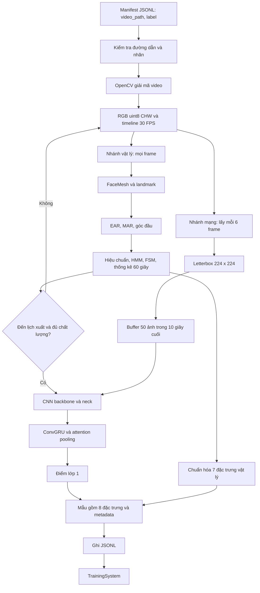
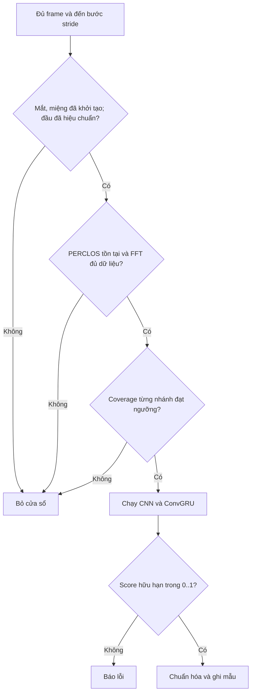
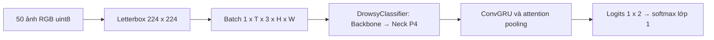
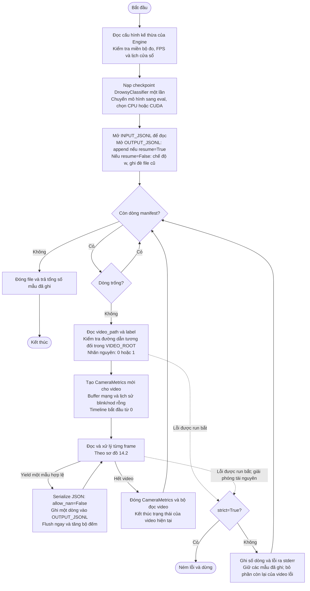
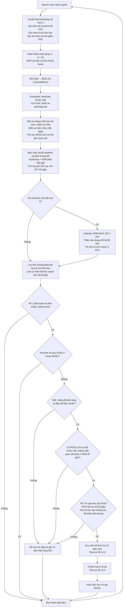
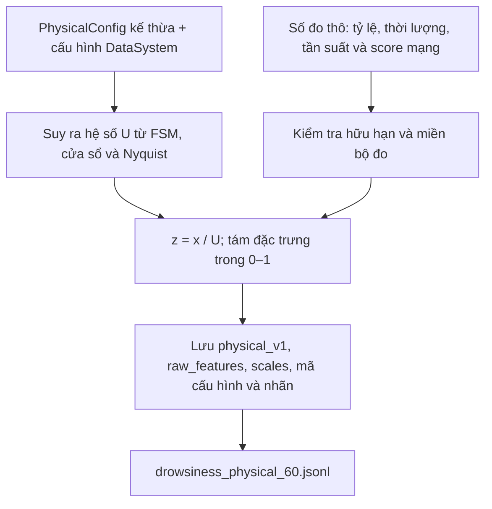

# DataSystem — Hệ thống tạo dữ liệu đặc trưng buồn ngủ

**Chuẩn hóa theo miền bộ đo `physical_v1`, không gán mức nguy hiểm.** Xem [NORMALIZATION.md](NORMALIZATION.md) để biết công thức, cơ sở và giới hạn.

## 1. Mục đích và phạm vi

Cấu hình nằm tại [config.py](config.py). `DataSystemConfig` kế thừa
`PhysicalConfig` từ [PhysicalBranch/config.py](../../PhysicalBranch/config.py),
bổ sung stride, tham số mạng, coverage và tổng hợp thời lượng. Các đường dẫn chạy,
checkpoint, `RUN_DEVICE`, `STRICT`, `RESUME` cũng nằm trong file này.

```python
from dataclasses import replace
from ai.OptimalAlgorithsm.DataSystem.config import DEFAULT_CONFIG, VIDEO_ROOT
from ai.OptimalAlgorithsm.DataSystem.engine import Engine

config = replace(DEFAULT_CONFIG, nod_pitch_deg=16, nod_release_deg=9,
                 chunk_size=16, blink_duration_percentile=90)
engine = Engine(VIDEO_ROOT, config=config)
```

Thứ tự ưu tiên: mặc định vật lý → cấu hình kế thừa DataSystem → tham số
truyền trực tiếp. Thời lượng ngáp/gật và cửa sổ FFT lấy từ cấu hình vật lý.
Hệ số chuẩn hóa được suy ra từ cấu hình thực tế của detector, bao gồm
`eye_options`, `mouth_options` và `windows`; không có bộ ngưỡng nguy hiểm riêng.

DataSystem đọc video và nhãn từ manifest JSONL, trích xuất **7 đặc trưng vật lý + 1 điểm CNN–ConvGRU**, sau đó ghi từng mẫu thành một dòng JSONL cho `TrainingSystem`.

Một mẫu mặc định mô tả cửa sổ video 60 giây. Nhánh vật lý cập nhật ở 30 FPS; nhánh mạng dùng 50 ảnh ở 5 FPS trong **10 giây cuối** của cửa sổ. Các cửa sổ dịch 60 giây mỗi lần, không chồng lấn.

Mã không huấn luyện lại CNN/ConvGRU, không tự gán nhãn và không xác nhận người trong video thực sự buồn ngủ. Nhãn đầu ra được giữ nguyên từ manifest. Các đặc trưng đã chuẩn hóa là đầu vào cho bước tối ưu tiếp theo, không phải tất cả đều là xác suất.

## 2. Thành phần

| Tệp/thành phần | Vai trò |
| --- | --- |
| `loadvideo2handle.py` | Giải mã video, chuyển BGR → RGB, đưa video về timeline FPS đích |
| `config.py` | Kế thừa cấu hình vật lý, cấu hình trích xuất và đường dẫn chạy |
| `normalization.py` | Chuẩn hóa tuyến tính theo cận bộ đo, kiểm tra miền và tạo mã cấu hình |
| `engine.py` | Điều phối hai nhánh, quản lý cửa sổ và lịch sử sự kiện, lọc chất lượng, chuẩn hóa, ghi JSONL |
| `neuralnetwork.py` | Tìm checkpoint, nạp CNN và ConvGRU, letterbox ảnh, suy luận điểm lớp 1 |
| `physicalbranch.py` | Import `CameraMetrics`; cung cấp lớp tiện ích `VideoMetrics` để lấy kết quả cuối của một chuỗi frame |
| `../../PhysicalBranch/camera_metrics.py` | FaceMesh, EAR/MAR, góc đầu, hiệu chuẩn, kết hợp các bộ đo thời gian |
| `../../PhysicalBranch/adaptive_hmm_fsm.py` | HMM thích nghi và bộ đếm sự kiện mắt/miệng |
| `../../PhysicalBranch/temporal_metrics.py` | FSM, tỷ lệ theo thời gian và phân tích chuyển động đầu bằng FFT |
| `tests/test_data_system.py` | Kiểm thử hồi quy DataSystem |

`Engine` gọi trực tiếp `CameraMetrics`, không gọi `VideoMetrics.process()`. `VideoMetrics` chỉ trả trạng thái cuối chuỗi; nó không tạo bộ mẫu cửa sổ trượt.

## 3. Sơ đồ tổng thể



Hai nhánh dùng chung frame đã giải mã. CNN chỉ chạy khi đến lịch xuất một cửa sổ đạt điều kiện chất lượng. Video được đọc tuần tự; lịch sử HMM và baseline đầu được giữ giữa các cửa sổ cùng video, nhưng được tạo mới khi chuyển video.

## 4. Đầu vào và quy ước nhãn

Manifest: mỗi dòng không trống phải là một JSON object.

```json
{"video_path": "Fold1_part1/01/0.mov", "label": 0}
{"video_path": "Fold1_part1/01/5.mov", "label": 1}
{"video_path": "Fold1_part1/01/10.MOV", "label": 1}
```

- `video_path`: chuỗi đường dẫn tương đối, tính từ `video_root`. Đường dẫn tuyệt đối hoặc đường dẫn thoát khỏi root bị từ chối, kể cả qua symlink.
- `label`: số nguyên `0` hoặc `1`; không nhận chuỗi `"1"`, boolean hoặc nhãn gốc `5`, `10`.
- Manifest hiện tại gộp mức `5` và `10` thành lớp `1`; mức `0` thành lớp `0`. Đây là lựa chọn nhị phân của bộ dữ liệu này. Engine không suy ra nhãn từ tên file.
- Một nhãn video được gán cho mọi cửa sổ của video đó; chưa có annotation riêng cho từng thời điểm.

Kiểm tra manifest trong phiên rà soát: **182 dòng, 60 nhãn 0 và 122 nhãn 1**, không thiếu file, không trùng đường dẫn. Tên file khớp quy ước gộp nhãn trên. Điều này kiểm chứng tính nhất quán manifest, không kiểm chứng nhãn hành vi bằng quan sát thủ công.

## 5. Đọc video và lấy mẫu thời gian

`read_video(path, target_fps=30)` trả về:

```text
(frame, timestamp)
frame: numpy.ndarray, uint8, RGB, [3, H, W]
timestamp: giây, bắt đầu từ 0, tăng theo index / target_fps
```

Quy trình:

1. Kiểm tra FPS đích và FPS nguồn là số hữu hạn, lớn hơn 0.
2. Đọc timestamp nguồn bằng `CAP_PROP_POS_MSEC`.
3. Trừ timestamp đầu tiên để chuẩn hóa mốc thời gian về 0. Timestamp đầu âm vẫn được hỗ trợ.
4. Nếu hai timestamp đầu đều bằng 0, xem backend không cung cấp timeline và dùng `frame_index / source_fps` cho video đó.
5. Ngoài chế độ thay thế trên, timestamp nguồn không hữu hạn hoặc không tăng sẽ gây lỗi.
6. Mỗi mốc lấy mẫu dùng ảnh nguồn gần nhất ở trước hoặc đúng mốc đó. Không dùng ảnh tương lai và không nội suy nội dung ảnh.
7. Khoảng tồn tại của frame cuối được ước lượng thêm `1 / source_fps`, để không bỏ mất frame cuối khi tăng FPS.
8. Giải phóng `VideoCapture` khi kết thúc hoặc xảy ra lỗi.

Ví dụ video 2 FPS chuyển thành 4 FPS:

```text
Thời gian đích:  0.00   0.25   0.50   0.75
Ảnh được dùng:     A      A      B      B
```

Đưa video nguồn thấp FPS lên 30 FPS chỉ lặp ảnh; không tạo thêm thông tin chuyển động. Trường hợp timestamp không có và video thực tế có FPS biến thiên không thể phục hồi chính xác chỉ từ FPS trung bình. `cap.read()` thất bại giữa video hiện được xử lý như kết thúc luồng; chưa phân biệt chắc chắn EOF với file bị lỗi giải mã một phần.

## 6. Cửa sổ và hai tốc độ FPS

| Tham số | Mặc định | Ý nghĩa |
| --- | --- | --- |
| `fps` | 30 | Timeline chung và tốc độ xử lý nhánh vật lý |
| `window_sec` | 60 | Độ dài cửa sổ vật lý, 1.800 frame |
| `stride_sec` | 60 | Khoảng dịch giữa hai cửa sổ, 1.800 frame |
| `neural_sec` | 10 | Độ dài đoạn đưa vào ConvGRU |
| `neural_fps` | 5 | 5 ảnh/giây, cách nhau 0,2 giây |
| `neural_size` | 224 | Kích thước letterbox trước khi lưu buffer mạng |
| `min_observed_ratio` | 0,8 | Tỷ lệ thời gian quan sát tối thiểu cho mắt, miệng và đầu |
| `device` | `None` | Tự chọn CUDA nếu có; có thể truyền `"cpu"` |
| `checkpoint_path` | `../../LSTM/checkpoints/frozenv1` | Checkpoint DrowsyClassifier hoàn chỉnh |
| `chunk_size` | 8 | Số ảnh mỗi lượt chạy CNN backbone/neck |
| `blink_duration_percentile`, `nod_duration_percentile` | 90, 100 | Tổng hợp thời lượng sự kiện hợp lệ |

Với mặc định, cứ mỗi 6 frame của timeline 30 FPS sẽ giữ 1 frame cho mạng. Buffer mạng chứa tối đa 50 ảnh.

```text
Cửa sổ vật lý         Frame mạng tương ứng
[ 0, 60) giây         50.0, 50.2, ..., 59.8
[60,120) giây        110.0, 110.2, ..., 119.8
[120,180) giây       170.0, 170.2, ..., 179.8
```

Đây là lịch xét xuất, không đảm bảo mỗi mốc đều có một dòng đầu ra. Video ngắn hơn một cửa sổ không tạo mẫu. Cửa sổ cuối chưa đầy bị bỏ.

Với `N` frame đầu ra bộ đọc, số cửa sổ được xét là:

```text
0                                           nếu N < window_frames
1 + floor((N - window_frames) / stride_frames)  nếu N >= window_frames
```

Số dòng thực tế có thể thấp hơn do lọc chất lượng.

Ràng buộc cấu hình: FPS và kích thước ảnh là số nguyên dương; `neural_fps` phải chia hết `fps`; cửa sổ và stride phải khớp lưới lấy mẫu; đoạn mạng không dài hơn cửa sổ vật lý. Đầu vào suy luận mặc định là `224×224`, lấy mẫu `5 FPS`. Kích thước suy luận được đặt tại `MODEL_IMAGE_SIZE` trong `config.py`.

### Quy ước biên thời gian

Metadata `[start_second, end_second)` biểu diễn cửa sổ **frame**. Frame cuối có timestamp `end_second - 1/fps`; các chỉ số vật lý được lấy tại timestamp này.

FSM giữ sự kiện hoàn tất trong `(t - window_sec, t]`. Trên lưới đều, đó là các mốc sự kiện thuộc cửa sổ frame. Tỷ lệ như PERCLOS được tích phân từ các khoảng giữa hai lần quan sát đến `t`, nên biên thống kê liên tục sớm hơn biên metadata tối đa một bước frame, khoảng 33,3 ms ở 30 FPS. Không diễn giải đây là phép đo liên tục chính xác đến mili giây.

Cửa sổ FFT được đặt đúng 60 giây theo cấu hình riêng. Tại mốc xuất đầu tiên, 1.800 ảnh chỉ trải dài 59,9667 giây nên chưa đủ chuỗi FFT; mẫu đầu tiên có thể bị loại.

## 7. Nhánh vật lý

### 7.1. Khuôn mặt và tín hiệu cơ sở

`CameraMetrics` dùng MediaPipe FaceMesh với tối đa một khuôn mặt, `refine_landmarks=True`, ngưỡng detection/tracking mặc định 0,6.

Với sáu điểm cấu thành mắt hoặc miệng:

```text
aspect_ratio = (||p1 - p5|| + ||p2 - p4||) / (2 * ||p0 - p3||)
```

EAR là trung bình tỷ lệ của hai mắt; MAR là tỷ lệ miệng. Tín hiệu không hợp lệ hoặc không tìm thấy mặt được biểu diễn bằng `None`.

Mắt và miệng khởi tạo từ **300 quan sát hợp lệ** ở cấu hình 30 FPS, tương đương khoảng 10 giây nếu tín hiệu liên tục. Các mẫu khởi tạo có thể tích lũy lâu hơn khi mất mặt. HMM phân biệt trạng thái mắt mở/đóng và miệng nghỉ/mở; FSM xác nhận sự kiện theo thời lượng.

### 7.2. Sự kiện và thời lượng

| Sự kiện | Điều kiện thời lượng mặc định |
| --- | --- |
| Chớp mắt | 100–2.000 ms |
| Ngáp | 4.000–7.500 ms |
| Gật đầu | 800–3.500 ms |

Sự kiện chỉ được đếm khi kết thúc và đã quan sát được trạng thái nghỉ để khởi động FSM. Mất tín hiệu hoặc khoảng cách quan sát lớn hơn 0,25 giây hủy sự kiện đang dở. Một lần đóng mắt quá dài không được tính là chớp mắt hợp lệ, nhưng vẫn có thể đóng góp vào PERCLOS.

Tần suất sự kiện:

```text
rate_per_minute = số sự kiện hoàn tất trong cửa sổ * 60 / window_sec
```

Mẫu số là toàn bộ độ dài cửa sổ, không phải riêng thời gian quan sát hợp lệ. Điều kiện coverage hạn chế tác động của mất tín hiệu, nhưng không bù hoàn toàn số sự kiện có thể đã bị bỏ lỡ.

`blink_duration` là P90 theo ms; `nod_duration` là max theo giây, của các sự kiện hợp lệ **kết thúc trong cửa sổ**. Một sự kiện có thể bắt đầu trước biên cửa sổ; thời lượng của nó vẫn được giữ nguyên. Không có sự kiện thì giá trị tổng hợp bằng 0.

### 7.3. PERCLOS

Ngưỡng mắt đóng sâu được tính từ baseline EAR mở và tham chiếu đóng:

```text
threshold = EAR_open - 0.8 * (EAR_open - EAR_closed_reference)
active = EAR <= threshold
PERCLOS (%) = 100 * thời gian active / thời gian mắt quan sát hợp lệ
```

Các khoảng mất tín hiệu không được xem là mắt mở và không nằm trong mẫu số. Khi chưa có khoảng quan sát hợp lệ, PERCLOS là `None` và cửa sổ bị loại.

### 7.4. Gật đầu và chuyển động đầu

Góc đầu được ước lượng từ landmark. Baseline tư thế trung tính lấy từ 30 mẫu hợp lệ đầu tiên, dùng trung vị sau xử lý góc vòng. Góc sử dụng tiếp theo là góc tương đối với baseline.

Gật đầu dùng hysteresis theo pitch: vào trạng thái gật khi vượt 14°, giữ trạng thái đến khi không còn vượt 8°. Mặc định `nod_direction=None` dùng trị tuyệt đối pitch, nên không phân biệt cúi và ngửa. Tư thế ban đầu không trung tính có thể làm lệch baseline; cần kiểm chứng trên video thực tế khi đánh giá độ chính xác hành vi.

Tần số chuyển động đầu dùng chuỗi pitch liên tục đủ dài: nội suy theo timestamp, trừ trung bình, áp dụng cửa sổ Hann, tìm đỉnh phổ FFT khác DC. Nếu đã đủ cửa sổ liên tục và biên độ peak-to-peak không vượt 0,1°, trả `0 Hz` và giữ mẫu. Thiếu dữ liệu trả `None` và loại mẫu.

Mất pitch hoặc khoảng thời gian gián đoạn lớn hơn 0,25 giây làm xóa chuỗi FFT. Sau đó phải tích lũy lại đủ 60 giây liên tục. Đây là điều kiện mạnh hơn yêu cầu coverage 80%.

## 8. Điều kiện xuất một mẫu



Coverage dùng cửa sổ thực của từng metric (`perclos`, `pom`, `over_angle`), kể cả override. Mặc định yêu cầu từng giá trị `eye_observed_sec`, `mouth_observed_sec`, `head_observed_sec` đạt ít nhất `60 * 0.8 = 48 giây`.

Trong điều kiện liên tục, HMM khởi tạo khoảng 10 giây, còn khoảng 50 giây quan sát mắt/miệng trong cửa sổ đầu. Tuy nhiên, `[0,60)` vẫn bị loại với cấu hình mặc định vì FFT chưa đủ 60 giây liên tục sau hiệu chuẩn đầu. Với stride mặc định 60 giây, `[60,120)` là cửa sổ tiếp theo có thể đạt điều kiện. Mất tín hiệu có thể làm đầu ra muộn hơn; đầu đứng yên nhưng đủ dữ liệu vẫn hợp lệ.

`min_observed_ratio=0` chỉ bỏ ngưỡng coverage. Các điều kiện khởi tạo và PERCLOS vẫn áp dụng; FFT phải có tần số hữu hạn không âm, độ phân giải dương và đủ cửa sổ quan sát liên tục. Thiếu dữ liệu FFT làm loại mẫu.

Hiện bộ lọc bỏ cửa sổ không đạt mà không ghi một dòng lý do riêng vào JSONL. Vì vậy cần theo dõi số dòng đầu ra; file rỗng không tự động đồng nghĩa với video không buồn ngủ.

## 9. Nhánh DrowsyClassifier



`NeuralNetwork` gọi trực tiếp `ai.LSTM.src.model.DrowsyClassifier`; mô hình tự
chuẩn hóa uint8 về `[0,1]`, chia chunk trích xuất P4 và ghép chuỗi thời gian.
Ảnh float phải hữu hạn trong `[0,1]`. Letterbox giữ tỷ lệ, viền RGB `(114,114,114)`.
Suy luận chạy `eval()` và `torch.inference_mode()`, trả xác suất lớp buồn ngủ;
không còn trả điểm cố định 0.5. Logits phải hữu hạn và có dạng `[1,2]`.

### Cấu hình và checkpoint

`DataSystemConfig` lấy mặc định từ `ai.LSTM.src.config.DEFAULT_CONFIG`:
ảnh 224, clip 10 giây, 5 FPS, chunk 8 ảnh (0 chạy toàn bộ frame).
`neural_size` áp dụng cho cả buffer và suy luận. Kiến trúc mạng được đọc từ
`model_config` của checkpoint, không khai báo lại trong DataSystem.

Dùng một checkpoint hoàn chỉnh, mặc định `../../LSTM/checkpoints/frozenv1`.
Đổi `DataSystemConfig.checkpoint_path` hoặc truyền `Engine(checkpoint_path=...)`.
`load_model()` nạp định dạng version 1 gồm `model`, `model_config`, `config`,
`epoch`, kiểm tra trọng số với `strict=True`. Hai checkpoint CNN/ConvGRU cũ
không còn được hỗ trợ tự động. Kích thước ảnh, FPS và độ dài clip trong
`config` của checkpoint phải khớp cấu hình DataSystem, nếu không sẽ báo lỗi.

```bash
python -m ai.OptimalAlgorithsm.DataSystem.neuralnetwork --checkpoint ai/LSTM/checkpoints/frozenv1/best.pt --device cpu
```

## 10. Đặc trưng đầu ra và chuẩn hóa

Tám đặc trưng nằm trong `[0,1]` theo `z = x / U`, với `U` là cận bộ đo.
PERCLOS và score mạng giữ nguyên tỷ lệ; thời lượng chia giới hạn FSM;
tần suất sự kiện chia cận số sự kiện trên cửa sổ; FFT chia Nyquist.
Chi tiết công thức và nguồn tham khảo: [NORMALIZATION.md](NORMALIZATION.md).

Metadata gồm `source_video`, `start_second`, `end_second`, `label`,
`feature_encoding="physical_v1"`, `raw_features`, `normalization_scales`
và `normalization_id` (SHA-256 của cấu hình kế thừa đã áp dụng).
Không làm tròn bốn chữ số để tránh mất chi tiết các giá trị nhỏ.
Hash này không bao gồm nội dung checkpoint hoặc phiên bản mã nguồn;
cần lưu chúng riêng khi tái lập thí nghiệm.

## 11. Cách chạy

Chạy từ thư mục gốc repository với môi trường đã có các dependency của dự án: NumPy, OpenCV, PyTorch và MediaPipe có API `mp.solutions.face_mesh`. Import gói `ai.LSTM.src` còn kéo theo dependency huấn luyện/đánh giá; xem `ai/LSTM/requirements.txt`.

### Tạo file mới qua Python

```python
from ai.OptimalAlgorithsm.DataSystem.engine import Engine

engine = Engine(
    video_root="ai/OptimalAlgorithsm/UTA-RLDD",
    fps=30,
    window_sec=60,
    stride_sec=60,
    neural_sec=10,
    neural_fps=5,
    neural_size=224,
    min_observed_ratio=0.8,
    device="cpu",  # Bỏ tham số này để tự chọn CUDA nếu có.
)
count = engine.run(
    "ai/OptimalAlgorithsm/UTA-RLDD/dataset.jsonl",
    "ai/OptimalAlgorithsm/drowsiness_verified.jsonl",
    strict=True,
)
print(f"Đã ghi {count} mẫu")
```

`run(..., resume=False)` mở output ở chế độ `w`: **ghi đè nếu tệp đã tồn tại**. `resume=True` kiểm tra file đã có rồi mở append; khối chạy chính hiện đặt `RESUME=True`. Input và output cùng đường dẫn bị từ chối. Ví dụ dùng tên mới để không ghi đè dữ liệu trước khi kiểm chứng.

`strict=True` dừng ở lỗi đầu tiên. Mặc định `strict=False` ghi lỗi có số dòng ra stderr và tiếp tục dòng manifest tiếp theo. Dòng JSONL trống được bỏ qua. Output được flush từng mẫu; nếu video lỗi sau khi đã xuất một số cửa sổ, các mẫu trước lỗi vẫn còn trong file. Chưa có rollback theo video hoặc cơ chế chống trùng khi manifest lặp video.

### Lấy mẫu từ một video

```python
samples = engine.process_video("Fold1_part1/01/0.mov", label=0)
try:
    first = next(samples, None)
    print(first)
finally:
    samples.close()
```

Đóng generator khi dừng đọc sớm để giải phóng FaceMesh và bộ đọc video.

Chạy `python -m ai.OptimalAlgorithsm.DataSystem.engine`. Chỉnh cấu hình tại `config.py`:

- `INPUT_JSONL`, `VIDEO_ROOT`, `OUTPUT_JSONL`: nguồn và đích dữ liệu.
- `DataSystemConfig.checkpoint_path`: checkpoint DrowsyClassifier hoàn chỉnh. Đường dẫn không tồn tại sẽ báo lỗi.
- `FPS`, `RISK_CONFIG["window_sec"]`, `STRIDE_SEC`: timeline và cửa sổ vật lý.
- `NEURAL_SEC`, `NEURAL_FPS`, `NEURAL_SIZE`: đoạn ảnh đầu vào mạng.
- `CHUNK_SIZE`, `DEVICE`: số ảnh mỗi lượt CNN và thiết bị suy luận.
- `MIN_OBSERVED_RATIO`, `RISK_CONFIG`, `STRICT`: lọc chất lượng, cấu hình điểm nguy hiểm và xử lý lỗi. `RISK_CONFIG` lấy bản sao của `DEFAULT_RISK_CONFIG`; có thể sửa các khóa tại đây.

Đường dẫn mặc định được suy ra từ vị trí thư mục dự án. `RESUME=True` giữ dữ liệu đã lưu và kiểm tra trước khi nối thêm; `RESUME=False` ghi đè output. Các giá trị mặc định của API `Engine` vẫn dùng được khi import từ mã Python khác.

### Môi trường không dùng âm thanh

Trong môi trường rà soát, import MediaPipe bị kẹt ở `sounddevice` → `PortAudio` khi khởi tạo hệ thống âm thanh. DataSystem không dùng microphone. Để kiểm thử video độc lập với dependency âm thanh tùy chọn, tiến trình thử nghiệm vô hiệu hóa import `sounddevice` **trước khi import MediaPipe**:

```python
import sys
sys.modules["sounddevice"] = None

from ai.OptimalAlgorithsm.DataSystem.engine import Engine
```

Đây là thiết lập riêng cho tiến trình chỉ xử lý video, không phải sửa dependency hay giả lập FaceMesh. Nó khiến chức năng ghi âm của MediaPipe không khả dụng trong tiến trình đó. Không đưa thiết lập này vào ứng dụng cần âm thanh. Nếu môi trường import MediaPipe bình thường thì không cần dùng.

## 12. Kiểm thử và mức độ kiểm chứng

Từ repository root:

```bash
MPLCONFIGDIR=/tmp/driver-guardian-mpl OMP_NUM_THREADS=4 \
python -m unittest discover -s ai/OptimalAlgorithsm/DataSystem/tests -v

python -m unittest discover -s ai/PhysicalBranch/tests -v
```

Kiểm thử DataSystem bao gồm miền `[0,1]`, tính tuyến tính, P90/max, đổi đơn vị, độc lập giữa các đặc trưng, cận FSM, FFT tin cậy, biên thời lượng ngáp/gật, cùng các ca: cùng FPS không lặp sai frame; tăng/giảm FPS; frame cuối; timestamp thiếu, âm, đi qua 0 và không tăng; giữ tỷ lệ ảnh và màu viền float; cấu hình/nhãn không hợp lệ; JSONL strict/continue; suy luận DrowsyClassifier, checkpoint version 1 và kiểm tra cấu hình huấn luyện; lịch cửa sổ, buffer 5 FPS và điều kiện chất lượng.

Kiểm thử PhysicalBranch bao gồm FSM, thời lượng sự kiện, mất tín hiệu, PERCLOS theo khoảng thời gian, hiệu chuẩn đầu, FFT và cửa sổ độc lập. Đây là kiểm thử logic; chưa thay thế đánh giá trên landmark và nhãn sự kiện được gán thủ công.

Kết quả kiểm chứng video trước đây trên kiến trúc cũ (không xác minh checkpoint DrowsyClassifier mới, stride 10 giây):

| Hạng mục | Kết quả |
| --- | --- |
| DataSystem | 17 kiểm thử đạt |
| PhysicalBranch | 18 kiểm thử đạt |
| Trọng số CNN backbone/neck và ConvGRU | Khớp toàn bộ khóa với `strict=True` |
| Pipeline trên video thật | Chạy đủ 2.100 frame đầu ra, tương đương 70 giây ở 30 FPS |
| Cửa sổ `[0,60)` | Bị loại đúng: mắt/miệng mới quan sát 45 giây; FFT chưa đủ chuỗi |
| Cửa sổ `[10,70)` | Được xuất: mắt/miệng quan sát 55 giây, đầu 60 giây, FFT đủ dữ liệu |

Video thử là `Fold1_part1/01/0.mov`, nhãn 0, dùng CPU. Bộ đọc thật được giới hạn ở 2.100 frame để kiểm tra hai mốc xuất đầu tiên; không giả lập landmark hoặc đầu ra mạng. Chỉ dependency âm thanh tùy chọn bị vô hiệu hóa như hướng dẫn ở trên.

Kết quả video ở bảng trên thuộc phiên bản trước. Phiên bản `physical_v1`
đã kiểm thử logic và tích hợp bằng dữ liệu tổng hợp; chưa tạo lại toàn bộ video.
Không dùng các điểm cũ để suy ngược số đo vì phép bão hòa/đường cong cũ đã mất thông tin.

## 13. Những điểm cần giữ khi tạo bộ dữ liệu huấn luyện

1. **Tạo lại dữ liệu theo `physical_v1`.** Không trộn các phiên bản cũ với dữ liệu mới. Phiên cập nhật không ghi đè dataset hiện có.
2. **Tách tập theo người/video trước khi đánh giá.** Dữ liệu cũ dùng cửa sổ 60 giây dịch 10 giây, chồng lấn 50 giây; cấu hình mới dùng stride 60 giây. Chia ngẫu nhiên theo dòng có thể đưa gần như cùng nội dung vào train và test. Với UTA-RLDD nên giữ toàn bộ video cùng subject trong cùng nhóm; DataSystem chưa tự chia tập.
3. **Theo dõi tỷ lệ cửa sổ bị loại.** Điều kiện FFT đủ 60 giây liên tục có thể loại nhiều video khó. Cần báo cáo số mẫu theo lớp/subject và coverage để nhận biết thiên lệch do chất lượng theo dõi.
4. **Kiểm chứng calibration trên video thực tế.** Tư thế ban đầu, mắt đã nhắm, kính, che khuất, góc quay và ảnh lặp do FPS thấp có thể làm thay đổi phép đo.
5. **Không đồng nhất chạy đúng với dự đoán đúng.** Muốn kết luận độ chính xác cần tập kiểm thử độc lập, nhãn phù hợp cho từng cửa sổ và đối chiếu sự kiện với annotation. Bộ kiểm thử phần mềm không cung cấp accuracy/precision/recall hành vi.
6. **Lưu provenance.** Ghi phiên bản mã, đường dẫn/hash checkpoint, tham số Engine, manifest và log tạo dữ liệu. Kiểm tra checkpoint có từng được huấn luyện trên các subject dùng để đánh giá hay không.

## 14. Sơ đồ Mermaid chi tiết: video → JSONL

Các sơ đồ dưới đây mô tả cấu hình mặc định `physical_v1`: nhánh vật lý 30 FPS, cửa sổ 60 giây, stride 60 giây; mạng nhận 50 ảnh ở 5 FPS trong 10 giây cuối. Hai nhánh dùng cùng timeline; mã cập nhật tuần tự theo frame, không chạy hai worker song song.

### 14.1. Điều phối manifest và vòng đời từng video



Mỗi video có bộ đo và buffer riêng nên không nối frame, sự kiện hoặc trạng thái hiệu chuẩn sang video tiếp theo. Checkpoint mạng được tái sử dụng. Nhãn của mọi cửa sổ được kế thừa từ manifest, không lấy từ dự đoán của mạng.

### 14.2. Từ frame đến cửa sổ đủ điều kiện suy luận



Tại cửa sổ frame `[0,60)`, timestamp cuối là khoảng 59,9667 giây nên chưa đủ chuỗi FFT dài 60 giây. Một cửa sổ bị loại không làm reset cả video. Riêng mất pitch hoặc gián đoạn trên 0,25 giây làm xóa chuỗi FFT, cần tích lũy lại. FFT không tin cậy làm loại mẫu; không thay giá trị thiếu bằng 0.

### 14.3. Nhánh CNN–ConvGRU: chỉ dùng 10 giây cuối

```mermaid
flowchart LR
    INPUT["50 ảnh RGB uint8<br/>Ví dụ cửa sổ 60–120 giây:<br/>ảnh tại 110,0; 110,2; ...; 119,8"]
    INPUT --> STACK["Stack thành T × 3 × 224 × 224<br/>T = 50"]
    STACK --> CHUNK["DrowsyClassifier chia chunk tối đa 8 ảnh<br/>Chuyển sang device, float32<br/>Chia 255 để pixel về 0–1"]
    CHUNK --> CNN["CNN backbone → neck<br/>Trích xuất đặc trưng P4"]
    CNN --> SEQ["Ghép đặc trưng theo đúng thứ tự thời gian<br/>Thêm chiều batch, seq_lens = 50"]
    SEQ --> GRU["ConvGRU xử lý chuỗi đặc trưng<br/>Trả logits của clip"]
    GRU --> PROB["Hai logits: softmax lấy lớp 1"]
    PROB --> CHECK["Kiểm tra score hữu hạn trong 0–1<br/>Đưa vào neuralnetwork_score"]
```



Cột `neuralnetwork_score` là đầu ra của nhánh CNN–ConvGRU trong bộ tám đặc trưng. Chuẩn hóa pixel ở sơ đồ này khác với chuẩn hóa đặc trưng ở sơ đồ tiếp theo.

### 14.4. Chuẩn hóa 8 đặc trưng và định dạng dòng JSONL



Tần suất dùng cửa sổ của từng FSM. Không có sự kiện hợp lệ thì thời lượng bằng 0.
FFT thiếu hoặc không đáng tin cậy vẫn làm mẫu bị loại, không được thay bằng 0.
Giá trị chuẩn hóa lớn hơn chỉ có nghĩa là số đo lớn hơn.

## 15. Ngắt và chạy tiếp

Nhấn `Ctrl+C` trong terminal đang chạy. Các dòng đã ghi được flush sau mỗi mẫu; đợi tiến trình kết thúc rồi mới chạy lại, không chạy hai tiến trình ghi cùng output.

Trong `config.py`, giữ cùng manifest, output, checkpoint và cấu hình, đặt:

```python
RESUME = True
```

Chạy lại lệnh cũ. File chưa tồn tại thì được tạo mới. File đã có được kiểm tra trước khi mở append; mỗi cửa sổ được nhận diện bằng `(source_video, label, start_second, end_second)`. Cửa sổ đã lưu được bỏ qua trước suy luận mạng và không ghi trùng. Giá trị trả về là số mẫu **mới thêm** trong lần chạy này.

Resume này không lưu checkpoint trạng thái HMM/FSM. Nhánh vật lý vẫn đọc lại **tất cả video trong manifest từ đầu**, kể cả video đã có dữ liệu, nhằm khôi phục trạng thái hiệu chuẩn, mô hình thích nghi và lịch sử sự kiện. Vì vậy có thể chưa thấy file tăng kích thước trong lúc đọc lại phần cũ; CNN–ConvGRU không chạy cho cửa sổ đã lưu. Không seek thẳng đến timestamp cuối.

JSONL sai, dòng cuối bị cắt hoặc khác encoding/cửa sổ sẽ báo lỗi trước khi ghi thêm; chương trình không tự xóa dữ liệu lỗi. Mã cấu hình và hệ số chuẩn hóa phải khớp trước khi resume. File chưa lưu hash nội dung checkpoint: khi thay checkpoint, hãy dùng output mới. `RESUME=False` là chạy lại và ghi đè output.

## Rà soát bổ sung

Các kiểm thử bao phủ stride, resume khác phiên bản/cấu hình, dữ liệu trùng,
nhãn mâu thuẫn và coverage không hữu hạn. Chạy các lệnh ở mục 12 để kiểm tra
phiên bản hiện tại.

Output mặc định là `drowsiness_physical_60.jsonl`. Chọn file này khi chạy
TrainingSystem sau khi tạo dữ liệu mới. Các phép gộp hiện tại dùng trọng số dương:
chúng chưa học được quan hệ không đơn điệu từ đặc trưng trung lập.
Xem phần giới hạn trong [NORMALIZATION.md](NORMALIZATION.md).

### Chẩn đoán cửa sổ bị loại

`[skip]` in riêng lỗi readiness/coverage hoặc FFT. Với mặc định, `[0,60)`
không đủ 60 giây pitch sau hiệu chuẩn; mất một pose làm chuỗi FFT bắt đầu lại.
`min_observed_ratio` không hạ yêu cầu FFT. Có thể cấu hình
`windows={"head_motion": 20}` nếu chấp nhận độ phân giải khoảng 0,05 Hz
thay vì 0,0167 Hz. Đây là thay đổi định nghĩa đặc trưng, cần trích xuất dataset
mới vì `normalization_id` thay đổi. Đoạn cuối ngắn hơn cửa sổ không xuất mẫu.

`subject_id` trong manifest được giữ trong output và kiểm tra khi resume.
TrainingSystem nhận diện nhóm ULDD theo đường dẫn `A/A/A_IR_A.mp4`
(cùng người cho IR/L3D/R3D và A/D), hoặc nhận `subject_id` tường minh.

### Cân bằng sáng khi đọc video

`read_video` nâng sáng frame tối bằng gamma trên kênh Y của YCrCb, trước khi
đổi BGR → RGB và lấy mẫu timeline. Giữ nguyên Cr/Cb trước khi đổi lại BGR;
phép đổi màu và clipping có thể gây sai lệch nhỏ, nhất là ở màu bão hòa.
Frame có Y trung bình từ `target_luma` trở lên giữ nguyên từng pixel.
Gamma không thấp hơn 0,5 để giới hạn khuếch đại vùng tối; ảnh đen hoàn toàn
vẫn giữ đen vì không có chi tiết để khôi phục. Mức sáng mục tiêu là gần đúng,
không đảm bảo trung bình đầu ra bằng mục tiêu cho mọi phân bố ảnh.

Cấu hình mặc định: `DataSystemConfig.target_luma=70` trên thang 0–255.
Đặt `target_luma=0` để tắt; Engine truyền cấu hình này xuống bộ đọc.
Ví dụ gọi riêng: `read_video(path, target_fps=30, target_luma=70)`.
Cả nhánh vật lý và neural nhận ảnh đã nâng sáng. Tham số này nằm trong
`normalization_id`, nên dataset dùng cấu hình khác sẽ không được nối bằng resume.

Đây là thay đổi tiền xử lý ảnh tối so với dataloader LSTM hiện tại. Test khớp
pixel với training áp dụng cho video đủ sáng; cần đánh giá lại score trên video
tối với checkpoint thực tế, hoặc dùng `target_luma=0` để giữ ảnh nguồn.
Ngoài ra, DataSystem chọn frame nguồn trước mốc lấy mẫu, còn dataloader LSTM
làm tròn chỉ số tới frame gần nhất. Test đã xác nhận khớp trên video CFR
25/30/60 FPS, và khác chỉ số ở 24 FPS; không khẳng định khớp mọi FPS/VFR.

### Bộ test bổ sung cho load và chuẩn hóa

Chạy toàn bộ test (bao gồm các test pytest mới):

```bash
NO_ALBUMENTATIONS_UPDATE=1 python -m pytest ai/OptimalAlgorithsm/DataSystem/tests -q
```

- `test_normalization.py`: miền và phép đảo của cả 8 cột, hệ số/đơn vị,
  dung sai biên, từ chối bool NumPy/mảng/chuỗi và tính ổn định mã cấu hình.
- `test_pipeline_integration.py`: checkpoint DrowsyClassifier và video thật
  tự tạo → Engine → JSONL → TrainingSystem; so sánh trọng số, pixel, score,
  thứ tự đặc trưng, metadata và resume. Chỉ bộ đo landmark được giả lập.
- `test_brightness.py`: nâng sáng, giữ màu, ảnh đen/đủ sáng, giới hạn gamma,
  tắt xử lý, timeline/RGB trên video thật và cấu hình Engine.

Checkpoint trong test được tạo tạm thời; các test này không xác minh chất lượng
checkpoint triển khai hoặc độ chính xác nhận diện trên video có nhãn thực tế.
