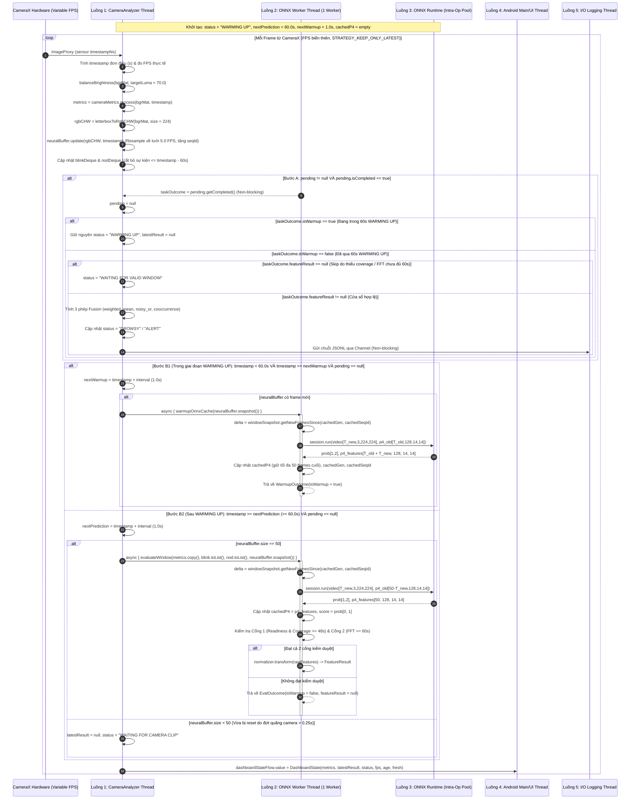

# Tài Liệu Đặc Tả Kỹ Thuật Toàn Diện: Hệ Thống Suy Luận Đa Luồng `inference.py` & Hướng Dẫn Tái Hiện Trên Android (Kotlin + ONNX Runtime)

Tài liệu này đặc tả chi tiết đến mức công thức toán học, máy trạng thái, cơ chế đồng bộ đa luồng và mã nguồn tham chiếu của toàn bộ pipeline suy luận trong [inference.py](file:///D:/Project/DATN/tempt/driver-guardian/ai/OptimalAlgorithsm/inference.py) và định dạng xuất mô hình trong [export_onnx.py](file:///D:/Project/DATN/tempt/driver-guardian/ai/OptimalAlgorithsm/export_onnx.py) cùng tất cả các module phụ thuộc ([`CameraMetrics`](file:///D:/Project/DATN/tempt/driver-guardian/ai/PhysicalBranch/camera_metrics.py), [`AdaptiveHMM_FSM`](file:///D:/Project/DATN/tempt/driver-guardian/ai/PhysicalBranch/adaptive_hmm_fsm.py), [`HeadPoseEstimator`](file:///D:/Project/DATN/tempt/driver-guardian/ai/PhysicalBranch/head_pose_estimation.py), [`temporal_metrics.py`](file:///D:/Project/DATN/tempt/driver-guardian/ai/PhysicalBranch/temporal_metrics.py), [`Engine`](file:///D:/Project/DATN/tempt/driver-guardian/ai/OptimalAlgorithsm/DataSystem/engine.py), [`NeuralNetwork`](file:///D:/Project/DATN/tempt/driver-guardian/ai/OptimalAlgorithsm/DataSystem/neuralnetwork.py), [`PhysicalNormalizer`](file:///D:/Project/DATN/tempt/driver-guardian/ai/OptimalAlgorithsm/DataSystem/normalization.py), [`Fitness`](file:///D:/Project/DATN/tempt/driver-guardian/ai/OptimalAlgorithsm/TrainingSystem/fitnessFunction.py)) để tái hiện chính xác 100% bằng **Kotlin trên nền tảng Android với ONNX Runtime**.

---

## Mục Lục
1. [Tổng Quan Kiến Trúc & Công Nghệ Trên Android](#1-tổng-quan-kiến-trúc--công-nghệ-trên-android)
2. [Kiến Trúc Đa Luồng & Tương Tác Giữa Các Luồng (Concurrency Specification)](#2-kiến-trúc-đa-luồng--tương-tác-giữa-các-luồng-concurrency-specification)
   - [2.1. Danh Sách Các Luồng Chạy (Thread Inventory) & Mô Hình Không Khóa](#21-danh-sách-các-luồng-chạy-thread-inventory--mô-hình-không-khóa-lock-free-snapshot)
   - [2.2. Thích Nghi Với FPS Biến Thiên Của Camera Trên `CameraAnalyzer Thread`](#22-thích-nghi-với-fps-biến-thiên-của-camera-trên-cameraanalyzer-thread)
   - [2.3. Sơ Đồ Tuần Tự Đa Luồng (Bao Gồm `WARMING UP` Tích Lũy `p4_old` & Suy Luận Chính Thức)](#23-sơ-đồ-tuần-tự-đa-luồng-bao-gồm-warming-up-tích-lũy-p4_old--suy-luận-chính-thức)
   - [2.4. Quy Tắc `WARMING UP`, Tích Lũy Trước `p4_old` & Chống Nghẽn Cổ Chai](#24-quy-tắc-warming-up-tích-lũy-trước-p4_old--chống-nghẽn-cổ-chai-backpressure-rules)
3. [Đặc Tả Tiền Xử Lý Ảnh & Bộ Đệm `NeuralBuffer`](#3-đặc-tả-tiền-xử-lý-ảnh--bộ-đệm-neuralbuffer)
   - [3.3. Bộ Đệm Lưới Thời Gian `NeuralBuffer` & Phương Thức Lấy Frame Mới Cho Cửa Sổ Trượt ONNX](#33-bộ-đệm-lưới-thời-gian-neuralbuffer--phương-thức-lấy-frame-mới-cho-cửa-sổ-trượt-onnx)
4. [Đặc Tả Chi Tiết Nhánh Vật Lý (`CameraMetrics` & Các Module Con)](#4-đặc-tả-chi-tiết-nhánh-vật-lý-camerametrics--các-module-con)
   - [4.1. `FaceTracker` & Công Thức Hình Học EAR / MAR](#41-facetracker--công-thức-hình-học-ear--mar)
   - [4.2. `HeadPoseEstimator` (SolvePnP) & Hiệu Chuẩn Góc Đầu](#42-headposeestimator-solvepnp--hiệu-chuẩn-góc-đầu)
   - [4.3. `AdaptiveHMM` & `AdaptiveHMM_FSM` (Mắt & Miệng)](#43-adaptivehmm--adaptivehmm_fsm-mắt--miệng)
   - [4.4. `StateMachine` (FSM Đếm Sự Kiện & Lọc Thời Lượng)](#44-statemachine-fsm-đếm-sự-kiện--lọc-thời-lượng)
   - [4.5. `WindowRatio` (Tính PERCLOS, POM, Over-Angle & Coverage)](#45-windowratio-tính-perclos-pom-over-angle--coverage)
   - [4.6. `HeadMotionWindow` (Tích Phân Biên Độ & Phổ FFT)](#46-headmotionwindow-tích-phân-biên-độ--phổ-fft)
5. [Đặc Tả Nhánh Học Sâu (`CNN–ConvGRU`) & Định Dạng Model ONNX Theo `export_onnx.py`](#5-đặc-tả-nhánh-học-sâu-cnnconvgru--định-dạng-model-onnx-theo-export_onnxpy)
6. [Đặc Tả Cổng Kiểm Duyệt (`Engine._features`), Chuẩn Hóa (`physical_v1`) & Hợp Nhất (`Fitness`)](#6-đặc-tả-cổng-kiểm-duyệt-engine_features-chuẩn-hóa-physical_v1--hợp-nhất-fitness)
7. [Mã Nguồn Tham Chiếu Python Gốc Hoàn Chỉnh (Original Python Reference Code)](#7-mã-nguồn-tham-chiếu-python-gốc-hoàn-chỉnh-original-python-reference-code)
   - [7.1. Tiền Xử Lý Ảnh & Mạng Học Sâu (`loadvideo2handle.py` & `neuralnetwork.py`)](#71-tiền-xử-lý-ảnh--mạng-học-sâu-loadvideo2handlepy--neuralnetworkpy)
   - [7.2. Bộ Đếm Thời Gian, Tỷ Lệ Cửa Sổ & Phổ FFT (`temporal_metrics.py`)](#72-bộ-đếm-thời-gian-tỷ-lệ-cửa-sổ--phổ-fft-temporal_metricspy)
   - [7.3. Ước Lượng Tư Thế Đầu 3D SolvePnP (`head_pose_estimation.py`)](#73-ước-lượng-tư-thế-đầu-3d-solvepnp-head_pose_estimationpy)
   - [7.4. Mô Hình Markov Ẩn Thích Nghi & Máy Trạng Thái (`adaptive_hmm_fsm.py`)](#74-mô-hình-markov-ẩn-thích-nghi--máy-trạng-thái-adaptive_hmm_fsmpy)
   - [7.5. Bộ Theo Dõi Khuôn Mặt & Trích Xuất Đặc Trưng Vật Lý (`camera_metrics.py`)](#75-bộ-theo-dõi-khuôn-mặt--trích-xuất-đặc-trưng-vật-lý-camera_metricspy)
   - [7.6. Cổng Kiểm Duyệt, Chuẩn Hóa `physical_v1` & Hợp Nhất `Fitness` (`engine.py`, `normalization.py`, `fitnessFunction.py`)](#76-cổng-kiểm-duyệt-chuẩn-hóa-physical_v1--hợp-nhất-fitness-enginepy-normalizationpy-fitnessfunctionpy)
   - [7.7. Đóng Gói & Xuất Mô Hình ONNX Hỗ Trợ Cache `p4_old` (`export_onnx.py`)](#77-đóng-gói--xuất-mô-hình-onnx-hỗ-trợ-cache-p4_old-export_onnxpy)
   - [7.8. Luồng Suy Luận Thời Gian Thực Đa Luồng (`inference.py`)](#78-luồng-suy-luận-thời-gian-thực-đa-luồng-inferencepy)
8. [Phân Tích Độ Phức Tạp Thuật Toán & Ước Tính Thời Gian Hoàn Thành (Complexity & Execution Time Specification)](#8-phân-tích-độ-phức-tạp-thuật-toán--ước-tính-thời-gian-hoàn-thành-complexity--execution-time-specification)
   - [8.1. Độ Phức Tạp Thuật Toán Trên `CameraAnalyzer Thread` (Chạy Mỗi Frame)](#81-độ-phức-tạp-thuật-toán-trên-cameraanalyzer-thread-chạy-mỗi-frame)
   - [8.2. Độ Phức Tạp Nhánh Học Sâu (`CNN–ConvGRU`) & Hiệu Quả Của `p4_old` Cache](#82-độ-phức-tạp-nhánh-học-sâu-cnnconvgru--hiệu-quả-của-p4_old-cache)
   - [8.3. Ước Tính Thời Gian Hoàn Thành (Execution Time) Trên Các Phân Khúc Phần Cứng](#83-ước-tính-thời-gian-hoàn-thành-execution-time-trên-các-phân-khúc-phần-cứng)
   - [8.4. Tổng Hợp Dung Lượng Bộ Nhớ (RAM Footprint)](#84-tổng-hợp-dung-lượng-bộ-nhớ-ram-footprint)
   - [8.5. Điều Kiện Đảm Bảo Thời Gian Thực Không Khóa (Real-Time Schedulability)](#85-điều-kiện-đảm-bảo-thời-gian-thực-không-khóa-real-time-schedulability)
9. [Danh Mục Kiểm Tra Tương Thích Số Học (Verification Checklist)](#9-danh-mục-kiểm-tra-tương-thích-số-học-verification-checklist)

---

## 1. Tổng Quan Kiến Trúc & Công Nghệ Trên Android

Hệ thống phát hiện buồn ngủ kết hợp hai nhánh xử lý chạy song song ở hai tần số khác nhau:
- **Nhánh Vật Lý (Physical Branch - Chạy ở FPS biến thiên của Camera thực tế, mỗi frame):** Chạy trực tiếp trên luồng phân tích camera (`CameraAnalyzer Thread`). Thích nghi linh hoạt với FPS biến thiên trên thiết bị Android (thường dao động `10–60 FPS` tùy điều kiện ánh sáng auto-exposure và nhiệt độ thiết bị) thông qua `timestamp` đơn điệu phần cứng. Trích xuất 478 điểm mốc mặt qua MediaPipe, tính toán `EAR`, `MAR`, giải bài toán `SolvePnP` để lấy góc nghiêng đầu (`pitch`, `yaw`, `roll`), cập nhật mô hình Markov ẩn thích nghi (`AdaptiveHMM`) + máy trạng thái hữu hạn (`StateMachine`), tính tỷ lệ đóng mắt `PERCLOS` trên cửa sổ trượt `60.0s` và phân tích phổ `FFT` của chuyển động đầu bằng nội suy lưới đều động.
- **Nhánh Học Sâu (Neural Branch - Lưới chuẩn 5 FPS × 10s = 50 frames, chu kỳ `interval = 1.0s`):** Chạy bất đồng bộ trên luồng nền đơn (`ONNX Worker Thread`) qua **ONNX Runtime Android** với mô hình `ExportDrowsyClassifier` từ [export_onnx.py](file:///D:/Project/DATN/tempt/driver-guardian/ai/OptimalAlgorithsm/export_onnx.py). Thay vì chạy lại toàn bộ 50 frames mỗi giây, hệ thống sử dụng cơ chế **Incremental P4 Feature Caching**: chỉ đưa các frame mới phát sinh so với cửa sổ trượt cũ (`video: [T_new, 3, 224, 224]`) kết hợp với bộ đệm đặc trưng mức P4 của cửa sổ trước (`p4_old: [T_old, 128, 14, 14]`) để xuất xác suất `prob: [1, 2]` và cập nhật `p4_features: [T_old + T_new, 128, 14, 14]`. Đặc biệt, ngay trong quá trình **`WARMING UP` (`60.0s` đầu)**, luồng ONNX vẫn chạy định kỳ để làm nóng bộ thực thi và tích lũy sẵn cache `p4_old`.
- **Nhánh Hợp Nhất (Late Fusion - 3 chế độ đồng thời):** Chuẩn hóa 7 đặc trưng vật lý + 1 điểm mạng học sâu (`neuralnetwork_score`) về miền $[0, 1]$ theo chuẩn `physical_v1` và đánh giá đồng thời 3 hàm hợp nhất (`weighted_mean`, `noisy_or`, `cooccurrence`).

### Bảng Ánh Xạ Công Nghệ (Python $\rightarrow$ Android Kotlin)

| Thành phần | Python (`inference.py` & `export_onnx.py`) | Android (Kotlin) | Thư viện Gradle khuyên dùng |
| :--- | :--- | :--- | :--- |
| **Camera Stream** | `cv2.VideoCapture` (`BUFFERSIZE=1`) | **CameraX `ImageAnalysis`** (`STRATEGY_KEEP_ONLY_LATEST`) | `androidx.camera:camera-camera2`, `camera-lifecycle` |
| **Xử lý ảnh & PnP** | `opencv-python` (`cvtColor`, `LUT`, `resize`, `solvePnP`, `RQDecomp3x3`) | **OpenCV Android SDK** (`Mat`, `Imgproc`, `Core`, `Calib3d`) | `org.opencv:opencv:4.9.0+` |
| **Face Landmarks** | `mediapipe.tasks.python.vision.FaceLandmarker` | **MediaPipe Tasks Vision Android** (`FaceLandmarker`) | `com.google.mediapipe:tasks-vision:0.10.14+` |
| **Mạng CNN–ConvGRU** | `ExportDrowsyClassifier` (`drowsy_classifier_*.onnx`) | **ONNX Runtime Android** (`OrtEnvironment`, `OrtSession`) | `com.microsoft.onnxruntime:onnxruntime-android:1.18.0+` |
| **Biến đổi FFT 1D** | `numpy.fft.rfft` | **JTransforms** (`DoubleFFT_1D.realForward`) hoặc FFT Kotlin thuần | `com.github.wendykierp:JTransforms:3.1` |
| **Quản lý Đa luồng** | `ThreadPoolExecutor(max_workers=1)` + `Future` | **Kotlin Coroutines** (`Dispatchers.Default.limitedParallelism(1)`) + `Deferred` | `org.jetbrains.kotlinx:kotlinx-coroutines-android` |
| **Giao diện (UI)** | `cv2.imshow("Driver Guardian", canvas)` | **Jetpack Compose** / `PreviewView` + Overlay `StateFlow` | `androidx.compose.ui:ui` |
| **JSON & Băm** | `json`, `hashlib.sha256` | **`kotlinx.serialization.json`**, `MessageDigest("SHA-256")` | `org.jetbrains.kotlinx:kotlinx-serialization-json` |

---

## 2. Kiến Trúc Đa Luồng & Tương Tác Giữa Các Luồng (Concurrency Specification)

### 2.1. Danh Sách Các Luồng Chạy (Thread Inventory) & Mô Hình Không Khóa (Lock-Free Snapshot)

Trên nền tảng Android, toàn bộ hệ thống được phân tách thành **5 luồng / nhóm luồng thực thi** với trách nhiệm và quyền sở hữu dữ liệu tách biệt hoàn toàn (Thread-Confined State):

| STT | Tên Luồng (Thread / Dispatcher) | Cách Khởi Tạo Trên Android | Tần Suất Hoạt Động | Trạng Thái Sở Hữu Độc Quyền (Thread-Confined State) | Nhiệm Vụ Chính |
| :-: | :--- | :--- | :--- | :--- | :--- |
| **1** | **`CameraAnalyzer Thread`** *(Luồng Phân Tích Camera)* | `Executors.newSingleThreadExecutor()` gắn vào `ImageAnalysis.setAnalyzer()` | **FPS biến thiên** theo phần cứng Camera (`~10–60 FPS`, phụ thuộc phơi sáng/nhiệt độ) | `CameraMetrics` (`FaceLandmarker`, `HeadPoseEstimator`, `AdaptiveHMM_FSM`, `StateMachine`, `WindowRatio`, `HeadMotionWindow`), `NeuralBuffer`, `blinkDeque`, `nodDeque`, `pending`, `status`, `nextPrediction`, `nextWarmupTime` | Nhận `ImageProxy`, tính `timestamp` đơn điệu từ sensor, đo FPS thực tế, chạy `balanceBrightness`, `cameraMetrics.process()`, cập nhật lưới 5 FPS của `NeuralBuffer`, quản lý trạng thái `WARMING UP` (`60.0s` đầu) và tạo bản chụp bất biến giao việc cho Luồng 2. |
| **2** | **`ONNX Worker Thread`** *(Luồng Suy Luận Học Sâu & Chuẩn Hóa)* | `Dispatchers.Default.limitedParallelism(1)` (hoặc `SingleThreadExecutor` đơn) | Chu kỳ `interval = 1.0s` (chạy **ngay trong `WARMING UP`** để tích lũy `p4_old` và sau `WARMING UP` để dự đoán) | `OnnxNeuralClassifier` (`OrtSession`, bộ đệm `cachedP4`, `cachedFrameCount`, `cachedGeneration`, `cachedSeqId`), `PhysicalNormalizer` | Nhận `NeuralWindowSnapshot`, gọi `getNewFramesSince()` để trích xuất $T_{\text{new}}$ frame mới + cắt $T_{\text{old}}$ frame từ `cachedP4`, chạy `OrtSession.run()` để cập nhật `p4_old`. Khi hết `WARMING UP` (`timestamp >= 60.0s`) và đạt 2 cổng kiểm duyệt (`Engine._features`), chuẩn hóa 8 đặc trưng `physical_v1` và trả kết quả về Luồng 1. |
| **3** | **`ONNX Intra-Op Thread Pool`** *(Nhóm Luồng Toán Tử C++)* | Quản lý nội bộ bởi ONNX Runtime C++ (`setIntraOpNumThreads(4)`) | Kích hoạt đồng bộ bên trong lệnh `session.run()` của Luồng 2 | Các vùng nhớ tạm (workspace) của toán tử `Conv`, `Gemm`, `Loop (ConvGRU)` trong C++ | Chia tải song song các phép tích chập của `BackboneNeck` (trên $T_{\text{new}}$ frames), `Adapter` và chuỗi `ConvGRUCell` trên 4 nhân CPU ARM (hoặc phần cứng NNAPI/XNNPACK). |
| **4** | **`Main / UI Thread`** *(Luồng Giao Diện Chính)* | Android Main Looper (`Dispatchers.Main` / Jetpack Compose) | Theo nhịp VSync màn hình (`60–120 Hz`) khi `StateFlow` phát trạng thái mới | `PreviewView`, Compose `State<DashboardState>`, bộ phát âm thanh/rung cảnh báo | Lắng nghe `dashboardStateFlow`, hiển thị thông số vật lý trực tiếp, FPS thực tế, tiến độ `WARMING UP`, điểm `CNN + ConvGRU` và kết quả 3 phép hợp nhất `Fitness` (`DROWSY` / `ALERT` / `STALE`). |
| **5** | **`I/O Logging Thread`** *(Luồng Ghi File JSONL - Tùy chọn)* | `Dispatchers.IO.limitedParallelism(1)` qua `Channel<String>(UNLIMITED)` | Mỗi khi có kết quả cửa sổ hợp lệ (`~1 lần/giây` sau `60.0s`) | `BufferedWriter` của file `.jsonl` đầu ra | Ghi và `flush()` dòng JSONL kết quả xuống bộ nhớ Flash bất đồng bộ để thao tác I/O đĩa không bao giờ làm khựng `CameraAnalyzer Thread`. |

#### Cơ chế giao tiếp không khóa (Lock-Free Immutable Snapshot) giữa Luồng 1 và Luồng 2:
- **Luồng 1 (`CameraAnalyzer Thread`)** không bao giờ chia sẻ trực tiếp tham chiếu đối tượng khả biến (`CameraMetrics`, `NeuralBuffer`, `ArrayDeque`) cho **Luồng 2 (`ONNX Worker Thread`)**.
- Tại thời điểm giao việc, Luồng 1 đóng gói một **bản chụp bất biến (Immutable Snapshot)** trong thời gian $O(N)$ với $N \le 50$ ($< 0.01\text{ms}$):
  - `metricsSnapshot = metrics.copy()`
  - `blinkSnapshot = blinkDeque.toList()`
  - `nodSnapshot = nodDeque.toList()`
  - `windowSnapshot = neuralBuffer.snapshot()` (chứa `generation`, `latestSeqId`, và `frames = framesDeque.toList()`, trong đó mỗi `ByteArray[3 * 224 * 224]` của 1 frame là bất biến sau khi tạo).

> [!IMPORTANT]
> **Tại sao không dùng Mutex/Lock giữa `CameraAnalyzer Thread` và `ONNX Worker Thread`?**
> Nếu khóa `neuralBuffer` hoặc `cameraMetrics` trong lúc ONNX Runtime đang chạy, `CameraAnalyzer Thread` sẽ bị chặn (block), dẫn đến rớt frame, làm sai lệch khoảng cách thời gian $\Delta t$ và vi phạm ngưỡng `max_gap_sec = 0.25s` (gây reset toàn bộ cửa sổ FFT 60s, `NeuralBuffer` và xóa sạch cache `p4_old`). Việc truyền bản chụp bất biến giúp hai luồng chạy song song hoàn toàn không khóa.

---

### 2.2. Thích Nghi Với FPS Biến Thiên Của Camera Trên `CameraAnalyzer Thread`

Trên thiết bị Android thực tế, CameraX **không bao giờ duy trì cứng 30.0 FPS** mà biến thiên liên tục (ví dụ: giảm xuống `12–15 FPS` khi tự động tăng thời gian phơi sáng trong cabin tối, hoặc dao động `20–60 FPS` tùy cấu hình phần cứng và nhiệt độ CPU/ISP). `CameraAnalyzer Thread` phải thích nghi hoàn toàn với FPS biến thiên qua 4 cơ chế:

1. **Tính `timestamp` đơn điệu từ đồng hồ phần cứng Sensor (`ImageInfo.getTimestamp()`):**
   - Không bao giờ dùng công thức `frameIndex / 30.0`.
   - Lấy mốc `originNs = imageProxy.imageInfo.timestamp` ở frame đầu tiên, sau đó quy đổi từng frame sang giây thực tế và kẹp đơn điệu nghiêm ngặt giống [`inference.py:240-243`](file:///D:/Project/DATN/tempt/driver-guardian/ai/OptimalAlgorithsm/inference.py#L240-L243):
     ```kotlin
     var timestamp = (imageProxy.imageInfo.timestamp - originNs) / 1_000_000_000.0
     if (lastTimestamp != null && timestamp <= lastTimestamp!!) {
         timestamp = lastTimestamp!! + 1e-4
     }
     lastTimestamp = timestamp
     ```
2. **Đo tốc độ khung hình thực tế (`fps`):**
   - Tính FPS trung bình lũy kế `avgFps = frames / max(timestamp, 1e-6)` (khớp 100% với [`inference.py:295`](file:///D:/Project/DATN/tempt/driver-guardian/ai/OptimalAlgorithsm/inference.py#L295)) và FPS tức thời mượt theo EMA `instantFps` từ $\Delta t = \text{timestamp} - \text{prevTimestamp}$ để hiển thị lên UI.
3. **Tách rời FPS Camera và FPS Mạng Học Sâu qua lưới thời gian `NeuralBuffer`:**
   - Dù Camera gửi frame ở `12 FPS`, `24 FPS` hay `60 FPS`, `NeuralBuffer.update(rgbCHW, timestamp)` luôn lấy mẫu lại (resample) chính xác về lưới `neural_fps = 5.0 FPS` ($\Delta t_{\text{grid}} = 0.20\text{s}$).
4. **Tính toán Nhánh Vật Lý theo thời gian liên tục ($\Delta t$ thực tế):**
   - `StateMachine` và `WindowRatio` tích phân thời lượng đóng mắt/mở miệng/nghiêng đầu theo hiệu số `timestamp` thực tế.
   - `HeadMotionWindow` tự động ước lượng trung vị bước thời gian $\Delta t_{\text{med}} = \text{median}(\text{diff}(\text{times}))$ của chuỗi mẫu thực tế trong 60s để nội suy tuyến tính ra $N = \max(4, \text{round}(\text{observed} / \Delta t_{\text{med}}) + 1)$ điểm cách đều trước khi biến đổi `rfft`.
   - Trong `WARMING UP` (`60.0s` đầu), việc hiệu chuẩn góc đầu (`30` frames) và khởi tạo `AdaptiveHMM` (`300` frames) luôn hoàn tất an toàn trước mốc `60.0s` ngay cả khi FPS camera tụt xuống mức thấp `10–15 FPS` ($300\text{ frames} / 10\text{ FPS} = 30\text{s} < 60\text{s}$).

---

### 2.3. Sơ Đồ Tuần Tự Đa Luồng (Bao Gồm `WARMING UP` Tích Lũy `p4_old` & Suy Luận Chính Thức)



---

### 2.4. Quy Tắc `WARMING UP`, Tích Lũy Trước `p4_old` & Chống Nghẽn Cổ Chai (Backpressure Rules)

Các quy tắc điều phối trong [`inference.py:232-291`](file:///D:/Project/DATN/tempt/driver-guardian/ai/OptimalAlgorithsm/inference.py#L232-L291) kết hợp với cơ chế cache `p4_old` của [`export_onnx.py`](file:///D:/Project/DATN/tempt/driver-guardian/ai/OptimalAlgorithsm/export_onnx.py):

1. **Giữ nguyên quá trình `WARMING UP` (`0.0s <= timestamp < 60.0s`) đồng thời tích lũy cache `p4_old`:**
   - Khi khởi tạo: `nextPrediction = config.windowSec` (**60.0 giây**), `nextWarmupTime = config.interval` (**1.0 giây**), `status = "WARMING UP"`, `result = null`.
   - Trong suốt $60.0\text{s}$ đầu tiên (`timestamp < 60.0s`):
     - Giao diện và trạng thái hệ thống giữ nguyên `status = "WARMING UP"` và `result = null` giống hệt `inference.py`.
     - Tuy nhiên, mỗi `1.0s` (`timestamp >= nextWarmupTime && pending == null`), nếu `neuralBuffer` có frame mới, `CameraAnalyzer Thread` gửi bản chụp `neuralBuffer.snapshot()` sang `ONNX Worker Thread` ở chế độ `isWarmup = true`.
     - `ONNX Worker Thread` trích xuất các frame mới phát sinh trong giây vừa qua (thường là `5` frames mới ở lưới `5.0 FPS`), ghép với `p4_old` đang tích lũy và gọi `OrtSession.run()`.
     - **Lợi ích kép:**
       1. Làm nóng bộ cấp phát bộ nhớ, thread pool và trình biên dịch JIT của ONNX Runtime (CPU/XNNPACK/NNAPI) ngay từ giây đầu tiên.
       2. Tích lũy cuốn chiếu `p4_old` từ `5 -> 10 -> ... -> 50` frames. Đến giây `59.0s`, `cachedP4` đã chứa sẵn đặc trưng P4 của 50 frames (`49.0s..59.0s`). Khi chạm mốc `timestamp = 60.0s` (lần dự đoán chính thức đầu tiên), `ONNX Worker Thread` **chỉ cần chạy `BackboneNeck` trên 5 frames mới (`59.0s..60.0s`)** kết hợp với `45` frames `p4_old` có sẵn, loại bỏ hoàn toàn hiện tượng khựng (latency spike) ở giây thứ 60!
2. **Duy trì cập nhật `p4_old` ngay cả khi cửa sổ vật lý bị `skip` sau `60.0s`:**
   - Sau mốc `60.0s`, nếu một cửa sổ có `neuralBuffer.size == 50` nhưng bị `Engine._features` từ chối ở Cổng 1 (Coverage $< 48\text{s}$) hoặc Cổng 2 (FFT $< 60\text{s}$), `ONNX Worker Thread` vẫn cập nhật `cachedP4` với các frame mới của cửa sổ đó trước khi trả về `null`. Nhờ vậy, `cachedP4` không bao giờ bị tụt hậu so với cửa sổ trượt của `NeuralBuffer`.
3. **Thứ tự kiểm tra trong mỗi vòng lặp frame:**
   - **Bước A (Thu hồi kết quả trước):** Luôn kiểm tra `if (pending != null && pending.isCompleted)` **TRƯỚC** khi kiểm tra điều kiện giao việc mới (`timestamp >= nextWarmupTime` hoặc `timestamp >= nextPrediction`).
   - Nhờ thứ tự này, ngay trong cùng một frame mà Worker vừa hoàn tất (`pending` được giải phóng về `null`), Luồng Camera có thể lập tức gửi tác vụ kế tiếp mà không bị trễ thêm 1 frame.
4. **Cơ chế Backpressure tự nhiên:**
   - Nếu một lần chạy Worker tốn nhiều hơn `interval = 1.0s` (ví dụ `1.2s`), tại `timestamp = 61.0s`, `pending` vẫn khác `null` nên Luồng Camera tự động bỏ qua. Đến `timestamp = 61.2s` khi `pending` hoàn tất, hệ thống đặt `nextPrediction = 61.2 + 1.0 = 62.2s` và gửi tác vụ mới (lúc này `getNewFramesSince` sẽ tự động lấy `6` frames mới thay vì `5` frames để bù đúng khoảng thời gian `1.2s` đã trôi qua!).

---

## 3. Đặc Tả Tiền Xử Lý Ảnh & Bộ Đệm `NeuralBuffer`

### 3.1. Hàm Cân Bằng Sáng `balance_brightness(frame, target_luma = 70.0)`
Nguồn: [`loadvideo2handle.py:13-26`](file:///D:/Project/DATN/tempt/driver-guardian/ai/OptimalAlgorithsm/DataSystem/loadvideo2handle.py#L13-L26).
- **Đầu vào:** Ảnh `frame` định dạng **BGR `uint8` `[H, W, 3]`**, tham số `target_luma = 70.0`.
- **Thuật toán từng bước:**
  1. Nếu `target_luma == 0.0`, trả về `frame` nguyên bản.
  2. Chuyển đổi không gian màu `BGR` $\rightarrow$ `YCrCb` (`Imgproc.COLOR_BGR2YCrCb`).
  3. Tách kênh $Y$ (kênh chỉ số 0) và tính trung bình cộng tất cả các điểm ảnh:
     $$\mu_Y = \frac{1}{H \times W} \sum_{y, x} Y(y, x)$$
  4. Nếu $\mu_Y == 0.0$ hoặc $\mu_Y \ge \text{target\_luma}$, trả về `frame` nguyên bản (không làm tối ảnh đang sáng).
  5. Tính số mũ hiệu chỉnh gamma:
     $$\gamma = \max\left(0.5, \frac{\ln(\text{target\_luma} / 255.0)}{\ln(\mu_Y / 255.0)}\right)$$
  6. Tạo bảng tra `LUT` gồm 256 byte (`0..255`):
     $$\text{LUT}[i] = \text{rint}\left(255.0 \times \left(\frac{i}{255.0}\right)^\gamma\right).\text{toUInt8}()$$
     *(Lưu ý: `np.rint` làm tròn tới số nguyên chẵn gần nhất - `round(x)` trong Kotlin)*.
  7. Áp dụng `Core.LUT(channelY, lutMat, channelY)`, gộp lại với `Cr, Cb` và chuyển từ `YCrCb` $\rightarrow$ `BGR` (`Imgproc.COLOR_YCrCb2BGR`).

---

### 3.2. Hàm Căn Chỉnh Khung Hình `letterbox(rgbImage, newSize = 224, color = (114, 114, 114))`
Nguồn: [`neuralnetwork.py:91-120`](file:///D:/Project/DATN/tempt/driver-guardian/ai/OptimalAlgorithsm/DataSystem/neuralnetwork.py#L91-L120).
- **Đầu vào:** Ảnh **RGB `uint8` `[H, W, 3]`**.
- **Thuật toán từng bước:**
  1. Tính tỷ lệ co giãn giữ nguyên tỷ lệ khung hình:
     $$s = \min\left(\frac{224.0}{H}, \frac{224.0}{W}\right)$$
  2. Tính kích thước mới:
     $$W_{\text{new}} = \max(1, \text{round}(W \times s)), \quad H_{\text{new}} = \max(1, \text{round}(H \times s))$$
  3. Resize ảnh về $(W_{\text{new}}, H_{\text{new}})$ bằng `Imgproc.INTER_LINEAR`.
  4. Khởi tạo ảnh nền vuông `224 × 224 × 3` với giá trị mỗi kênh bằng `114` (`Scalar(114.0, 114.0, 114.0)`).
  5. Tính vị trí đặt ảnh (chia nguyên lấy phần nguyên dưới `//`):
     $$\text{pad\_left} = (224 - W_{\text{new}}) \div 2, \quad \text{pad\_top} = (224 - H_{\text{new}}) \div 2$$
  6. Copy ảnh đã resize vào vùng ROI `[pad_top .. pad_top + H_new - 1, pad_left .. pad_left + W_new - 1]`.
  7. Chuyển đổi bố cục bộ nhớ từ `HWC [224, 224, 3]` sang **`CHW [3, 224, 224]`** (kênh R liên tiếp $224\times224$ phần tử, tiếp theo là kênh G, rồi kênh B).

---

### 3.3. Bộ Đệm Lưới Thời Gian `NeuralBuffer` & Phương Thức Lấy Frame Mới Cho Cửa Sổ Trượt ONNX
Nguồn: [`inference.py:180-200`](file:///D:/Project/DATN/tempt/driver-guardian/ai/OptimalAlgorithsm/inference.py#L180-L200) kết hợp cơ chế trượt `p4_old` trong [`export_onnx.py:117-155, 356-378`](file:///D:/Project/DATN/tempt/driver-guardian/ai/OptimalAlgorithsm/export_onnx.py#L117-L155).

#### a. Lấy mẫu lại (Resampling) thích nghi FPS biến thiên của Camera
- **Mục đích:** Chuyển đổi dòng frame có tần số biến thiên bất kỳ từ Camera thực tế về lưới thời gian đều đặn `neural_fps = 5.0 FPS` (bước lưới $\Delta t_{\text{grid}} = 0.2\text{s}$, tối đa `neural_count = 50` frames ứng với cửa sổ `10.0s`).
- **Biến trạng thái trong `NeuralBuffer`:**
  - `frames`: `ArrayDeque<ByteArray>` chứa tối đa `neural_count = 50` frames (`[3, 224, 224]` kiểu `uint8`).
  - `previous`: `ByteArray? = null` (Frame `[3, 224, 224]` liền trước).
  - `previousTime`: `Double? = null`.
  - `nextTime`: `Double = 0.0`.
  - `generation`: `Long = 1L` — Mã thế hệ liên tục của buffer (tăng lên `generation++` mỗi khi camera bị đứt quãng $> \text{max\_gap\_sec}$ làm `frames.clear()`).
  - `seqCounter`: `Long = 0L` — Bộ đếm tổng số frame đã đẩy vào lưới `5.0 FPS` trong `generation` hiện tại.
- **Thuật toán `update(rgbFrame, timestamp)`:**
  1. Nếu `previousTime == null` hoặc `timestamp - previousTime > config.maxGapSec` ($0.25\text{s}$):
     - `frames.clear()`
     - `nextTime = timestamp`
     - `generation += 1L`
     - `seqCounter = 0L`
  2. Tạo `frame = letterboxToRgbCHW(rgbFrame, 224)`.
  3. Lặp `while (nextTime <= timestamp + 1e-9)`:
     - Chọn `past = if (nextTime < timestamp - 1e-9) previous!! else frame`
     - Nếu `frames.size == 50` thì `frames.removeFirst()`.
     - `frames.addLast(past)`
     - `seqCounter += 1L`
     - `nextTime += 1.0 / config.neuralFps` ($+0.2\text{s}$).
  4. Cập nhật `previous = frame`, `previousTime = timestamp`.

#### b. Phương thức xác định và trích xuất các Frame mới so với cửa sổ trượt cũ (`getNewFramesSince`)
Để ONNX Runtime chỉ phải chạy `BackboneNeck` trên những frame mới xuất hiện kể từ lần chạy ONNX trước đó, mỗi bản chụp `NeuralWindowSnapshot(generation, latestSeqId = seqCounter, frames = frames.toList())` cung cấp phương thức **`getNewFramesSince(cachedGeneration, cachedSeqId, cachedFrameCount)`**:

1. **Tính độ dịch chuyển của cửa sổ trượt (`delta`):**
   $$\Delta = \text{latestSeqId} - \text{cachedSeqId}$$
   trong đó $\text{latestSeqId}$ là chỉ số của frame mới nhất trong cửa sổ hiện tại (có kích thước $L = \text{frames.size} \in [1..50]$), và $\text{cachedSeqId}$ là chỉ số của frame mới nhất đã được ONNX xử lý ở lần chạy trước (đang lưu `cachedFrameCount` frame đặc trưng trong `cachedP4`).
2. **Các trường hợp xử lý:**
   - **Trường hợp 1 (Khởi tạo mới hoặc mất liên tục):** Nếu `generation != cachedGeneration` (camera từng bị gián đoạn $> 0.25\text{s}$), hoặc `cachedSeqId <= 0`, hoặc `cachedFrameCount <= 0`:
     - Không sử dụng cache cũ (`keepOldCount = 0`, tức `p4_old` có shape `[0, 128, 14, 14]`).
     - Truyền toàn bộ `newFrames = frames` (shape `[L, 3, 224, 224]`) vào ONNX.
   - **Trường hợp 2 (Trượt cửa sổ bình thường `0 < delta < L` và `cachedFrameCount >= L - delta`):**
     - Số lượng frame mới cần đưa vào đầu vào `"video"` của ONNX là $\Delta$ frame cuối cùng:
       $$\text{newFrames} = \text{frames.takeLast}(\Delta) \quad (\text{kích thước } [\Delta, 3, 224, 224])$$
     - Số lượng frame đặc trưng cũ giữ lại từ phần đuôi của `cachedP4` để đưa vào đầu vào `"p4_old"` là:
       $$\text{keepOldCount} = L - \Delta \quad (\text{kích thước } [L - \Delta, 128, 14, 14])$$
     - Sau khi ONNX nối `cat([p4_old, p4_new], dim=0)`, tổng số frame đặc trưng luôn bằng đúng $(L - \Delta) + \Delta = L$ (bằng `50` khi cửa sổ đã đầy, hoặc tăng dần `5 -> 10 -> ... -> 50` trong 10s đầu của `WARMING UP`!).
   - **Trường hợp 3 (Trượt quá một cửa sổ đầy `delta >= L`):**
     - Cửa sổ mới không còn phần giao với cửa sổ cũ $\rightarrow$ `keepOldCount = 0` và `newFrames = frames` (truyền toàn bộ $L$ frames).
   - **Trường hợp 4 (Chưa có mốc lưới mới nào phát sinh `delta == 0`):**
     - Cửa sổ không đổi so với lần chạy trước $\rightarrow$ giữ `keepOldCount = L - 1` frame từ `cachedP4` và chỉ truyền `1` frame cuối cùng (`frames.takeLast(1)`), hoặc trả về ngay xác suất đã lưu.

#### Bảng minh họa dòng chảy của `getNewFramesSince` (Chu kỳ `interval = 1.0s`, lưới `5.0 FPS` $\rightarrow \Delta = 5$ frames/giây):

| Thời điểm `timestamp` | Giai đoạn | `frames.size` ($L$) | `latestSeqId` | `cachedSeqId` | Số frame mới `video` ($T_{\text{new}} = \Delta$) | Số frame lấy từ `p4_old` ($T_{\text{old}} = L - \Delta$) | Kích thước `p4_features` xuất ra ($T_{\text{old}} + T_{\text{new}}$) |
| :-: | :--- | :-: | :-: | :-: | :-: | :-: | :-: |
| `1.0s` | `WARMING UP` | `5` (#1..#5) | `5` | `0` | **5** (#1..#5) | **0** `[0, 128, 14, 14]` | `[5, 128, 14, 14]` |
| `2.0s` | `WARMING UP` | `10` (#1..#10) | `10` | `5` | **5** (#6..#10) | **5** (#1..#5) | `[10, 128, 14, 14]` |
| `...` | `WARMING UP` | `...` | `...` | `...` | **5** | $L - 5$ | $[L, 128, 14, 14]$ |
| `10.0s` | `WARMING UP` | `50` (#1..#50) | `50` | `45` | **5** (#46..#50) | **45** (#1..#45) | `[50, 128, 14, 14]` |
| `11.0s..59.0s` | `WARMING UP` | `50` | $5k$ | $5(k-1)$ | **5** (5 frames mới nhất) | **45** (45 frames cuối của cache) | `[50, 128, 14, 14]` |
| **`60.0s`** | **Dự đoán đầu tiên** | `50` (#251..#300) | `300` | `295` | **5** (#296..#300) | **45** (#251..#295) | `[50, 128, 14, 14]` + Xuất `prob[0, 1]` |
| `61.0s+` | **Suy luận liên tục** | `50` | $300 + 5m$ | $295 + 5m$ | **5** (5 frames mới nhất) | **45** (45 frames cuối của cache) | `[50, 128, 14, 14]` + Xuất `prob[0, 1]` |

---

## 4. Đặc Tả Chi Tiết Nhánh Vật Lý (`CameraMetrics` & Các Module Con)

### 4.1. `FaceTracker` & Công Thức Hình Học EAR / MAR
Nguồn: [`camera_metrics.py:18-107, 214-243`](file:///D:/Project/DATN/tempt/driver-guardian/ai/PhysicalBranch/camera_metrics.py#L18-L107).

#### a. Cấu hình MediaPipe `FaceLandmarker`
- Sử dụng model `face_landmarker.task` với:
  - `running_mode = RunningMode.IMAGE`
  - `num_faces = 1`
  - `min_face_detection_confidence = 0.6`
  - `min_face_presence_confidence = 0.6`
  - `min_tracking_confidence = 0.6`
  - `output_face_blendshapes = false`
  - `output_facial_transformation_matrixes = false`
- Khi phát hiện được khuôn mặt, quy đổi tọa độ chuẩn hóa $(x_{\text{norm}}, y_{\text{norm}}) \in [0, 1]$ sang tọa độ pixel thực $(x, y)$ theo kích thước ảnh $(W, H)$:
  $$p_i = (x_{\text{norm}, i} \times W, \; y_{\text{norm}, i} \times H), \quad \forall i \in \{0..477\}$$
- **Kiểm tra hợp lệ mảng điểm `points`:** Phải có số hàng $\ge 468$, 2 cột $(x, y)$, và mọi giá trị đều hữu hạn (`isFinite()`). Nếu không, coi như `points = null` (`face_detected = false`).

#### b. Công thức tính `aspect_ratio(points, indices)`
Với bộ 6 chỉ số landmark $[i_0, i_1, i_2, i_3, i_4, i_5]$ tương ứng các điểm 2D $[p_0, p_1, p_2, p_3, p_4, p_5]$:
- Chiều rộng ngang: $w = \|p_0 - p_3\|_2 = \sqrt{(x_0 - x_3)^2 + (y_0 - y_3)^2}$.
- Nếu $w < 10^{-6}$ hoặc có tọa độ không hữu hạn $\rightarrow$ trả về `null`.
- Tỷ số khung (Aspect Ratio):
  $$\text{AR} = \frac{\|p_1 - p_5\|_2 + \|p_2 - p_4\|_2}{2.0 \times w}$$

#### c. Chỉ số Landmark cụ thể cho Mắt (`EAR`) và Miệng (`MAR`)
- **Mắt trái (`LEFT_EYE`):** `(362, 385, 387, 263, 373, 380)` $\rightarrow \text{EAR}_{\text{left}}$
- **Mắt phải (`RIGHT_EYE`):** `(33, 160, 158, 133, 153, 144)` $\rightarrow \text{EAR}_{\text{right}}$
- **EAR tổng hợp:**
  $$\text{EAR} = \begin{cases} \frac{\text{EAR}_{\text{left}} + \text{EAR}_{\text{right}}}{2.0} & \text{nếu cả hai } \neq \text{null} \\ \text{null} & \text{ngược lại} \end{cases}$$
- **Miệng (`MOUTH`):** `(61, 37, 267, 291, 314, 84)` $\rightarrow \text{MAR}$

---

### 4.2. `HeadPoseEstimator` (SolvePnP) & Hiệu Chuẩn Góc Đầu
Nguồn: [`head_pose_estimation.py:8-55`](file:///D:/Project/DATN/tempt/driver-guardian/ai/PhysicalBranch/head_pose_estimation.py#L8-L55) và [`camera_metrics.py:229-271`](file:///D:/Project/DATN/tempt/driver-guardian/ai/PhysicalBranch/camera_metrics.py#L229-L271).

#### a. Mô hình 3D chuẩn & Nội tại Camera
- **6 chỉ số Landmark 2D (`pose_landmarks`):** `(1, 152, 263, 33, 291, 61)` (Chóp mũi, Cằm, Đuôi mắt trái, Đuôi mắt phải, Khóe miệng trái, Khóe miệng phải).
- **Tọa độ 3D tương ứng (`face_model`):**
  ```kotlin
  val FACE_MODEL_3D = arrayOf(
      doubleArrayOf(0.0, 0.0, 0.0),         // 1: Nose tip
      doubleArrayOf(0.0, 330.0, 65.0),      // 152: Chin
      doubleArrayOf(225.0, -170.0, 135.0),  // 263: Left eye outer corner
      doubleArrayOf(-225.0, -170.0, 135.0), // 33: Right eye outer corner
      doubleArrayOf(150.0, 150.0, 125.0),   // 291: Left mouth corner
      doubleArrayOf(-150.0, 150.0, 125.0)   // 61: Right mouth corner
  )
  ```
- **Ma trận nội tại Camera $K$ ($3 \times 3$):** Với ảnh kích thước $(W, H)$:
  $$K = \begin{bmatrix} W & 0 & W/2.0 \\ 0 & W & H/2.0 \\ 0 & 0 & 1.0 \end{bmatrix}, \quad \text{distortion} = [0, 0, 0, 0]$$
  *(Nếu kích thước ảnh $(W, H)$ thay đổi giữa chừng, khởi tạo lại `HeadPoseEstimator` và gọi `_reset_head()`)*.

#### b. Các bước giải `estimate(landmarks_2d)`
1. **Kiểm tra suy biến (Collinearity / Rank check):**
   Trừ tọa độ trung bình $(\bar{x}, \bar{y})$ khỏi 6 điểm 2D. Tính hạng ma trận $6 \times 2$ (bằng SVD hoặc kiểm tra $\sigma_{\min} > \text{tol}$). Nếu $\text{rank} < 2$ (6 điểm thẳng hàng) $\rightarrow$ ném lỗi `"Degenerate landmarks"`.
2. **Giải PnP ban đầu:**
   Gọi `Calib3d.solvePnP(MODEL, points, K, distortion, rvec, tvec, false, Calib3d.SOLVEPNP_SQPNP)`.
3. **Tinh chỉnh Levenberg-Marquardt:**
   Gọi `Calib3d.solvePnPRefineLM(MODEL, points, K, distortion, rvec, tvec)`.
4. **Kiểm tra nghiệm phía trước Camera (Cheirality check):**
   Chuyển `rvec` sang ma trận quay $R_{3\times3}$ bằng `Calib3d.Rodrigues(rvec, R)`.
   Tính tọa độ $Z$ trong hệ trục camera của cả 6 điểm 3D:
   $$P_{\text{cam}} = \text{MODEL} \times R^T + t^T$$
   Nếu bất kỳ điểm nào có $Z_{\text{cam}} \le 0$ $\rightarrow$ ném lỗi `"Pose behind camera"`.
5. **Phân rã góc Euler:**
   Gọi `Calib3d.RQDecomp3x3(R, mtxR, mtxQ)` trả về bộ 3 góc Euler thô `raw = (pitch, yaw, roll)` tính bằng **độ (degrees)**.

#### c. Hiệu chuẩn tư thế trung tính (`neutral` calibration) & Hysteresis Gật Đầu
1. **Khi chưa hiệu chuẩn (`neutral == null`):**
   - Nếu frame không có mặt, hoặc `estimate()` ném lỗi, hoặc khoảng cách thời gian `timestamp - prev_timestamp > max_gap_sec` ($0.25\text{s}$) $\rightarrow$ xóa danh sách `neutral_samples.clear()` (yêu cầu 30 frames hợp lệ **liên tiếp**).
   - Mỗi frame hợp lệ thêm `raw` vào `neutral_samples`.
   - Khi `neutral_samples.size == calibration_frames` ($30$):
     - Thực hiện mở cuộn pha góc (unwrap theo chu kỳ $360^\circ$ dọc theo trục thời gian cho từng góc pitch, yaw, roll):
       Với chuỗi góc $a_0, a_1, \dots, a_{29}$, tại mỗi bước $t$: gọi $d = a_t - a_{t-1}$, hiệu chỉnh $d' = ((d + 180) \bmod 360) - 180$ (nếu $d' == -180$ và $d > 0$ thì $d' = 180$), tích lũy $u_t = u_{t-1} + d'$.
     - Lấy trung vị (`median`) của 30 mẫu đã unwrap cho từng trục, sau đó chuẩn hóa về $[-180^\circ, 180^\circ)$:
       $$\text{neutral} = ((\text{median}(u) + 180.0) \bmod 360.0) - 180.0$$
     - Xóa `neutral_samples.clear()`.
2. **Tính góc tương đối (`angles`) sau khi đã có `neutral`:**
   $$\text{angles}[k] = ((\text{raw}[k] - \text{neutral}[k] + 180.0) \bmod 360.0) - 180.0, \quad k \in \{0, 1, 2\}$$
   *(Trong Kotlin, lưu ý toán tử `%` có thể âm nên dùng hàm `fun wrap180(deg: Double) = ((deg + 180.0).mod(360.0)) - 180.0`)*.
3. **Phát hiện vượt ngưỡng góc (`over_angle`) & trạng thái gật đầu (`nod_state`):**
   - `over_angle = (abs(angles[0]) > 20.0) || (abs(angles[1]) > 25.0) || (abs(angles[2]) > 20.0)`
   - Tín hiệu gật `pitch_down`: Mặc định `nod_direction = null` nên `pitch_down = abs(angles[0])`.
   - **Mạch trễ Hysteresis 2 ngưỡng (`nod_pitch_deg = 14.0`, `nod_release_deg = 8.0`):**
     ```kotlin
     val threshold = if (nodding) config.nodReleaseDeg else config.nodPitchDeg
     nodding = pitchDown > threshold
     val nodState: Int? = if (nodding) 1 else 0
     ```
     Nếu `angles == null` (mất mặt hoặc lỗi PnP), đặt `nodding = false` và `nodState = null`.

---

### 4.3. `AdaptiveHMM` & `AdaptiveHMM_FSM` (Mắt & Miệng)
Nguồn: [`adaptive_hmm_fsm.py:7-313`](file:///D:/Project/DATN/tempt/driver-guardian/ai/PhysicalBranch/adaptive_hmm_fsm.py#L7-L313).

Mỗi nhánh `eye` (đầu vào `EAR`) và `mouth` (đầu vào `MAR`) được quản lý bởi một bộ `AdaptiveHMM_FSM` độc lập.
- **Quy ước trạng thái HMM (`n_states = 2`):**
  - Trạng thái `0`: **Trạng thái nghỉ (Resting)** — Mắt mở (`EAR` cao) hoặc Miệng ngậm (`MAR` thấp).
  - Trạng thái `1`: **Trạng thái sự kiện (Event / Positive State)** — Mắt nhắm (`EAR` thấp, `positive_state = "low"`) hoặc Miệng mở/ngáp (`MAR` cao, `positive_state = "high"`).

#### a. Giai đoạn Khởi tạo (`_initialize` sau `init_frames = 300` mẫu hợp lệ)
Khi thu thập đủ 300 mẫu hợp lệ đầu tiên ($10\text{s} \times 30\text{ FPS}$) vào `samples`:
1. Tính phân vị thứ 5 và 95: `low = percentile(samples, 5.0)`, `high = percentile(samples, 95.0)`.
2. Tính mức nền `normal`:
   - Nếu `mode == "eye"`: `normal = percentile(samples, 80.0)` (`eye_baseline_percentile = 80`).
   - Nếu `mode == "mouth"`: `normal = percentile(samples, 20.0)` (`other_baseline_percentile = 20`).
3. Kiểm tra điều kiện phân tách 2 cụm rõ rệt:
   - Với `eye`: `separation = 0.06`, `distinct = (low < normal * 0.65)`.
   - Với `mouth`: `separation = 0.15`, `distinct = (high > normal + 0.15)`.
4. **Trường hợp 1: Có đủ 2 cụm (`high - low >= separation && distinct`) $\rightarrow$ Chạy `hmm.fit_initial(samples)`:**
   - **Khởi tạo 1D K-Means (`_kmeans_1d`, tối đa 25 vòng):**
     - Tâm ban đầu: `centers = [percentile(x, 33.333333), percentile(x, 66.666667)]` (nếu 2 tâm trùng nhau thì dùng `[min(x), max(x)]`).
     - Lặp tối đa 25 vòng: gán nhãn mỗi điểm về tâm gần nhất, cập nhật tâm bằng trung bình cụm, dừng sớm nếu `allclose(centers, new_centers)`.
   - **Ước lượng tham số ban đầu từ nhãn (`_estimate_from_labels`):**
     - Với `eps = 1e-3`:
       $$\pi_k = \frac{\text{count}(k) + \text{eps}}{\sum_{j=0}^1 (\text{count}(j) + \text{eps})}, \quad A_{i, j} = \frac{\text{trans}(i \to j) + \text{eps}}{\sum_{l=0}^1 (\text{trans}(i \to l) + \text{eps})}$$
       $$\mu_k = \text{mean}(x_{\text{label}=k}), \quad \sigma_k^2 = \max(\text{var}(x_{\text{label}=k}), 10^{-5})$$
   - **Chạy 20 vòng lặp Baum-Welch EM (`em_iterations = 20`):**
     - **Bước E (`_forward_backward` trong miền Log):**
       - Mật độ phát xạ log Gaussian:
         $$\log B_t(k) = -\frac{1}{2} \left( \ln(2\pi \sigma_k^2) + \frac{(x_t - \mu_k)^2}{\sigma_k^2} \right)$$
       - Lan truyền tiến (`log_alpha`):
         $$\log \alpha_0(k) = \ln \max(\pi_k, 10^{-300}) + \log B_0(k)$$
         $$\log \alpha_t(j) = \log B_t(j) + \text{logsumexp}_{i=0}^1 \left( \log \alpha_{t-1}(i) + \ln \max(A_{i,j}, 10^{-300}) \right)$$
       - Lan truyền lùi (`log_beta`): $\log \beta_{T-1}(k) = 0$,
         $$\log \beta_t(i) = \text{logsumexp}_{j=0}^1 \left( \ln \max(A_{i,j}, 10^{-300}) + \log B_{t+1}(j) + \log \beta_{t+1}(j) \right)$$
       - Xác suất hậu nghiệm trạng thái $\gamma_t(k)$ và chuyển tiếp $\xi_t(i, j)$:
         $$\gamma_t(k) = \exp\left(\log \alpha_t(k) + \log \beta_t(k) - \text{logsumexp}_j(\log \alpha_t(j) + \log \beta_t(j))\right)$$
         $$\xi_t(i, j) = \exp\left(\log \Xi_t(i, j) - \text{logsumexp}_{u,v} \log \Xi_t(u, v)\right)$$
         với $\log \Xi_t(i, j) = \log \alpha_t(i) + \ln A_{i,j} + \log B_{t+1}(j) + \log \beta_{t+1}(j)$.
     - **Bước M (`_m_step` với $\alpha = 1.0$ khi khởi tạo):**
       Cập nhật $\pi, A, \mu, \sigma^2$ từ $\gamma$ và $\xi$ (áp dụng sàn phương sai $\sigma_k^2 \ge 10^{-5}$).
   - **Sắp xếp trạng thái (`_sort_states`):**
     - Nếu `positive_state == "low"` (`eye`): Sắp xếp sao cho $\mu_0 \ge \mu_1$ (Trạng thái 0 có EAR cao = mở mắt, Trạng thái 1 có EAR thấp = nhắm mắt).
     - Nếu `positive_state == "high"` (`mouth`): Sắp xếp sao cho $\mu_0 \le \mu_1$ (Trạng thái 0 có MAR thấp = ngậm miệng, Trạng thái 1 có MAR cao = mở miệng).
     - Hoán vị tương ứng cho vector $\pi$, các hàng và cột của ma trận $A$, vector $\mu, \sigma^2$ và `posterior`.
5. **Trường hợp 2: Không đủ 2 cụm (Người lái không chớp mắt/ngáp trong 10s đầu) $\rightarrow$ Khởi tạo Dự Phòng (Fallback Model):**
   - Trung bình trạng thái:
     - Với `eye`: $\mu_0 = \text{normal}$, $\mu_1 = \text{normal} \times 0.2$ (`eye_closed_ratio = 0.2`).
     - Với `mouth`: $\mu_0 = \text{normal}$, $\mu_1 = \text{normal} + 0.15 \times 2.0 = \text{normal} + 0.30$.
   - Phương sai: $\sigma = \max(|\mu_0 - \mu_1| / 4.0, 0.01)$, $\sigma_0^2 = \sigma_1^2 = \sigma^2$.
   - Ma trận chuyển tiếp: $A = \begin{bmatrix} 0.97 & 0.03 \\ 0.10 & 0.90 \end{bmatrix}$.
   - Phân phối đầu: $\pi = [0.99, 0.01]$.
6. Lưu lại tham chiếu sự kiện ban đầu: `event_reference = hmm.means[1]` (giữ cố định suốt phiên để tính ngưỡng PERCLOS).

#### b. Suy Luận Trực Tuyến Từng Frame (`predict`) & Học Thích Nghi (`update_online`)
Tại mỗi frame có giá trị đo `value` hợp lệ (`value != null && value >= 0`):
1. **Kiểm tra đứt quãng:** Nếu `timestamp - prev_time > max_gap_sec` ($0.25\text{s}$) hoặc `value == null`, xóa `hmm.posterior = null` và `hmm.buffer.clear()`.
2. **Dự đoán trạng thái tức thời (`hmm.predict(value)`):**
   - Tiên nghiệm: $\text{prior} = \begin{cases} \pi & \text{nếu } \text{posterior} == \text{null} \\ \text{posterior} \times A & \text{ngược lại} \end{cases}$
   - Hậu nghiệm log: $\log p_k = \ln \max(\text{prior}_k, 10^{-300}) + \log B(value \mid \mu_k, \sigma_k^2)$.
   - Chuẩn hóa: $\text{posterior}_k = \exp(\log p_k - \text{logsumexp}(\log p))$.
   - Nhãn trạng thái: `state = argmax(posterior)` ($\in \{0, 1\}$).
3. **Quy tắc kẹp an toàn cho mắt mở (`eye_open_ratio = 0.75`):**
   - Nếu `mode == "eye"` và `value >= normal * 0.75`:
     Cưỡng bức `state = 0` và đặt lại `posterior = hmm.posterior = [0.99, 0.01]`.
4. **Cập nhật trực tuyến (`hmm.update_online(value)`):**
   - Thêm `value` vào `hmm.buffer` (dung lượng `adapt_interval = 300`).
   - Khi `hmm.buffer.size == 300`:
     - Chạy `_forward_backward(buffer)` lấy $\gamma, \xi$.
     - Kiểm tra trọng số tối thiểu ở cả 2 trạng thái: nếu $\min_{k \in \{0, 1\}} \sum_{t=0}^{299} \gamma_t(k) < 2.0$ (`min_adapt_state_weight = 2.0`), xóa `buffer.clear()` và **không cập nhật** (tránh làm suy biến HMM khi người dùng chỉ giữ 1 trạng thái suốt 300 frames).
     - Nếu đạt, cập nhật pha trộn EMA qua `_m_step` với $\alpha = \text{learning\_rate} = 0.01$:
       $$\theta_{\text{new}} = 0.99 \times \theta_{\text{old}} + 0.01 \times \hat{\theta}_{\text{batch}}$$
     - Cập nhật `posterior = gamma[299] / sum(gamma[299])`, gọi `_sort_states()` và xóa `buffer.clear()`.
5. **Tính ngưỡng `p80_threshold` và tín hiệu `active` cho `WindowRatio`:**
   - Nếu `mode == "eye"` và `initialized == true`:
     $$\text{p80\_threshold} = \text{normal} - 0.8 \times (\text{normal} - \text{event\_reference})$$
     $$\text{active} = (\text{value} \le \text{p80\_threshold})$$
   - Nếu `mode == "mouth"`:
     $$\text{active} = (\text{state} == 1)$$

---

### 4.4. `StateMachine` (FSM Đếm Sự Kiện & Lọc Thời Lượng)
Nguồn: [`temporal_metrics.py:15-82`](file:///D:/Project/DATN/tempt/driver-guardian/ai/PhysicalBranch/temporal_metrics.py#L15-L82).

Được dùng cho cả 3 bộ đếm sự kiện: `blink` (mắt), `yawn` (miệng), và `nod` (gật đầu):
- **Giới hạn thời lượng hợp lệ `[minimum, maximum]` (tính bằng ms):**
  - `eye` (Nháy mắt): `[100.0, 2000.0]` ms
  - `mouth` (Ngáp): `[4000.0, 7500.0]` ms
  - `pitch` (Gật đầu): `[800.0, 3500.0]` ms
- **Logic chuyển trạng thái trong `process(state, timestamp)`:**
  1. Nếu `time != null` và `timestamp - time > max_gap` ($0.25\text{s}$):
     Ngắt sự kiện đang dở: `start = null`, `armed = false`.
  2. Cập nhật `time = timestamp`, đặt `done = false`.
  3. Xét giá trị `state` ($\in \{0, 1, \text{null}\}$):
     - Nếu `state == null`: `start = null`, `armed = false`.
     - Nếu `state == 1` và `start == null`: Bắt đầu ghi nhận sự kiện $\rightarrow$ `start = now`.
     - Nếu `state == 0` và `start != null`: Kết thúc sự kiện $\rightarrow$
       - `last_duration = (now - start) * 1000.0` (ms)
       - Kiểm tra hợp lệ:
         $$\text{done} = \text{armed} \land (\text{minimum} - 10^{-6} \le \text{last\_duration} \le \text{maximum} + 10^{-6})$$
       - Nếu `done == true`:
         - Thêm thời điểm kết thúc `now` vào hàng đợi `events`.
         - Cập nhật `last_valid_duration = last_duration`.
       - Đặt lại `start = null`.
  4. Nếu `state == 0`: Đặt `armed = true` *(Đảm bảo hệ thống phải thấy trạng thái nghỉ `0` trước khi tính một sự kiện `0 -> 1 -> 0` hoàn chỉnh)*.
  5. Loại bỏ các sự kiện cũ khỏi cửa sổ trượt:
     `while (events.isNotEmpty() && events.first() <= now - window) events.removeFirst()`
  6. Tính tần suất sự kiện mỗi phút:
     $$\text{rate\_per\_minute} = \frac{\text{events.size} \times 60.0}{\text{window}}$$

---

### 4.5. `WindowRatio` (Tính PERCLOS, POM, Over-Angle & Coverage)
Nguồn: [`temporal_metrics.py:84-115`](file:///D:/Project/DATN/tempt/driver-guardian/ai/PhysicalBranch/temporal_metrics.py#L84-L115).

Tính phần trăm thời gian tín hiệu `active == true` và tổng số giây quan sát hợp lệ (`observed_sec`) trên cửa sổ trượt `window = 60.0s`:
1. Lưu danh sách các đoạn thời gian liên tiếp `intervals` gồm các bộ 3 `(start, end, state: Boolean)`.
2. Khi nhận `(active: Boolean?, timestamp: Double)`:
   - Nếu `previous != null` (gồm `(prev_time, prev_active)`) **VÀ** `active != null`:
     - Nếu `timestamp - prev_time <= max_gap` ($0.25\text{s}$):
       Thêm đoạn `(prev_time, timestamp, prev_active)` vào cuối `intervals`.
   - Cập nhật `previous = if (active == null) null else Pair(timestamp, active)`.
3. Cắt bỏ các đoạn đã trôi hoàn toàn ra ngoài `cutoff = timestamp - window`:
   `while (intervals.isNotEmpty() && intervals.first().end <= cutoff) intervals.removeFirst()`
4. Tính tổng thời gian quan sát hợp lệ `valid` và thời gian kích hoạt `total`:
   $$\text{valid} = \sum_{(s, e, \text{st}) \in \text{intervals}} (e - \max(s, \text{cutoff}))$$
   $$\text{total} = \sum_{(s, e, \text{st}) \in \text{intervals}, \text{st}=\text{true}} (e - \max(s, \text{cutoff}))$$
5. Trả về:
   - `percentage = if (valid > 0.0) 100.0 * total / valid else null`
   - `observed_sec = valid`

---

### 4.6. `HeadMotionWindow` (Tích Phân Biên Độ & Phổ FFT)
Nguồn: [`temporal_metrics.py:117-185`](file:///D:/Project/DATN/tempt/driver-guardian/ai/PhysicalBranch/temporal_metrics.py#L117-L185).

Đây là module quyết định đặc trưng `dominant_head_motion_frequency` và cổng kiểm duyệt thứ 2 trong `Engine._features()`:
1. **Tính liên tục nghiêm ngặt:**
   - Nếu `timestamp - prev_time > max_gap` ($0.25\text{s}$) **HOẶC** `pitch == null` (mất mặt hoặc chưa hiệu chuẩn xong 30 frames đầu):
     **Xóa toàn bộ `samples.clear()`!** (Do FFT chỉ cho phép chạy trên cửa sổ liên tục không đứt quãng).
   - Nếu hợp lệ, thêm `(timestamp, pitch)` vào `samples`.
2. **Cắt tỉa cửa sổ trượt (Giữ lại 1 điểm neo bên trái `cutoff` để nội suy biên):**
   - Đặt `cutoff = timestamp - window` ($60.0\text{s}$).
   - `while (samples.size > 1 && samples[1].timestamp <= cutoff) samples.removeFirst()`
   - Nếu `samples.size < 2`, trả về `head_motion_observed_sec = 0.0` và các trường khác `null`.
3. **Nội suy tại mốc biên `start = max(times[0], cutoff)` và tính tích phân hình thang:**
   - `observed = timestamp - start`.
   - Tạo mảng thời gian đã cắt `clipped_times = [start] + times.filter { it > start }`.
   - Nội suy tuyến tính giá trị `pitch` tại `start` để có `clipped_values`.
   - Với mỗi đoạn thứ $k$ có độ dài $\Delta t_k = t_{k+1} - t_k$ và hai đầu mút $l = v_k, r = v_{k+1}$:
     - Trung bình đại số: $\text{mean}_k = \frac{l + r}{2.0}$.
     - Trung bình độ lớn $|pitch|$ (`amplitudes[k]`):
       - Nếu $l$ và $r$ cùng dấu: $\text{amp}_k = \frac{|l| + |r|}{2.0}$.
       - Nếu $l$ và $r$ **trái dấu** (`(l < 0 && r > 0) || (l > 0 && r < 0)` — đoạn thẳng cắt qua trục $0$ tạo thành 2 tam giác):
         $$\text{amp}_k = \frac{l^2 + r^2}{2.0 \times (|l| + |r|)}$$
   - `pitch_mean_deg` = $\frac{1}{\text{observed}} \sum_k \text{mean}_k \cdot \Delta t_k$.
   - `pitch_mean_amplitude_deg` = $\frac{1}{\text{observed}} \sum_k \text{amp}_k \cdot \Delta t_k$.
4. **Tính Phổ Tần Số Chủ Đạo qua FFT (`head_motion_frequency_hz`):**
   - Nếu `observed < window - 1e-9` (chưa đủ $60.0\text{s}$ liên tục) hoặc `times.size < 4` $\rightarrow$ trả về `head_motion_frequency_hz = null`.
   - Tính số điểm lưới nội suy đều dựa trên trung vị bước thời gian:
     $$\Delta t_{\text{med}} = \text{median}(\text{diff}(\text{times}))$$
     $$N = \text{count} = \max\left(4, \text{round}\left(\frac{\text{observed}}{\Delta t_{\text{med}}}\right) + 1\right)$$
   - Tạo lưới đều `grid = linspace(start, timestamp, N)` với bước lưới $dt = \frac{\text{observed}}{N - 1}$.
   - Nội suy tuyến tính chuỗi tín hiệu $s[0..N-1] = \text{interp}(\text{grid}, \text{times}, \text{values})$.
   - Độ phân giải tần số:
     $$\text{head\_motion\_resolution\_hz} = \frac{1.0}{N \times dt}$$
   - Kiểm tra biên độ đỉnh-đỉnh (peak-to-peak):
     Nếu $\max(s) - \min(s) \le \text{min\_amplitude}$ ($0.1^\circ$) $\rightarrow$ trả về `head_motion_frequency_hz = 0.0`.
   - Ngược lại, khử thành phần một chiều (DC) và nhân cửa sổ Hann:
     $$\bar{s} = \frac{1}{N} \sum_{n=0}^{N-1} s[n], \quad w_{\text{Hann}}[n] = 0.5 - 0.5 \cos\left(\frac{2\pi n}{N - 1}\right)$$
     $$x[n] = (s[n] - \bar{s}) \times w_{\text{Hann}}[n], \quad n \in \{0..N-1\}$$
   - Thực hiện biến đổi Fourier rời rạc thực 1 chiều (`rfft`) trên $x[0..N-1]$ thu được $\lfloor N/2 \rfloor + 1$ hệ số phức $X[k]$ ($k = 0..\lfloor N/2 \rfloor$).
   - Tính phổ năng lượng $P[k] = |X[k]|^2 = \text{Re}(X[k])^2 + \text{Im}(X[k])^2$.
   - Tìm chỉ số đỉnh $k_{\text{peak}}$ từ $k = 1$ đến $\lfloor N/2 \rfloor$ (bỏ qua $k = 0$):
     $$k_{\text{peak}} = \arg\max_{k \in \{1..\lfloor N/2 \rfloor\}} P[k]$$
   - Tần số chuyển động đầu chủ đạo:
     $$\text{head\_motion\_frequency\_hz} = \frac{k_{\text{peak}}}{N \times dt}$$

---

## 5. Đặc Tả Nhánh Học Sâu (`CNN–ConvGRU`) & Định Dạng Model ONNX Theo `export_onnx.py`

### 5.1. Kiến Trúc `ExportDrowsyClassifier` & `ScriptableConvGRU`
Nguồn: [`export_onnx.py:46-156`](file:///D:/Project/DATN/tempt/driver-guardian/ai/OptimalAlgorithsm/export_onnx.py#L46-L156), [`model.py`](file:///D:/Project/DATN/tempt/driver-guardian/ai/LSTM/src/model.py), [`model_backbone_neck.py`](file:///D:/Project/DATN/tempt/driver-guardian/ai/LSTM/src/model_backbone_neck.py), [`models_convgru.py`](file:///D:/Project/DATN/tempt/driver-guardian/ai/LSTM/src/models_convgru.py).

Mô hình gốc trong `best.pt` có cấu hình chuẩn từ `TrainConfig`:
- `backbone_w = (16, 32, 64, 128, 256)`, `backbone_n = (1, 2, 2, 1)`, `neck_n = 1`
- `NECK_P4_CHANNELS = 128`, `feat_spatial = IMAGE_SIZE // 16 = 14` (stride = 16 trên ảnh `224×224`)
- `input_dim = 96`, `hidden_dim = 96`, `image_size = 224`, cửa sổ đầy đủ `T = 50` frames (`10s @ 5 FPS`).

Trong [`export_onnx.py`](file:///D:/Project/DATN/tempt/driver-guardian/ai/OptimalAlgorithsm/export_onnx.py), mô hình được đóng gói qua lớp `ExportDrowsyClassifier` (kết hợp `ScriptableConvGRU` được biên dịch bằng `torch.jit.script` sang toán tử vòng lặp động `onnx::Loop`, `opset_version = 17`) để hỗ trợ **suy luận cửa sổ trượt gia tăng (Incremental Sliding-Window Inference)**:

1. **Chuẩn hóa đầu vào tự động trong đồ thị (`x -> frames`):**
   - Nhận tensor `"video"` kích thước `[T_new, 3, 224, 224]`.
   - Nếu `video` có kiểu `uint8` $\in [0..255]$, đồ thị ONNX tự động ép kiểu sang `param_dtype` (`float32` hoặc `float16`) và chia cho `255.0` về miền $[0.0, 1.0]$.
2. **Trích xuất đặc trưng mức P4 chỉ trên các frame mới (`BackboneNeck`):**
   - Chạy `p4 = self.backbone_neck(frames)[1]` **chỉ trên $T_{\text{new}}$ frame mới** (ví dụ $T_{\text{new}} = 5$ frames mỗi giây thay vì 50 frames), thu được tensor `p4` kích thước `[T_new, 128, 14, 14]`.
3. **Ghép nối với bộ đệm đặc trưng cũ (`p4_old`):**
   - Nhận tensor `"p4_old"` kích thước `[T_old, 128, 14, 14]` từ lần chạy trước (nếu chưa có cache hoặc mới reset, truyền tensor rỗng `[0, 128, 14, 14]`).
   - Nối dọc theo chiều thời gian (`dim = 0`):
     $$\text{features} = \text{cat}([\text{p4\_old}, \text{p4}], \text{dim}=0) \in \mathbb{R}^{[T_{\text{total}}, 128, 14, 14]}, \quad T_{\text{total}} = T_{\text{old}} + T_{\text{new}}$$
   - Tensor `features` này được xuất trực tiếp ra Output thứ 2 (`"p4_features"`) để ứng dụng Android cắt giữ lại phần đuôi làm `"p4_old"` cho chu kỳ kế tiếp.
4. **Chuyển đổi số kênh qua `adapter`:**
   - `adapted = self.adapter(features)` gồm `Conv2d(128 -> 96, 1×1, bias=False)` $\rightarrow$ `GroupNorm(1, 96)` $\rightarrow$ `SiLU`, sau đó `unsqueeze(0)` thành `adapted_seq` kích thước `[1, T_total, 96, 14, 14]`.
5. **Chuỗi thời gian qua `ScriptableConvGRU` (`ConvGRUCell(96, 96, kernel=3×3)`):**
   - Khởi tạo trạng thái ẩn $h_{-1} = \mathbf{0}_{[1, 96, 14, 14]}$.
   - Lặp $i \in \{0 .. T_{\text{total}} - 1\}$:
     - $h_i = \text{ConvGRUCell}(\text{adapted\_seq}[:, i], h_{i-1})$
     - **Spatial Attention:** $a_i = \text{softmax}_{14\times 14}(\text{Conv}_{1\times1}(h_i).\text{flatten}(2)).\text{reshape}(1, 1, 14, 14)$.
     - Vector đặc trưng khung hình: $v_i = \sum_{y=0}^{13} \sum_{x=0}^{13} (h_i \odot a_i) \in \mathbb{R}^{[1, 96]}$.
6. **Temporal Mean Pooling & Phân loại (`fc_out` + `Softmax`):**
   - Trung bình cộng theo thời gian: $\bar{v} = \frac{1}{T_{\text{total}}} \sum_{i=0}^{T_{\text{total}}-1} v_i \in \mathbb{R}^{[1, 96]}$.
   - Qua tầng phân loại `logits = self.fc_out(mean_vec)` kích thước `[1, 2]`.
   - Xuất xác suất Output thứ 1:
     $$\text{prob} = \text{softmax}(\text{logits}, \text{dim}=1) = \begin{bmatrix} P(\text{alert}), & P(\text{drowsy}) \end{bmatrix} \in [0, 1]^{[1, 2]}$$
   - Điểm số nhánh học sâu:
     $$\text{neuralnetwork\_score} = \text{prob}[0, 1]$$

---

### 5.2. Đặc Tả Chi Tiết Inputs, Outputs & Các Phiên Bản Model Từ `export_onnx.py`
Nguồn: [`export_onnx.py:158-388`](file:///D:/Project/DATN/tempt/driver-guardian/ai/OptimalAlgorithsm/export_onnx.py#L158-L388).

#### a. Bảng Đặc Tả Tensor Đầu Vào (Inputs) & Đầu Ra (Outputs)

| Chiều | Tên Tensor | Shape (Kích thước) | Trục động (`dynamic_axes`) | Kiểu dữ liệu (`fp32` / `int8` model) | Kiểu dữ liệu (`fp16` model) | Mô tả chi tiết |
| :--- | :--- | :--- | :--- | :--- | :--- | :--- |
| **Input 0** | **`"video"`** | `[num_frames, 3, 224, 224]` | `dim 0`: `num_frames` ($T_{\text{new}} \ge 1$) | `uint8` $[0..255]$ hoặc `float32` $[0..1]$ | `uint8` $[0..255]$ hoặc `float16` $[0..1]$ | Chuỗi các frame RGB mới đã qua `letterbox` (bố cục `CHW`). Phép chia `255.0` được thực hiện tự động bên trong đồ thị ONNX nếu truyền `uint8`. |
| **Input 1** | **`"p4_old"`** | `[num_old_frames, 128, 14, 14]` | `dim 0`: `num_old_frames` ($T_{\text{old}} \ge 0$) | `float32` | `float16` | Bộ đệm đặc trưng mức P4 từ bước suy luận trước. Khi khởi đầu hoặc khi mất liên tục, truyền tensor rỗng kích thước `[0, 128, 14, 14]`. |
| **Output 0** | **`"prob"`** | `[1, 2]` | Cố định `[1, 2]` | `float32` | `float16` | Phân phối xác suất Softmax: `prob[0, 0] = P(alert)`, `prob[0, 1] = P(drowsy)`. Lấy `prob[0, 1]` làm `neuralnetwork_score`. |
| **Output 1** | **`"p4_features"`** | `[total_frames, 128, 14, 14]` | `dim 0`: `total_frames` ($T_{\text{old}} + T_{\text{new}}$) | `float32` | `float16` | Chuỗi đặc trưng P4 đã ghép nối (`p4_old` + `p4_new`). Mỗi frame chiếm `128 × 14 × 14 = 25,088` phần tử (`~98 KB` ở FP32). Giữ lại tối đa `50` frames cuối cho bước tiếp theo. |

#### b. Ba Biến Thể Model Được Xuất Bởi `export_onnx.py`
Khi chạy `python -m ai.OptimalAlgorithsm.export_onnx`, thư mục `ai/OptimalAlgorithsm/checkpoints/head_landmarkv1/` sẽ sinh ra các file sau cùng manifest `drowsy_classifier_metadata.json`:

| Tên File Model | Độ Chính Xác (Precision) | Sai số tối đa so với PyTorch | Khuyên dùng trên Android |
| :--- | :--- | :---: | :--- |
| `drowsy_classifier_fp32.onnx` *(và `drowsy_classifier.onnx`)* | **FP32** (Chuẩn đơn chính xác) | $< 10^{-4}$ | Dùng làm chuẩn đối chiếu chính xác tuyệt đối (Baseline Parity) trên CPU Android. |
| `drowsy_classifier_fp16.onnx` | **FP16** (Bán chính xác) | $< 10^{-2}$ | Giảm 50% dung lượng model và bộ nhớ `p4_old`, tối ưu cho GPU/NPU di động hỗ trợ FP16. |
| `drowsy_classifier_int8.onnx` | **INT8** (`QInt8` Dynamic Quantization per-channel) | $< 0.15$ | Giảm ~51% dung lượng trọng số, tối ưu tốc độ trên CPU ARMv8.2+ (dot-product). Nhận `p4_old` và xuất `prob`, `p4_features` ở kiểu `float32`. |

---

## 6. Đặc Tả Cổng Kiểm Duyệt (`Engine._features`), Chuẩn Hóa (`physical_v1`) & Hợp Nhất (`Fitness`)

### 6.1. Cổng Kiểm Duyệt Hai Lớp Trong `Engine._features` & Phối Hợp Cập Nhật `p4_old`
Nguồn: [`engine.py:114-160`](file:///D:/Project/DATN/tempt/driver-guardian/ai/OptimalAlgorithsm/DataSystem/engine.py#L114-L160).

Khi `ONNX Worker Thread` thực thi đánh giá một cửa sổ tại `timestamp >= 60.0s`:
- **Bước 0 (Luôn cập nhật `p4_old` trên các frame mới):**
  Ngay cả khi đang trong giai đoạn `WARMING UP` (`timestamp < 60.0s`) hoặc khi một trong hai cổng kiểm duyệt vật lý bên dưới chưa đạt, `ONNX Worker Thread` vẫn gọi `onnxClassifier.predictAndUpdateCache(windowSnapshot)` trên các frame mới ($\Delta \approx 5$ frames) để bộ đệm `p4_old` luôn trượt đồng bộ với thời gian thực.
- **Cổng 1 - Sẵn sàng & Độ phủ (Readiness & Coverage Gate):**
  Trả về `null` (Skip xuất mẫu) nếu bất kỳ điều kiện nào sau đây đúng:
  - `!metrics.eyeReady || !metrics.mouthReady || !metrics.headCalibrated`
  - `metrics.perclosPct == null`
  - `metrics.eyeObservedSec < windows["perclos"] * 0.8 - 1e-9` ($< 48.0\text{s}$)
  - `metrics.mouthObservedSec < windows["pom"] * 0.8 - 1e-9` ($< 48.0\text{s}$)
  - `metrics.headObservedSec < windows["over_angle"] * 0.8 - 1e-9` ($< 48.0\text{s}$)
- **Cổng 2 - Độ tin cậy FFT (Head Motion Gate):**
  Trả về `null` (Skip xuất mẫu) nếu bất kỳ điều kiện nào sau đây đúng:
  - `metrics.headMotionFrequencyHz == null || !metrics.headMotionFrequencyHz.isFinite() || metrics.headMotionFrequencyHz < 0.0`
  - `metrics.headMotionResolutionHz == null || !metrics.headMotionResolutionHz.isFinite() || metrics.headMotionResolutionHz <= 0.0`
  - `metrics.headMotionObservedSec == null || !metrics.headMotionObservedSec.isFinite() || metrics.headMotionObservedSec < windows["head_motion"] - 1e-9` ($< 60.0\text{s}$)

---

### 6.2. Tổng Hợp 8 Đặc Trưng & Chuẩn Hóa `PhysicalNormalizer` (`physical_v1`)
Nguồn: [`engine.py:166-186`](file:///D:/Project/DATN/tempt/driver-guardian/ai/OptimalAlgorithsm/DataSystem/engine.py#L166-L186) và [`normalization.py:14-54`](file:///D:/Project/DATN/tempt/driver-guardian/ai/OptimalAlgorithsm/DataSystem/normalization.py#L14-L54).

| Thứ tự | Tên đặc trưng (`FEATURES[i]`) | Công thức trích xuất giá trị thô (`raw[k]`) | Cận trên `scales[k]` (`fps=30, window=60s`) | Công thức chuẩn hóa `normalized[k]` |
| :---: | :--- | :--- | :---: | :--- |
| `0` | `blink_frequency` | `metrics.blinkRatePerMin` | `602.0` | `min(raw / 602.0, 1.0)` |
| `1` | `blink_duration` | `percentile(blinkDurations, 90.0)` *(rỗng $\rightarrow 0.0$)* | `2000.0` | `min(raw / 2000.0, 1.0)` |
| `2` | `perclos` | `metrics.perclosPct / 100.0` | `1.0` | `min(raw / 1.0, 1.0)` |
| `3` | `yawn_frequency` | `metrics.yawningFrequencyPerMin` | `17.0` | `min(raw / 17.0, 1.0)` |
| `4` | `nod_duration` | `percentile(nodDurations, 100.0) / 1000.0` *(đổi ms $\rightarrow$ s)* | `3.5` | `min(raw / 3.5, 1.0)` |
| `5` | `nod_frequency` | `metrics.noddingFrequencyPerMin` | `77.0` | `min(raw / 77.0, 1.0)` |
| `6` | `dominant_head_motion_frequency` | `metrics.headMotionFrequencyHz` | `15.0` | `min(raw / 15.0, 1.0)` |
| `7` | `neuralnetwork_score` | `onnxClassifier.predict(windowSnapshot)` (`prob[0, 1]`) | `1.0` | `min(raw / 1.0, 1.0)` |

---

### 6.3. Ba Phép Hợp Nhất Quyết Định (`Fitness`: `weighted_mean`, `noisy_or`, `cooccurrence`)
Nguồn: [`fitnessFunction.py:128-186`](file:///D:/Project/DATN/tempt/driver-guardian/ai/OptimalAlgorithsm/TrainingSystem/fitnessFunction.py#L128-L186).

Với vector đặc trưng đã chuẩn hóa $x = [x_0, \dots, x_7] \in [0, 1]^8$ và vector trọng số ứng viên $\text{candidate} = [w_0, \dots, w_7, T_{\text{cls}}] \in [0, 1]^9$:
- Tập chỉ số đặc trưng được chọn: $M = \{i \in \{0..7\} \mid w_i \ge 0.5\}$.
- Nếu $M = \emptyset$: $\text{score} = 0.0$, $\text{prediction} = 0$.
- Nếu $M \neq \emptyset$, đặt $z_i = x_i \cdot w_i$ với $i \in M$:
  - **`weighted_mean`:** $\text{score} = \frac{\sum_{i \in M} z_i}{\sum_{i \in M} w_i}$
  - **`noisy_or`:** $\text{score} = 1.0 - \prod_{i \in M} (1.0 - z_i)$
  - **`cooccurrence`:** Gọi $s_1 = \max_{i \in M} z_i$ và $s_2$ là giá trị lớn thứ hai trong $\{z_i \mid i \in M\}$ (nếu $|M| == 1$ thì $s_2 = 0.0$):
    $$\text{score} = s_1 + (1.0 - s_1) \cdot (s_1 \cdot s_2)$$
- **Nhãn dự đoán:** $\text{prediction} = \begin{cases} 1 & \text{nếu } \text{score} \ge T_{\text{cls}} \\ 0 & \text{ngược lại} \end{cases}$

---

## 7. Mã Nguồn Tham Chiếu Python Gốc Hoàn Chỉnh (Original Python Reference Code)

Dưới đây là toàn bộ mã nguồn Python gốc của các module cốt lõi trong dự án làm chuẩn tham chiếu đối chiếu 1-1 khi triển khai.

### 7.1. Tiền Xử Lý Ảnh & Mạng Học Sâu (`loadvideo2handle.py` & `neuralnetwork.py`)

#### a. Cân bằng sáng & Đọc video (`ai/OptimalAlgorithsm/DataSystem/loadvideo2handle.py`)
Nguồn: [loadvideo2handle.py](file:///D:/Project/DATN/tempt/driver-guardian/ai/OptimalAlgorithsm/DataSystem/loadvideo2handle.py)

```python
import sys
from pathlib import Path

import cv2
import numpy as np

if not __package__:
    sys.path.insert(0, str(Path(__file__).resolve().parents[3]))
from ai.OptimalAlgorithsm.DataSystem.config import DEFAULT_CONFIG, VIDEO_ROOT


def balance_brightness(frame, target_luma=DEFAULT_CONFIG.target_luma):
    """Nâng sáng BGR uint8 trên kênh Y; giữ chroma và giới hạn khuếch đại vùng tối."""
    if not np.isfinite(target_luma) or not 0 <= target_luma <= 255:
        raise ValueError("target_luma must be finite and in [0,255]")
    if target_luma == 0:
        return frame
    ycrcb = cv2.cvtColor(frame, cv2.COLOR_BGR2YCrCb)
    mean = float(ycrcb[:, :, 0].mean())
    if mean == 0 or mean >= target_luma:
        return frame
    gamma = max(0.5, np.log(target_luma / 255) / np.log(mean / 255))
    lut = np.rint(255 * (np.arange(256) / 255) ** gamma).astype(np.uint8)
    ycrcb[:, :, 0] = cv2.LUT(ycrcb[:, :, 0], lut)
    return cv2.cvtColor(ycrcb, cv2.COLOR_YCrCb2BGR)


# [Frame: RGB, shape: [3, H, W], dtype: uint8, range: [0, 255], timeline = 30FPS]
# (frame: np.ndarray, timestamp: float)
def read_video(path, target_fps=DEFAULT_CONFIG.fps, *, target_luma=DEFAULT_CONFIG.target_luma):
    if not np.isfinite(target_fps) or target_fps <= 0:
        raise ValueError("target_fps must be finite and positive")
    if not np.isfinite(target_luma) or not 0 <= target_luma <= 255:
        raise ValueError("target_luma must be finite and in [0,255]")
    cap = cv2.VideoCapture(path)
    previous = None
    previous_t = origin = None
    index = output_index = 0
    use_frame_index = False
    try:
        if not cap.isOpened():
            raise RuntimeError(f"Cannot open video: {path}")
        source_fps = cap.get(cv2.CAP_PROP_FPS)
        if not np.isfinite(source_fps) or source_fps <= 0:
            raise ValueError(f"Invalid source FPS: {path}")
        while True:
            ok, frame = cap.read()
            if not ok:
                break
            t = cap.get(cv2.CAP_PROP_POS_MSEC) / 1000.0
            if origin is None:
                origin = t
            # Chỉ dùng FPS thay thế khi backend không có timestamp ngay từ đầu.
            if index == 1:
                use_frame_index = origin == 0 and t == 0
            t = index / source_fps if use_frame_index else t - origin
            if (
                not np.isfinite(t)
                or t < 0
                or (previous_t is not None and t <= previous_t)
            ):
                raise ValueError(f"Invalid video timestamp: {path}")
            frame = balance_brightness(frame, target_luma)
            frame = np.transpose(cv2.cvtColor(frame, cv2.COLOR_BGR2RGB), (2, 0, 1))
            if previous is not None:
                while output_index / target_fps < t - 1e-9:
                    yield previous, output_index / target_fps
                    output_index += 1
            previous, previous_t = frame, t
            index += 1
        if previous is None:
            raise ValueError(f"Video has no decodable frames: {path}")
        # Khung cuối vẫn chiếm một khoảng thời gian, kể cả khi tăng FPS.
        end = previous_t + 1 / source_fps
        while output_index / target_fps < end - 1e-9:
            yield previous, output_index / target_fps
            output_index += 1
    finally:
        cap.release()
```

#### b. Căn chỉnh `letterbox` & Lớp `NeuralNetwork` (`ai/OptimalAlgorithsm/DataSystem/neuralnetwork.py`)
Nguồn: [neuralnetwork.py](file:///D:/Project/DATN/tempt/driver-guardian/ai/OptimalAlgorithsm/DataSystem/neuralnetwork.py)

```python
from pathlib import Path
from typing import Tuple

import cv2
import numpy as np
import torch
from torch import nn

from ai.LSTM.src.checkpoint import load_model
from ai.LSTM.src.model import DrowsyClassifier
from ai.OptimalAlgorithsm.DataSystem.config import (
    DEFAULT_CONFIG, LETTERBOX_COLOR, MODEL_IMAGE_SIZE,
)


class NeuralNetwork(nn.Module):
    def __init__(self, checkpoint_path=None, device=None, chunk_size=None, *,
                 config=DEFAULT_CONFIG, model: DrowsyClassifier | None = None):
        super().__init__()
        device = config.device if device is None else device
        self.device = torch.device(device or ("cuda" if torch.cuda.is_available() else "cpu"))
        self.image_size = config.neural_size
        if (not np.isfinite([config.neural_fps, config.neural_sec]).all()
                or min(config.neural_fps, config.neural_sec) <= 0
                or config.neural_count < 1
                or abs(config.neural_count / config.neural_fps - config.neural_sec) > 1e-6):
            raise ValueError("neural_sec must contain a positive integer number of neural frames")
        self.frame_count = config.neural_count
        self.fps = config.neural_fps
        chunk_size = config.chunk_size if chunk_size is None else chunk_size
        if type(chunk_size) is not int or chunk_size < 0:
            raise ValueError("chunk_size must be a nonnegative integer")
        if type(self.image_size) is not int or self.image_size < 1:
            raise ValueError("neural_size must be a positive integer")
        if model is None:
            path = Path(checkpoint_path or config.checkpoint_path).expanduser()
            model, state = load_model(path, self.device)
            for key, expected in (("image_size", self.image_size),
                                  ("target_fps", config.neural_fps),
                                  ("window_sec", config.neural_sec)):
                if state["config"].get(key) != expected:
                    raise ValueError(f"Checkpoint {key}={state['config'].get(key)!r}, expected {expected}")
        self.model = model.to(self.device).eval()
        self.model.chunk_size = chunk_size
        self.eval()

    @classmethod
    def from_checkpoint(cls, checkpoint_path=None, **kwargs):
        return cls(checkpoint_path=checkpoint_path, **kwargs)

    @torch.inference_mode()
    def forward(self, x) -> float:
        """RGB [50,3,H,W] đã lấy mẫu 5 FPS/10s -> P(drowsy).

        Engine lấy mỗi 6 frame từ read_video 30 FPS trước khi gọi mạng.
        DrowsyClassifier tự chia uint8 cho 255; giữ nguyên thứ tự kênh RGB.
        """
        if isinstance(x, np.ndarray):
            x = torch.from_numpy(x)
        if not isinstance(x, torch.Tensor):
            raise TypeError("Frames must be a numpy array or torch tensor")
        if x.ndim != 4 or x.shape[1] != 3 or any(size == 0 for size in x.shape):
            raise ValueError("Frames must have nonempty shape [T,3,H,W]")
        if x.shape[0] != self.frame_count:
            raise ValueError(f"Expected {self.frame_count} frames sampled at {self.fps:g} FPS, got {x.shape[0]}")
        if x.dtype != torch.uint8 and (
            not x.is_floating_point() or not torch.isfinite(x).all()
            or x.min() < 0 or x.max() > 1
        ):
            raise ValueError("Frames must be uint8 [0,255] or finite float [0,1]")
        if x.shape[-2:] != (self.image_size, self.image_size):
            frames = x.detach().cpu()
            frames = (frames if frames.dtype == torch.uint8 else frames.float()).numpy()
            x = torch.from_numpy(np.stack([letterbox(frame.transpose(1, 2, 0), self.image_size).transpose(2, 0, 1)
                                           for frame in frames]))
        if x.dtype != torch.uint8:
            x = x.float()
        x = x.unsqueeze(0).to(self.device)
        self.model.eval()
        logits = self.model(x, seq_lens=torch.tensor([x.shape[1]], device=self.device))
        if logits.shape != (1, 2) or not torch.isfinite(logits).all():
            raise ValueError("Expected finite binary clip logits [1,2]")
        return logits.float().softmax(dim=-1)[0, 1].item()


def letterbox(
    image: np.ndarray,
    new_size: int = MODEL_IMAGE_SIZE,
    color: Tuple[int, int, int] = LETTERBOX_COLOR,
) -> np.ndarray:
    """
    Căn chỉnh kích thước ảnh về new_size x new_size giữ nguyên tỷ lệ khung hình
    và chèn viền màu (mặc định 114, 114, 114).
    Hỗ trợ linh hoạt cả định dạng HWC [H, W, 3] và CHW [3, H, W].
    """
    is_chw = image.ndim == 3 and image.shape[0] == 3 and image.shape[-1] != 3
    if is_chw:
        image = np.transpose(image, (1, 2, 0))

    h, w = image.shape[:2]
    scale = min(new_size / h, new_size / w)
    new_w = max(1, int(round(w * scale)))
    new_h = max(1, int(round(h * scale)))
    resized = cv2.resize(image, (new_w, new_h), interpolation=cv2.INTER_LINEAR)

    if np.issubdtype(image.dtype, np.floating):
        color = np.asarray(color) / 255.0
    canvas = np.full((new_size, new_size, 3), color, dtype=image.dtype)
    pad_left = (new_size - new_w) // 2
    pad_top = (new_size - new_h) // 2
    canvas[pad_top : pad_top + new_h, pad_left : pad_left + new_w] = resized

    if is_chw:
        return np.transpose(canvas, (2, 0, 1))
    return canvas
```

---

### 7.2. Bộ Đếm Thời Gian, Tỷ Lệ Cửa Sổ & Phổ FFT (`temporal_metrics.py`)
Nguồn: [temporal_metrics.py](file:///D:/Project/DATN/tempt/driver-guardian/ai/PhysicalBranch/temporal_metrics.py)

```python
from collections import deque

import numpy as np

from ai.PhysicalBranch.config import DEFAULT_CONFIG


def positive_seconds(value):
    if isinstance(value, bool) or not np.isfinite(value) or value <= 0:
        raise ValueError("Time parameters must be finite and positive")
    return float(value)


class StateMachine:

    def __init__(self, mode="eye", fps=None, window_size_sec=None,
                 min_duration_ms=None, max_duration_ms=None, max_gap_sec=None, *, config=DEFAULT_CONFIG):
        fps = config.fps if fps is None else fps
        window_size_sec = config.window_sec if window_size_sec is None else window_size_sec
        max_gap_sec = config.max_gap_sec if max_gap_sec is None else max_gap_sec
        limits = {"eye": config.blink_duration_ms, "mouth": config.yawn_duration_ms,
                  "pitch": config.nod_duration_ms}
        if mode not in limits:
            raise ValueError("Invalid FSM configuration")
        self.mode = mode
        self.fps = positive_seconds(fps)
        self.window = positive_seconds(window_size_sec)
        lo, hi = limits[mode]
        self.minimum = lo if min_duration_ms is None else min_duration_ms
        self.maximum = hi if max_duration_ms is None else max_duration_ms
        if not np.isfinite([self.minimum, self.maximum]).all() or not 0 <= self.minimum < self.maximum:
            raise ValueError("Invalid event duration limits")
        self.max_gap = positive_seconds(max_gap_sec)
        self.reset()

    def reset(self):
        self.time = None
        self.start = None
        self.last_duration = 0.0
        self.last_valid_duration = None
        self.armed = False
        self.events = deque()

    def process(self, state, timestamp=None):
        now = (0 if self.time is None else self.time + 1 / self.fps) if timestamp is None else float(timestamp)
        if not np.isfinite(now) or (self.time is not None and now <= self.time):
            raise ValueError("Timestamps must be finite and strictly increasing")
        if state not in (0, 1, None):
            raise ValueError("State must be 0, 1 or None")
        if self.time is not None and now - self.time > self.max_gap:
            self.start = None
            self.armed = False
        self.time = now
        done = False
        if state is None:
            self.start = None
            self.armed = False
        elif state == 1 and self.start is None:
            self.start = now
        elif state == 0 and self.start is not None:
            self.last_duration = (now - self.start) * 1000
            done = self.armed and self.minimum - 1e-6 <= self.last_duration <= self.maximum + 1e-6
            if done:
                self.events.append(now)
                self.last_valid_duration = self.last_duration
            self.start = None
        if state == 0:
            self.armed = True
        while self.events and self.events[0] <= now - self.window:
            self.events.popleft()
        duration = 0 if self.start is None else (now - self.start) * 1000
        rate = len(self.events) * 60 / self.window
        return {
            "state": state, "signal_missing": state is None,
            "event_done": done, "current_duration_ms": duration,
            "last_event_duration_ms": self.last_duration,
            "last_valid_duration_ms": self.last_valid_duration,
            "event_count": len(self.events),
            "rate_per_minute": rate, "prolonged": duration > self.maximum,
        }


class WindowRatio:
    def __init__(self, window_sec=None, max_gap_sec=None, *, config=DEFAULT_CONFIG):
        window_sec = config.window_sec if window_sec is None else window_sec
        max_gap_sec = config.max_gap_sec if max_gap_sec is None else max_gap_sec
        self.window = positive_seconds(window_sec)
        self.max_gap = positive_seconds(max_gap_sec)
        self.reset()

    def reset(self):
        self.intervals = deque()
        self.previous = None
        self.time = None

    def process(self, active, timestamp):
        if not np.isfinite(timestamp) or (self.time is not None and timestamp <= self.time):
            raise ValueError("Timestamps must be finite and strictly increasing")
        self.time = timestamp
        if self.previous is not None and active is not None:
            start, previous_active = self.previous
            if timestamp - start <= self.max_gap:
                self.intervals.append((start, timestamp, previous_active))
        self.previous = None if active is None else (timestamp, bool(active))
        cutoff = timestamp - self.window
        while self.intervals and self.intervals[0][1] <= cutoff:
            self.intervals.popleft()
        valid = total = 0.0
        for start, end, state in self.intervals:
            duration = end - max(start, cutoff)
            valid += duration
            total += duration * state
        return (100 * total / valid if valid else None), valid


class HeadMotionWindow:
    """Thống kê pitch tương đối; FFT chỉ dùng cửa sổ đầy, liên tục."""

    def __init__(self, window_sec=None, max_gap_sec=None, min_amplitude_deg=None, *, config=DEFAULT_CONFIG):
        window_sec = config.window_sec if window_sec is None else window_sec
        max_gap_sec = config.max_gap_sec if max_gap_sec is None else max_gap_sec
        min_amplitude_deg = config.head_motion_min_amplitude_deg if min_amplitude_deg is None else min_amplitude_deg
        self.window = positive_seconds(window_sec)
        self.max_gap = positive_seconds(max_gap_sec)
        if not np.isfinite(min_amplitude_deg) or min_amplitude_deg < 0:
            raise ValueError("Minimum motion amplitude must be finite and nonnegative")
        self.min_amplitude = min_amplitude_deg
        self.reset()

    def reset(self):
        self.samples = deque()
        self.time = None

    def process(self, pitch, timestamp):
        if not np.isfinite(timestamp) or (self.time is not None and timestamp <= self.time):
            raise ValueError("Timestamps must be finite and strictly increasing")
        if self.time is not None and timestamp - self.time > self.max_gap:
            self.samples.clear()
        self.time = timestamp
        if pitch is None or not np.isfinite(pitch):
            self.samples.clear()
        else:
            self.samples.append((timestamp, float(pitch)))
        cutoff = timestamp - self.window
        while len(self.samples) > 1 and self.samples[1][0] <= cutoff:
            self.samples.popleft()
        result = dict(pitch_mean_deg=None, pitch_mean_amplitude_deg=None,
                      head_motion_frequency_hz=None, head_motion_resolution_hz=None,
                      head_motion_observed_sec=0.0)
        if len(self.samples) < 2:
            return result
        times, values = np.asarray(self.samples).T
        start = max(times[0], cutoff)
        observed = timestamp - start
        clipped_times = np.r_[start, times[times > start]]
        clipped_values = np.interp(clipped_times, times, values)
        durations = np.diff(clipped_times)
        left, right = clipped_values[:-1], clipped_values[1:]
        amplitudes = (np.abs(left) + np.abs(right)) / 2
        crossing = (left < 0) & (right > 0) | (left > 0) & (right < 0)
        # Tích phân |pitch| phải tách hai tam giác khi đoạn nội suy đi qua 0.
        amplitudes[crossing] = (left[crossing] ** 2 + right[crossing] ** 2) / (
            2 * (np.abs(left[crossing]) + np.abs(right[crossing])))
        result.update(
            pitch_mean_deg=float(np.sum((left + right) * durations / 2) / observed),
            pitch_mean_amplitude_deg=float(np.sum(amplitudes * durations) / observed),
            head_motion_observed_sec=float(observed),
        )
        if observed < self.window - 1e-9 or len(times) < 4:
            return result
        # Nội suy theo timestamp để FPS dao động không làm đổi đơn vị tần số.
        count = max(4, round(observed / np.median(np.diff(times))) + 1)
        grid = np.linspace(start, timestamp, count)
        signal = np.interp(grid, times, values)
        dt = observed / (count - 1)
        result["head_motion_resolution_hz"] = 1 / (count * dt)
        if np.ptp(signal) <= self.min_amplitude:
            result["head_motion_frequency_hz"] = 0.0
            return result
        spectrum = np.abs(np.fft.rfft((signal - signal.mean()) * np.hanning(count))) ** 2
        peak = int(np.argmax(spectrum[1:])) + 1
        result["head_motion_frequency_hz"] = float(np.fft.rfftfreq(count, dt)[peak])
        return result
```

---

### 7.3. Ước Lượng Tư Thế Đầu 3D SolvePnP (`head_pose_estimation.py`)
Nguồn: [head_pose_estimation.py](file:///D:/Project/DATN/tempt/driver-guardian/ai/PhysicalBranch/head_pose_estimation.py)

```python
import cv2
import numpy as np

from ai.PhysicalBranch.config import DEFAULT_CONFIG


class HeadPoseEstimator:
    LANDMARKS = list(DEFAULT_CONFIG.pose_landmarks)
    MODEL = np.array(DEFAULT_CONFIG.face_model, dtype=float)

    def __init__(self, image_width, image_height, camera_matrix=None, distortion_coeffs=None,
                 *, config=DEFAULT_CONFIG):
        self.LANDMARKS = list(config.pose_landmarks)
        self.MODEL = np.array(config.face_model, dtype=float)
        camera_matrix = config.camera_matrix if camera_matrix is None else camera_matrix
        if not np.isfinite([image_width, image_height]).all() or image_width <= 0 or image_height <= 0:
            raise ValueError("Image dimensions must be finite and positive")
        self.camera_matrix = np.asarray(camera_matrix if camera_matrix is not None else
                                        [[image_width, 0, image_width / 2],
                                         [0, image_width, image_height / 2], [0, 0, 1]], dtype=float)
        self.distortion = np.asarray(config.distortion_coeffs if distortion_coeffs is None else distortion_coeffs, dtype=float)
        if self.camera_matrix.shape != (3, 3) or not np.isfinite(self.camera_matrix).all():
            raise ValueError("Invalid camera matrix")
        if (self.camera_matrix[0, 0] <= 0 or self.camera_matrix[1, 1] <= 0
                or not np.array_equal(self.camera_matrix[2], [0, 0, 1])):
            raise ValueError("Camera matrix requires positive focal lengths and last row [0, 0, 1]")
        if (self.distortion.ndim not in (1, 2)
                or (self.distortion.ndim == 2 and 1 not in self.distortion.shape)
                or self.distortion.size not in (4, 5, 8, 12, 14)
                or not np.isfinite(self.distortion).all()):
            raise ValueError("Distortion coefficients must be a finite vector of length 4, 5, 8, 12 or 14")
        self.rotation = self.translation = None

    def estimate(self, landmarks_2d):
        self.rotation = self.translation = None
        points = np.asarray(landmarks_2d, dtype=float)
        if points.shape != (6, 2) or not np.isfinite(points).all():
            raise ValueError("Expected six finite 2D landmarks")
        if np.linalg.matrix_rank(points - points.mean(axis=0)) < 2:
            raise ValueError("Degenerate landmarks")
        ok, rotation, translation = cv2.solvePnP(
            self.MODEL, points, self.camera_matrix, self.distortion, flags=cv2.SOLVEPNP_SQPNP)
        if not ok:
            raise ValueError("No valid pose solution")
        rotation, translation = cv2.solvePnPRefineLM(
            self.MODEL, points, self.camera_matrix, self.distortion, rotation, translation)
        if not np.isfinite(rotation).all() or not np.isfinite(translation).all():
            raise ValueError("Non-finite pose solution")
        matrix, _ = cv2.Rodrigues(rotation)
        if np.any((self.MODEL @ matrix.T + translation.ravel())[:, 2] <= 0):
            raise ValueError("Pose behind camera")
        self.rotation, self.translation = rotation, translation
        return tuple(float(v) for v in cv2.RQDecomp3x3(matrix)[0])

    def draw_axes(self, frame):
        if self.rotation is None:
            return
        axes = np.array([(0, 0, 0), (100, 0, 0), (0, 100, 0), (0, 0, -100)], dtype=float)
        projected, _ = cv2.projectPoints(axes, self.rotation, self.translation,
                                         self.camera_matrix, self.distortion)
        points = np.rint(projected.reshape(-1, 2)).astype(int)
        for end, color in zip(points[1:], [(0, 0, 255), (0, 255, 0), (255, 0, 0)]):
            cv2.line(frame, tuple(points[0]), tuple(end), color, 2, cv2.LINE_AA)
```

---

### 7.4. Mô Hình Markov Ẩn Thích Nghi & Máy Trạng Thái (`adaptive_hmm_fsm.py`)
Nguồn: [adaptive_hmm_fsm.py](file:///D:/Project/DATN/tempt/driver-guardian/ai/PhysicalBranch/adaptive_hmm_fsm.py)

```python
from collections import deque

import numpy as np

from ai.PhysicalBranch.config import DEFAULT_CONFIG
from ai.PhysicalBranch.temporal_metrics import StateMachine, WindowRatio, positive_seconds


class AdaptiveHMM:
    def __init__(
        self,
        n_states=2,
        learning_rate=None,
        adapt_interval=None,
        positive_state="low",
        min_variance=None,
        em_iterations=None,
        *, config=DEFAULT_CONFIG,
    ):
        self.config = config
        learning_rate = config.learning_rate if learning_rate is None else learning_rate
        adapt_interval = config.adapt_interval if adapt_interval is None else adapt_interval
        min_variance = config.min_variance if min_variance is None else min_variance
        em_iterations = config.em_iterations if em_iterations is None else em_iterations
        if positive_state not in ("low", "high"):
            raise ValueError("positive_state phải là 'low' hoặc 'high'")

        if n_states != 2 or not 0 < learning_rate <= 1:
            raise ValueError("HMM requires two states and 0 < learning_rate <= 1")
        if (type(adapt_interval) is not int or adapt_interval < 2
                or type(em_iterations) is not int or em_iterations < 1
                or not np.isfinite(min_variance) or min_variance <= 0
                or not np.isfinite(config.min_adapt_state_weight) or config.min_adapt_state_weight < 0):
            raise ValueError("Invalid adaptation parameters")
        self.n_states = int(n_states)
        self.learning_rate = float(learning_rate)
        self.adapt_interval = max(1, int(adapt_interval))
        self.positive_state = positive_state
        self.min_variance = float(min_variance)
        self.em_iterations = int(em_iterations)

        self.pi = np.full(self.n_states, 1.0 / self.n_states)
        self.A = np.full((self.n_states, self.n_states), 1.0 / self.n_states)
        self.means = np.zeros(self.n_states)
        self.vars = np.ones(self.n_states)
        self.posterior = None
        self.initialized = False
        self.buffer = deque(maxlen=self.adapt_interval)

    def reset(self):
        self.__init__(
            n_states=self.n_states,
            learning_rate=self.learning_rate,
            adapt_interval=self.adapt_interval,
            positive_state=self.positive_state,
            min_variance=self.min_variance,
            em_iterations=self.em_iterations,
            config=self.config,
        )

    def fit_initial(self, data):
        x = self._as_vector(data)
        labels = self._kmeans_1d(x)
        self._estimate_from_labels(x, labels)

        for _ in range(self.em_iterations):
            gamma, xi = self._forward_backward(x)
            self._m_step(x, gamma, xi, alpha=1.0)

        self._sort_states()
        self.posterior = None
        self.initialized = True
        self.buffer.clear()
        return self

    def predict(self, value):
        if not self.initialized:
            raise RuntimeError("HMM chưa được khởi tạo")

        if not np.isfinite(value):
            raise ValueError("Observation must be finite")
        prior = self.pi if self.posterior is None else self.posterior @ self.A
        log_p = np.log(np.maximum(prior, 1e-300)) + self._log_emission_prob(np.array([value]))[0]
        self.posterior = np.exp(log_p - self._logsumexp(log_p))
        return int(np.argmax(self.posterior)), self.posterior.copy()

    def update_online(self, value):
        if not self.initialized:
            return False

        if not np.isfinite(value):
            raise ValueError("Observation must be finite")
        self.buffer.append(float(value))
        if len(self.buffer) < self.adapt_interval:
            return False

        x = np.asarray(self.buffer, dtype=float)
        gamma, xi = self._forward_backward(x)
        if np.min(gamma.sum(axis=0)) < self.config.min_adapt_state_weight:
            self.buffer.clear()
            return False
        self._m_step(x, gamma, xi, alpha=self.learning_rate)
        self.posterior = gamma[-1] / max(gamma[-1].sum(), 1e-12)
        self._sort_states()
        self.buffer.clear()
        return True

    def _as_vector(self, data):
        x = np.asarray(data, dtype=float).reshape(-1)
        if x.size < self.n_states * 2:
            raise ValueError("Không đủ dữ liệu để khởi tạo HMM")
        if not np.all(np.isfinite(x)):
            raise ValueError("Dữ liệu chứa NaN hoặc inf")
        return x

    def _kmeans_1d(self, x, iterations=None):
        iterations = self.config.kmeans_iterations if iterations is None else iterations
        centers = np.percentile(x, np.linspace(0, 100, self.n_states + 2)[1:-1])
        if np.unique(centers).size < self.n_states:
            centers = np.linspace(x.min(), x.max(), self.n_states)

        labels = np.zeros(x.size, dtype=int)
        for _ in range(iterations):
            labels = np.argmin(np.abs(x[:, None] - centers[None, :]), axis=1)
            new_centers = centers.copy()
            for k in range(self.n_states):
                if np.any(labels == k):
                    new_centers[k] = x[labels == k].mean()
            if np.allclose(centers, new_centers):
                break
            centers = new_centers
        return labels

    def _estimate_from_labels(self, x, labels):
        eps = self.config.transition_smoothing
        counts = np.bincount(labels, minlength=self.n_states).astype(float) + eps
        self.pi = counts / counts.sum()

        trans = np.full((self.n_states, self.n_states), eps)
        for a, b in zip(labels[:-1], labels[1:]):
            trans[a, b] += 1.0
        self.A = trans / trans.sum(axis=1, keepdims=True)

        for k in range(self.n_states):
            part = x[labels == k]
            self.means[k] = part.mean() if part.size else x.mean()
            self.vars[k] = max(float(part.var()) if part.size else float(x.var()), self.min_variance)

    def _log_emission_prob(self, x):
        var = np.maximum(self.vars, self.min_variance)
        z = x[:, None] - self.means[None, :]
        return -0.5 * (np.log(2 * np.pi * var[None, :]) + z * z / var[None, :])

    def _forward_backward(self, x):
        T = len(x)
        log_b = self._log_emission_prob(x)
        log_pi = np.log(np.maximum(self.pi, 1e-300))
        log_a = np.log(np.maximum(self.A, 1e-300))

        log_alpha = np.zeros((T, self.n_states))
        log_beta = np.zeros((T, self.n_states))
        log_alpha[0] = log_pi + log_b[0]

        for t in range(1, T):
            log_alpha[t] = log_b[t] + self._logsumexp(log_alpha[t - 1, :, None] + log_a, axis=0)

        for t in range(T - 2, -1, -1):
            log_beta[t] = self._logsumexp(log_a + log_b[t + 1, None, :] + log_beta[t + 1, None, :], axis=1)

        log_gamma = log_alpha + log_beta
        log_gamma -= self._logsumexp(log_gamma, axis=1)[:, None]
        gamma = np.exp(log_gamma)

        xi = np.zeros((max(T - 1, 0), self.n_states, self.n_states))
        for t in range(T - 1):
            log_xi = log_alpha[t, :, None] + log_a + log_b[t + 1, None, :] + log_beta[t + 1, None, :]
            xi[t] = np.exp(log_xi - self._logsumexp(log_xi))
        return gamma, xi

    def _m_step(self, x, gamma, xi, alpha):
        eps = 1e-12
        weights = np.maximum(gamma.sum(axis=0), eps)
        means = (gamma * x[:, None]).sum(axis=0) / weights
        vars_ = (gamma * (x[:, None] - means[None, :]) ** 2).sum(axis=0) / weights

        new_pi = gamma[0] / max(gamma[0].sum(), eps)
        counts = xi.sum(axis=0) + eps
        new_A = self.A if len(xi) == 0 else counts / counts.sum(axis=1, keepdims=True)

        self.pi = (1 - alpha) * self.pi + alpha * new_pi
        self.A = (1 - alpha) * self.A + alpha * new_A
        self.A /= np.maximum(self.A.sum(axis=1, keepdims=True), eps)
        self.means = (1 - alpha) * self.means + alpha * means
        self.vars = np.maximum((1 - alpha) * self.vars + alpha * vars_, self.min_variance)

    def _sort_states(self):
        order = np.argsort(self.means)
        if self.positive_state == "low":
            order = order[::-1]
        self.pi = self.pi[order]
        self.A = self.A[order][:, order]
        self.means = self.means[order]
        self.vars = self.vars[order]
        if self.posterior is not None:
            self.posterior = self.posterior[order]

    @staticmethod
    def _logsumexp(v, axis=None):
        m = np.max(v, axis=axis, keepdims=True)
        out = m + np.log(np.maximum(np.sum(np.exp(v - m), axis=axis, keepdims=True), 1e-300))
        return float(np.squeeze(out)) if axis is None else np.squeeze(out, axis=axis)


class AdaptiveHMM_FSM:

    def __init__(self, mode="eye", fps=None, init_duration_sec=None, window_size_sec=None,
                 min_duration_ms=None, max_duration_ms=None, max_gap_sec=None,
                 learning_rate=None, adapt_interval=None, ratio_window_sec=None, *, config=DEFAULT_CONFIG):
        self.config = config
        fps = config.fps if fps is None else fps
        init_duration_sec = config.init_duration_sec if init_duration_sec is None else init_duration_sec
        window_size_sec = config.window_sec if window_size_sec is None else window_size_sec
        max_gap_sec = config.max_gap_sec if max_gap_sec is None else max_gap_sec
        if mode not in ("eye", "mouth", "pitch"):
            raise ValueError("Invalid detector configuration")
        fps = positive_seconds(fps)
        init_duration_sec = positive_seconds(init_duration_sec)
        self.mode, self.fps = mode, fps
        self.init_frames = max(4, round(fps * init_duration_sec))
        self.hmm = AdaptiveHMM(positive_state="low" if mode == "eye" else "high",
                               learning_rate=learning_rate, adapt_interval=adapt_interval, config=config)
        self.fsm = StateMachine(mode, fps, window_size_sec, min_duration_ms,
                                max_duration_ms, max_gap_sec, config=config)
        self.ratio = WindowRatio(window_size_sec if ratio_window_sec is None else ratio_window_sec, max_gap_sec, config=config)
        self.reset()

    def reset(self):
        self.hmm.reset()
        self.fsm.reset()
        self.samples = deque(maxlen=self.init_frames)
        self.ratio.reset()
        self.initialized = False
        self.normal = self.event_reference = None

    def _initialize(self):
        data = np.asarray(self.samples)
        cfg = self.config
        low, high = np.percentile(data, cfg.init_percentiles)
        separation = {"eye": cfg.eye_separation, "mouth": cfg.mouth_separation,
                      "pitch": cfg.pitch_separation}[self.mode]
        percentile = cfg.eye_baseline_percentile if self.mode == "eye" else cfg.other_baseline_percentile
        self.normal = float(np.percentile(data, percentile))
        distinct = low < self.normal * cfg.eye_distinct_ratio if self.mode == "eye" else high > self.normal + separation
        if high - low >= separation and distinct:
            self.hmm.fit_initial(data)
        else:
            normal = self.normal
            event = normal * cfg.eye_closed_ratio if self.mode == "eye" else normal + separation * cfg.event_separation_multiplier
            self.hmm.means = np.array([normal, event])
            sigma = max(abs(normal - event) / cfg.fallback_sigma_divisor, cfg.fallback_min_sigma)
            self.hmm.vars[:] = sigma ** 2
            self.hmm.A = np.array(cfg.fallback_transition, dtype=float)
            self.hmm.pi = np.array(cfg.resting_prior, dtype=float)
            self.hmm.initialized = True
        self.event_reference = float(self.hmm.means[1])
        self.initialized = True
        self.samples.clear()

    def process(self, value, timestamp=None):
        timestamp = (0 if self.fsm.time is None else self.fsm.time + 1 / self.fps) if timestamp is None else float(timestamp)
        if not np.isfinite(timestamp) or (self.fsm.time is not None and timestamp <= self.fsm.time):
            raise ValueError("Timestamps must be finite and strictly increasing")
        if self.fsm.time is not None and timestamp - self.fsm.time > self.fsm.max_gap:
            self.hmm.posterior = None
            self.hmm.buffer.clear()
        try:
            value = float(value)
            if not np.isfinite(value) or (self.mode != "pitch" and value < 0):
                value = None
        except (TypeError, ValueError):
            value = None
        state, posterior, updated = None, None, False
        if value is not None:
            if not self.initialized:
                self.samples.append(value)
                if len(self.samples) == self.init_frames:
                    self._initialize()
            if self.initialized:
                state, posterior = self.hmm.predict(value)
                if self.mode == "eye" and value >= self.normal * self.config.eye_open_ratio:
                    state = 0
                    posterior = self.hmm.posterior = np.array(self.config.resting_prior, dtype=float)
                updated = self.hmm.update_online(value)
        else:
            self.hmm.posterior = None
            self.hmm.buffer.clear()
        out = self.fsm.process(state, timestamp)
        now = self.fsm.time
        threshold = None
        if self.mode == "eye" and self.initialized:
            opened, closed = self.normal, self.event_reference
            threshold = float(opened - self.config.perclos_closed_fraction * (opened - closed))
        if self.mode == "eye":
            active = None if value is None or threshold is None else value <= threshold
        else:
            active = None if state is None else bool(state)
        percentage, valid = self.ratio.process(active, now)
        out.update(mode=self.mode, input_value=value, initialized=self.initialized,
                   signal_missing=value is None, model_updated=updated,
                   posterior=None if posterior is None else posterior.tolist(),
                   p80_threshold=threshold, perclos=percentage if self.mode == "eye" else None,
                   pom=percentage if self.mode == "mouth" else None,
                   observed_seconds=valid)
        return out
```

---

### 7.5. Bộ Theo Dõi Khuôn Mặt & Trích Xuất Đặc Trưng Vật Lý (`camera_metrics.py`)
Nguồn: [camera_metrics.py](file:///D:/Project/DATN/tempt/driver-guardian/ai/PhysicalBranch/camera_metrics.py)

```python
import os
import sys
import time
from dataclasses import replace

import cv2
import numpy as np

from ai.PhysicalBranch.config import DEFAULT_CONFIG
from ai.PhysicalBranch.adaptive_hmm_fsm import AdaptiveHMM_FSM
from ai.PhysicalBranch.head_pose_estimation import HeadPoseEstimator
from ai.PhysicalBranch.temporal_metrics import HeadMotionWindow, StateMachine, WindowRatio, positive_seconds


class FaceTracker:
    def __init__(self, detection_confidence=None, tracking_confidence=None, *, config=DEFAULT_CONFIG):
        skip_audio = "sounddevice" not in sys.modules
        if skip_audio:
            sys.modules["sounddevice"] = None
        try:
            import mediapipe as mp
        finally:
            if skip_audio:
                sys.modules.pop("sounddevice", None)

        det_conf = config.detection_confidence if detection_confidence is None else detection_confidence
        track_conf = config.tracking_confidence if tracking_confidence is None else tracking_confidence

        if hasattr(mp, "solutions") and hasattr(mp.solutions, "face_mesh"):
            self._mode = "legacy"
            self.mesh = mp.solutions.face_mesh.FaceMesh(
                max_num_faces=config.max_num_faces,
                refine_landmarks=config.refine_landmarks,
                min_detection_confidence=det_conf,
                min_tracking_confidence=track_conf,
            )
        else:
            from mediapipe.tasks.python import BaseOptions
            from mediapipe.tasks.python.vision import FaceLandmarker, FaceLandmarkerOptions, RunningMode

            model_path = getattr(config, "face_landmarker_model_path", None)
            if not model_path or not os.path.isfile(model_path):
                base_dir = os.path.dirname(__file__)
                candidates = [
                    os.path.join(base_dir, "models", "face_landmarker.task"),
                    os.path.join(base_dir, "face_landmarker.task"),
                    os.path.abspath(os.path.join(base_dir, "..", "..", "system", "android", "app", "src", "main", "assets", "face_landmarker.task")),
                    "face_landmarker.task",
                ]
                for candidate in candidates:
                    if os.path.isfile(candidate):
                        model_path = candidate
                        break

            if not model_path or not os.path.isfile(model_path):
                raise FileNotFoundError(
                    "Không tìm thấy file model 'face_landmarker.task'. "
                    "Vui lòng đặt file tại ai/PhysicalBranch/models/face_landmarker.task "
                    "hoặc chỉ định qua config.face_landmarker_model_path."
                )

            options = FaceLandmarkerOptions(
                base_options=BaseOptions(model_asset_path=model_path),
                running_mode=RunningMode.IMAGE,
                num_faces=config.max_num_faces,
                min_face_detection_confidence=det_conf,
                min_face_presence_confidence=det_conf,
                min_tracking_confidence=track_conf,
                output_face_blendshapes=False,
                output_facial_transformation_matrixes=False,
            )
            self._mode = "tasks"
            self.detector = FaceLandmarker.create_from_options(options)

    def process(self, frame):
        if self._mode == "legacy":
            rgb = cv2.cvtColor(frame, cv2.COLOR_BGR2RGB)
            rgb.flags.writeable = False
            result = self.mesh.process(rgb)
            if not result.multi_face_landmarks:
                return None
            height, width = frame.shape[:2]
            return np.array([(p.x * width, p.y * height)
                             for p in result.multi_face_landmarks[0].landmark])
        else:
            import mediapipe as mp
            rgb = cv2.cvtColor(frame, cv2.COLOR_BGR2RGB)
            mp_image = mp.Image(image_format=mp.ImageFormat.SRGB, data=rgb)
            result = self.detector.detect(mp_image)
            if not result.face_landmarks:
                return None
            height, width = frame.shape[:2]
            return np.array([(p.x * width, p.y * height)
                             for p in result.face_landmarks[0]])

    def close(self):
        if self._mode == "legacy" and hasattr(self, "mesh") and self.mesh is not None:
            self.mesh.close()
            self.mesh = None
        elif self._mode == "tasks" and hasattr(self, "detector") and self.detector is not None:
            self.detector.close()
            self.detector = None


class CameraMetrics:
    LEFT_EYE = list(DEFAULT_CONFIG.left_eye)
    RIGHT_EYE = list(DEFAULT_CONFIG.right_eye)
    MOUTH = list(DEFAULT_CONFIG.mouth)

    def __init__(self, fps=None, window_sec=None, *, config=DEFAULT_CONFIG,
                 eye_options=None, mouth_options=None, windows=None, **overrides):
        self.config = cfg = replace(
            config, fps=config.fps if fps is None else fps,
            window_sec=config.window_sec if window_sec is None else window_sec, **overrides)
        fps, window_sec, max_gap_sec = cfg.fps, cfg.window_sec, cfg.max_gap_sec
        calibration_frames, nod_direction = cfg.calibration_frames, cfg.nod_direction
        detection_confidence, tracking_confidence = cfg.detection_confidence, cfg.tracking_confidence
        nod_duration_ms = cfg.nod_duration_ms
        nod_release_deg, nod_pitch_deg = cfg.nod_release_deg, cfg.nod_pitch_deg
        angle_limits = cfg.angle_limits
        self.LEFT_EYE, self.RIGHT_EYE, self.MOUTH = map(list, (cfg.left_eye, cfg.right_eye, cfg.mouth))
        if (type(calibration_frames) is not int or calibration_frames < 1
                or isinstance(nod_direction, bool) or nod_direction not in (None, -1, 1)):
            raise ValueError("Invalid calibration or nod direction")
        if (not np.isfinite([detection_confidence, tracking_confidence]).all()
                or not 0 <= detection_confidence <= 1 or not 0 <= tracking_confidence <= 1):
            raise ValueError("Detection and tracking confidence must be finite and in [0, 1]")
        if np.shape(nod_duration_ms) != (2,):
            raise ValueError("Nod duration limits must contain a minimum and maximum")
        if not np.isfinite([nod_release_deg, nod_pitch_deg]).all() or not 0 <= nod_release_deg < nod_pitch_deg:
            raise ValueError("Nod release must be below the pitch threshold")
        self.angle_limits = np.asarray(angle_limits, dtype=float)
        if self.angle_limits.shape != (3,) or not np.isfinite(self.angle_limits).all() or (self.angle_limits <= 0).any():
            raise ValueError("Angle limits must contain three positive finite values")
        common = dict(fps=fps, window_size_sec=window_sec, max_gap_sec=max_gap_sec, config=cfg)
        self.eye = AdaptiveHMM_FSM("eye", **(common | cfg.eye_options | (eye_options or {})))
        self.mouth = AdaptiveHMM_FSM("mouth", **(common | cfg.mouth_options | (mouth_options or {})))
        self.nod = StateMachine("pitch", min_duration_ms=nod_duration_ms[0],
                                max_duration_ms=nod_duration_ms[1], **common)
        self.over_angle_ratio = WindowRatio(window_sec, max_gap_sec, config=cfg)
        self.head_motion = HeadMotionWindow(window_sec, max_gap_sec, config=cfg)
        self._windows = dict(blink=self.eye.fsm, perclos=self.eye.ratio,
                             yawn=self.mouth.fsm, pom=self.mouth.ratio,
                             nod=self.nod, over_angle=self.over_angle_ratio, head_motion=self.head_motion)
        self.window_sec = positive_seconds(window_sec)
        self.set_windows(**(cfg.windows | (windows or {})))
        self.calibration_frames = calibration_frames
        self.nod_pitch, self.nod_release, self.nod_direction = nod_pitch_deg, nod_release_deg, nod_direction
        self.confidence = detection_confidence, tracking_confidence
        self.tracker = None
        self.estimator = None
        self.shape = None
        self.reset()

    def reset(self):
        for detector in (self.eye, self.mouth):
            detector.reset()
        self._reset_head()
        self.timestamp = None

    def _reset_head(self):
        self.nod.reset()
        self.over_angle_ratio.reset()
        self.head_motion.reset()
        self.neutral_samples = []
        self.neutral = None
        self.nodding = False

    @property
    def windows_sec(self):
        return {name: metric.window for name, metric in self._windows.items()}

    def set_windows(self, window_sec=None, **windows):
        """Đổi cửa sổ; xóa lịch sử chỉ số bị đổi, giữ HMM và baseline đầu."""
        unknown = windows.keys() - self._windows.keys()
        if unknown:
            raise ValueError(f"Unknown windows: {sorted(unknown)}")
        configured = self.windows_sec
        if window_sec is not None:
            configured = dict.fromkeys(configured, positive_seconds(window_sec))
        configured.update({name: positive_seconds(value) for name, value in windows.items()})
        for name, value in configured.items():
            metric = self._windows[name]
            if metric.window != value:
                metric.window = value
                metric.reset()
                if name == "nod":
                    self.nodding = False
        if window_sec is not None:
            self.window_sec = float(window_sec)

    @staticmethod
    def aspect_ratio(points, indices):
        p = np.asarray(points, dtype=float)[indices, :2]
        width = np.linalg.norm(p[0] - p[3])
        if not np.isfinite(p).all() or width < 1e-6:
            return None
        return float((np.linalg.norm(p[1] - p[5]) + np.linalg.norm(p[2] - p[4])) / (2 * width))

    def process_landmarks(self, points, image_size, timestamp):
        timestamp = float(timestamp)
        if not np.isfinite(timestamp) or (self.timestamp is not None and timestamp <= self.timestamp):
            raise ValueError("Timestamps must be finite and strictly increasing")
        if self.timestamp is not None and timestamp - self.timestamp > self.nod.max_gap:
            self.nodding = False
            self.neutral_samples.clear()
        self.timestamp = timestamp
        if self.shape != tuple(image_size):
            self.estimator = HeadPoseEstimator(*image_size, config=self.config)
            self.shape = tuple(image_size)
            self._reset_head()
        if points is not None:
            points = np.asarray(points, dtype=float)
            if points.ndim != 2 or points.shape[0] < 468 or points.shape[1] != 2 or not np.isfinite(points).all():
                points = None
        ear = mar = angles = raw = None
        pose_error = None
        if points is not None:
            left = self.aspect_ratio(points, self.LEFT_EYE)
            right = self.aspect_ratio(points, self.RIGHT_EYE)
            ear = (left + right) / 2 if left is not None and right is not None else None
            mar = self.aspect_ratio(points, self.MOUTH)
            try:
                raw = np.asarray(self.estimator.estimate(points[self.estimator.LANDMARKS]))
                if self.neutral is None:
                    self.neutral_samples.append(raw)
                    if len(self.neutral_samples) >= self.calibration_frames:
                        unwrapped = np.unwrap(self.neutral_samples, period=360, axis=0)
                        self.neutral = (np.median(unwrapped, axis=0) + 180) % 360 - 180
                        self.neutral_samples.clear()
                if self.neutral is not None:
                    angles = (raw - self.neutral + 180) % 360 - 180
            except (ValueError, cv2.error) as exc:
                pose_error = str(exc)
                self.neutral_samples.clear()
        elif self.neutral is None:
            self.neutral_samples.clear()
        eye = self.eye.process(ear, timestamp)
        mouth = self.mouth.process(mar, timestamp)
        over_angle = nod_state = None
        if angles is not None:
            over_angle = bool(np.any(np.abs(angles) > self.angle_limits))
            pitch_down = abs(angles[0]) if self.nod_direction is None else self.nod_direction * angles[0]
            self.nodding = bool(pitch_down > (self.nod_release if self.nodding else self.nod_pitch))
            nod_state = int(self.nodding)
        else:
            self.nodding = False
        nod = self.nod.process(nod_state, timestamp)
        over_percent, head_seconds = self.over_angle_ratio.process(over_angle, timestamp)
        motion = self.head_motion.process(None if angles is None else angles[0], timestamp)
        return {
            "timestamp_sec": timestamp,
            "window_sec": self.window_sec,
            "windows_sec": self.windows_sec,
            "face_detected": points is not None,
            "eye_ready": eye["initialized"],
            "mouth_ready": mouth["initialized"],
            "head_ready": angles is not None,
            "head_calibrated": self.neutral is not None,
            "pose_valid": raw is not None,
            "pose_error": pose_error,
            "eye_state": eye["state"],
            "mouth_state": mouth["state"],
            "ear": ear,
            "perclos_pct": eye["perclos"],
            "p80_ear_threshold": eye["p80_threshold"],
            "blink_rate_per_min": eye["rate_per_minute"],
            "blink_detected": eye["event_done"],
            "blink_count": eye["event_count"],
            "blink_duration_ms": eye["last_valid_duration_ms"],
            "eye_closure_duration_ms": eye["current_duration_ms"] if ear is not None and eye["initialized"] else None,
            "last_eye_closure_duration_ms": eye["last_event_duration_ms"],
            "eye_observed_sec": eye["observed_seconds"],
            "mar": mar,
            "pom_pct": mouth["pom"],
            "yawning_frequency_per_min": mouth["rate_per_minute"],
            "yawn_detected": mouth["event_done"],
            "yawn_count": mouth["event_count"],
            "yawn_duration_ms": mouth["last_valid_duration_ms"],
            "mouth_open_duration_ms": mouth["current_duration_ms"] if mar is not None and mouth["initialized"] else None,
            "last_mouth_open_duration_ms": mouth["last_event_duration_ms"],
            "mouth_observed_sec": mouth["observed_seconds"],
            "pitch_deg": None if angles is None else float(angles[0]),
            "pitch_amplitude_deg": None if angles is None else float(abs(angles[0])),
            "yaw_deg": None if angles is None else float(angles[1]),
            "roll_deg": None if angles is None else float(angles[2]),
            "over_angle": over_angle,
            "over_angle_pct": over_percent,
            "nodding": None if nod_state is None else bool(nod_state),
            "nod_detected": nod["event_done"],
            "nod_count": nod["event_count"],
            "nodding_frequency_per_min": nod["rate_per_minute"],
            "nod_duration_ms": nod["current_duration_ms"] if nod_state is not None else None,
            "last_nod_duration_ms": nod["last_event_duration_ms"],
            "nod_event_duration_ms": nod["last_valid_duration_ms"],
            "head_observed_sec": head_seconds,
            **motion,
        }

    def process(self, frame, timestamp=None):
        if self.tracker is None:
            self.tracker = FaceTracker(*self.confidence, config=self.config)
        timestamp = time.monotonic() if timestamp is None else timestamp
        return self.process_landmarks(self.tracker.process(frame), frame.shape[1::-1], timestamp)

    def close(self):
        if self.tracker is not None:
            self.tracker.close()
            self.tracker = None
```

---

### 7.6. Cổng Kiểm Duyệt, Chuẩn Hóa `physical_v1` & Hợp Nhất `Fitness` (`engine.py`, `normalization.py`, `fitnessFunction.py`)

#### a. Chuẩn hóa đặc trưng `PhysicalNormalizer` (`ai/OptimalAlgorithsm/DataSystem/normalization.py`)
Nguồn: [normalization.py](file:///D:/Project/DATN/tempt/driver-guardian/ai/OptimalAlgorithsm/DataSystem/normalization.py)

```python
"""Đổi đơn vị theo miền bộ đo, không ánh xạ mức nguy hiểm."""

import hashlib
import json
from dataclasses import asdict
from math import ceil, isfinite
from numbers import Real

from ai.PhysicalBranch.camera_metrics import CameraMetrics

FEATURE_ENCODING = "physical_v1"


class PhysicalNormalizer:
    def __init__(self, config):
        for percentile in (config.blink_duration_percentile, config.nod_duration_percentile):
            if not isfinite(percentile) or not 0 <= percentile <= 100:
                raise ValueError("Duration percentiles must be in [0, 100]")
        # Dùng đúng cấu hình đã gộp của detector; chưa mở camera/FaceMesh.
        camera = CameraMetrics(config=config)

        def rate_bound(fsm):
            duration = max((fsm.minimum - 1e-6) / 1000, 1 / config.fps)
            return (ceil(fsm.window / duration) + 1) * 60 / fsm.window

        # FFT làm tròn số mẫu nội suy; cửa sổ lẻ frame có thể tăng Fs hiệu dụng.
        motion_window = camera.head_motion.window
        nyquist = max(3, ceil(motion_window * config.fps)) / (2 * motion_window)
        self.scales = {
            "blink_frequency": rate_bound(camera.eye.fsm),
            "blink_duration": camera.eye.fsm.maximum,
            "perclos": 1.0,
            "yawn_frequency": rate_bound(camera.mouth.fsm),
            "nod_duration": camera.nod.maximum / 1000,
            "nod_frequency": rate_bound(camera.nod),
            "dominant_head_motion_frequency": nyquist,
            "neuralnetwork_score": 1.0,
        }
        payload = json.dumps({"encoding": FEATURE_ENCODING, "config": asdict(config)},
                             sort_keys=True, allow_nan=False)
        self.id = hashlib.sha256(payload.encode()).hexdigest()

    def transform(self, raw):
        result = {}
        for key, upper in self.scales.items():
            value = raw[key]
            if isinstance(value, bool) or not isinstance(value, Real) or not isfinite(value) or value < 0:
                raise ValueError(f"Invalid raw feature: {key}")
            # Chỉ dung sai số học tại biên; không che số đo lỗi bằng clipping.
            if value > upper + 1e-6:
                raise ValueError(f"Raw feature exceeds detector bound: {key}")
            result[key] = min(float(value / upper), 1.0)
        return result
```

#### b. Cổng kiểm duyệt & Trích xuất mẫu `Engine._features` (`ai/OptimalAlgorithsm/DataSystem/engine.py`)
Nguồn: [engine.py](file:///D:/Project/DATN/tempt/driver-guardian/ai/OptimalAlgorithsm/DataSystem/engine.py)

```python
import sys
import numpy as np
import torch
from ai.OptimalAlgorithsm.DataSystem.normalization import FEATURE_ENCODING


class Engine:
    # ... (khởi tạo xem chi tiết trong DataSystem/engine.py) ...

    @staticmethod
    def _duration(history, percentile):
        values = [duration for _, duration in history]
        return float(np.percentile(values, percentile)) if values else 0.0

    def _features(
        self, m, blink_durations, nod_durations, nn_frames, source, start, label
    ):
        window = self.window_sec
        coverage = [
            m[k]
            for k in ("eye_observed_sec", "mouth_observed_sec", "head_observed_sec")
        ]
        windows = m.get("windows_sec", self.config.windows)
        required = [windows.get(k, window) * self.min_observed_ratio
                    for k in ("perclos", "pom", "over_angle")]
        if (
            not m["eye_ready"]
            or not m["mouth_ready"]
            or not m["head_calibrated"]
            or m["perclos_pct"] is None
            or any(
                v is None or not np.isfinite(v) or v < minimum - 1e-9
                for v, minimum in zip(coverage, required)
            )
        ):
            print(f"[skip] {source} [{start:g}, {start + window:g}): "
                  f"ready eye/mouth/head={m['eye_ready']}/{m['mouth_ready']}/{m['head_calibrated']}, "
                  f"coverage eye/mouth/head={coverage}s (need {required}s), "
                  f"perclos={m['perclos_pct']}", file=sys.stderr, flush=True)
            return None

        motion_window = windows.get("head_motion", self.window_sec)
        frequency = m["head_motion_frequency_hz"]
        resolution = m["head_motion_resolution_hz"]
        observed = m["head_motion_observed_sec"]
        reliable_motion = (
            frequency is not None
            and resolution is not None
            and observed is not None
            and np.isfinite((frequency, resolution, observed)).all()
            and frequency >= 0
            and resolution > 0
            and observed >= motion_window - 1e-9
        )
        if not reliable_motion:
            print(f"[skip] {source} [{start:g}, {start + window:g}): "
                  f"FFT observed={observed}s (need {motion_window:g}s), "
                  f"frequency={frequency}Hz, resolution={resolution}Hz",
                  file=sys.stderr, flush=True)
            return None

        with torch.inference_mode():
            score = float(self.neural(np.stack(nn_frames)))
        if not np.isfinite(score) or not 0 <= score <= 1:
            raise ValueError(f"Invalid neural score: {score}")

        raw = {
            "blink_frequency": m["blink_rate_per_min"],
            "blink_duration": self._duration(blink_durations, self.config.blink_duration_percentile),
            "perclos": m["perclos_pct"] / 100,
            "yawn_frequency": m["yawning_frequency_per_min"],
            "nod_duration": self._duration(nod_durations, self.config.nod_duration_percentile) / 1000,
            "nod_frequency": m["nodding_frequency_per_min"],
            "dominant_head_motion_frequency": frequency,
            "neuralnetwork_score": score,
        }
        return {
            **self.normalizer.transform(raw),
            "raw_features": raw,
            "normalization_id": self.normalizer.id,
            "normalization_scales": self.normalizer.scales,
            "source_video": source,
            "start_second": start,
            "end_second": start + window,
            "label": label,
            "feature_encoding": FEATURE_ENCODING,
        }
```

#### c. Ba Phép Hợp Nhất Quyết Định `Fitness` (`ai/OptimalAlgorithsm/TrainingSystem/fitnessFunction.py`)
Nguồn: [fitnessFunction.py](file:///D:/Project/DATN/tempt/driver-guardian/ai/OptimalAlgorithsm/TrainingSystem/fitnessFunction.py)

```python
import numpy as np

FEATURES = [
    "blink_frequency",
    "blink_duration",
    "perclos",
    "yawn_frequency",
    "nod_duration",
    "nod_frequency",
    "dominant_head_motion_frequency",
    "neuralnetwork_score",
]


class Fitness:
    def __init__(self, X):
        self.X = np.asarray(X, dtype=np.float32)
        if (
            self.X.ndim != 2
            or self.X.shape[1] != 8
            or len(self.X) == 0
            or not np.isfinite(self.X).all()
            or np.any((self.X < 0) | (self.X > 1))
        ):
            raise ValueError(
                "X must be a nonempty [N,8] array of finite values in [0,1]"
            )

    @staticmethod
    def _candidate(candidate):
        candidate = np.asarray(candidate, dtype=np.float32)
        if candidate.shape != (9,):
            raise ValueError("Candidate must be [w1, ..., w8, T_cls]")
        if not np.isfinite(candidate).all() or np.any(
            (candidate < 0) | (candidate > 1)
        ):
            raise ValueError("Candidate values must be in [0, 1]")
        w = candidate[:8]
        threshold = candidate[8]
        mask = w >= 0.5
        return w, threshold, mask

    def score(self, candidate, method="weighted_mean"):
        if method not in ("weighted_mean", "noisy_or", "cooccurrence"):
            raise ValueError(f"Unknown fitness method: {method}")
        w, _, mask = self._candidate(candidate)
        if not mask.any():
            return np.zeros(len(self.X), dtype=np.float32)
        z = self.X[:, mask] * w[mask]
        if method == "weighted_mean":
            return z.sum(axis=1) / w[mask].sum()
        if method == "noisy_or":
            return 1.0 - np.prod(1.0 - z, axis=1)
        z = np.sort(z, axis=1)
        strongest = z[:, -1]
        # The strongest pair adds support without accumulating many weak signals.
        joint = strongest * z[:, -2] if z.shape[1] > 1 else 0.0
        return strongest + (1.0 - strongest) * joint

    def weighted_mean(self, candidate):
        return self.predict(candidate, "weighted_mean")

    def noisy_or(self, candidate):
        return self.predict(candidate, "noisy_or")

    def cooccurrence(self, candidate):
        return self.predict(candidate, "cooccurrence")

    def predict(self, candidate, method="weighted_mean"):
        score = self.score(candidate, method)
        _, threshold, mask = self._candidate(candidate)
        return (score >= threshold).astype(np.int8) if mask.any() else np.zeros(len(self.X), dtype=np.int8)
```

---

### 7.7. Đóng Gói & Xuất Mô Hình ONNX Hỗ Trợ Cache `p4_old` (`export_onnx.py`)
Nguồn: [export_onnx.py](file:///D:/Project/DATN/tempt/driver-guardian/ai/OptimalAlgorithsm/export_onnx.py)

```python
from pathlib import Path
import torch
import torch.nn as nn
import torch.nn.functional as F

from ai.LSTM.src.checkpoint import load_model
from ai.LSTM.src.models_convgru import ConvGRUCell

OPSET_VERSION = 17
IMAGE_SIZE = 224
NECK_P4_CHANNELS = 128


class ScriptableConvGRU(nn.Module):
    """ConvGRU loop & attention pooling designed for TorchScript & dynamic ONNX Loop export."""

    def __init__(
            self,
            convgru: ConvGRUCell,
            spatial_attention: nn.Conv2d,
            fc_out: nn.Sequential,
            hidden_dim: int,
    ):
        super().__init__()
        self.convgru = convgru
        self.spatial_attention = spatial_attention
        self.fc_out = fc_out
        self.hidden_dim = hidden_dim

    def forward(self, features: torch.Tensor) -> torch.Tensor:
        # features shape: (1, T, input_dim, H, W)
        b = features.shape[0]
        t = features.shape[1]
        h_dim = features.shape[3]
        w_dim = features.shape[4]

        h = torch.zeros(
            b,
            self.hidden_dim,
            h_dim,
            w_dim,
            dtype=features.dtype,
            device=features.device,
        )
        vectors = torch.jit.annotate(list[torch.Tensor], [])

        for i in range(t):
            h = self.convgru(features[:, i], h)
            att = F.softmax(self.spatial_attention(h).flatten(2), dim=-1)
            att = att.reshape(b, 1, h_dim, w_dim)
            vectors.append((h * att).sum(dim=(-2, -1)))

        stacked = torch.stack(vectors, dim=1)
        mean_vec = stacked.mean(dim=1)
        logits = self.fc_out(mean_vec)
        return F.softmax(logits, dim=1)


class ExportDrowsyClassifier(nn.Module):
    """Wrapper encapsulating BackboneNeck, Adapter, and ConvGRU for ONNX export and inference.

    Inputs:
        x: Video frames tensor of shape (T, 3, H, W). Dtype can be uint8 [0..255] or matching float.
        p4_old: Previous P4 feature tensor of shape (T_old, C, H, W).
                If no old features are available, pass an empty tensor of shape (0, C, H, W)
                or a 1D indicator such as torch.tensor([0]).

    Outputs:
        prob: Softmax probabilities of shape (1, num_classes) [alert, drowsy].
        p4_features: Concatenated P4 features of shape (T_old + T, C, H, W).
    """

    def __init__(self, checkpoint: str | Path):
        super().__init__()
        model, _ = load_model(checkpoint)
        self.backbone_neck = model.backbone_neck
        self.adapter = model.conv_gru.adapter
        self.gru_classifier = ScriptableConvGRU(
            model.conv_gru.convgru,
            model.conv_gru.spatial_attention,
            model.conv_gru.fc_out,
            model.conv_gru.hidden_dim,
        )

    def forward(
            self,
            x: torch.Tensor,
            p4_old: torch.Tensor,
    ) -> tuple[torch.Tensor, torch.Tensor]:
        # Handle uint8 or float frame inputs matching weight dtype
        param_dtype = self.adapter[0].weight.dtype
        if x.dtype == torch.uint8:
            frames = x.to(param_dtype) / 255.0
        else:
            frames = x.to(param_dtype)

        # Extract P4 features: (T, C, H, W)
        p4 = self.backbone_neck(frames)[1]

        # Normalize p4_old: if 1D / dummy / empty tensor, convert to 4D empty tensor
        if p4_old.dim() != 4:
            p4_norm = torch.zeros(
                0,
                p4.shape[1],
                p4.shape[2],
                p4.shape[3],
                dtype=p4.dtype,
                device=x.device,
            )
        else:
            p4_norm = p4_old.to(p4.dtype)

        # Concatenate cached features and new features along sequence dimension
        features = torch.cat([p4_norm, p4], dim=0)

        # Adapt P4 channels to ConvGRU input_dim
        adapted = self.adapter(features)

        # Add batch dimension for ConvGRU: (1, total_T, input_dim, H, W)
        adapted_seq = adapted.unsqueeze(0)

        probs = self.gru_classifier(adapted_seq)
        return probs, features
```

---

### 7.8. Luồng Suy Luận Thời Gian Thực Đa Luồng (`inference.py`)
Nguồn: [inference.py](file:///D:/Project/DATN/tempt/driver-guardian/ai/OptimalAlgorithsm/inference.py)

```python
"""Camera thật → đặc trưng physical_v1 → CNN–ConvGRU → phân loại.

Chỉnh cấu hình bên dưới rồi chạy: python -m ai.OptimalAlgorithsm.inference
Một lần chạy neural phục vụ cả ba phép fusion của TrainingSystem.
"""

from collections import deque
from concurrent.futures import ThreadPoolExecutor
from dataclasses import dataclass, replace
import json
import os
from pathlib import Path
import sys
import time

import cv2
import numpy as np

from ai.OptimalAlgorithsm.DataSystem.config import DEFAULT_CONFIG
from ai.OptimalAlgorithsm.DataSystem.engine import Engine
from ai.OptimalAlgorithsm.DataSystem.loadvideo2handle import balance_brightness
from ai.OptimalAlgorithsm.DataSystem.neuralnetwork import letterbox
from ai.OptimalAlgorithsm.DataSystem.normalization import FEATURE_ENCODING
from ai.OptimalAlgorithsm.TrainingSystem.fitnessFunction import FEATURES, Fitness
from ai.PhysicalBranch.camera_metrics import CameraMetrics


@dataclass(frozen=True)
class CameraConfig:
    camera: int | str = 0
    checkpoint: Path = Path(__file__).resolve().parents[1] / "LSTM/checkpoints/head_landmarkv1/best.pt"
    device: str | None = None  # None: tự chọn CUDA/CPU.
    interval: float = 1.0
    duration: float | None = None
    output: str | None = None
    no_display: bool = False
    primary_fusion: str = "cooccurrence"  # Nhãn chính; vẫn xuất cả ba chế độ.


CAMERA_CONFIG = CameraConfig()
FUSION_CANDIDATES = {
    "weighted_mean": [1.0, 1.0, 1.0, 1.0, 1.0, 1.0, 1.0, 1.0, 0.5],
    "noisy_or": [1.0, 1.0, 1.0, 1.0, 1.0, 1.0, 1.0, 1.0, 0.5],
    "cooccurrence": [1.0, 1.0, 1.0, 1.0, 1.0, 1.0, 1.0, 1.0, 0.5],
}
FUSION_REPORTS = {"weighted_mean": None, "noisy_or": None, "cooccurrence": None}


def classify(sample, fusion):
    selected = fusion["selected_model"]
    if selected["model"] != "candidate":
        return selected["constant_label"]
    return int(Fitness([[sample[name] for name in FEATURES]]).predict(
        selected["candidate"], fusion["fitness_method"]
    )[0])


def fusion_details(sample, fusion):
    selected = fusion["selected_model"]
    score = threshold = None
    if selected["model"] == "candidate":
        candidate = selected["candidate"]
        score = float(Fitness([[sample[name] for name in FEATURES]]).score(candidate, fusion["fitness_method"])[0])
        threshold = float(candidate[8])
    return {"score": score, "threshold": threshold, "prediction": classify(sample, fusion)}


class NeuralBuffer:
    """Lấy ảnh quá khứ gần nhất theo lưới neural_fps; bỏ clip khi camera gián đoạn."""

    def __init__(self, config):
        self.config = config
        self.frames = deque(maxlen=config.neural_count)
        self.previous = None
        self.previous_time = None
        self.next_time = 0.0

    def update(self, rgb, timestamp):
        if self.previous_time is None or timestamp - self.previous_time > self.config.max_gap_sec:
            self.frames.clear()
            self.next_time = timestamp
        frame = np.moveaxis(letterbox(rgb, self.config.neural_size), -1, 0)
        while self.next_time <= timestamp + 1e-9:
            past = self.previous if self.next_time < timestamp - 1e-9 else frame
            self.frames.append(past)
            self.next_time += 1 / self.config.neural_fps
        self.previous, self.previous_time = frame, timestamp


def run(args=CAMERA_CONFIG):
    if not np.isfinite(args.interval) or args.interval <= 0:
        raise ValueError("interval phải hữu hạn và > 0")
    if args.duration is not None and (not np.isfinite(args.duration) or args.duration <= 0):
        raise ValueError("duration phải hữu hạn và > 0")
    config = replace(DEFAULT_CONFIG, checkpoint_path=str(args.checkpoint), device=args.device)
    engine = Engine(Path(__file__).parent, config=config)
    fusions = load_fusions(engine.normalizer)
    mode = args.primary_fusion
    if mode not in fusions:
        raise ValueError(f"primary_fusion không có trong FUSION_CANDIDATES: {mode}")
    source = int(args.camera) if isinstance(args.camera, str) and args.camera.isdecimal() else args.camera
    capture = cv2.VideoCapture(source)
    camera = CameraMetrics(config=config)
    worker = ThreadPoolExecutor(max_workers=1)
    pending = output = None
    try:
        if not capture.isOpened():
            raise RuntimeError(f"Không mở được camera: {source}")
        capture.set(cv2.CAP_PROP_FPS, config.fps)
        capture.set(cv2.CAP_PROP_BUFFERSIZE, 1)
        if args.output:
            output = Path(args.output).expanduser().open("a", encoding="utf-8")
        buffer = NeuralBuffer(config)
        blink, nod = deque(), deque()
        origin = time.perf_counter()
        last_timestamp = None
        next_prediction = config.window_sec
        result = None
        status = "WARMING UP"
        frames = 0
        while True:
            ok, frame = capture.read()
            timestamp = time.perf_counter() - origin
            if last_timestamp is not None and timestamp <= last_timestamp:
                timestamp = last_timestamp + 1e-4
            last_timestamp = timestamp
            if not ok:
                raise RuntimeError("Không đọc được frame từ camera")
            frame = balance_brightness(frame, config.target_luma)
            metrics = camera.process(frame, timestamp)
            buffer.update(cv2.cvtColor(frame, cv2.COLOR_BGR2RGB), timestamp)
            for history, detected, duration in (
                (blink, "blink_detected", "blink_duration_ms"),
                (nod, "nod_detected", "nod_event_duration_ms"),
            ):
                if metrics[detected] and metrics[duration] is not None:
                    history.append((timestamp, metrics[duration]))
                while history and history[0][0] <= timestamp - config.window_sec:
                    history.popleft()

            if pending is not None and pending.done():
                result = pending.result()
                pending = None
                status = "WAITING FOR VALID WINDOW"
                if result is not None:
                    result.pop("label")
                    result["source_camera"] = result.pop("source_video")
                    result["fusion_details"] = {
                        method: fusion_details(result, fusion) for method, fusion in fusions.items()
                    }
                    result["fusion_predictions"] = {
                        method: detail["prediction"] for method, detail in result["fusion_details"].items()
                    }
                    result["fusion_sources"] = {method: fusion["source"] for method, fusion in fusions.items()}
                    result["prediction"] = result["fusion_predictions"][mode]
                    result["mode"] = mode
                    line = json.dumps(result, ensure_ascii=False, allow_nan=False)
                    print(line, flush=True)
                    if output:
                        output.write(line + "\n")
                        output.flush()
                    status = "DROWSY" if result["prediction"] else "ALERT"

            if timestamp >= next_prediction and pending is None:
                next_prediction = timestamp + args.interval
                if len(buffer.frames) == config.neural_count:
                    pending = worker.submit(
                        engine._features, metrics.copy(), tuple(blink), tuple(nod),
                        tuple(buffer.frames), str(source), timestamp - config.window_sec, None,
                    )
                else:
                    result = None
                    status = "WAITING FOR CAMERA CLIP"

            frames += 1
            if not args.no_display:
                canvas = draw_dashboard(frame, metrics, result, fusions, status, timestamp,
                                        frames / max(timestamp, 1e-6), args)
                cv2.imshow("Driver Guardian", canvas)
                if cv2.waitKey(1) & 0xFF in (27, ord("q")):
                    break
                if cv2.getWindowProperty("Driver Guardian", cv2.WND_PROP_VISIBLE) < 1:
                    break
            if args.duration is not None and timestamp >= args.duration:
                break
    finally:
        capture.release()
        camera.close()
        worker.shutdown(wait=True, cancel_futures=True)
        if output:
            output.close()
        if not args.no_display:
            cv2.destroyAllWindows()
```

---

## 8. Phân Tích Độ Phức Tạp Thuật Toán & Ước Tính Thời Gian Hoàn Thành (Complexity & Execution Time Specification)

Mục này định lượng chi tiết **độ phức tạp tính toán lý thuyết** (Time Complexity & Space Complexity theo ký hiệu Big-O), **số phép tính số học / MACs / FLOPs**, và **ước tính thời gian hoàn thành (Execution Time / Latency)** cho toàn bộ các thuật toán trong hệ thống.

### Ký hiệu các biến kích thước chuẩn trong hệ thống:
- $H \times W$: Độ phân giải khung hình Camera đầu vào (thường là VGA $480 \times 640 \implies P = 307,200$ pixel hoặc HD $720 \times 1280 \implies P = 921,600$ pixel).
- $S = 224$: Kích thước cạnh ảnh vuông đầu vào của nhánh mạng học sâu (`neural_size = 224`, số phần tử mỗi frame $3 \times 224 \times 224 = 150,528$ byte).
- $L = 478$: Số điểm mốc khuôn mặt 2D trích xuất từ MediaPipe `FaceLandmarker`.
- $n_{\text{pnp}} = 6$: Số điểm mốc 3D–2D dùng để giải bài toán `SolvePnP`.
- $C_{\text{cal}} = 30$: Số frame liên tiếp dùng để hiệu chuẩn tư thế đầu trung tính (`calibration_frames = 30`).
- $K = 2$: Số trạng thái ẩn của mô hình Markov (`AdaptiveHMM`: trạng thái nghỉ `0` và trạng thái sự kiện `1`).
- $N_{\text{init}} = 300, \; N_{\text{adapt}} = 300$: Số lượng mẫu khởi tạo HMM (`10s @ 30 FPS`) và chu kỳ học thích nghi trực tuyến (`adapt_interval = 300`).
- $I_{\text{km}} = 25, \; I_{\text{em}} = 20$: Số vòng lặp tối đa của 1D K-Means và thuật toán Baum-Welch EM khi khởi tạo.
- $W = 60.0\text{s}$: Độ rộng cửa sổ thời gian trượt vật lý (`window_sec = 60.0`).
- $M_W \approx W \times \text{FPS}$: Số lượng mẫu / khoảng thời gian lưu trong cửa sổ trượt $60.0\text{s}$ (ở $30\text{ FPS}$, $M_W \le 1,800$; ở $60\text{ FPS}$, $M_W \le 3,600$).
- $N_{\text{fft}} \approx M_W$: Số điểm lưới nội suy cách đều dùng cho biến đổi `rfft` trong `HeadMotionWindow` (ở $30\text{ FPS}$, $N_{\text{fft}} \approx 1,801$).
- $E_W$: Số sự kiện rời rạc (`blink`, `yawn`, `nod`) xảy ra trong cửa sổ $60.0\text{s}$ (thực tế $E_{\text{blink}} \le 60$, $E_{\text{yawn}} \le 10$, $E_{\text{nod}} \le 30$; cận trên lý thuyết $E_W \le 600$).
- $T_{\text{total}} = 50, \; T_{\text{new}} = 5, \; T_{\text{old}} = 45$: Tổng số frame của cửa sổ mạng học sâu (`10s @ 5 FPS`), số frame mới mỗi chu kỳ `interval = 1.0s`, và số frame đặc trưng P4 tái sử dụng từ cache `p4_old`.
- $D = 8$: Số đặc trưng đầu vào của bộ chuẩn hóa `PhysicalNormalizer` và bộ hợp nhất `Fitness`.

---

### 8.1. Độ Phức Tạp Thuật Toán Trên `CameraAnalyzer Thread` (Chạy Mỗi Frame)

Bảng dưới đây thống kê độ phức tạp thời gian, không gian bộ nhớ và khối lượng tính toán của từng thuật toán chạy trực tiếp trên mỗi frame camera:

| STT | Thuật Toán / Module | Tần Suất Chạy | Độ Phức Tạp Thời Gian (Time Complexity) | Độ Phức Tạp Không Gian (Space Complexity) | Khối Lượng Phép Tính Cụ Thể (Operations / FLOPs) |
| :-: | :--- | :--- | :---: | :---: | :--- |
| **1** | **Chuyển hệ màu & `balance_brightness`** (`BGR` $\leftrightarrow$ `YCrCb`, Mean $Y$, Gamma `LUT` 256) | Mỗi frame | $\mathcal{O}(H \cdot W + 256)$ | $\mathcal{O}(H \cdot W + 256)$ | • Chuyển đổi `BGR -> YCrCb` + tính $\mu_Y$: $\approx 6 \cdot H \cdot W$ ops.<br>• Tạo bảng `LUT`: $256$ phép lũy thừa `pow`.<br>• Nếu $\mu_Y < 70$ (trời tối): Tra bảng `LUT` $H \cdot W$ byte + `YCrCb -> BGR` ($\approx 6 \cdot H \cdot W$ ops).<br>• Với VGA ($640\times480$): $\approx 1.8\text{–}3.7 \times 10^6$ phép tính số nguyên/thực. |
| **2** | **`FaceTracker.process`** (`MediaPipe FaceLandmarker`) | Mỗi frame | $\mathcal{O}(H_{\text{mp}} \cdot W_{\text{mp}} + L)$ | $\mathcal{O}(H_{\text{mp}} \cdot W_{\text{mp}} + L)$ | • Nội suy ảnh về kích thước mạng MediaPipe ($192\times192$ / $256\times256$) + chạy mạng phát hiện mặt & 478 điểm mốc: $\approx \mathbf{15\text{–}25\text{ MFLOPs}}$.<br>• Quy đổi $L=478$ điểm chuẩn hóa sang tọa độ pixel $(x_i \cdot W, y_i \cdot H)$ và kiểm tra `isfinite`: $478 \times 3 \approx 1,434\text{ FLOPs}$. |
| **3** | **`CameraMetrics.aspect_ratio`** (`EAR` 2 mắt & `MAR` miệng) | Mỗi frame | $\mathcal{O}(1)$ | $\mathcal{O}(1)$ | • Trích xuất $3 \times 6 = 18$ điểm 2D cố định.<br>• Tính $3 \times 3 = 9$ khoảng cách Euclid 2D ($\|p_a - p_b\|_2$): $18$ phép trừ, $18$ phép nhân, $9$ phép cộng, $9$ phép căn bậc hai `sqrt`, $3$ phép chia $\implies \mathbf{\approx 60\text{ FLOPs}}$. |
| **4a** | **`HeadPoseEstimator.estimate`** (`SQPnP` + `RefineLM` + `Rodrigues` + `RQDecomp3x3`) | Mỗi frame | $\mathcal{O}(n_{\text{pnp}}) = \mathcal{O}(1)$ *(với $n_{\text{pnp}} = 6$)* | $\mathcal{O}(1)$ | • Kiểm tra suy biến `matrix_rank` trên ma trận $6 \times 2$: $\approx 150\text{ FLOPs}$.<br>• Giải hệ đa thức bậc hai `SOLVEPNP_SQPNP` ($n=6$) + tinh chỉnh lặp `solvePnPRefineLM` ($\le 20$ bước Jacobian $12\times6$): $\approx 2,100\text{ FLOPs}$.<br>• `Rodrigues` ($3\times3$), kiểm tra $Z_{\text{cam}} > 0$ ($6\times3$) và phân rã `RQDecomp3x3`: $\approx 250\text{ FLOPs}$.<br>• Tổng cộng: $\mathbf{\approx 2.5 \times 10^3\text{ FLOPs}}$. |
| **4b** | **Hiệu chuẩn góc trung tính (`neutral` calibration)** | **1 lần duy nhất** tại frame hợp lệ thứ $C_{\text{cal}} = 30$ | $\mathcal{O}(C_{\text{cal}} \log C_{\text{cal}})$ | $\mathcal{O}(C_{\text{cal}})$ | • Mở cuộn pha `np.unwrap` trên mảng $30 \times 3$: $29 \times 3 \approx 87$ phép chia dư.<br>• Tìm trung vị `np.median` trên 3 trục ($C_{\text{cal}} = 30$): $3 \times 30 \log_2(30) \approx 450$ phép so sánh ($\mathbf{< 10^3\text{ FLOPs}}$). |
| **5a** | **`AdaptiveHMM.predict`** (Dự đoán trạng thái Mắt & Miệng) | Mỗi frame *(sau khi khởi tạo)* | $\mathcal{O}(K^2) = \mathcal{O}(1)$ *(với $K = 2$)* | $\mathcal{O}(K) = \mathcal{O}(1)$ | • Cho mỗi bộ (`eye`, `mouth`): nhân vector-ma trận $1 \times 2$ với $2 \times 2$ ($4$ nhân, $2$ cộng), tính 2 mật độ log-Gaussian, `logsumexp` 2 phần tử.<br>• Tổng cho cả 2 bộ: $\mathbf{\approx 70\text{ FLOPs/frame}}$. |
| **5b** | **`AdaptiveHMM.fit_initial`** (Khởi tạo K-Means 1D + Baum-Welch EM) | **1 lần** tại frame hợp lệ thứ $N_{\text{init}} = 300$ | $\mathcal{O}\big(N_{\text{init}} \log N_{\text{init}} + I_{\text{km}} N_{\text{init}} K + I_{\text{em}} N_{\text{init}} K^2\big)$ | $\mathcal{O}(N_{\text{init}} K^2)$ | • Sắp xếp tính 3 phân vị (`5, 80/20, 95`): $300 \log_2(300) \approx 2,470$ ops.<br>• 1D K-Means ($\le 25$ vòng $\times 300 \times 2$): $\le 15,000$ ops.<br>• 20 vòng Baum-Welch EM ($\log B_t, \log\alpha_t, \log\beta_t, \gamma_t, \xi_t$ trên $N_{\text{init}}=300, K=2$): $20 \times 300 \times 4 = 24,000$ bước chuyển tiếp $\approx 1.25 \times 10^5\text{ FLOPs}$ mỗi bộ.<br>• Tổng cho cả 2 bộ (`eye` + `mouth`): $\mathbf{\approx 2.5 \times 10^5\text{ FLOPs}}$. |
| **5c** | **`AdaptiveHMM.update_online`** (Học thích nghi trực tuyến) | Mỗi $N_{\text{adapt}} = 300$ frames ($\approx 10\text{s/lần}$) | $\mathcal{O}(N_{\text{adapt}} K^2)$ *(Khấu hao: $\mathcal{O}(K^2)$/frame)* | $\mathcal{O}(N_{\text{adapt}} K^2)$ | • Chạy đúng **1 vòng** `_forward_backward` + `_m_step` trên 300 mẫu: $\approx 6,250\text{ FLOPs}$ mỗi bộ ($\mathbf{\approx 1.25 \times 10^4\text{ FLOPs}}$ cho cả 2 bộ, tức trung bình chỉ $\approx 42\text{ FLOPs/frame}$). |
| **6** | **`StateMachine.process`** (3 bộ FSM: `blink`, `yawn`, `nod`) | Mỗi frame | $\mathcal{O}(1)$ *(khấu hao - amortized)* | $\mathcal{O}(E_W)$ | • Kiểm tra chuyển trạng thái $0 \leftrightarrow 1$, đẩy `timestamp` vào cuối `deque` và cắt bỏ sự kiện cũ $\le t - 60\text{s}$ ở đầu `deque` (mỗi sự kiện vào/ra đúng 1 lần): $\mathbf{< 30\text{ ops/frame}}$. |
| **7** | **`WindowRatio.process`** (3 bộ: `PERCLOS`, `POM`, `Over-Angle`) | Mỗi frame | $\mathcal{O}(M_W)$ | $\mathcal{O}(M_W)$ | • Thêm 1 đoạn $(t_{k-1}, t_k, \text{active})$, loại bỏ đoạn cũ $\le t - 60\text{s}$ và duyệt tính tổng `valid`, `total` qua $M_W$ đoạn.<br>• Với $M_W \le 1,800$ (ở 30 FPS): $3 \times 1,800 \times 3 \approx \mathbf{1.6 \times 10^4\text{ FLOPs/frame}}$. *(Có thể tối ưu xuống $\mathcal{O}(1)$ bằng tổng trượt cộng dồn).* |
| **8** | **`HeadMotionWindow.process`** (Tích phân hình thang + Nội suy + Phổ `rfft`) | Mỗi frame | • Khi $t < 60\text{s}$: $\mathcal{O}(M_W)$<br>• Khi $t \ge 60\text{s}$: $\mathcal{O}(M_W \log M_W + N_{\text{fft}} \log N_{\text{fft}})$ | $\mathcal{O}(M_W + N_{\text{fft}})$ | • Tích phân hình thang biên độ (tách tam giác khi đổi dấu): $\approx 8 \cdot M_W \approx 14,400\text{ FLOPs}$.<br>• Khi đủ $60.0\text{s}$ ($M_W \approx N_{\text{fft}} \approx 1,800$):<br>  1. Trung vị `median(diff(times))`: $\approx 1,800 \log_2(1,800) \approx 19,500$ ops.<br>  2. Nội suy tuyến tính `np.interp` sang lưới đều $N_{\text{fft}}$ điểm: $\approx 10,800\text{ FLOPs}$.<br>  3. Trừ trung bình, nhân cửa sổ `hanning` & biến đổi `rfft` ($5 N_{\text{fft}} \log_2 N_{\text{fft}} / 2$): $\approx 50,000\text{ FLOPs}$.<br>  4. Tính phổ năng lượng $|X[k]|^2$ và tìm đỉnh `argmax`: $\approx 2,700\text{ FLOPs}$.<br>• Tổng cộng: $\mathbf{\approx 1.0 \times 10^5\text{ FLOPs/frame}}$. |
| **9** | **`letterbox` & `NeuralBuffer.update`** + **`snapshot()`** | Mỗi frame | $\mathcal{O}(H \cdot W + 3 S^2)$ | $\mathcal{O}(T_{\text{total}} \cdot 3 S^2)$ | • Resize tuyến tính về $224\times224$ + điền viền + chuyển trục `HWC -> CHW`: $\approx 6 \times 224^2 \approx 3.0 \times 10^5$ ops.<br>• Đẩy tham chiếu vào `deque(maxlen=50)`: $\mathcal{O}(1)$.<br>• Khi tạo `snapshot()` mỗi $1.0\text{s}$: sao chép 50 con trỏ mảng $\mathcal{O}(T_{\text{total}}) = 50$ ops ($< 0.01\text{ms}$). |

---

### 8.2. Độ Phức Tạp Nhánh Học Sâu (`CNN–ConvGRU`) & Hiệu Quả Của `p4_old` Cache

Mô hình `ExportDrowsyClassifier` (trong [export_onnx.py](file:///D:/Project/DATN/tempt/driver-guardian/ai/OptimalAlgorithsm/export_onnx.py), cấu hình từ [model_backbone_neck.py](file:///D:/Project/DATN/tempt/driver-guardian/ai/LSTM/src/model_backbone_neck.py) và [models_convgru.py](file:///D:/Project/DATN/tempt/driver-guardian/ai/LSTM/src/models_convgru.py)) có kiến trúc `backbone_w = (16, 32, 64, 128, 256)`, `backbone_n = (1, 2, 2, 1)`, `neck_n = 1`, `input_dim = 96`, `hidden_dim = 96`, kích thước ảnh đầu vào $S = 224 \times 224$ và kích thước không gian đặc trưng P4 là $H_p \times W_p = 14 \times 14 = 196$.

#### a. Bảng Phân Rã Tham Số (Parameters) & Phép Tính (MACs / FLOPs) Theo Từng Khối Mạng

*(Quy ước: $1\text{ MAC} = 2\text{ FLOPs}$ gồm 1 phép nhân và 1 phép cộng).*

| Khối Mạng (Module) | Cấu Trúc Chi Tiết & Kích Thước Tensor | Số Tham Số (Parameters) | Khối Lượng Tính Toán Trên 1 Frame / 1 Bước Thời Gian (MMACs) | Độ Phức Tạp Lý Thuyết Theo Chuỗi Thời Gian |
| :--- | :--- | :---: | :---: | :---: |
| **1. `Backbone`** | • `stem`: `Conv(3->16, k=3, s=2)` $[112\times112]$<br>• `stage1`: `Conv(16->32, k=3, s=2)` + `C2f(32, n=1)` $[56\times56]$<br>• `stage2`: `Conv(32->64, k=3, s=2)` + `C2f(64, n=2)` $[28\times28]$ (`P3`)<br>• `stage3`: `SCDown(64->128, s=2)` + `C2fCIB(128, n=2)` $[14\times14]$ (`P4`)<br>• `stage4`: `SCDown(128->256, s=2)` + `C2fCIB(256, n=1, k=7)` + `SPPF` + `C2fPSA(256, n=2)` $[7\times7]$ (`P5`) | `1,037,008` *(~1.04M)* | **165.50 MMACs / frame** *(331.00 MFLOPs / frame)* | $\mathcal{O}\left(T_{\text{new}} \cdot S^2 \sum_{l} C_{\text{in},l} C_{\text{out},l} k_l^2 / s_l^2\right)$ *(Tuyến tính theo số frame mới $T_{\text{new}}$)* |
| **2. `PAFPN Neck`** *(Nhánh trích xuất `P4`)* | • Top-down: `Upsample(P5)` + `c2f_p4(384->128, n=1)` $[14\times14]$ $\rightarrow$ `Upsample` + `c2f_p3(192->64, n=1)` $[28\times28]$<br>• Bottom-up: `down3(64->64, k=3, s=2)` + `c2f_n4(192->128, n=1)` $[14\times14]$ $\rightarrow$ Xuất **`p4_out [128, 14, 14]`**<br>*(Lưu ý: nhánh `down4` + `c2f_n5` tạo `P5` gồm 308,096 params được trình xuất ONNX tự động cắt bỏ vì chỉ lấy đầu ra `[1]` là `P4`)* | `291,712` active *(`599,808` tổng)* | **78.33 MMACs / frame** *(156.66 MFLOPs / frame)* | $\mathcal{O}\left(T_{\text{new}} \cdot (H_p W_p) \cdot C_{p4}^2\right)$ *(Chỉ chạy trên $T_{\text{new}}$ frame mới)* |
| **Tổng `BackboneNeck`** | **`video [T_new, 3, 224, 224]` $\rightarrow$ `p4 [T_new, 128, 14, 14]`** | **`1,328,720`** active | **243.83 MMACs / frame** *(487.66 MFLOPs / frame)* | **Chạy trên $T_{\text{new}}$ frames** |
| **3. `Adapter`** | `Conv2d(128->96, k=1)` + `GroupNorm(1, 96)` + `SiLU` trên lưới $14\times14$ | `12,480` | **2.41 MMACs / step** *(4.82 MFLOPs / step)* | $\mathcal{O}(T_{\text{total}} \cdot H_p W_p \cdot C_{p4} C_{\text{in}})$ |
| **4. `ScriptableConvGRU`** | • `ConvGRUCell(96, 96, k=3)`:<br>  - `gates`: `Conv2d(192->192, k=3)` ($65.03\text{ MMACs}$)<br>  - `candidate`: `Conv2d(192->96, k=3)` ($32.51\text{ MMACs}$)<br>• `spatial_attention`: `Conv2d(96->1, k=1)` + `Softmax(196)` + Weighted Sum ($0.02\text{ MMACs}$) | `498,049` | **97.56 MMACs / step** *(195.12 MFLOPs / step)* | $\mathcal{O}\left(T_{\text{total}} \cdot H_p W_p \cdot 3 C_h (C_{\text{in}} + C_h) k_g^2\right)$ *(Chạy tuần tự qua $T_{\text{total}} = T_{\text{old}} + T_{\text{new}}$ bước)* |
| **5. `fc_out` + `Softmax`** | Temporal Mean Pooling `[1, T_total, 96] -> [1, 96]` + `Linear(96->2)` + `Softmax` | `194` | **0.0002 MMACs** *(~400 FLOPs)* | $\mathcal{O}(T_{\text{total}} \cdot C_h + C_h \cdot N_{\text{cls}})$ |
| **TỔNG TOÀN MẠNG** | **`ExportDrowsyClassifier`** | **`1,839,443` active** *(`2,147,539` tổng trong checkpoint)* | — | — |

#### b. Bảng So Sánh Khối Lượng Tính Toán Mỗi Chu Kỳ `interval = 1.0s`: Có Cache `p4_old` vs Không Cache

Khi cửa sổ trượt đạt độ dài chuẩn $T_{\text{total}} = 50$ frames (`10.0s @ 5.0 FPS`) và đánh giá mỗi `interval = 1.0s` (tương ứng $\Delta = T_{\text{new}} = 5$ frames mới và $T_{\text{old}} = 45$ frames cũ lấy từ `p4_old`):

| Phương Pháp Suy Luận Mỗi Chu Kỳ `1.0s` | Chi Phí `BackboneNeck` (CNN) | Chi Phí `Adapter` + `ConvGRU` | Tổng Số Phép Tính Mỗi Lần Suy Luận | Mức Tiết Kiệm Tính Toán |
| :--- | :---: | :---: | :---: | :---: |
| **1. Không dùng `p4_old` cache** *(Truyền lại cả 50 frames: $T_{\text{new}}=50, T_{\text{old}}=0$)* | $50 \times 243.83 = \mathbf{12,191.5\text{ MMACs}}$ *(24.38 GFLOPs)* | $50 \times 99.97 = \mathbf{4,998.5\text{ MMACs}}$ *(10.00 GFLOPs)* | **17,190.0 MMACs** ***(34.38 GFLOPs)*** | Baseline (1.00×) |
| **2. Dùng `p4_old` cache (Chuẩn thiết kế)** *(Chỉ truyền 5 frames mới: $T_{\text{new}}=5, T_{\text{old}}=45$)* | $5 \times 243.83 = \mathbf{1,219.2\text{ MMACs}}$ *(2.44 GFLOPs)* | $50 \times 99.97 = \mathbf{4,998.5\text{ MMACs}}$ *(10.00 GFLOPs)* | **6,217.7 MMACs** ***(12.44 GFLOPs)*** | **Giảm 90.0% FLOPs của CNN**<br>**Giảm 63.8% tổng FLOPs (~2.76× nhanh hơn)** |
| **3. Trong 10s đầu `WARMING UP`** *(Tích lũy cuốn chiếu $T_{\text{new}}=5, T_{\text{total}} = 5k$)* | $5 \times 243.83 = \mathbf{1,219.2\text{ MMACs}}$ *(2.44 GFLOPs)* | $(5..50) \times 99.97 = \mathbf{500\text{–}4,998.5\text{ MMACs}}$ | **1,719 – 6,217.7 MMACs** ***(3.44 – 12.44 GFLOPs)*** | Làm nóng JIT & điền đầy `p4_old` trước giây 60 |

#### c. Độ Phức Tạp Của `Engine._features`, `PhysicalNormalizer` & Hợp Nhất `Fitness`
- **Kiểm tra 2 cổng kiểm duyệt (`Readiness/Coverage Gate` & `FFT Gate`):** $\mathcal{O}(1)$ ($\approx 20$ phép so sánh vô hướng).
- **Tính phân vị thời lượng `blink_duration` ($P_{90}$) và `nod_duration` ($P_{100}$):** $\mathcal{O}(E_{\text{blink}} \log E_{\text{blink}} + E_{\text{nod}} \log E_{\text{nod}})$ với $E_{\text{blink}} \le 60, E_{\text{nod}} \le 30$ ($\approx 500$ phép so sánh).
- **Chuẩn hóa `PhysicalNormalizer.transform` trên $D = 8$ đặc trưng:** $\mathcal{O}(D) = \mathcal{O}(1)$ ($8$ phép chia + $8$ phép `min`, $\approx 24\text{ FLOPs}$).
- **Đánh giá 3 chế độ hợp nhất `Fitness` (`weighted_mean`, `noisy_or`, `cooccurrence`) trên $D = 8$ đặc trưng:**
  - `weighted_mean`: $\mathcal{O}(D)$ ($8$ nhân, $15$ cộng, $1$ chia).
  - `noisy_or`: $\mathcal{O}(D)$ ($8$ nhân, $8$ trừ, $7$ nhân tích lũy).
  - `cooccurrence`: $\mathcal{O}(D \log D)$ để tìm 2 phần tử lớn nhất $s_1, s_2$ trong $\le 8$ phần tử ($8 \log_2 8 = 24$ phép so sánh + $4$ phép tính số học).
  - **Tổng cả 3 phép hợp nhất:** $\mathcal{O}(D \log D) = \mathcal{O}(1)$ ($\mathbf{< 100\text{ FLOPs}}$, thời gian thực thi $< 0.005\text{ms}$).

---

### 8.3. Ước Tính Thời Gian Hoàn Thành (Execution Time) Trên Các Phân Khúc Phần Cứng

Dựa trên số lượng phép tính (`FLOPs` / `MACs`) và đặc tính băng thông bộ nhớ, dưới đây là bảng ước tính thời gian hoàn thành (Latency tính bằng **ms**) trên 4 cấu hình phần cứng từ PC đến thiết bị di động Android:
- **PC Tham Chiếu:** CPU 8 nhân (Intel Core i7 / AMD Ryzen 7) hoặc GPU rời.
- **Android Cao Cấp (High-End SoC):** Snapdragon 8 Gen 2 / Gen 3, Dimensity 9200/9300 (Nhân Cortex-X3/X4 @ 3.2GHz + Cortex-A715/A720).
- **Android Tầm Trung (Mid-Range SoC):** Snapdragon 778G / 7 Gen 1, Dimensity 7050, Exynos 1380 (4× Cortex-A78 @ 2.4GHz + 4× Cortex-A55).
- **Android Phổ Thông (Low-End SoC):** Snapdragon 680 / Helio G85 / G99 (2× Cortex-A75/A76 @ 2.0GHz + 6× Cortex-A55).

#### a. Bảng Ước Tính Thời Gian Thực Thi Trên Luồng 1 (`CameraAnalyzer Thread` — Chạy Mỗi Frame)

| Bước Thuật Toán Trên Mỗi Frame | PC Tham Chiếu | Android Cao Cấp (High-End) | Android Tầm Trung (Mid-Range) | Android Phổ Thông (Low-End) | Ghi Chú Tối Ưu Hóa |
| :--- | :---: | :---: | :---: | :---: | :--- |
| **1. Chuyển đổi ảnh Camera & `balance_brightness`** *(VGA $640\times480$)* | `0.4 – 0.8 ms` | `0.8 – 1.5 ms` | `1.5 – 2.8 ms` | `2.8 – 4.5 ms` | Nếu trời đủ sáng ($\mu_Y \ge 70$), bỏ qua bước áp `LUT` và chuyển ngược màu, giảm 45% thời gian. |
| **2. `FaceTracker.process` (`MediaPipe FaceLandmarker`)** | `3.5 – 6.0 ms` | `5.0 – 8.5 ms` | `9.0 – 15.0 ms` | `16.0 – 26.0 ms` | Chiếm ~70–80% thời gian của Luồng 1. Có thể bật GPU Delegate trên Android để giảm còn `4–7 ms`. |
| **3. Tính hình học `EAR` & `MAR` (`aspect_ratio`)** | `< 0.01 ms` | `0.01 ms` | `0.02 ms` | `0.04 ms` | Chỉ 9 khoảng cách Euclid 2D, chi phí không đáng kể. |
| **4. `HeadPoseEstimator.estimate` (`SQPnP` + `RefineLM`)** | `0.08 – 0.15 ms` | `0.15 – 0.30 ms` | `0.30 – 0.55 ms` | `0.55 – 0.90 ms` | Ma trận cố định $6 \times 3$, chạy bằng C++ OpenCV rất nhanh. |
| **5. `AdaptiveHMM.predict` + `StateMachine` (3 bộ)** | `0.01 – 0.02 ms` | `0.02 – 0.05 ms` | `0.05 – 0.10 ms` | `0.10 – 0.18 ms` | Độ phức tạp $\mathcal{O}(1)$ ở trạng thái ổn định. |
| **6. `WindowRatio.process` (3 bộ `PERCLOS`, `POM`, `Over-Angle`)** | `0.03 – 0.08 ms` | `0.06 – 0.15 ms` | `0.15 – 0.30 ms` | `0.30 – 0.60 ms` | Duyệt tối đa $1,800$ khoảng thời gian trong cửa sổ 60s. |
| **7. `HeadMotionWindow.process` *(Tích phân + Nội suy + `rfft` 1800 điểm)*** | `0.25 – 0.50 ms` | `0.45 – 0.90 ms` | `0.90 – 1.80 ms` | `1.80 – 3.20 ms` | Trong 60s đầu (chưa chạy FFT) chỉ tốn `0.05 – 0.30 ms`. Sau 60s chạy thêm `interp` + `rfft`. |
| **8. `letterbox(224)` + `NeuralBuffer.update` + `snapshot`** | `0.15 – 0.30 ms` | `0.30 – 0.60 ms` | `0.60 – 1.10 ms` | `1.10 – 2.00 ms` | Resize tuyến tính về $224\times224$ và đảo kênh `CHW`. |
| **TỔNG THỜI GIAN 1 FRAME (Trạng thái ổn định)** | **`4.5 – 7.8 ms`** | **`6.8 – 12.0 ms`** | **`12.5 – 21.7 ms`** | **`22.7 – 37.4 ms`** | **Tốc độ đạt được:**<br>• High-End: **30–60 FPS**<br>• Mid-Range: **30–45 FPS**<br>• Low-End: **25–30 FPS** |
| **Đỉnh đột biến (Spike) tại Frame #300 (`AdaptiveHMM.fit_initial` 20 vòng EM)** | `+0.6 – 1.2 ms` | `+1.0 – 2.0 ms` | `+2.0 – 3.5 ms` | `+3.5 – 6.0 ms` | Chỉ xảy ra **1 lần duy nhất** khi khởi tạo xong 300 mẫu. Tổng thời gian frame đó vẫn $< 45\text{ms} \ll 250\text{ms}$. |
| **Đỉnh đột biến mỗi 300 frames (`AdaptiveHMM.update_online` 1 vòng EM)** | `+0.05 ms` | `+0.10 ms` | `+0.20 ms` | `+0.35 ms` | Xảy ra mỗi ~10 giây, hoàn toàn không ảnh hưởng tới FPS. |

---

#### b. Bảng Ước Tính Thời Gian Thực Thi Trên Luồng 2 (`ONNX Worker Thread` — Chu Kỳ `interval = 1.0s`)

Luồng 2 chạy bất đồng bộ trên nền (Background Thread) mỗi `1.0s` (`1000 ms`) với `IntraOpNumThreads = 4`:

| Tác Vụ Trên `ONNX Worker Thread` | PC Tham Chiếu (CPU 4–8 threads) | Android Cao Cấp (High-End, 4 threads) | Android Tầm Trung (Mid-Range, 4 threads) | Android Phổ Thông (Low-End, 4 threads) | Đánh Giá So Với Chu Kỳ `interval = 1000 ms` |
| :--- | :---: | :---: | :---: | :---: | :--- |
| **A. Có `p4_old` cache ($T_{\text{new}}=5, T_{\text{old}}=45$, `12.44 GFLOPs`):** | | | | | |
| • Chế độ **`INT8`** (`drowsy_classifier_int8.onnx`) | `18 – 30 ms` | `28 – 45 ms` | `55 – 90 ms` | `105 – 165 ms` | **Rất tối ưu:** Chỉ chiếm `3% – 16%` chu kỳ `1000 ms`. |
| • Chế độ **`FP16`** (`drowsy_classifier_fp16.onnx`) | `22 – 38 ms` | `32 – 55 ms` | `65 – 110 ms` | `125 – 195 ms` | **Rất tối ưu** trên CPU ARMv8.2+ FP16 / GPU / NPU. |
| • Chế độ **`FP32`** (`drowsy_classifier_fp32.onnx`) | `35 – 60 ms` | `55 – 90 ms` | `110 – 180 ms` | `210 – 320 ms` | **Đạt chuẩn thời gian thực:** Luôn hoàn tất trước `350 ms` ($< 1000\text{ms}$). |
| **B. Không dùng `p4_old` cache ($T_{\text{new}}=50, T_{\text{old}}=0$, `34.38 GFLOPs`):** *(Khi mới khởi động lại sau đứt quãng hoặc không cache)* | `95 – 165 ms` *(FP32)* | `150 – 250 ms` *(FP32)* | `300 – 490 ms` *(FP32)* | `580 – 890 ms` *(FP32)* | Nặng hơn **~2.76 lần**; nhờ cơ chế chạy warmup tích lũy `p4_old` mỗi 1s trong 60s đầu nên ở giây thứ 60 hệ thống luôn rơi vào **Trường hợp A ($T_{\text{new}}=5$)**. |
| **C. Kiểm duyệt `Engine._features` + `PhysicalNormalizer` + 3 phép `Fitness`** | `< 0.05 ms` | `< 0.08 ms` | `0.10 – 0.15 ms` | `0.15 – 0.25 ms` | Chi phí tính toán không đáng kể ($< 0.3\text{ms}$). |

---

### 8.4. Tổng Hợp Dung Lượng Bộ Nhớ (RAM Footprint)

Bảng dưới đây thống kê chi tiết dung lượng bộ nhớ RAM cần thiết cho các cấu trúc dữ liệu của hệ thống khi chạy thực tế:

| Thành Phần Bộ Nhớ | Công Thức Kích Thước | Dung Lượng Chính Xác | Luồng Sở Hữu |
| :--- | :--- | :---: | :--- |
| **1. Bộ đệm ảnh `NeuralBuffer`** (`frames` + `previous`) | $(50 + 1) \times 3 \times 224 \times 224 \times 1\text{ byte (uint8)}$ | **7.32 MB** (`7,676,928` bytes) | `CameraAnalyzer Thread` *(chia sẻ bất biến không sao chép mảng byte sang Worker)* |
| **2. Bộ đệm đặc trưng `cachedP4` (`p4_old`)** | • Ở `FP32`: $50 \times 128 \times 14 \times 14 \times 4\text{ bytes}$<br>• Ở `FP16`: $50 \times 128 \times 14 \times 14 \times 2\text{ bytes}$ | **4.79 MB** *(FP32)*<br>**2.39 MB** *(FP16)* | `ONNX Worker Thread` |
| **3. Bộ nhớ Tensor trung gian khi chạy `OrtSession.run()`** | • Input `video` ($T_{\text{new}}=5$): $5 \times 150,528\text{ B} = 0.72\text{ MB}$<br>• Output `p4_features` ($50$ frames): $4.79\text{ MB}$<br>• Activations nội bộ CNN + ConvGRU (`[1, 50, 96, 14, 14]`): $\approx 18\text{–}25\text{ MB}$ | **~24 – 31 MB** | `ONNX Worker Thread` & `Intra-Op Pool` |
| **4. Trọng số mô hình ONNX nạp trong RAM (`OrtSession`)** | `2,147,539` tham số (`1,839,443` active) | • `FP32`: **~8.2 MB**<br>• `FP16`: **~4.1 MB**<br>• `INT8`: **~4.0 MB** | `ONNX Worker Thread` |
| **5. Cửa sổ trượt Nhánh Vật Lý (60s @ 30–60 FPS)** | • `HeadMotionWindow.samples` ($\le 3,600 \times 16\text{ B} \approx 58\text{ KB}$) + mảng lưới FFT ($\approx 58\text{ KB}$)<br>• 3× `WindowRatio.intervals` ($\le 3 \times 3,600 \times 24\text{ B} \approx 260\text{ KB}$)<br>• 2× `AdaptiveHMM` (`buffer` 300 mẫu + bảng $\alpha, \beta, \gamma, \xi$): $\approx 45\text{ KB}$<br>• 3× `StateMachine.events` + `blink/nod deque`: $< 20\text{ KB}$ | **~0.45 MB** (`~450 KB`) | `CameraAnalyzer Thread` |
| **6. Моđun `MediaPipe FaceLandmarker` (`face_landmarker.task`)** | Model TFLite + vùng nhớ thực thi CPU/GPU | **~15 – 25 MB** | `CameraAnalyzer Thread` |
| **TỔNG DUNG LƯỢNG BỘ NHỚ (TOTAL RAM FOOTPRINT)** | — | **~55 – 76 MB** | **Rất nhẹ**, hoạt động ổn định ngay cả trên thiết bị Android 2GB–4GB RAM. |

---

### 8.5. Điều Kiện Đảm Bảo Thời Gian Thực Không Khóa (Real-Time Schedulability)

Hệ thống đa luồng đạt trạng thái **Thời Gian Thực Cứng (Hard Real-Time Stability)** và không bao giờ bị mất liên tục cửa sổ khi thỏa mãn đồng thời 3 bất đẳng thức thiết kế sau:

1. **Điều kiện không đứt quãng cảm biến trên Luồng 1 (`Continuity Constraint`):**
   $$\max_{k} \left( T_{\text{camera\_analyze}}(k) \right) < \text{max\_gap\_sec} = 250.0\text{ ms}$$
   - **Thực tế đạt được:** Ngay cả trên thiết bị phân khúc thấp (Low-End SoC) tại frame nặng nhất (frame thứ 300 khi chạy đồng thời `MediaPipe` + `SolvePnP` + `20 vòng EM của AdaptiveHMM` + `HeadMotionWindow`), tổng thời gian xử lý cực đại chỉ là:
     $$T_{\text{max\_frame}} \approx 37.4\text{ ms} + 6.0\text{ ms} = \mathbf{43.4\text{ ms}} \ll \mathbf{250.0\text{ ms}}$$
   - Biên độ an toàn đạt **gấp ~5.7 lần** ngưỡng cho phép, đảm bảo không bao giờ làm rớt frame gây xóa nhầm cửa sổ FFT 60s hoặc `NeuralBuffer`.

2. **Điều kiện không trễ hạn suy luận trên Luồng 2 (`Worker Deadline Constraint`):**
   $$T_{\text{onnx\_worker}}(T_{\text{new}} = 5, \; T_{\text{old}} = 45) + T_{\text{normalizer\_fusion}} < \text{interval} = 1000.0\text{ ms}$$
   - **Thực tế đạt được:** Nhờ cơ chế `Incremental P4 Feature Caching` (`p4_old`), thời gian chạy `ONNX Worker` mỗi giây chỉ dao động từ **`28 ms` đến `320 ms`** (nhỏ hơn rất nhiều so với chu kỳ `1000 ms`).

3. **Điều kiện không nghẽn tại thời điểm chuyển giao `WARMING UP` $\rightarrow$ Suy luận chính thức (`t = 60.0s`):**
   - Nhờ việc chạy làm nóng định kỳ mỗi `1.0s` trong suốt giai đoạn `0.0s <= timestamp < 60.0s` để điền đầy dần `p4_old` từ `5 -> 10 -> ... -> 50` frames, tại đúng mốc `timestamp = 60.0s`, hệ thống đã có sẵn $T_{\text{old}} = 45$ frames đặc trưng P4 trong cache và chỉ phải tính thêm $T_{\text{new}} = 5$ frames mới, giữ độ trễ ở giây thứ 60 phẳng tuyệt đối như mọi giây tiếp theo.

---

## 9. Danh Mục Kiểm Tra Tương Thích Số Học (Verification Checklist)

Để đảm bảo bản cài đặt Kotlin/Android cho ra kết quả **khớp 100%** với bản Python [inference.py](file:///D:/Project/DATN/tempt/driver-guardian/ai/OptimalAlgorithsm/inference.py) và [export_onnx.py](file:///D:/Project/DATN/tempt/driver-guardian/ai/OptimalAlgorithsm/export_onnx.py):

1. **Giữ nguyên `WARMING UP` 60s kết hợp làm nóng `p4_old`:**
   - Trong suốt `0.0s <= timestamp < 60.0s` (`next_prediction = 60.0s`), trạng thái hiển thị bắt buộc giữ là `"WARMING UP"` và `result = null`.
   - Trong thời gian này, `ONNX Worker Thread` vẫn được gọi định kỳ mỗi `1.0s` để cập nhật cuốn chiếu `p4_old` từ các frame mới. Khi chạm mốc `60.0s`, trong cache đã có sẵn `45` frames đặc trưng P4 (`50.0s..59.0s`), giúp lần dự đoán đầu tiên ở giây `60.0s` chỉ phải chạy `BackboneNeck` trên `5` frames mới (`59.0s..60.0s`).
2. **Thích nghi FPS biến thiên trên `CameraAnalyzer Thread`:**
   - Mọi tính toán thời gian trong `CameraMetrics`, `StateMachine`, `WindowRatio`, `HeadMotionWindow` và `NeuralBuffer` đều phải lấy `timestamp` thực tế từ phần cứng camera (`imageProxy.imageInfo.timestamp`), tuyệt đối không giả định khoảng cách cố định `1 / 30.0s` giữa hai frame.
3. **Tính tương đương tuyệt đối của cửa sổ trượt `p4_old` + `video`:**
   - Do `BackboneNeck` xử lý độc lập từng frame (không có liên kết thời gian ở tầng CNN), việc truyền `video = newFrames [T_new, 3, 224, 224]` + `p4_old [50 - T_new, 128, 14, 14]` cho ra đầu ra `prob [1, 2]` và `p4_features [50, 128, 14, 14]` **trùng khớp hoàn toàn** (sai số $< 10^{-5}$ ở FP32) so với việc truyền lại toàn bộ 50 frames.
   - Khi camera bị gián đoạn quá `max_gap_sec = 0.25s`, `NeuralBuffer.generation` tăng lên, tự động vô hiệu hóa `p4_old` cũ (`keepOldCount = 0`).
4. **Thứ tự kênh màu & Kiểu dữ liệu ONNX:**
   - `balance_brightness` tính kênh $Y$ từ công thức chuyển đổi **BGR $\rightarrow$ YCrCb** của OpenCV (`Imgproc.COLOR_BGR2YCrCb`), không phải RGB $\rightarrow$ YCrCb.
   - Đầu vào `"video"` của model ONNX nhận mảng **RGB** bố cục `CHW` với viền `letterbox` màu `(114, 114, 114)` ở kiểu `uint8` `[0..255]` (không cần chia `255.0` ở phía Kotlin vì đồ thị ONNX trong `export_onnx.py` đã tự chia `255.0`).
5. **Phép chia dư số âm (`%` vs `mod`) & Đơn vị thời lượng:**
   - Khi chuẩn hóa góc đầu về $[-180^\circ, 180^\circ)$, **bắt buộc dùng `.mod(360.0)`** thay vì toán tử `%`.
   - Trong `Engine._features`, `blink_duration` giữ nguyên đơn vị **ms** (chia cho cận trên `2000.0`), còn `nod_duration` được chia `1000.0` sang **giây (s)** trước khi chia cho cận trên `3.5`.
6. **Reset cửa sổ FFT khi mất khuôn mặt & Tính tươi mới (`fresh` vs `STALE`):**
   - Chỉ cần **1 frame** mất khuôn mặt (`pitch == null`) hoặc trễ quá `max_gap_sec = 0.25s`, `HeadMotionWindow.samples` sẽ bị xóa sạch (`clear()`) và cần tích lũy lại đủ `60.0s` liên tục trước khi `Engine._features` cho phép xuất mẫu mới.
   - Kết quả dự đoán trên màn hình được coi là `fresh` khi và chỉ khi `result != null && (timestamp - result.endSecond <= interval * 2.0) && metrics.faceDetected`.
