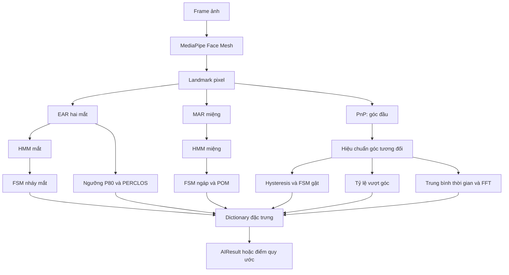

# PhysicalBranch — Nền tảng toán học và học máy

Tài liệu này dành cho người muốn hiểu **vì sao mã trích xuất được các đặc trưng mắt, miệng và đầu**, thay vì chỉ biết cách gọi hàm. Mỗi phần đi từ trực giác, ký hiệu, công thức đến hàm triển khai tương ứng. Các giá trị cấu hình và hành vi mô tả dưới đây được đối chiếu với mã nguồn hiện tại trong thư mục.

`PhysicalBranch` biến video thành các số đo theo thời gian. Nó chưa tự kết luận người lái buồn ngủ. HMM ở đây phân loại trạng thái mắt/miệng; MediaPipe cung cấp landmark; PnP ước lượng tư thế đầu; FSM và FFT tạo đặc trưng thời gian. `AIResult` có trường dành cho xác suất LSTM và điểm cảnh báo, nhưng nhánh này không tính chúng. File `inference_system..py` hiện rỗng.

Thông tin vận hành và danh sách trường đầu ra được trình bày thêm trong [Structure.md](Structure.md). Khi tài liệu cũ và mã khác nhau, lấy mã hiện tại làm căn cứ; chẳng hạn thời lượng ngáp tối thiểu mặc định hiện là **4000 ms**.

## Mục lục

Cấu hình mặc định được tập trung tại [config.py](config.py), trong `PhysicalConfig`
và `DEFAULT_SCALES`. Xem [cách ghi đè và kế thừa](Structure.md#cấu-hình-chung-và-kế-thừa)
để dùng cấu hình riêng trong DataSystem.

1. [Bản đồ kiến thức và luồng xử lý](#1-bản-đồ-kiến-thức-và-luồng-xử-lý)
2. [Đại số, thống kê và xác suất cần biết](#2-đại-số-thống-kê-và-xác-suất-cần-biết)
3. [Landmark, EAR và MAR](#3-landmark-ear-và-mar)
4. [HMM: mô hình trạng thái ẩn](#4-hmm-mô-hình-trạng-thái-ẩn)
5. [Học tham số: K-means, EM và thích nghi trực tuyến](#5-học-tham-số-k-means-em-và-thích-nghi-trực-tuyến)
6. [FSM: từ trạng thái đến sự kiện](#6-fsm-từ-trạng-thái-đến-sự-kiện)
7. [Cửa sổ thời gian, PERCLOS và POM](#7-cửa-sổ-thời-gian-perclos-và-pom)
8. [Hình học camera và ước lượng tư thế đầu](#8-hình-học-camera-và-ước-lượng-tư-thế-đầu)
9. [Hiệu chuẩn góc và phát hiện gật đầu](#9-hiệu-chuẩn-góc-và-phát-hiện-gật-đầu)
10. [Tích phân và trung bình chuyển động đầu](#10-tích-phân-và-trung-bình-chuyển-động-đầu)
11. [Lấy mẫu, nội suy và FFT](#11-lấy-mẫu-nội-suy-và-fft)
12. [Chuẩn hóa đặc trưng và cách hiểu đầu ra](#12-chuẩn-hóa-đặc-trưng-và-cách-hiểu-đầu-ra)
13. [Giả định học máy, sai số và đánh giá](#13-giả-định-học-máy-sai-số-và-đánh-giá)
14. [Lộ trình đọc mã và bài tập](#14-lộ-trình-đọc-mã-và-bài-tập)
15. [Tài liệu tham khảo](#15-tài-liệu-tham-khảo)

## 1. Bản đồ kiến thức và luồng xử lý



| Kiến thức | Câu hỏi nó giải quyết | Nơi đọc mã |
| --- | --- | --- |
| Vector, khoảng cách Euclid, tỷ số | Mắt/miệng đang mở rộng bao nhiêu? | `CameraMetrics.aspect_ratio()` |
| Phân phối Gaussian, Bayes, Markov | Số đo nhiễu này thuộc trạng thái nào? | `AdaptiveHMM.predict()` |
| K-means, EM, forward–backward | Học phân phối riêng từ dữ liệu quan sát thế nào? | `AdaptiveHMM.fit_initial()` |
| FSM và thời lượng | Khi nào một pha đóng/mở trở thành một sự kiện? | `StateMachine.process()` |
| Tích phân theo thời gian | Bao nhiêu phần trăm thời gian ở trạng thái cần đo? | `WindowRatio.process()` |
| Phép chiếu phối cảnh, ma trận quay, tối ưu | Từ điểm ảnh suy ra hướng đầu thế nào? | `HeadPoseEstimator.estimate()` |
| Góc tuần hoàn, trung vị, hysteresis | Đo lệch khỏi tư thế trung tính và tránh rung trạng thái thế nào? | `CameraMetrics.process_landmarks()` |
| Lấy mẫu, Fourier, cửa sổ Hann | Chuỗi pitch có dao động trội ở tần số nào? | `HeadMotionWindow.process()` |
| Nội suy tuyến tính từng đoạn | Đưa các số đo khác đơn vị về thang điểm chung thế nào? | `normalize_metrics()` |

Không cần học toàn bộ deep learning trước khi đọc nhánh này. Để hiểu phần tự triển khai, ưu tiên đại số tuyến tính cơ bản, xác suất, chuỗi thời gian và tối ưu số. Kiến trúc mạng landmark được đóng gói trong thư viện MediaPipe.

## 2. Đại số, thống kê và xác suất cần biết

### 2.1. Ký hiệu và đơn vị

| Ký hiệu | Ý nghĩa |
| --- | --- |
| $n$ | Chỉ số mẫu/frame; không phải thời gian thực |
| $t_n$ | Timestamp của mẫu $n$, đơn vị giây |
| $x_n$ | Một số đo EAR hoặc MAR |
| $z_n\in\{0,1\}$ | Trạng thái ẩn của HMM |
| $N$ | Số mẫu trong một đoạn dữ liệu |
| $W$ | Chiều dài cửa sổ thống kê, đơn vị giây |
| $\Delta t$ | Khoảng thời gian giữa hai mẫu trên lưới đều |
| $\mu_k,\sigma_k^2$ | Trung bình và phương sai của trạng thái $k$ |
| $\theta(t)$ | Góc pitch tương đối, đơn vị độ |

Phân biệt `ms`, `sec`, `%`, `Hz` và `lần/phút`. Ví dụ 0,2 giây = 200 ms; 0,2 Hz = một chu kỳ mỗi 5 giây. Một chu kỳ dao động không nhất thiết được FSM công nhận là một sự kiện gật.

### 2.2. Vector, chuẩn và ma trận

Điểm ảnh $p=(u,v)$ là vector hai chiều. Khoảng cách giữa hai điểm:

$$
\|p-q\|_2=\sqrt{(u_p-u_q)^2+(v_p-v_q)^2}.
$$

`np.linalg.norm(p - q)` thực hiện phép tính này. Trừ hai điểm cho ta độ dịch chuyển; chuẩn của độ dịch chuyển cho ta khoảng cách vô hướng.

Ma trận biểu diễn phép biến đổi hoặc một bảng quan hệ. Trong nhánh này:

- Ma trận camera $K$ ánh xạ tọa độ camera sang tọa độ ảnh sau phép chia phối cảnh.
- Ma trận quay $R$ đổi hướng vector 3D.
- Ma trận chuyển trạng thái $A$ chứa xác suất từ trạng thái hiện tại sang trạng thái tiếp theo.

Toán tử `@` là nhân ma trận. Với vector hàng xác suất $q=[q_0,q_1]$, thành phần $j$ của `q @ A` bằng $\sum_iq_iA_{ij}$.

### 2.3. Trung bình, phương sai và phân vị

Với $N$ số đo:

$$
\bar x=\frac{1}{N}\sum_{n=1}^Nx_n,
\qquad
v=\frac{1}{N}\sum_{n=1}^N(x_n-\bar x)^2.
$$

Trung bình mô tả vị trí trung tâm; phương sai mô tả độ phân tán. Code dùng dạng chia cho $N$ khi ước lượng Gaussian, tương ứng mặc định `np.var()`. Không nhầm phương sai $v$ với độ lệch chuẩn $\sigma=\sqrt v$.

Phân vị $Q_p$ là mốc ở mức $p\%$ của dữ liệu đã sắp xếp, có thể được nội suy giữa các mẫu. Trung vị là $Q_{50}$. So với trung bình, trung vị ít bị kéo lệch bởi một vài giá trị cực đoan.

Code dùng các phân vị để khởi tạo cụm và chọn mốc bình thường. **Phân vị 80 của EAR và mức đóng mắt 80% dùng trong PERCLOS là hai khái niệm khác nhau.** Chúng tình cờ cùng xuất hiện số 80.

### 2.4. Xác suất có điều kiện và Bayes

$P(z=1)$ là xác suất trước khi nhìn số đo. $P(z=1\mid x)$ là xác suất sau khi đã quan sát $x$. Bayes cập nhật niềm tin theo dữ liệu:

$$
P(z=k\mid x)=\frac{p(x\mid z=k)P(z=k)}{\sum_jp(x\mid z=j)P(z=j)}.
$$

Ba thuật ngữ cần nhớ:

- **Prior**: niềm tin trước khi dùng quan sát hiện tại.
- **Likelihood**: mức độ quan sát phù hợp với một trạng thái.
- **Posterior**: niềm tin sau khi kết hợp prior và likelihood.

EAR/MAR là biến liên tục nên $p(x\mid z)$ là **mật độ**, không phải xác suất tại đúng một điểm. Mật độ có thể lớn hơn 1; tích phân của nó trên toàn miền mới bằng 1.

### 2.5. Gaussian một chiều

Code giả sử số đo trong mỗi trạng thái có phân phối chuẩn:

$$
p(x\mid z=k)=\frac{1}{\sqrt{2\pi\sigma_k^2}}
\exp\left[-\frac{(x-\mu_k)^2}{2\sigma_k^2}\right].
$$

Số đo gần $\mu_k$ thường phù hợp với trạng thái $k$ hơn. Tuy nhiên, không thể chỉ chọn tâm gần nhất: độ phân tán $\sigma_k$ và prior cũng ảnh hưởng kết quả.

Trong `_log_emission_prob()`, công thức được viết dưới dạng log:

$$
\log p(x\mid z=k)=-\frac12\left[\log(2\pi\sigma_k^2)+\frac{(x-\mu_k)^2}{\sigma_k^2}\right].
$$

`min_variance=1e-5` chặn phương sai quá nhỏ, tránh chia cho 0 và tránh mô hình quá tự tin khi các mẫu gần như giống nhau.

## 3. Landmark, EAR và MAR

### 3.1. Landmark đến từ đâu?

`FaceTracker` gọi MediaPipe Face Mesh với một khuôn mặt và `refine_landmarks=True`. Đây là bước suy luận bằng mô hình đã huấn luyện sẵn; thư mục này không huấn luyện lại mạng landmark. Face Mesh kết hợp phát hiện mặt và ước lượng landmark; tùy chọn refine tăng độ chi tiết ở các vùng như mắt và môi. Xem [tài liệu MediaPipe Face Mesh](https://chuoling.github.io/mediapipe/solutions/face_mesh.html).

MediaPipe trả tọa độ ảnh chuẩn hóa. Code lấy riêng $x,y$ và chuyển sang pixel:

$$
u=x_{norm}\times\text{width},\qquad v=y_{norm}\times\text{height}.
$$

Phải nhân đúng chiều rộng và chiều cao trước khi tính khoảng cách: dùng trực tiếp tọa độ chuẩn hóa trên ảnh không vuông làm trục ngang và dọc có thang đo khác nhau. Tọa độ $z$ của landmark không được dùng trong pipeline này; phần pose dùng một mẫu mặt 3D riêng.

`process_landmarks()` nhận mảng ít nhất 468 điểm, mỗi điểm đúng hai tọa độ hữu hạn. Mảng không hợp lệ được xử lý như mất landmark. Có landmark hợp lệ chưa bảo đảm ước lượng pose thành công.

### 3.2. Tỷ số hình học sáu điểm

Đánh số sáu điểm theo thứ tự trong danh sách của code là $p_0,\ldots,p_5$:

$$
r=\frac{\|p_1-p_5\|_2+\|p_2-p_4\|_2}{2\|p_0-p_3\|_2}.
$$

Tử số là tổng hai khoảng mở theo chiều dọc; mẫu số là hai lần chiều rộng. Đây là tỷ số không có đơn vị.

| Vùng | Danh sách landmark trong `CameraMetrics` |
| --- | --- |
| `LEFT_EYE` | `[362, 385, 387, 263, 373, 380]` |
| `RIGHT_EYE` | `[33, 160, 158, 133, 153, 144]` |
| `MOUTH` | `[61, 37, 267, 291, 314, 84]` |

Code dùng cùng công thức cho EAR và MAR:

$$
EAR=\frac{EAR_{left}+EAR_{right}}2,\qquad MAR=r_{mouth}.
$$

Ví dụ một mắt rộng 40 pixel, hai khoảng dọc là 12 và 10 pixel:

$$
EAR=\frac{12+10}{2\times40}=0.275.
$$

Nếu hai khoảng dọc giảm còn 2 pixel, EAR giảm còn 0,05. Miệng mở rộng thường làm MAR tăng, nên hướng của trạng thái sự kiện ở mắt và miệng ngược nhau.

### 3.3. Vì sao dùng tỷ số?

Nếu mọi tọa độ cùng được nhân với hệ số $s>0$, cả tử và mẫu cùng nhân $s$ nên tỷ số giữ nguyên. Khoảng cách cũng không đổi khi tịnh tiến hoặc quay cứng trong mặt phẳng ảnh. Nhờ đó, tỷ số ít phụ thuộc vị trí khuôn mặt và kích thước ảnh hơn khoảng cách pixel đơn thuần.

Tính chất này không bảo đảm bất biến khi đầu quay trong 3D: phép chiếu phối cảnh có thể làm chiều ngang và dọc co khác nhau. Kính, che khuất, nét mặt và lỗi landmark vẫn gây nhiễu. Trung bình hai mắt giảm ảnh hưởng nhiễu riêng từng mắt nhưng cũng có thể làm mất thông tin nhắm một bên.

`aspect_ratio()` trả `None` nếu điểm không hữu hạn hoặc chiều rộng nhỏ hơn `1e-6`. Đây là bảo vệ phép chia, không phải kiểm định đầy đủ chất lượng khuôn mặt.

## 4. HMM: mô hình trạng thái ẩn

### 4.1. Phân biệt quan sát và trạng thái

Ta quan sát số thực EAR/MAR, nhưng muốn biết trạng thái mắt/miệng. HMM, viết tắt của Hidden Markov Model, mô hình hóa hai lớp:

$$
z_1\rightarrow z_2\rightarrow\cdots\rightarrow z_N,
\qquad z_n\rightarrow x_n.
$$

| Bộ phát hiện | $z=0$ | $z=1$ | Xu hướng số đo ở trạng thái 1 |
| --- | --- | --- | --- |
| Mắt | Mở | Đóng | EAR thấp |
| Miệng | Nghỉ | Mở | MAR cao |

“Ẩn” nghĩa là trạng thái không được đo trực tiếp. EAR thấp là bằng chứng cho mắt đóng, nhưng không phải nhãn chắc chắn.

### 4.2. Hai giả định của HMM

**Markov bậc một:** khi biết trạng thái gần nhất, trạng thái tiếp theo không phụ thuộc trực tiếp toàn bộ lịch sử trạng thái:

$$
P(z_n\mid z_{1:n-1})=P(z_n\mid z_{n-1}).
$$

**Độc lập có điều kiện của quan sát:** khi biết trạng thái hiện tại, phân phối quan sát hiện tại chỉ phụ thuộc trạng thái đó:

$$
p(x_n\mid z_{1:N},x_{1:n-1})=p(x_n\mid z_n).
$$

Đây là giả định mô hình để tính toán được, không phải khẳng định đầy đủ về sinh lý. Nhiễu landmark giữa các frame trên thực tế có thể tương quan.

### 4.3. Các tham số cần học

$$
\Theta=(\pi,A,\mu_0,\mu_1,\sigma_0^2,\sigma_1^2).
$$

- $\pi_k=P(z_1=k)$: phân phối trạng thái đầu.
- $A_{ij}=P(z_n=j\mid z_{n-1}=i)$: xác suất chuyển trạng thái; mỗi hàng có tổng bằng 1.
- $(\mu_k,\sigma_k^2)$: Gaussian phát ra EAR/MAR khi ở trạng thái $k$.

Một cấu hình dự phòng thực sự trong code là:

$$
A=\begin{bmatrix}0.97&0.03\\0.10&0.90\end{bmatrix},
\qquad \pi=[0.99,0.01].
$$

Hàng đầu nói rằng nếu đang ở trạng thái 0, mô hình ưu tiên tiếp tục ở trạng thái 0. Đây là nguồn tạo tính liên tục theo thời gian; HMM không chỉ phân loại từng frame độc lập.

### 4.4. Suy luận trực tuyến bằng Bayes

Gọi $q_{n-1}(i)=P(z_{n-1}=i\mid x_{1:n-1})$. Trước khi nhìn $x_n$:

$$
\widetilde q_n(j)=\sum_iq_{n-1}(i)A_{ij}.
$$

Sau khi nhìn $x_n$:

$$
q_n(j)=\frac{\widetilde q_n(j)b_j(x_n)}{\sum_k\widetilde q_n(k)b_k(x_n)},
\qquad b_j(x)=p(x\mid z=j).
$$

Frame đầu sau khi khởi tạo hoặc reset posterior dùng $\pi$ thay cho bước dự báo. Nhãn đầu ra là:

$$
\widehat z_n=\arg\max_jq_n(j).
$$

Ví dụ $q_{n-1}=[0.9,0.1]$ và ma trận trên cho prior mới $[0.883,0.117]$. Nếu likelihood của số đo hiện tại ở hai trạng thái là $[1,8]$, trọng số chưa chuẩn hóa là $[0.883,0.936]$. Sau chuẩn hóa, posterior xấp xỉ $[0.485,0.515]$, nên trạng thái 1 thắng dù prior ban đầu ưu tiên trạng thái 0.

Đó là `AdaptiveHMM.predict()`: **lọc trực tuyến** bằng dữ liệu đến hiện tại. Code không chạy Viterbi để chọn cả chuỗi trạng thái tối ưu.

### 4.5. Log-sum-exp và ổn định số

Nhân nhiều xác suất nhỏ dễ bị underflow, tức máy tính làm tròn kết quả về 0. Chuyển sang log biến tích thành tổng. Khi cần tính log của tổng các số đã ở miền log, dùng:

$$
\operatorname{LSE}(a_1,\ldots,a_m)
=c+\log\sum_i\exp(a_i-c),\qquad c=\max_i a_i.
$$

Trừ $c$ làm mọi số mũ không dương và có ít nhất một số mũ bằng 0. Trong `predict()`, code tính log prior cộng log likelihood rồi trừ LSE trước khi lấy hàm mũ. `_forward_backward()` dùng cùng kỹ thuật.

Các hằng nhỏ như `1e-300`, `1e-12` bảo vệ log và phép chia. Chúng không phải ngưỡng phát hiện hành vi.

### 4.6. HMM thực tế còn có quy tắc ghi đè

Sau `predict()`, `AdaptiveHMM_FSM.process()` áp dụng riêng cho mắt:

$$
EAR\geq0.75\times normal\quad\Rightarrow\quad
state=0,\quad posterior=[0.99,0.01].
$$

Đây là heuristic: khi EAR đủ gần mốc mắt mở, ép về mở để hạn chế mô hình bị kẹt ở trạng thái đóng. Nó còn thay posterior nội bộ, nên ảnh hưởng bước suy luận tiếp theo. Miệng không có quy tắc tương tự trong mã hiện tại.

Vì vậy, trạng thái đầu ra của bộ mắt là kết quả **HMM kết hợp quy tắc**, không hoàn toàn là argmax HMM nguyên bản. Posterior sau ghi đè cũng không thể được xem như xác suất đã kiểm chứng từ dữ liệu gán nhãn.

## 5. Học tham số: K-means, EM và thích nghi trực tuyến

### 5.1. Học không giám sát và vấn đề tên trạng thái

Không có nhãn “mắt đóng” được truyền vào `fit_initial()`. Mô hình tự tìm hai nhóm số đo và quan hệ chuyển tiếp giữa chúng. Đây là học không giám sát trên dữ liệu của phiên hiện tại.

Hai cụm tự học có thể đổi số thứ tự cho nhau mà không đổi ý nghĩa thống kê. `_sort_states()` giải quyết bằng quy ước:

- Mắt: sắp trung bình giảm dần, trạng thái 1 có trung bình thấp.
- Miệng: sắp trung bình tăng dần, trạng thái 1 có trung bình cao.

Khi đổi thứ tự, phải đổi đồng bộ `pi`, cả hàng lẫn cột của `A`, `means`, `vars` và posterior. Chỉ đổi trung bình sẽ làm ý nghĩa trạng thái không còn nhất quán.

### 5.2. K-means một chiều để có điểm xuất phát

K-means tìm các tâm $c_k$ làm nhỏ tổng khoảng cách bình phương trong cụm:

$$
J=\sum_n(x_n-c_{\ell_n})^2.
$$

Hai bước lặp:

1. Gán $\ell_n=\arg\min_k|x_n-c_k|$.
2. Cập nhật $c_k$ bằng trung bình các mẫu được gán vào cụm $k$.

Trong một chiều, tối thiểu khoảng cách tuyệt đối hay bình phương khoảng cách cho cùng nhãn khi tâm cố định. `_kmeans_1d()` khởi tạo tâm từ các phân vị khoảng 33,3% và 66,7%, lặp tối đa 25 lần, dừng khi tâm gần như không đổi.

`_estimate_from_labels()` lấy trung bình/phương sai của từng cụm và đếm các cặp nhãn liên tiếp để khởi tạo $A$. Nó cộng `1e-3` vào số đếm để tránh xác suất bằng 0. `pi` ban đầu được ước lượng từ tỷ lệ mẫu trong cụm; sau EM, `pi` được cập nhật từ posterior của mẫu đầu.

### 5.3. Vì sao cần EM sau K-means?

K-means dùng nhãn cứng và chưa khai thác cấu trúc thời gian. Nhưng một số đo gần ranh giới có thể thuộc cả hai trạng thái với mức độ khác nhau.

EM, Expectation–Maximization, luân phiên:

- **E-step:** giữ tham số, tính phân bố xác suất của các trạng thái ẩn.
- **M-step:** giữ các trọng số xác suất đó, ước lượng lại tham số.

Đối với HMM, cách học này thường gọi là Baum–Welch. EM chuẩn hướng đến tăng likelihood, nhưng có thể hội tụ vào nghiệm cục bộ. Với các phép chặn phương sai và làm trơn trong mã, không nên xem đây là bảo đảm tìm được bộ tham số tối ưu toàn cục.

### 5.4. Forward–backward

Định nghĩa forward:

$$
\alpha_n(k)=p(x_{1:n},z_n=k).
$$

Khởi tạo và truy hồi:

$$
\alpha_1(k)=\pi_kb_k(x_1),\qquad
\alpha_n(j)=b_j(x_n)\sum_i\alpha_{n-1}(i)A_{ij}.
$$

Định nghĩa backward:

$$
\beta_n(i)=p(x_{n+1:N}\mid z_n=i),
$$

$$
\beta_N(i)=1,\qquad
\beta_n(i)=\sum_jA_{ij}b_j(x_{n+1})\beta_{n+1}(j).
$$

Forward nhìn phần trước của đoạn dữ liệu, backward nhìn phần sau. Kết hợp để có:

$$
\gamma_n(k)=P(z_n=k\mid x_{1:N})
=\frac{\alpha_n(k)\beta_n(k)}{\sum_j\alpha_n(j)\beta_n(j)}.
$$

Và xác suất của một lần chuyển trạng thái:

$$
\xi_n(i,j)=P(z_n=i,z_{n+1}=j\mid x_{1:N})
\propto\alpha_n(i)A_{ij}b_j(x_{n+1})\beta_{n+1}(j).
$$

Chuẩn hóa $\xi_n$ bằng tổng trên mọi cặp $(i,j)$. `_forward_backward()` thực hiện các công thức trong miền log. Với hai trạng thái, `gamma` có kích thước $(N,2)$ và `xi` có kích thước $(N-1,2,2)$.

Đây là **smoothing trong đoạn đã có dữ liệu**, khác với filtering của `predict()`. Việc học trên buffer đã thu thập không có nghĩa hệ thống cần xem trước các frame chưa đến để xuất trạng thái hiện tại.

### 5.5. M-step: trung bình có trọng số

Đặt $w_k=\sum_n\gamma_n(k)$, tức số mẫu hiệu dụng thuộc trạng thái $k$:

$$
\widehat\mu_k=\frac{\sum_n\gamma_n(k)x_n}{w_k},\qquad
\widehat\sigma_k^2=\frac{\sum_n\gamma_n(k)(x_n-\widehat\mu_k)^2}{w_k}.
$$

$$
\widehat\pi_k=\gamma_1(k),\qquad
\widehat A_{ij}=\frac{\sum_{n=1}^{N-1}\xi_n(i,j)}
{\sum_j\sum_{n=1}^{N-1}\xi_n(i,j)}.
$$

Code cộng epsilon vào số đếm của $A$ trước khi chuẩn hóa. Trong khởi tạo, `_m_step(..., alpha=1.0)` thay hẳn tham số bằng ước lượng mới; mặc định lặp EM 20 lần, không dùng tiêu chí dừng theo độ tăng likelihood.

### 5.6. Khởi tạo khi chưa thấy đủ hai trạng thái

`AdaptiveHMM_FSM` gom:

$$
N_{init}=\max(4,\operatorname{round}(fps\times init\_duration\_sec)).
$$

Mặc định 30 FPS và 10 giây tương ứng 300 mẫu hợp lệ. Đây là **số mẫu**, nên không luôn bằng đúng 10 giây thực tế nếu FPS khác cấu hình hoặc bị mất mặt.

`_initialize()` lấy $low=Q_5$, $high=Q_{95}$ và mốc `normal`:

| Điều kiện | Mắt | Miệng |
| --- | --- | --- |
| `normal` | $Q_{80}$ | $Q_{20}$ |
| Độ tách yêu cầu | 0,06 | 0,15 |
| Điều kiện bổ sung | $low<0.65\,normal$ | $high>normal+0.15$ |
| Trung bình trạng thái sự kiện dự phòng | $0.2\,normal$ | $normal+0.30$ |

Chỉ gọi `fit_initial()` khi cả độ rộng $high-low$ đủ lớn lẫn điều kiện bổ sung đạt. Nếu không, code dùng các trung bình dự phòng trong bảng, cùng:

$$
\sigma=\max\left(\frac{|normal-event|}{4},0.01\right).
$$

Hai phương sai được đặt bằng $\sigma^2$; ma trận chuyển và prior là cấu hình đã minh họa ở phần 4.3. Cách này cho phép khởi tạo khi người dùng chủ yếu mở mắt, miệng nghỉ, nhưng trạng thái sự kiện khi đó được **giả định**, chưa được quan sát đầy đủ.

`normal` và `event_reference` được lưu tại khởi tạo. Chúng không được cập nhật theo mỗi lần HMM học trực tuyến. `AdaptiveHMM_FSM` còn hỗ trợ mode `pitch`, nhưng pipeline `CameraMetrics` hiện dùng hysteresis và FSM trực tiếp cho đầu, không dùng HMM pitch.

### 5.7. Thích nghi trực tuyến

`update_online()` gom một buffer đủ `adapt_interval=300` mẫu. Khi đầy, nó chạy một lượt E-step/M-step với hệ số học $\eta=0.01$:

$$
\Theta_{new}=(1-\eta)\Theta_{old}+\eta\widehat\Theta_{buffer}.
$$

Phép trộn được áp dụng riêng cho `pi`, `A`, trung bình và phương sai; sau đó chuẩn hóa lại hàng của $A$ và chặn phương sai. Đây là quy tắc thích nghi thực dụng, không phải huấn luyện bằng gradient descent. Trộn hai phương sai trực tiếp cũng không đồng nhất với tính phương sai của một hỗn hợp dữ liệu đầy đủ.

Ví dụ trung bình cũ là 0,30, ước lượng từ buffer là 0,28:

$$
\mu_{new}=0.99\times0.30+0.01\times0.28=0.2998.
$$

Mô hình dịch chuyển chậm. Ở 30 mẫu/giây, 300 mẫu tương đương khoảng 10 giây nếu không gián đoạn. Tăng hệ số học giúp theo kịp thay đổi nhanh hơn nhưng cũng dễ bị dữ liệu nhiễu kéo lệch.

Nếu một trạng thái có $\sum_n\gamma_n(k)<2$, code bỏ cập nhật và xóa buffer. Điều này hạn chế học lại cả hai Gaussian từ một đoạn gần như chỉ chứa một trạng thái. Sau cập nhật thành công, posterior được đặt từ `gamma[-1]`, các trạng thái được sắp lại và buffer được xóa.

### 5.8. HMM đếm bước mẫu, FSM đếm giây

Ma trận $A$ được áp dụng một lần cho mỗi quan sát. Nó không tự thay đổi theo khoảng cách timestamp. Khi $A_{kk}$ cố định, thời gian lưu trạng thái theo số mẫu có phân phối hình học, với kỳ vọng:

$$
E[L_k]=\frac{1}{1-A_{kk}}.
$$

Ví dụ $A_{11}=0.9$ cho kỳ vọng 10 mẫu, khoảng 0,33 giây nếu thực sự lấy mẫu đều ở 30 FPS. Đây là tính chất mô hình, không phải thời lượng nháy mắt hợp lệ do FSM quy định.

Khi FPS thay đổi, độ “bám trạng thái” theo giây của HMM cũng thay đổi, dù phần đo thời lượng vẫn dùng timestamp. Không nên suy ra toàn pipeline bất biến với FPS chỉ vì có timestamp.

## 6. FSM: từ trạng thái đến sự kiện

### 6.1. Trạng thái không phải sự kiện

Một trăm frame mắt đóng liên tiếp là một pha đóng mắt, không phải một trăm lần nháy. FSM, Finite State Machine, ghi nhớ chu kỳ để chuyển nhãn từng frame thành sự kiện.

`StateMachine` yêu cầu chu kỳ đầy đủ:

```text
Đã thấy 0 → bắt đầu pha 1 → tiếp tục 1 → trở về 0 → kiểm tra thời lượng
```

`armed` ghi nhận đã thấy trạng thái nền 0. `start` lưu timestamp đầu pha 1. Khi trở về 0:

$$
d_{ms}=1000(t_{end}-t_{start}).
$$

Sự kiện chỉ được xác nhận khi `armed=True` và $d_{min}\leq d_{ms}\leq d_{max}$; code dùng dung sai số nhỏ ở hai biên.

| Sự kiện | Tối thiểu mặc định | Tối đa mặc định |
| --- | --- | --- |
| Nháy mắt | 100 ms | 2000 ms |
| Ngáp | 4000 ms | 7500 ms |
| Gật đầu | 800 ms | 3500 ms |

Các dải này là cấu hình vận hành của code, không phải hằng số sinh lý hay kết quả đánh giá độ chính xác trên mọi người dùng.

### 6.2. Ví dụ nháy mắt

Giả sử luôn có mẫu hợp lệ giữa các mốc, không khoảng nào vượt `max_gap_sec`:

| Thời điểm | Trạng thái | Ý nghĩa |
| --- | --- | --- |
| 1,00 s | 0 | Đã thấy mắt mở, kích hoạt `armed` |
| 1,10 s | 1 | Bắt đầu pha đóng mắt |
| 1,20 s | 1 | Pha đang kéo dài 100 ms |
| 1,30 s | 0 | Kết thúc pha, thời lượng 200 ms, xác nhận một lần nháy |

`event_done=True` chỉ ở lần gọi kết thúc sự kiện. `last_valid_duration_ms` giữ 200 ms cho đến khi có sự kiện hợp lệ mới hoặc reset. Nếu bắt đầu quan sát ngay khi mắt đã đóng, lần mở mắt đầu tiên không được đếm vì chưa chứng kiến đầu chu kỳ.

### 6.3. Pha quá dài và mất dữ liệu

Pha 1 kéo dài quá mức tối đa có thể khiến `prolonged=True` trong kết quả FSM. Nó không bị chia thành nhiều sự kiện hợp lệ. Khi kết thúc, pha vượt thời lượng bị loại khỏi bộ đếm.

`state=None` hoặc khoảng cách mẫu lớn hơn `max_gap_sec` xóa pha đang đo và bỏ `armed`. Các sự kiện hoàn chỉnh trước đó vẫn còn trong cửa sổ cho đến khi hết hạn. Đây là lý do mất mặt không thể được diễn giải thành mắt mở hay mắt đóng.

Thời điểm chuyển thật nằm giữa hai mẫu; FSM dùng timestamp của mẫu đầu tiên thấy trạng thái mới. Vì vậy, thời lượng vẫn có sai số do lấy mẫu và có thể thêm độ trễ do HMM.

### 6.4. Đếm trong cửa sổ và đổi sang lần/phút

FSM giữ timestamp **kết thúc** của sự kiện trong $(t-W,t]$:

$$
F=\frac{60\,N_{events}}{W}.
$$

Hai sự kiện trong cửa sổ 20 giây cho 6 lần/phút. Sự kiện kết thúc đúng tại $t-W$ bị loại. Mẫu số luôn là chiều dài cửa sổ cấu hình, kể cả lúc mới chạy hoặc có mất dữ liệu; đây không phải tần suất đã hiệu chỉnh theo thời lượng quan sát hợp lệ.

## 7. Cửa sổ thời gian, PERCLOS và POM

### 7.1. Vì sao không lấy tỷ lệ số frame?

Giả sử 1 giây mắt đóng có 30 frame, còn 9 giây mắt mở chỉ có 90 frame. Tỷ lệ frame đóng là 25%, trong khi tỷ lệ thời gian đóng là 10%. Khi nhịp lấy mẫu thay đổi, mỗi frame không đại diện cho cùng lượng thời gian.

`WindowRatio` xem trạng thái tại mẫu trước là trạng thái của khoảng đến mẫu hiện tại, thường gọi là giữ bậc không:

$$
a(t)=a_i\quad\text{trên }[t_i,t_{i+1}).
$$

Khoảng chỉ hợp lệ nếu cả hai đầu có dữ liệu và $t_{i+1}-t_i\leq max\_gap\_sec$. Khoảng bị cắt tại biên trái cửa sổ khi cần.

Với độ dài phần còn lại của từng khoảng là $\ell_i$:

$$
D_{valid}=\sum_i\ell_i,\qquad
D_{active}=\sum_i a_i\ell_i,\qquad
R=100\frac{D_{active}}{D_{valid}}.
$$

Nếu $D_{valid}=0$, kết quả là `None`, không phải 0%. Một mẫu đơn lẻ chưa tạo ra khoảng thời gian để tính tỷ lệ.

### 7.2. PERCLOS trong triển khai này

Đặt $A_0=normal$, $A_{100}=event\_reference$. Mức EAR tương ứng đóng 80% được nội suy:

$$
EAR_{P80}=A_0-0.8(A_0-A_{100})=0.2A_0+0.8A_{100}.
$$

Một khoảng được đánh dấu đóng cho PERCLOS khi:

$$
EAR\leq EAR_{P80}.
$$

Ví dụ $A_0=0.30$, $A_{100}=0.06$ thì ngưỡng là 0,108. Nếu có 6 giây đạt ngưỡng trong 50 giây quan sát hợp lệ, `perclos_pct=12`, kể cả cửa sổ cấu hình là 60 giây.

Đây là phép xấp xỉ mức đóng qua tỷ số landmark và hai mốc tham chiếu; không đo trực tiếp diện tích đồng tử bị che. `event_reference` có thể đến từ cụm Gaussian hoặc giá trị dự phòng, nên tên $A_{100}$ không bảo đảm là một phép đo mắt đóng hoàn toàn ngoài thực tế.

Các điểm phải nhớ khi đọc mã:

- PERCLOS lấy ngưỡng từ EAR, không lấy nhãn HMM mắt.
- Ngưỡng giữ theo mốc khởi tạo dù Gaussian tiếp tục thích nghi.
- Những khoảng nhắm ngắn vẫn tham gia tỷ lệ nếu đạt ngưỡng; code không loại riêng mọi lần nháy khỏi PERCLOS.
- Ngưỡng P80 gồm cả trường hợp EAR đúng bằng ngưỡng.

### 7.3. POM và tỷ lệ vượt góc

POM dùng cùng bộ tích lũy, với $a_i=1$ khi HMM miệng trả trạng thái mở. POM là tỷ lệ thời gian miệng mở theo mô hình, không phải tỷ lệ thời gian các sự kiện ngáp hợp lệ. Một pha mở 2 giây có thể làm POM tăng nhưng không đủ điều kiện đếm ngáp.

Tỷ lệ vượt góc dùng:

$$
a_i=\mathbf1\{ |pitch|>20^\circ\ \lor\ |yaw|>25^\circ\ \lor\ |roll|>20^\circ\}.
$$

Các giới hạn trên là mặc định và có thể cấu hình. Chỉ cần một góc vượt giới hạn. Tỷ lệ không biểu diễn độ lớn của góc: lệch yaw 26° và 50° đều đóng góp cùng lượng thời gian nếu duy trì bằng nhau.

### 7.4. Coverage và lịch sử khi mất tín hiệu

Có thể tính độ phủ dữ liệu từ đầu ra:

$$
coverage=\frac{observed\_seconds}{W}.
$$

Ví dụ PERCLOS 20% với 5 giây hợp lệ có ít thông tin hơn cùng tỷ lệ với 60 giây hợp lệ. `eye_ready=True` chỉ nói HMM đã khởi tạo, không nói cửa sổ đã đầy hoặc coverage đạt yêu cầu. Nhánh này cung cấp thời lượng quan sát, không tự áp một ngưỡng coverage chung để ra quyết định.

`WindowRatio` giữ các khoảng hợp lệ cũ qua một lần mất tín hiệu rồi tiếp tục cộng khoảng hợp lệ mới. Ngược lại, `HeadMotionWindow` xóa chuỗi khi mất dữ liệu để chỉ phân tích chuyển động liên tục.

Các cửa sổ `blink`, `perclos`, `yawn`, `pom`, `nod`, `over_angle`, `head_motion` có thể khác nhau. Đổi độ dài một cửa sổ xóa lịch sử của chỉ số đó; HMM và baseline đầu được giữ. Tăng cửa sổ không khôi phục dữ liệu đã loại trước đó.

## 8. Hình học camera và ước lượng tư thế đầu

### 8.1. Từ mô hình mặt 3D đến điểm ảnh 2D

`HeadPoseEstimator` ghép sáu landmark ảnh `[1, 152, 263, 33, 291, 61]` với sáu điểm mẫu:

```text
(0, 0, 0), (0, 330, 65), (225, -170, 135),
(-225, -170, 135), (150, 150, 125), (-150, 150, 125)
```

Các điểm tương ứng lần lượt với vùng mũi, cằm, hai phía mắt và hai khóe miệng. Đây là mô hình hình học cố định, không phải khuôn mặt 3D được đo riêng cho người dùng. Không nên diễn giải các tọa độ này là số đo giải phẫu chính xác theo mm.

Một điểm mô hình $X$ được chuyển sang hệ camera bởi:

$$
X_c=RX+\mathbf t.
$$

$R$ là ma trận quay $3\times3$, $\mathbf t$ là vector tịnh tiến. Ký hiệu $\mathbf t$ ở đây là tịnh tiến, không phải timestamp.

### 8.2. Mô hình camera lỗ kim

Với $X_c=(X_c,Y_c,Z_c)^T$ và bỏ qua méo ống kính:

$$
u=f_x\frac{X_c}{Z_c}+c_x,\qquad
v=f_y\frac{Y_c}{Z_c}+c_y.
$$

Viết bằng tọa độ thuần nhất:

$$
s\begin{bmatrix}u\\v\\1\end{bmatrix}
=K(RX+\mathbf t),\qquad
K=\begin{bmatrix}f_x&0&c_x\\0&f_y&c_y\\0&0&1\end{bmatrix}.
$$

$f_x,f_y$ là tiêu cự theo pixel; $(c_x,c_y)$ là tâm chiếu; phép chia cho $Z_c$ tạo hiệu ứng vật xa trông nhỏ. Trong code, khi không truyền thông số camera:

$$
f_x=f_y=\text{image width},\qquad
c_x=\frac{\text{width}}2,\qquad c_y=\frac{\text{height}}2.
$$

Hệ số méo mặc định bằng 0. Đây là xấp xỉ để chạy được với camera thông thường, không phải kết quả hiệu chuẩn nội tại. `HeadPoseEstimator` cho phép truyền ma trận camera và hệ số méo, nhưng `CameraMetrics` hiện khởi tạo estimator bằng kích thước ảnh, không chuyển tiếp hai cấu hình này.

### 8.3. PnP là một bài toán ngược

Khi biết $R,\mathbf t,K$, ta chiếu điểm 3D ra ảnh. PnP làm ngược lại: biết điểm 3D và các điểm ảnh tương ứng, tìm hướng và vị trí vật thể.

Cách nhìn theo bình phương tối thiểu là tìm pose làm nhỏ sai số tái chiếu:

$$
E(R,\mathbf t)=\sum_{i=1}^{6}\|p_i-\operatorname{project}(RX_i+\mathbf t;K,d)\|_2^2,
$$

trong đó $d$ là tham số méo ống kính. Sai số tái chiếu so sánh điểm ảnh quan sát với điểm ảnh dự đoán, không trực tiếp đo sai số góc thật.

Code gọi `solvePnP(..., SOLVEPNP_SQPNP)` để có pose ban đầu rồi `solvePnPRefineLM()` để tinh chỉnh. Đây là các bộ giải hình học/tối ưu của OpenCV, không phải một mạng thần kinh được huấn luyện trong thư mục. Xem [OpenCV: PnP và pose refinement](https://docs.opencv.org/4.x/d5/d1f/calib3d_solvePnP.html).

### 8.4. Hiểu tối ưu Levenberg–Marquardt ở mức cần thiết

Gộp các tham số pose thành vector $\vartheta$ và các sai số tái chiếu thành vector residual $r(\vartheta)$. Xấp xỉ quanh nghiệm hiện tại:

$$
r(\vartheta+\delta)\approx r(\vartheta)+J\delta,
$$

$J$ là Jacobian: mỗi phần tử cho biết một residual thay đổi thế nào khi một tham số thay đổi rất nhỏ. Một dạng bước LM là:

$$
(J^TJ+\lambda I)\delta=-J^Tr.
$$

$\lambda$ điều chỉnh mức giảm bước: lớn thì thận trọng hơn; nhỏ thì gần bước Gauss–Newton. Lặp việc tìm $\delta$ và cập nhật pose có thể giảm sai số từ nghiệm ban đầu. Đây là công thức để hiểu nguyên lý; code giao chi tiết số học và điều chỉnh damping cho OpenCV.

Tối ưu tốt không khắc phục hoàn toàn mô hình mặt sai, tiêu cự sai hay landmark bị lệch. Một pose có residual nhỏ vẫn có thể lệch khỏi hướng đầu thật nếu các giả định hình học không đúng.

### 8.5. Ma trận quay, Rodrigues và góc Euler

Ma trận quay hợp lệ thỏa:

$$
R^TR=I,\qquad\det(R)=1.
$$

OpenCV trả `rotation` dưới dạng vector quay: hướng vector là trục quay, chuẩn vector là góc quay tính bằng radian. `cv2.Rodrigues()` chuyển nó thành ma trận $R$. Với trục đơn vị $a$ và góc $\phi$:

$$
R=I+\sin\phi[a]_\times+(1-\cos\phi)[a]_\times^2,
$$

trong đó $[a]_\times v=a\times v$. Sau đó `RQDecomp3x3(matrix)[0]` được code đọc thành pitch, yaw, roll theo độ.

Pitch biểu diễn cúi/ngẩng, yaw quay ngang, roll nghiêng đầu. Dấu và cách ghép góc phụ thuộc quy ước trục, thứ tự quay và cách đặt camera. Góc Euler cũng có điểm kỳ dị; không nên hiểu ba góc luôn là ba biến hoàn toàn độc lập trên mọi tư thế.

### 8.6. Kiểm tra nghiệm

Estimator từ chối điểm không đúng kích thước, không hữu hạn, hoặc các điểm 2D sau trừ trung bình có hạng nhỏ hơn 2. Hạng nhỏ hơn 2 nghĩa là các điểm không trải ra đủ hai chiều, chẳng hạn gần cấu hình thẳng hàng chính xác trong kiểm tra số học.

Sau khi giải, code kiểm tra tham số hữu hạn và mọi điểm mô hình đã biến đổi có $Z_c>0$, tức nằm trước camera. Các kiểm tra này loại một số nghiệm không hợp lệ; code hiện không đặt ngưỡng residual tái chiếu, không dùng `solvePnPRansac()` và không bảo đảm mọi nghiệm còn lại đều chính xác.

## 9. Hiệu chuẩn góc và phát hiện gật đầu

### 9.1. Vì sao cần baseline cá nhân?

Camera có thể đặt lệch; tư thế ngồi tự nhiên cũng khác nhau. Góc tuyệt đối từ pose chưa trực tiếp phản ánh độ lệch khỏi tư thế bình thường.

Code gom mặc định 30 mẫu góc hợp lệ, unwrap theo từng trục, lấy trung vị rồi đưa baseline về $[-180,180)$. Người dùng cần nhìn thẳng, giữ tư thế tự nhiên trong giai đoạn này; số mẫu hợp lệ không tự bảo đảm tư thế được dùng là tư thế mong muốn.

### 9.2. Góc là đại lượng tuần hoàn

Hai góc 179° và −179° chỉ cách nhau 2°, nhưng trung bình số học trực tiếp cho 0°. Unwrap chuyển chuỗi qua một nhánh liên tục, chẳng hạn `[179, -179]` thành `[179, 181]`, trước khi lấy trung vị.

Sau hiệu chuẩn:

$$
\theta_{relative}=((\theta_{raw}-\theta_{neutral}+180)\bmod360)-180.
$$

Ví dụ raw = −179°, neutral = 179° cho góc tương đối 2°. Đây là hiệu từng thành phần Euler có wrap; nó không tương đương trong mọi trường hợp với phép quay tương đối đầy đủ $R_{neutral}^TR_{raw}$. Với quay 3D lớn, thứ tự quay và liên kết giữa các trục trở nên quan trọng.

Mất mặt, lỗi pose hoặc khoảng cách mẫu quá lớn xóa các mẫu đang gom cho baseline. Baseline đã hoàn tất được giữ qua mất tín hiệu. Đổi kích thước ảnh tạo estimator mới và reset phần đầu; `reset()` xóa cả hiệu chuẩn lẫn mô hình/thống kê của nhánh.

### 9.3. Hysteresis: hai ngưỡng để tránh rung

Nếu dùng cùng một ngưỡng bật/tắt, chuỗi 13,9° → 14,1° → 13,9° dễ làm trạng thái đổi liên tục. Hysteresis dùng ngưỡng bật cao hơn ngưỡng nhả:

$$
s_n=\begin{cases}
\mathbf1\{a_n>14^\circ\},&s_{n-1}=0,\\
\mathbf1\{a_n>8^\circ\},&s_{n-1}=1.
\end{cases}
$$

Mặc định $a_n=|pitch_n|$. Khi chưa gật, phải vượt 14° mới bật; đã bật thì giữ đến khi về bằng hoặc dưới 8°. Chuỗi biên độ `[5, 15, 12, 9, 8]` cho trạng thái `[0, 1, 1, 1, 0]`.

Nếu đặt `nod_direction=1` hoặc `-1`, code dùng $a_n=direction\times pitch_n$ để xét một hướng. Mặc định dùng trị tuyệt đối nên cả hai phía baseline đều có thể tạo một pha được gọi là gật trong đầu ra.

Chuỗi trạng thái này đi qua FSM kiểm tra thời lượng 800–3500 ms. Một độ lệch pitch lớn không tự tạo sự kiện; cần trở về trạng thái nền và hoàn thành chu kỳ hợp lệ.

## 10. Tích phân và trung bình chuyển động đầu

### 10.1. Trung bình theo thời gian khác trung bình theo mẫu

Trong đoạn quan sát liên tục $[a,b]$, đặt $D=b-a$:

$$
\overline\theta=\frac1D\int_a^b\theta(t)\,dt,\qquad
\overline{|\theta|}=\frac1D\int_a^b|\theta(t)|\,dt.
$$

`pitch_mean_deg` là đại lượng thứ nhất; `pitch_mean_amplitude_deg` là đại lượng thứ hai. Dao động đối xứng có thể có trung bình có dấu gần 0 dù đầu chuyển động nhiều. Giá trị trung bình tuyệt đối không phải biên độ đỉnh–đỉnh, độ lệch chuẩn hay RMS.

`HeadMotionWindow` giả sử pitch thay đổi tuyến tính giữa hai mẫu. Khác với `WindowRatio`, phần này dùng nội suy tuyến tính vì đầu vào là số thực thay vì trạng thái nhị phân.

### 10.2. Quy tắc hình thang

Với hai giá trị $u,v$ cách nhau $\Delta t$, diện tích có dấu dưới đoạn thẳng:

$$
I=\frac{u+v}{2}\Delta t.
$$

Cộng diện tích mọi đoạn, sau khi cắt đúng biên cửa sổ, rồi chia cho thời lượng quan sát. Với mô hình nội suy tuyến tính, diện tích đoạn này là chính xác.

### 10.3. Vì sao trị tuyệt đối cần xử lý điểm qua 0?

Nếu $u,v$ cùng dấu, diện tích trị tuyệt đối là $(|u|+|v|)\Delta t/2$. Nếu trái dấu, đồ thị trị tuyệt đối gồm hai tam giác:

$$
I_{abs}=\frac{u^2+v^2}{2(|u|+|v|)}\Delta t.
$$

Ví dụ pitch đi tuyến tính từ −10° đến +10° trong 2 giây. Trung bình có dấu là 0°, còn trung bình biên độ là 5°. Nếu chỉ lấy trung bình hai đầu $|-10|$ và $|10|$, ta nhận sai thành 10° vì bỏ qua lúc đầu đi qua vị trí 0°.

Code chỉ cần ít nhất hai mẫu để tính trung bình; không đợi cửa sổ đầy. `head_motion_observed_sec` là thời lượng đoạn liên tục hiện còn, không phải tổng thời lượng hợp lệ rải rác trong cửa sổ.

## 11. Lấy mẫu, nội suy và FFT

### 11.1. Tần số và chu kỳ

Một dao động lý tưởng có dạng:

$$
\theta(t)=b+a\sin(2\pi ft+\varphi).
$$

$b$ là độ lệch nền, $a$ là biên độ, $f$ là tần số Hz, $\varphi$ là pha. Chu kỳ $P=1/f$. Ví dụ $f=0.25$ Hz tương ứng một chu kỳ mỗi 4 giây.

FFT không “hiểu hành vi gật”; nó phân tích những thành phần dao động của chuỗi số pitch. Một chuyển động chậm, xu hướng hoặc nhiễu cũng có thể tạo đỉnh phổ.

### 11.2. Lấy mẫu đều, Nyquist và aliasing

Với bước đều $\Delta t$, tần số lấy mẫu là $f_s=1/\Delta t$. Tần số trên $f_s/2$ không thể được phân biệt duy nhất với các tần số thấp hơn chỉ từ các mẫu đó; hiện tượng nhập nhằng gọi là aliasing.

FFT chuẩn gắn mỗi chỉ số mẫu với một khoảng thời gian bằng nhau. Camera có thể trả frame không đều, nên áp FFT trực tiếp lên danh sách giá trị và giả định FPS cố định có thể làm sai đơn vị tần số.

### 11.3. Nội suy về lưới đều

Giữa hai mẫu $(t_i,x_i)$ và $(t_{i+1},x_{i+1})$:

$$
x(t)=x_i+\frac{t-t_i}{t_{i+1}-t_i}(x_{i+1}-x_i).
$$

Code ước lượng bước mẫu điển hình bằng trung vị khoảng cách timestamp, rồi chọn:

$$
N=\max\left(4,\operatorname{round}\left(\frac{D}{\operatorname{median}(\Delta t_i)}\right)+1\right),
\qquad \Delta t=\frac{D}{N-1}.
$$

`np.linspace()` tạo lưới đều từ đầu đến cuối đoạn; `np.interp()` đặt pitch lên lưới đó. Nội suy không tạo thêm thông tin chuyển động thật và không khôi phục được dao động đã bị mất do lấy mẫu quá thưa.

### 11.4. Trừ trung bình và cửa sổ Hann

Code trừ trung bình mẫu của tín hiệu đã nội suy:

$$
y_n=x_n-\bar x.
$$

Việc này giảm thành phần nền không đổi, thường gọi là DC. Đây không phải khử một xu hướng tuyến tính theo thời gian.

Một đoạn hữu hạn có thể bị gián đoạn khi xem như lặp lại tuần hoàn; điều đó làm năng lượng lan ra nhiều bin tần số. Cửa sổ Hann giảm đóng góp ở hai đầu:

$$
w_n=\frac12\left(1-\cos\frac{2\pi n}{N-1}\right),\qquad n=0,\ldots,N-1.
$$

Tín hiệu đưa vào FFT là $y_nw_n$. Đổi lại, cửa sổ làm đỉnh phổ rộng hơn và thay đổi biên độ phổ. Code dùng phổ để chọn tần số trội, không tính biên độ vật lý đã hiệu chỉnh cửa sổ.

### 11.5. DFT và FFT

DFT biểu diễn tín hiệu bằng các thành phần sin/cos, viết gọn với số phức:

$$
X_k=\sum_{n=0}^{N-1}(y_nw_n)e^{-\mathrm{i}2\pi kn/N}.
$$

$\mathrm{i}^2=-1$; phần thực và ảo chứa hai thành phần lệch pha. $|X_k|^2$ đo độ mạnh tương đối của bin $k$. FFT là thuật toán tính DFT nhanh, thường giảm chi phí từ $O(N^2)$ xuống $O(N\log N)$.

Vì pitch là tín hiệu thực, code dùng `np.fft.rfft()`. Tần số bin được lấy từ `np.fft.rfftfreq()`:

$$
f_k=\frac{k}{N\Delta t}.
$$

Code bỏ bin DC, rồi chọn:

$$
k^*=\arg\max_{k\geq1}|X_k|^2,\qquad H_F=f_{k^*}.
$$

Đầu ra `head_motion_frequency_hz` là $H_F$. Phổ bình phương trong code chưa được chuẩn hóa thành mật độ phổ công suất. Quy ước DFT và các hàm được mô tả tại [NumPy FFT](https://numpy.org/doc/stable/reference/routines.fft.html).

### 11.6. Độ phân giải tần số

Khoảng cách giữa hai bin:

$$
\Delta f=\frac1{N\Delta t}=\frac{N-1}{ND}\approx\frac1D.
$$

Code dùng biểu thức chính xác bên trái cho `head_motion_resolution_hz`. Vì lưới có cả hai đầu mút, không nên thay mọi phép tính bằng đúng $1/D$.

| Cửa sổ đầy | Khoảng cách bin xấp xỉ |
| --- | --- |
| 20 giây | 0,05 Hz |
| 60 giây | 0,0167 Hz |
| 80 giây | 0,0125 Hz |

Khoảng cách bin không phải sai số ước lượng được bảo đảm, cũng không đồng nhất với khả năng phân biệt hai dao động gần nhau sau khi dùng Hann. Cửa sổ dài tăng khả năng quan sát dao động chậm nhưng làm kết quả phản ứng chậm với thay đổi mới.

### 11.7. Khi nào FFT chưa có kết quả?

`head_motion_frequency_hz` có giá trị khi:

1. Đoạn pitch liên tục đủ chiều dài cửa sổ `head_motion`.
2. Có ít nhất bốn mẫu gốc được giữ.
3. Không bị mất pitch hoặc gap vượt `max_gap_sec` làm xóa chuỗi.
4. Nếu độ dao động đỉnh–đỉnh không vượt `min_amplitude_deg` (mặc định 0,1°), trả `0 Hz`; nếu vượt ngưỡng, chọn đỉnh FFT khác DC.

`min_amplitude_deg` được so với `np.ptp(signal)=max(signal)-min(signal)`, không phải biên độ một phía $a$ trong công thức sin. Khi cửa sổ đã đầy nhưng tín hiệu gần như đứng yên, độ phân giải được trả về và tần số bằng `0 Hz`. `None` chỉ dùng khi chưa đủ dữ liệu; 0 biểu thị không phát hiện dao động trên ngưỡng biên độ.

Mặc định phải có khoảng 30 giây pitch liên tục **sau khi** hiệu chuẩn đầu hoàn tất. Một lần mất pose làm FFT phải tích lũy lại; HMM mắt sẵn sàng sau 300 mẫu không đồng nghĩa FFT cũng đã sẵn sàng.

### 11.8. Vì sao dùng pitch có dấu?

Nếu $x(t)=\sin(2\pi ft)$, lấy $|x(t)|$ gập nửa chu kỳ âm lên phía dương; tín hiệu mới có chu kỳ bằng một nửa và thành phần dao động cơ bản ở $2f$. Do đó code dùng pitch có dấu cho FFT, dù bộ phát hiện gật mặc định dùng $|pitch|$.

`nodding_frequency_per_min` đếm sự kiện vượt ngưỡng rồi quay về trong dải thời lượng. `head_motion_frequency_hz` tìm đỉnh phổ của toàn bộ chuỗi. Nhân Hz với 60 chỉ đổi sang chu kỳ/phút, không bảo đảm bằng số sự kiện gật/phút.

## 12. Chuẩn hóa đặc trưng và cách hiểu đầu ra

### 12.1. Nội suy điểm quy ước

`brand.py` dùng các mốc $(x_0,s_0),(x_1,s_1)$ để ánh xạ số đo sang điểm trong $[0,1]$:

$$
s(x)=s_0+\frac{x-x_0}{x_1-x_0}(s_1-s_0).
$$

Ngoài miền mốc, lấy điểm tại đầu mút; với nhiều mốc, tìm đoạn chứa $x$ và nội suy trong đoạn đó. Trục số đo phải tăng nghiêm ngặt, còn điểm không bắt buộc tăng theo số đo.

Một số thang mặc định trong code:

| Chỉ số | Điểm 0 | Điểm 1 | Ví dụ |
| --- | --- | --- | --- |
| `eye_closure_duration_ms` | 400 ms | 800 ms | 600 ms → 0,5 |
| `blink_duration_ms` | 400 ms | 800 ms | 600 ms → 0,5 |
| `perclos_pct` | 0% | 15% | 7,5% → 0,5 |
| `pitch_amplitude_deg` | 8° | 20° | 14° → 0,5 |

Đây là **điểm theo quy ước**, không phải $P(\text{buồn ngủ}\mid dữ liệu)$. Có thang 0–1 không biến một đại lượng thành xác suất được hiệu chuẩn. Các chỉ số chưa có thang hoặc thiếu số đo trả `None`.

Phép này cũng khác z-score $(x-\mu)/\sigma$: z-score dựa trên thống kê dữ liệu và không bị giới hạn vào $[0,1]$.

### 12.2. Phân biệt các trường dễ nhầm

| Trường | Ý nghĩa |
| --- | --- |
| `eye_state` | Nhãn HMM mắt sau quy tắc ghi đè |
| `perclos_pct` | Tỷ lệ thời gian EAR đạt ngưỡng P80 trên các khoảng hợp lệ |
| `blink_duration_ms` | Thời lượng lần nháy hợp lệ gần nhất |
| `eye_closure_duration_ms` | Thời lượng pha đóng đang diễn ra |
| `last_eye_closure_duration_ms` | Thời lượng pha đóng vừa kết thúc, kể cả pha không hợp lệ |
| `blink_count` | Số sự kiện còn trong cửa sổ đếm |
| `pitch_amplitude_deg` | Trị tuyệt đối pitch hiện tại |
| `pitch_mean_amplitude_deg` | Trung bình theo thời gian của trị tuyệt đối pitch |
| `nod_duration_ms` | Thời lượng pha gật đang diễn ra |
| `nod_event_duration_ms` | Thời lượng sự kiện gật hợp lệ gần nhất |
| `head_calibrated` | Đã có baseline đầu |
| `head_ready` | Frame hiện tại có góc tương đối hợp lệ |

`blink_count=0` cùng `blink_duration_ms=200` không mâu thuẫn: sự kiện đã ra khỏi cửa sổ, nhưng bộ nhớ thời lượng gần nhất chưa bị xóa. Tương tự, `head_calibrated=True` vẫn có thể đi cùng `head_ready=False` khi mất pose.

`None` là không có giá trị đo/ước lượng theo điều kiện hiện tại. Số 0 là một giá trị có nghĩa, chẳng hạn 0 sự kiện hoặc 0% thời gian active. Khi truyền sang JSON, `None` trở thành `null`; không tự đổi nó thành 0 nếu muốn giữ thông tin mất dữ liệu.

## 13. Giả định học máy, sai số và đánh giá

### 13.1. Ba loại thành phần trong cùng một pipeline

| Loại | Thành phần | Điều cần hiểu |
| --- | --- | --- |
| Mô hình học sẵn | MediaPipe Face Mesh | Suy luận landmark; không huấn luyện trong nhánh này |
| Mô hình thích nghi từ phiên | Gaussian HMM mắt/miệng | Học phân phối và chuyển trạng thái từ EAR/MAR |
| Công thức và quy tắc | EAR/MAR, PnP, FSM, PERCLOS, hysteresis, FFT, điểm nội suy | Không tự học mọi ngưỡng hay suy ra nhãn buồn ngủ |

Các trạng thái được ước lượng không phải ground truth. “Miệng mở” có thể do nói chuyện; “pitch lệch” có thể do nhìn vật khác. Muốn kết luận buồn ngủ cần tầng quyết định và dữ liệu đánh giá phù hợp ngoài phần trích xuất này.

### 13.2. Sai số có thể lan truyền

```text
Landmark lệch → EAR/MAR hoặc pose lệch → trạng thái sai
             → sự kiện/tỷ lệ sai → đặc trưng cửa sổ sai
```

Một nhãn sai trong một frame có thể tạo hoặc cắt chu kỳ FSM. Một chuỗi pose sai nhưng vẫn hữu hạn có thể làm méo FFT mà không kích hoạt kiểm tra mất tín hiệu. Vì vậy, kiểm tra tính hợp lệ số học là cần thiết nhưng không đủ để xác nhận độ chính xác ngoài thực tế.

### 13.3. Những giả định đáng kiểm tra trên dữ liệu thực

- Mỗi trạng thái EAR/MAR được xấp xỉ bằng một Gaussian; nhiều tư thế hoặc che khuất có thể tạo phân phối phức tạp hơn.
- Giai đoạn đầu đại diện cho tư thế bình thường. Khởi tạo khi nhắm mắt hoặc miệng mở lâu có thể làm sai mốc.
- HMM thích nghi chậm nhưng mốc PERCLOS và quy tắc ép mắt mở giữ nguyên; thay đổi camera hoặc tư thế có thể làm hai phần lệch nhau.
- Mẫu hợp lệ cho khởi tạo HMM có thể được tích lũy qua các đoạn gián đoạn; `samples` khởi tạo không bị xóa cùng posterior khi mất tín hiệu. Ngược lại, baseline đầu đang gom yêu cầu tính liên tục theo cách code xử lý gap/mất pose.
- Mất dữ liệu có thể tập trung đúng lúc quay đầu hoặc nhắm mắt; tỷ lệ trên phần quan sát còn lại không nhất thiết đại diện cho toàn bộ cửa sổ.
- FFT chọn đỉnh lớn nhất ngoài DC, chưa giới hạn dải tần hành vi và chưa kiểm định độ nổi bật của đỉnh so với nền nhiễu.

### 13.4. Đánh giá ở đúng cấp độ

Để đánh giá bộ phân loại trạng thái trên dữ liệu có nhãn, có thể dùng:

$$
Precision=\frac{TP}{TP+FP},\qquad
Recall=\frac{TP}{TP+FN},\qquad
F_1=\frac{2PR}{P+R}.
$$

$TP$ là phát hiện đúng, $FP$ là báo nhầm, $FN$ là bỏ sót. Cần quy định cách xử lý mẫu số bằng 0. Accuracy một mình có thể gây hiểu nhầm nếu phần lớn frame đều là trạng thái bình thường.

Đánh giá sự kiện cần ghép sự kiện dự đoán với sự kiện thật theo dung sai thời gian hoặc độ chồng lấn, tránh tính nhiều dự đoán cho cùng một sự kiện thật. Đánh giá metric liên tục như PERCLOS hoặc góc đầu cần nhãn tham chiếu và có thể dùng MAE:

$$
MAE=\frac1M\sum_{m=1}^{M}|\widehat y_m-y_m|.
$$

Nếu các đặc trưng này được đưa vào mô hình phía sau, nên tách dữ liệu theo người/phiên trước khi tạo các cửa sổ chồng lấn. Chia ngẫu nhiên những cửa sổ gần như giống nhau giữa train và test dễ làm kết quả lạc quan. Các thống kê chuẩn hóa học từ tập dữ liệu cũng phải được ước lượng trên phần train.

Đây là các nguyên tắc đánh giá đề xuất, không phải khả năng đánh giá đã được triển khai trong thư mục. Các unit test hiện có kiểm tra tính đúng của công thức và hành vi biên, không chứng minh hiệu quả phát hiện buồn ngủ ngoài thực tế.

## 14. Lộ trình đọc mã và bài tập

### 14.1. Thứ tự đọc để không bị ngợp

1. Đọc `CameraMetrics.aspect_ratio()` và tự tính một EAR bằng tay.
2. Đọc `StateMachine.process()` với chuỗi nhãn tự tạo; tạm coi HMM là hộp trả 0/1.
3. Đọc `WindowRatio.process()` để hiểu mẫu số thời gian và gap.
4. Đọc `AdaptiveHMM.predict()` cùng `_log_emission_prob()`; tính một bước Bayes.
5. Đọc `_kmeans_1d()`, `_forward_backward()`, `_m_step()` và `_sort_states()`.
6. Đọc `AdaptiveHMM_FSM._initialize()` và `process()` để thấy những quy tắc ngoài HMM.
7. Đọc `HeadPoseEstimator.estimate()`, rồi quay lại baseline/hysteresis trong `process_landmarks()`.
8. Đọc `HeadMotionWindow.process()` theo thứ tự: cắt cửa sổ → tích phân → nội suy đều → FFT.
9. Đọc `brand.py`, `interface.py` và các kiểm thử liên quan để hiểu cách xuất đặc trưng.

Các file tương ứng: [camera_metrics.py](camera_metrics.py), [adaptive_hmm_fsm.py](adaptive_hmm_fsm.py), [temporal_metrics.py](temporal_metrics.py), [head_pose_estimation.py](head_pose_estimation.py), [brand.py](brand.py), [interface.py](interface.py), [tests/test_metrics.py](tests/test_metrics.py).

### 14.2. Thí nghiệm nhỏ không cần camera

Chạy từ thư mục gốc `driver-guardian` trong môi trường có NumPy và các phụ thuộc của dự án:

```python
import numpy as np

from ai.PhysicalBranch.adaptive_hmm_fsm import AdaptiveHMM_FSM
from ai.PhysicalBranch.temporal_metrics import HeadMotionWindow, StateMachine

# Thử chu kỳ 0 → 1 → 0 dài 200 ms.
fsm = StateMachine("eye")
for state, t in [(0, 0.0), (1, 0.1), (1, 0.2), (0, 0.3)]:
    result = fsm.process(state, t)
assert result["event_done"]
assert abs(result["last_valid_duration_ms"] - 200) < 1e-6

# Hiệu chuẩn HMM bằng mắt mở: nhánh này sẽ dùng phân phối dự phòng.
eye = AdaptiveHMM_FSM()
for i in range(150):
    result = eye.process(0.30, i / 30)
assert result["initialized"]
assert abs(result["p80_threshold"] - 0.108) < 1e-6

# Dao động có dấu 0,25 Hz, biên độ 10 độ, đủ cửa sổ 20 giây.
motion = HeadMotionWindow(window_sec=20)
for t in np.linspace(0, 20, 601):
    result = motion.process(10 * np.sin(2 * np.pi * 0.25 * t), float(t))
assert abs(result["head_motion_frequency_hz"] - 0.25) < 0.01
print(result)
```

Tần số trả về chỉ gần 0,25 Hz vì phải nằm trên lưới bin FFT. Thử thay pitch bằng trị tuyệt đối của nó để quan sát đỉnh gần 0,5 Hz; đây là minh họa lý do không dùng biên độ tuyệt đối cho FFT.

Bộ kiểm thử hiện có có thể chạy bằng:

```bash
python -m unittest discover -s ai/PhysicalBranch/tests -p 'test_*.py'
```

### 14.3. Câu hỏi tự kiểm tra

1. Nếu phóng ảnh gấp đôi cả hai chiều, EAR thay đổi không? **Không**, trong điều kiện landmark được phóng đúng cùng tỷ lệ.
2. Một số đo EAR có quyết định trạng thái độc lập với quá khứ không? **Không**, HMM dùng posterior trước và ma trận chuyển, rồi wrapper còn áp heuristic.
3. PERCLOS 10% có nghĩa 10% frame là `eye_state=1` không? **Không**, nó dùng ngưỡng EAR và thời lượng hợp lệ.
4. Miệng mở 2 giây có thể tăng POM nhưng không tăng `yawn_count` không? **Có**, mặc định ngáp cần ít nhất 4 giây và chu kỳ hoàn chỉnh.
5. Pitch trung bình bằng 0 có nghĩa đầu đứng yên không? **Không**, chuyển động hai chiều có thể triệt tiêu trung bình có dấu.
6. FFT 0,2 Hz có bảo đảm 12 sự kiện gật/phút không? **Không**, FFT và FSM đo hai khái niệm khác nhau.
7. Điểm chuẩn hóa 0,8 có nghĩa xác suất buồn ngủ 80% không? **Không**, đó chỉ là nội suy theo thang quy ước.

## 15. Tài liệu tham khảo

- [Mã nguồn và kiểm thử của nhánh](tests/test_metrics.py): căn cứ cho tên biến, mặc định, quy tắc và hành vi cụ thể trong README này.
- [MediaPipe Face Mesh](https://chuoling.github.io/mediapipe/solutions/face_mesh.html): nguồn của landmark, cách biểu diễn đầu ra và các tùy chọn được wrapper sử dụng.
- [OpenCV — Perspective-n-Point pose computation](https://docs.opencv.org/4.x/d5/d1f/calib3d_solvePnP.html): quy ước hình học camera, các phương pháp PnP và tinh chỉnh pose.
- [NumPy — Discrete Fourier Transform](https://numpy.org/doc/stable/reference/routines.fft.html): quy ước DFT, `rfft` và trục tần số.
- [Jurafsky & Martin — Hidden Markov Models, phụ lục A](https://web.stanford.edu/~jurafsky/slp3/A.pdf): đọc sâu thêm về suy luận và học HMM; cần phân biệt kiến thức tổng quát với các heuristic riêng của code.

Các ví dụ số trong README dùng để giải thích phép tính. Các ngưỡng, thang điểm và giả định dự phòng được ghi lại từ mã, không phải các kết quả hiệu chuẩn hoặc đánh giá y khoa.
