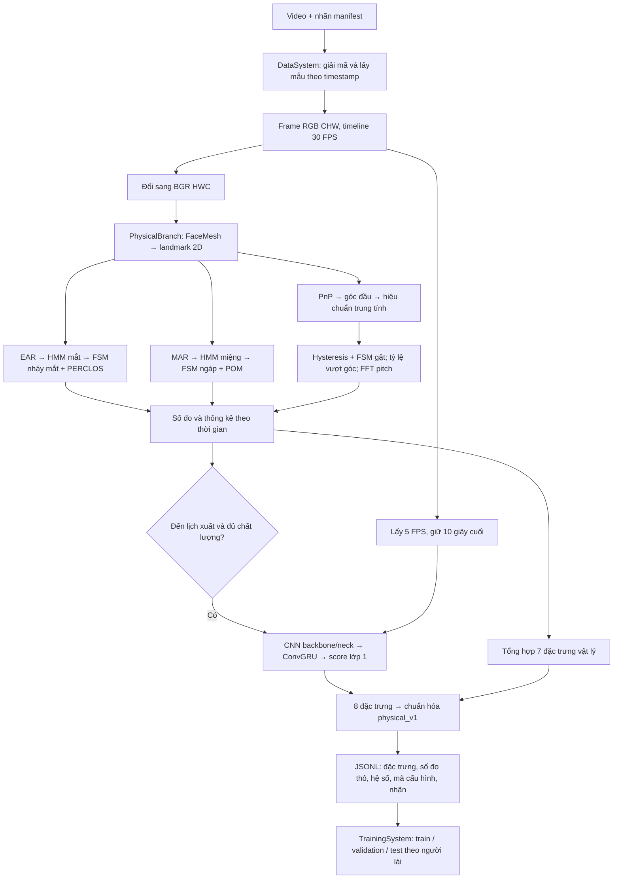
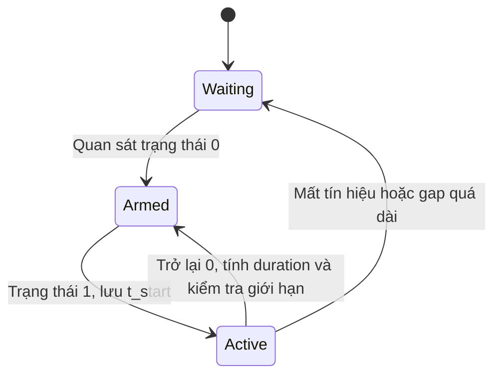

# Kiến trúc khai thác tín hiệu vật lý và tạo dữ liệu đặc trưng

Tài liệu mô tả mã hiện tại của `ai/PhysicalBranch` và cách `ai/OptimalAlgorithsm/DataSystem` sử dụng kết quả. Các giá trị dưới đây là cấu hình mặc định, không phải ngưỡng chẩn đoán y khoa. Phiên bản chuẩn hóa hiện tại là `physical_v1`.

## 1. Phân chia trách nhiệm

**PhysicalBranch** biến chuỗi ảnh thành số đo mắt, miệng và đầu: EAR, MAR, góc đầu, trạng thái, thời lượng, số sự kiện, tỷ lệ thời gian và tần số chuyển động. Nhánh này chưa tự kết luận người lái buồn ngủ.

**DataSystem** đọc video có nhãn, gọi PhysicalBranch liên tục, tổng hợp theo cửa sổ, kết hợp score CNN–ConvGRU, chuẩn hóa tám đặc trưng về `[0,1]` và ghi JSONL. Nhãn được lấy từ manifest, không được tạo từ các chỉ số vật lý.

**TrainingSystem** đọc các đặc trưng đã chuẩn hóa để tối ưu lựa chọn đặc trưng, trọng số và ngưỡng phân loại. Chuẩn hóa không thay thế việc học hoặc đánh giá bộ phân loại.



Hai nhánh dùng cùng video đã giải mã. Sơ đồ mô tả luồng dữ liệu; `Engine` hiện cập nhật tuần tự theo frame, không tạo hai worker xử lý song song.

## 2. Thành phần và cấu hình thống nhất

| Thành phần | Vai trò |
| --- | --- |
| [PhysicalBranch/config.py](PhysicalBranch/config.py) | `PhysicalConfig`: cấu hình detector, cửa sổ, HMM, FSM, camera và hình học đầu |
| [PhysicalBranch/camera_metrics.py](PhysicalBranch/camera_metrics.py) | `FaceTracker`, `CameraMetrics`: lấy landmark, điều phối các bộ đo, trả metric theo frame |
| [PhysicalBranch/adaptive_hmm_fsm.py](PhysicalBranch/adaptive_hmm_fsm.py) | HMM hai trạng thái thích nghi; kết nối HMM với FSM và bộ tính tỷ lệ |
| [PhysicalBranch/temporal_metrics.py](PhysicalBranch/temporal_metrics.py) | `StateMachine`, `WindowRatio`, `HeadMotionWindow` |
| [PhysicalBranch/head_pose_estimation.py](PhysicalBranch/head_pose_estimation.py) | Ước lượng tư thế đầu bằng mô hình mặt 3D và landmark 2D |
| [PhysicalBranch/interface.py](PhysicalBranch/interface.py) | `AIResult`: cấu trúc số đo và xuất JSON; không phải bộ phân loại |
| [PhysicalBranch/brand.py](PhysicalBranch/brand.py) | Hàm chuẩn hóa tham khảo riêng; DataSystem không gọi hàm này |
| [DataSystem/config.py](OptimalAlgorithsm/DataSystem/config.py) | `DataSystemConfig(PhysicalConfig)`: kế thừa vật lý, bổ sung lấy mẫu mạng, tổng hợp và đường dẫn |
| [DataSystem/loadvideo2handle.py](OptimalAlgorithsm/DataSystem/loadvideo2handle.py) | Đọc video, tạo frame RGB CHW và timeline FPS đích |
| [DataSystem/engine.py](OptimalAlgorithsm/DataSystem/engine.py) | Quản lý từng video, cửa sổ, lịch sử sự kiện, lọc chất lượng, kết hợp hai nhánh |
| [DataSystem/normalization.py](OptimalAlgorithsm/DataSystem/normalization.py) | `PhysicalNormalizer`: suy ra hệ số từ bộ đo và chuẩn hóa `physical_v1` |
| [DataSystem/neuralnetwork.py](OptimalAlgorithsm/DataSystem/neuralnetwork.py) | Nạp checkpoint CNN/ConvGRU, xử lý ảnh và suy luận score mạng |

Luồng cấu hình:

```text
PhysicalConfig
    └── DataSystemConfig
          └── Engine.config sau khi áp dụng ghi đè
                ├── CameraMetrics(config=...)
                └── PhysicalNormalizer(config=...)
```

`CameraMetrics` truyền cấu hình xuống các detector. `eye_options` và `mouth_options` ghi đè riêng detector mắt/miệng. `windows` cho phép cửa sổ riêng theo tên `blink`, `perclos`, `yawn`, `pom`, `nod`, `over_angle`, `head_motion`.

Các tham số quan trọng mặc định:

| Nhóm | Tham số | Giá trị |
| --- | --- | --- |
| Timeline | `fps`, `window_sec`, `max_gap_sec` | 30 FPS; 30 giây; 0,25 giây |
| Khởi tạo HMM | `init_duration_sec` | 5 giây quy đổi thành 150 mẫu hợp lệ |
| Cập nhật HMM | `adapt_interval`, `learning_rate` | 300 mẫu; 0,01 |
| Thời lượng sự kiện | `blink_duration_ms` | 100–2.000 ms |
| Thời lượng sự kiện | `yawn_duration_ms` | 4.000–7.500 ms |
| Thời lượng sự kiện | `nod_duration_ms` | 800–3.500 ms |
| Góc đầu | `calibration_frames` | 30 mẫu góc hợp lệ |
| Gật đầu | `nod_pitch_deg`, `nod_release_deg` | Vào ở trên 14°; giữ khi còn trên 8° |
| Vượt góc | `angle_limits` | Pitch 20°, yaw 25°, roll 20° |
| FFT | `head_motion_min_amplitude_deg` | Biên độ đỉnh–đỉnh phải lớn hơn 0,1° |
| DataSystem | `stride_sec`, `min_observed_ratio` | 30 giây; 0,8 |
| Nhánh mạng | `neural_sec`, `neural_fps`, `neural_size` | 10 giây; 5 FPS; 224 |
| Tổng hợp | `blink_duration_percentile`, `nod_duration_percentile` | P90; P100, tức max |

## 3. Từ frame đến landmark

`CameraMetrics.process(frame, timestamp)` nhận ảnh BGR và timestamp tính bằng giây. Timestamp phải hữu hạn và tăng nghiêm ngặt. Khi không truyền timestamp, API camera sử dụng đồng hồ monotonic; DataSystem luôn truyền thời gian video đã lấy mẫu lại.

`FaceTracker` đổi BGR sang RGB rồi gọi MediaPipe FaceMesh. Mặc định chỉ xử lý một mặt, bật `refine_landmarks`, confidence phát hiện và tracking đều bằng 0,6. Các điểm chuẩn hóa được đổi sang tọa độ pixel:

```text
x_pixel = x_normalized × image_width
y_pixel = y_normalized × image_height
```

Đầu ra là mảng `[N,2]`, lấy mặt đầu tiên. PhysicalBranch chỉ sử dụng tọa độ 2D này, không dùng trực tiếp tọa độ z của FaceMesh để tính góc đầu.

`process_landmarks()` coi toàn bộ landmark là không hợp lệ nếu không đủ ít nhất 468 điểm, sai shape hoặc có NaN/Inf. Khi mất mặt, các bộ đo nhận `None`. Điểm có mặt không đồng nghĩa góc đầu đã hiệu chuẩn hoặc EAR/MAR đã sẵn sàng.

## 4. Khai thác tín hiệu mắt

### 4.1. EAR từ hình học mắt

Mỗi mắt sử dụng sáu điểm theo thứ tự cấu hình:

```text
left_eye  = (362, 385, 387, 263, 373, 380)
right_eye = (33, 160, 158, 133, 153, 144)
```

Với sáu điểm `p0..p5`, hàm `aspect_ratio()` tính:

```text
ratio = (||p1 - p5|| + ||p2 - p4||) / (2 × ||p0 - p3||)
EAR = (ratio_left + ratio_right) / 2
```

Tử số đo hai khoảng dọc; mẫu số là chiều rộng. EAR là tỷ số không có đơn vị. Độ mở mắt giảm thường làm khoảng dọc giảm, tạo tín hiệu để phân loại trạng thái.

Nếu một mắt không tính được tỷ số, EAR của frame là `None`. Chiều rộng dưới `1e-6` bị từ chối để tránh phép chia không ổn định. Tỷ số giúp giảm phụ thuộc kích thước ảnh, nhưng chưa loại được sai số do góc nhìn, che khuất hoặc landmark lệch.

### 4.2. HMM hai trạng thái

`AdaptiveHMM_FSM("eye")` dùng HMM Gaussian một chiều với hai trạng thái:

| Trạng thái | Ý nghĩa | Quan sát |
| --- | --- | --- |
| 0 | Mắt mở | EAR cao hơn |
| 1 | Mắt đóng | EAR thấp hơn |

HMM giữ phân phối ban đầu `pi`, ma trận chuyển trạng thái `A`, trung bình và phương sai của hai Gaussian. Với EAR mới `x_t`, prior được tính từ posterior trước đó:

```text
prior_t = posterior_(t-1) × A
posterior_t(k) ∝ prior_t(k) × Gaussian(x_t; mean_k, variance_k)
state_t = argmax posterior_t
```

Frame đầu hoặc sau khi posterior bị xóa dùng `pi`. Code tính trong miền log và dùng log-sum-exp để hạn chế underflow. Suy luận trực tuyến lấy trạng thái có posterior cao nhất; không chạy giải mã Viterbi cho toàn video.

### 4.3. Khởi tạo và thích nghi

Bộ phát hiện tích lũy `max(4, round(fps × init_duration_sec))` quan sát hợp lệ. Với mặc định là 150 mẫu. Đây là số mẫu hợp lệ, không bảo đảm đúng 5 giây thời gian thực nếu có mất tín hiệu; buffer khởi tạo hiện không bị xóa mỗi lần thiếu quan sát.

Mắt dùng P80 của EAR khởi tạo làm baseline `normal`. P5/P95 đánh giá độ phân tách. Khi `P95 - P5 >= 0,06` và `P5 < 0,65 × normal`, HMM khởi tạo bằng K-means một chiều rồi chạy 20 vòng EM; K-means tối đa 25 vòng.

Nếu chưa thấy đủ hai trạng thái, hệ thống khởi tạo dự phòng:

```text
mean_open   = normal
mean_closed = 0.2 × normal
sigma = max(|mean_open - mean_closed| / 4, 0.01)
A  = [[0.97, 0.03], [0.10, 0.90]]
pi = [0.99, 0.01]
```

Khi EAR đạt ít nhất `0,75 × normal`, code ép trạng thái về mở và đặt posterior theo `resting_prior`. Đây là quy tắc hỗ trợ bộ phát hiện, không phải chuẩn hóa điểm nguy hiểm.

Sau mỗi 300 quan sát hợp lệ tích lũy, HMM chạy forward–backward và cập nhật tham số với hệ số 0,01. Nếu tổng trọng số posterior của một trạng thái dưới 2, lượt cập nhật bị bỏ qua. Phương sai có sàn `1e-5`. Mất tín hiệu hoặc gap dài xóa posterior và buffer thích nghi; mô hình đã học vẫn được giữ.

Baseline `normal` và `event_reference` được chốt khi khởi tạo, không tự thay bằng trung bình HMM sau mỗi lần thích nghi. Chúng chỉ được tạo lại khi reset detector.

### 4.4. Nháy mắt từ FSM

HMM chỉ tạo trạng thái theo frame. `StateMachine` biến chuỗi trạng thái thành sự kiện có thời lượng:



FSM phải từng quan sát trạng thái nghỉ `0` để được phép đếm. Nếu video bắt đầu khi mắt đã đóng, đoạn đóng mắt đó không tự được xem là một nháy mắt hoàn chỉnh.

```text
duration_ms = (t_end - t_start) × 1000
blink hợp lệ khi 100 <= duration_ms <= 2000
```

Chỉ sự kiện hợp lệ đã kết thúc mới được thêm vào hàng đợi. Hàng đợi giữ sự kiện có thời điểm kết thúc trong `(t-W, t]`:

```text
blink_rate_per_min = blink_count × 60 / W
```

`blink_detected` chỉ đúng ở frame kết thúc sự kiện hợp lệ. `blink_duration_ms` giữ thời lượng hợp lệ gần nhất, có thể còn tồn tại ở các frame sau; không được thêm giá trị này vào lịch sử mỗi frame. DataSystem chỉ thêm khi `blink_detected=True`.

`eye_closure_duration_ms` là thời gian đóng mắt đang diễn ra; `last_eye_closure_duration_ms` là thời lượng lần đóng mắt vừa kết thúc, kể cả không được tính là nháy mắt hợp lệ. Một lần đóng mắt quá dài có thể không tăng `blink_count` nhưng vẫn góp phần vào PERCLOS.

### 4.5. PERCLOS dùng ngưỡng EAR riêng

PERCLOS không đơn giản là phần trăm frame HMM trả trạng thái đóng. Ngưỡng đóng sâu được tính từ baseline và tham chiếu sự kiện:

```text
threshold = normal - 0.8 × (normal - event_reference)
closed_deeply = EAR <= threshold
```

Với khởi tạo dự phòng `normal=0,30`, `event_reference=0,06`, ngưỡng là `0,108`.

`WindowRatio` tích lũy thời gian, không đếm số frame:

```text
PERCLOS (%) = 100 × thời gian closed_deeply / thời gian quan sát mắt hợp lệ
```

Trên mỗi khoảng `[t_previous, t_current)`, bộ đo dùng trạng thái ở đầu khoảng. Chỉ cộng khoảng khi cả hai đầu hợp lệ và khoảng cách không vượt `max_gap_sec`. Khoảng giao với biên cửa sổ được cắt đúng tại biên. Thiếu quan sát không được xem là mở mắt; mẫu số không có dữ liệu thì tỷ lệ là `None`.

Tên `p80_ear_threshold` trong output là ngưỡng đóng 80% theo khoảng EAR; không được nhầm với percentile P80 dùng để lấy baseline ban đầu.

## 5. Khai thác tín hiệu miệng

Miệng dùng sáu landmark `(61, 37, 267, 291, 314, 84)` và cùng công thức tỷ số hình học để tạo MAR.

`AdaptiveHMM_FSM("mouth")` dùng trạng thái 0 là nghỉ, trạng thái 1 là mở miệng. Khác với mắt, sự kiện miệng ứng với MAR cao. Baseline lấy P20 của mẫu khởi tạo; độ phân tách mặc định là 0,15. Khi không đủ hai cụm, mean sự kiện được đặt bằng `normal + 2 × 0,15`.

FSM chỉ ghi một sự kiện ngáp khi miệng trở về nghỉ và thời lượng mở miệng nằm trong 4.000–7.500 ms. `yawn_detected`, `yawn_count`, `yawn_duration_ms` và `yawning_frequency_per_min` có vai trò tương ứng với các trường nháy mắt.

`pom_pct` là phần trăm thời gian trạng thái miệng bằng 1 trên thời gian quan sát hợp lệ. POM bao gồm các đoạn mở miệng chưa chắc đã tạo thành một sự kiện ngáp hợp lệ. Nó dùng trạng thái HMM miệng, trong khi PERCLOS dùng ngưỡng EAR riêng.

Đây là phát hiện dựa trên hình học và thời lượng. Mã hiện tại chưa phân biệt chắc chắn ngáp với nói chuyện, hát hoặc mở miệng có chủ ý bằng một mô hình hành vi riêng.

## 6. Khai thác tín hiệu đầu

### 6.1. Tư thế từ landmark 2D và mô hình 3D

`HeadPoseEstimator` lấy sáu landmark `(1, 152, 263, 33, 291, 61)`, ghép với sáu điểm mô hình mặt 3D trong cấu hình. Luồng tính:

1. Kiểm tra shape `[6,2]`, giá trị hữu hạn và landmark không suy biến.
2. `solvePnP(..., SOLVEPNP_SQPNP)` ước lượng rotation và translation.
3. `solvePnPRefineLM()` tinh chỉnh nghiệm.
4. `Rodrigues()` đổi vector quay thành ma trận quay.
5. `RQDecomp3x3()` trả góc pitch, yaw, roll tính bằng độ.

Nghiệm không hữu hạn hoặc đặt mô hình phía sau camera bị từ chối. Khi cấu hình không có ma trận camera hiệu chuẩn, mã dùng xấp xỉ:

```text
K = [[image_width, 0, image_width/2],
     [0, image_width, image_height/2],
     [0, 0, 1]]
distortion = [0, 0, 0, 0]
```

Mô hình mặt và nội tại mặc định là giả định hình học. Có thể thay `camera_matrix` và `distortion_coeffs` trong cấu hình khi đã hiệu chuẩn camera.

### 6.2. Góc tương đối với tư thế trung tính

`CameraMetrics` thu 30 mẫu góc hợp lệ để hiệu chuẩn. Mỗi trục được unwrap qua biên góc vòng, lấy trung vị, sau đó đưa về `[-180,180)`.

```text
relative_angle = (raw_angle - neutral_angle + 180) % 360 - 180
```

Sau hiệu chuẩn, pitch/yaw/roll đầu ra là góc tương đối. Trong lúc hiệu chuẩn nên nhìn thẳng, giữ tư thế trung tính; hệ thống không có bộ xác nhận tự động rằng 30 mẫu đầu thực sự là trung tính.

`pose_valid` cho biết frame có nghiệm góc thô; `head_calibrated` cho biết đã có baseline; `head_ready` cho biết hiện có góc tương đối dùng được. Lỗi pose không bắt buộc làm mất EAR/MAR của cùng frame.

### 6.3. Gật đầu: hysteresis và FSM

Đường chạy đầu hiện tại không dùng HMM pitch. Nó dùng ngưỡng có hysteresis rồi đưa trạng thái vào `StateMachine("pitch")`:

```text
pitch_signal = abs(relative_pitch)                nếu nod_direction=None
pitch_signal = nod_direction × relative_pitch     nếu nod_direction là -1 hoặc 1

nếu chưa gật: active = pitch_signal > 14
nếu đang gật: active = pitch_signal > 8
```

Hai ngưỡng khác nhau giảm bật/tắt liên tục khi góc dao động quanh ngưỡng. Mặc định dùng trị tuyệt đối, nên chưa phân biệt cúi đầu với ngửa đầu; cần đặt `nod_direction` phù hợp nếu muốn chỉ xét một hướng.

FSM công nhận sự kiện gật khi trạng thái kết thúc và kéo dài 800–3.500 ms. DataSystem lấy `nod_event_duration_ms` khi `nod_detected=True`. Trường `nod_duration_ms` là thời lượng đang diễn ra, không phải thời lượng sự kiện hợp lệ vừa hoàn tất.

### 6.4. Tỷ lệ vượt góc

Một frame vượt góc khi ít nhất một điều kiện đúng:

```text
abs(pitch) > 20° hoặc abs(yaw) > 25° hoặc abs(roll) > 20°
```

`over_angle_pct` là tỷ lệ thời gian vượt góc trên thời gian có góc tương đối hợp lệ. `head_observed_sec` là thời gian quan sát hợp lệ của bộ tính tỷ lệ này. Vượt góc là mô tả tư thế, chưa đủ để kết luận mất tập trung hay buồn ngủ.

### 6.5. Thống kê pitch và FFT

`HeadMotionWindow` giữ chuỗi pitch có dấu theo timestamp. Mất pitch hoặc gap trên 0,25 giây xóa chuỗi để tránh nối hai đoạn không liên tục.

Các thống kê:

| Chỉ số | Ý nghĩa |
| --- | --- |
| `pitch_amplitude_deg` | `abs(pitch)` ở frame hiện tại |
| `pitch_mean_deg` | Trung bình pitch có trọng số thời gian |
| `pitch_mean_amplitude_deg` | Trung bình `abs(pitch)` có trọng số thời gian |
| `head_motion_observed_sec` | Độ dài chuỗi liên tục đang có trong cửa sổ |
| `head_motion_frequency_hz` | Tần số đỉnh phổ pitch sau tiền xử lý |
| `head_motion_resolution_hz` | Khoảng cách giữa hai bin FFT |

Trung bình dùng tích phân hình thang theo timestamp. Với trung bình trị tuyệt đối, đoạn pitch đổi dấu được tách tại điểm qua 0, tránh đánh giá quá lớn diện tích.

FFT chỉ được tính khi đủ cửa sổ liên tục và ít nhất bốn mẫu. Các bước:

```text
1. Cắt chuỗi theo cửa sổ W, nội suy tại biên trái.
2. N = max(4, round(observed / median(diff(times))) + 1).
3. Nội suy pitch lên N điểm cách đều trong đoạn quan sát.
4. Nếu peak-to-peak <= 0,1°: không trả tần số.
5. Trừ trung bình; nhân cửa sổ Hann.
6. spectrum = abs(rfft(signal))².
7. Bỏ bin DC; lấy bin có năng lượng lớn nhất.
```

Với `dt = observed / (N-1)`, độ phân giải là `1/(N × dt)` và tần số được lấy từ `rfftfreq(N, dt)`.

Tần số FFT là nhịp dao động trội của pitch, không phải số lần gật/phút. Một tín hiệu dao động không đủ ngưỡng gật vẫn có thể có đỉnh FFT. Bộ đo hiện không có kiểm định độ nổi bật của đỉnh phổ hoặc độ tin cậy thống kê riêng.

## 7. Xử lý thiếu dữ liệu và vòng đời trạng thái

| Tình huống | Hành vi hiện tại |
| --- | --- |
| Mất mặt hoặc EAR/MAR lỗi | Truyền `None`, ngắt sự kiện đang dở; không cộng tỷ lệ cho khoảng thiếu |
| Mất pose | Nhánh đầu không có góc tương đối ở frame đó; nhánh mắt/miệng có thể tiếp tục |
| Gap quá dài | Hủy sự kiện đang dở; xóa posterior/buffer cập nhật HMM và chuỗi FFT |
| Mất tín hiệu sau hiệu chuẩn đầu | Giữ baseline đầu đã có; xóa dữ liệu chuyển động liên tục khi cần |
| Đổi kích thước ảnh | Tạo lại estimator; reset hiệu chuẩn và thống kê đầu |
| `CameraMetrics.reset()` | Khởi tạo lại detector mắt/miệng, baseline đầu và các lịch sử |
| Đổi một cửa sổ bằng `set_windows()` | Xóa lịch sử của chỉ số thay đổi; giữ HMM và baseline đầu |
| Video mới trong DataSystem | Tạo `CameraMetrics` mới, không nối sự kiện hoặc baseline giữa video |

`None` và 0 có ý nghĩa khác nhau: `None` là chưa có số đo hợp lệ; 0 là đã quan sát nhưng không có hoạt động tương ứng. Các cờ readiness, coverage và lỗi pose phải được xem cùng số đo.

## 8. DataSystem sử dụng những tín hiệu nào?

PhysicalBranch xuất nhiều metric hơn tám cột dùng huấn luyện. DataSystem hiện lựa chọn:

| Cột đầu ra | Nguồn từ PhysicalBranch / nhánh mạng | Tổng hợp trước chuẩn hóa |
| --- | --- | --- |
| `blink_frequency` | `blink_rate_per_min` | Tần suất từ FSM mắt |
| `blink_duration` | `blink_duration_ms` khi `blink_detected=True` | P90 lịch sử thời lượng hợp lệ, ms |
| `perclos` | `perclos_pct` | Chia 100 thành tỷ lệ 0–1 |
| `yawn_frequency` | `yawning_frequency_per_min` | Tần suất từ FSM miệng |
| `nod_duration` | `nod_event_duration_ms` khi `nod_detected=True` | Max lịch sử hợp lệ, đổi ms sang giây |
| `nod_frequency` | `nodding_frequency_per_min` | Tần suất từ FSM gật |
| `dominant_head_motion_frequency` | `head_motion_frequency_hz` | Giữ tần số FFT theo Hz |
| `neuralnetwork_score` | `NeuralNetwork` | Score lớp 1 của CNN–ConvGRU |

Cột `neuralnetwork_score` chứa score của nhánh CNN–ConvGRU. EAR, MAR, POM, thời lượng ngáp, tỷ lệ vượt góc, pitch trung bình và biên độ pitch chưa trở thành cột huấn luyện riêng trong DataSystem hiện tại.

`Engine` giữ hai hàng đợi `(timestamp_kết_thúc, duration_ms)` cho nháy mắt và gật đầu. Mỗi frame loại sự kiện có thời điểm kết thúc `<= timestamp - window_sec`. Không có sự kiện hợp lệ thì giá trị tổng hợp bằng 0; khi có sự kiện, NumPy percentile dùng nội suy tuyến tính mặc định.

Cửa sổ lịch sử thời lượng do Engine quản lý luôn là `Engine.window_sec`. Trong khi đó, tần suất mắt/miệng/gật có thể dùng cửa sổ riêng từ `config.windows`. Nếu chỉnh riêng các cửa sổ này, không nên mặc định rằng mọi cột đều mô tả cùng một đoạn thời gian.

## 9. Timeline video, nhánh mạng và lịch xuất mẫu

### 9.1. Đọc video

`read_video()` trả `(RGB uint8 [3,H,W], timestamp_sec)` trên timeline FPS đích. Nó sử dụng timestamp video, trừ mốc đầu, và giữ frame trước cho các thời điểm đích tới trước frame tiếp theo. Khi backend không cung cấp timestamp ngay từ đầu, code dùng chỉ số frame/FPS nguồn.

Đây là lấy mẫu lại bằng giữ frame, không sinh chuyển động trung gian. Tăng FPS có thể lặp ảnh; giảm FPS có thể bỏ chi tiết sự kiện ngắn. Timestamp âm ban đầu được dịch về 0; timestamp không tăng hoặc không hợp lệ bị từ chối.

### 9.2. Hai tốc độ xử lý

PhysicalBranch nhận mọi frame trên timeline mặc định 30 FPS. Nhánh mạng lấy mỗi sáu frame để có 5 FPS, letterbox giữ tỷ lệ ảnh về 224×224 và giữ tối đa 50 ảnh tương ứng 10 giây cuối.

Chỉ khi cửa sổ đạt điều kiện chất lượng, `NeuralNetwork` mới chạy CNN backbone/neck, gom đặc trưng theo thời gian và đưa vào ConvGRU. Pixel uint8 được chia 255; đây là chuẩn hóa ảnh, khác với chuẩn hóa tám đặc trưng vật lý/mạng. Code dùng inference mode và không huấn luyện lại checkpoint trong bước tạo dữ liệu.

### 9.3. Cửa sổ và stride

Mặc định `window_sec=30`, `stride_sec=30`:

```text
Mẫu 1: frame thuộc [0,30),   ảnh mạng thuộc [20,30)
Mẫu 2: frame thuộc [30,60), ảnh mạng thuộc [50,60)
Mẫu 3: frame thuộc [120,180), ảnh mạng thuộc [170,180)
```

Lịch kiểm tra mẫu sau frame thứ `count`:

```text
count >= window_frames
(count - window_frames) % stride_frames == 0
start_second = (count - window_frames) / fps
end_second = start_second + window_sec
```

`end_second` là biên phải quy ước của đoạn frame. Timestamp frame cuối bằng `end_second - 1/fps`; các bộ đo thời gian được cập nhật tới timestamp đó. Vì vậy không nên hiểu metadata `[start,end)` là mọi cửa sổ nội bộ đều kết thúc đúng tại `end`.

HMM và baseline đầu tiếp tục được giữ giữa các cửa sổ cùng video. Chỉ đổi video mới tạo trạng thái mới. `VideoMetrics` trong `physicalbranch.py` là lớp tiện ích riêng; Engine gọi trực tiếp `CameraMetrics`, không dùng `VideoMetrics.process()` để tạo dataset.

### 9.4. Điều kiện giữ mẫu

Trước suy luận mạng, Engine yêu cầu:

1. HMM mắt và miệng đã khởi tạo; đầu đã hiệu chuẩn.
2. PERCLOS tồn tại.
3. Thời gian quan sát mắt, miệng, đầu đều hữu hạn và đạt ít nhất `window_sec × min_observed_ratio` — mặc định 24 giây.
4. Tần số FFT và độ phân giải hữu hạn, dương; thời gian quan sát FFT liên tục đủ cửa sổ chuyển động đầu.

Sau suy luận, score mạng phải hữu hạn trong `[0,1]`. Các số đo đưa vào chuẩn hóa phải hợp lệ và trong cận bộ đo.

Cửa sổ đầu `[0,30)` thường chưa đủ điều kiện FFT: frame cuối mới ở 29,9667 giây và còn thời gian hiệu chuẩn đầu. Với stride 30 giây, `[30,60)` là cửa sổ tiếp theo có thể được giữ nếu tín hiệu liên tục.

Đầu đứng yên hoặc chuyển động quá nhỏ cũng có thể không có tần số FFT và khiến cả mẫu bị loại. Đây là hạn chế của bộ lọc hiện tại; không có tần số không đồng nghĩa nguy hiểm hoặc không nguy hiểm. Khi so sánh dataset cần báo cáo số cửa sổ bị loại để thấy ảnh hưởng của điều kiện này.

## 10. Chuẩn hóa physical_v1 về [0,1]

### 10.1. Nguyên tắc

DataSystem dùng phép đổi thang tuyến tính:

```text
z = x / U
```

Trong đó x là số đo không âm; U là cận trên suy ra từ bộ trích xuất đang dùng. `PhysicalNormalizer` tạo một `CameraMetrics(config=...)` chưa mở camera/FaceMesh để lấy đúng cửa sổ và giới hạn FSM sau khi gộp cấu hình.

Không có `safe/danger`, không ánh xạ chữ U cho nháy mắt/FFT, không nhân tần suất nháy mắt với PERCLOS. Hai số đo khác nhau không bị nhập thành cùng mức nguy hiểm bằng quy tắc thủ công.

Chuẩn hóa không fit theo dataset và không dùng nhãn. Nó giữ thứ tự và tỷ lệ so với 0; với hệ số U đã lưu có thể suy ngược `x = z × U`, ngoại trừ dung sai tại biên và sai số số thực.

### 10.2. Tỷ lệ và thời lượng

| Đặc trưng | Hệ số U | Ví dụ mặc định |
| --- | --- | --- |
| `perclos` | 1, sau khi đổi phần trăm thành tỷ lệ | 10% → 0,10 |
| `neuralnetwork_score` | 1 | Score 0,7 → 0,7 |
| `blink_duration` | Giới hạn tối đa FSM mắt: 2.000 ms | P90 680 ms → 0,34 |
| `nod_duration` | Giới hạn tối đa FSM gật: 3,5 giây | Max 1,5 giây → khoảng 0,428571 |

Không trừ thời lượng tối thiểu: 0 được giữ làm mốc không có sự kiện hợp lệ; thời lượng càng lớn cho giá trị chuẩn hóa càng lớn. P90 của các thời lượng `[100,200,800]` ms là 680 ms theo nội suy tuyến tính.

### 10.3. Tần suất sự kiện

Với W là cửa sổ FSM tính bằng giây, m là thời lượng tối thiểu tính bằng ms và F là FPS của Engine:

```text
d = max((m - 0.000001) / 1000, 1/F)
N_upper = ceil(W/d) + 1
U_rate = N_upper × 60/W
z_rate = rate_per_minute / U_rate
```

Một sự kiện hợp lệ chiếm ít nhất d giây, và các sự kiện của cùng FSM không chồng lên nhau. Cộng một sự kiện để bao trường hợp sự kiện bắt đầu trước biên trái nhưng kết thúc trong cửa sổ. Công thức bỏ qua thời gian nghỉ giữa hai sự kiện nên là cận bảo thủ, không phải tần suất tối đa chắc chắn đạt được.

Dung sai 0,000001 ms khớp kiểm tra thời lượng của FSM; `1/F` bảo đảm cận vẫn xác định khi thời lượng tối thiểu được cấu hình bằng 0. Công thức áp dụng riêng cho mắt, miệng, gật với giới hạn và cửa sổ tương ứng.

### 10.4. Tần số FFT

Mặc định chia tần số FFT cho Nyquist: `F/2 = 15 Hz` ở 30 FPS. Với cửa sổ không chia hết cho bước frame, số điểm nội suy có thể bị làm tròn. Code dùng cận bảo thủ:

```text
U_fft = max(3, ceil(W_motion × F)) / (2 × W_motion)
z_fft = frequency_hz / U_fft
```

Công thức bao trường hợp ít nhất bốn điểm FFT và việc làm tròn lưới nội suy. Với W=30 giây, F=30 FPS, U vẫn là 15 Hz; tần số 0,1 Hz được đổi thành khoảng 0,006667.

Đây là cận của phép tính trên lưới lấy mẫu. Video nguồn FPS thấp được lặp frame lên 30 FPS không tự có thêm thông tin chuyển động thật.

### 10.5. Kiểm tra miền và giới hạn phương pháp

Giá trị âm, boolean, `None`, NaN/Inf hoặc vượt cận bị từ chối. Chỉ cho dung sai tuyệt đối `1e-6` tại biên trên rồi kẹp về 1. Code không clip mọi outlier để che số đo lỗi và không làm tròn bốn chữ số thập phân.

Cận kỹ thuật có thể rộng hơn miền dữ liệu thường gặp, khiến một số cột tập trung gần 0. Về `[0,1]` không đồng nghĩa có phân phối đều, phương sai bằng nhau hoặc ảnh hưởng bằng nhau tới mô hình. Lựa chọn này có cơ sở từ bộ đo nhưng chưa được chứng minh tốt nhất về độ chính xác dự đoán trên dataset hiện tại.

Đặc biệt, TrainingSystem hiện dùng các phép gộp trọng số dương. Chúng chưa học được quan hệ ngược chiều hoặc hình chữ U của đặc trưng. Không khắc phục giới hạn mô hình bằng cách đưa quy tắc nguy hiểm trở lại bước chuẩn hóa; cần đánh giá lại mô hình trên dữ liệu mới.

## 11. JSONL, cấu hình và tái lập kết quả

Mỗi dòng đầu ra có tám đặc trưng chuẩn hóa và metadata:

| Trường | Nội dung |
| --- | --- |
| `raw_features` | Tám số đo trước chuẩn hóa theo đơn vị ở mục 8 |
| `normalization_scales` | Hệ số U cho từng cột |
| `normalization_id` | SHA-256 của encoding và toàn bộ cấu hình DataSystem kế thừa đã áp dụng |
| `feature_encoding` | `physical_v1` |
| `source_video` | Đường dẫn video tương đối |
| `start_second`, `end_second` | Biên đoạn frame theo lịch xuất mẫu |
| `label` | Nhãn 0/1 từ manifest |

Output mặc định là `ai/OptimalAlgorithsm/drowsiness_physical_30.jsonl`. Resume kiểm tra encoding, mã cấu hình, hệ số, lịch cửa sổ, nhãn và trùng lặp trước khi nối dữ liệu. Nó đọc lại video từ đầu để tái lập trạng thái detector, bỏ qua suy luận mạng ở các cửa sổ đã lưu.

`normalization_id` không bao gồm nội dung checkpoint hoặc mã nguồn. Để tái lập đầy đủ cần lưu thêm phiên bản mã, checkpoint và manifest. Không thể phục hồi chính xác số đo từ JSONL risk cũ vì ánh xạ cũ có bão hòa và nhiều giá trị chung một điểm; cần trích xuất lại từ video.

Bốn entrypoint TrainingSystem lấy đường dẫn từ `DataSystem.config.OUTPUT_JSONL`. Loader không cho trộn encoding hoặc cấu hình chuẩn hóa; `split.json`, `config.json`, `evaluation.json` lưu `input_schema` gồm thứ tự feature, encoding, mã cấu hình và hệ số. Phân chia theo người lái giữ các video của cùng người trong một tập train/validation/test.

## 12. Phạm vi thực sự đã triển khai

- PhysicalBranch khai thác tín hiệu bằng landmark, HMM, FSM, PnP và FFT; chưa có mô hình hợp nhất quyết định buồn ngủ trong nhánh này.
- `AIResult` có trường `lstm_drowsiness_probability` và `warning_score`, nhưng PhysicalBranch chưa tự tính hai trường đó. `inference_system..py` hiện rỗng.
- `brand.normalize_metrics()` và `DEFAULT_SCALES` là cơ chế tham khảo riêng còn tồn tại trong PhysicalBranch. DataSystem sử dụng `PhysicalNormalizer`, không đi qua các thang này.
- DataSystem chọn bảy đặc trưng vật lý và một score mạng; không xuất mọi metric của PhysicalBranch thành đầu vào huấn luyện.
- Ngưỡng HMM/FSM và góc đầu phục vụ trích xuất sự kiện. Hệ số chuẩn hóa phục vụ đổi thang. Hai nhóm cấu hình có vai trò khác nhau và không phải kết luận chẩn đoán.
- Kiểm thử phần mềm kiểm tra công thức, luồng cấu hình, trạng thái, bộ lọc và định dạng dữ liệu; chưa thay thế đối chiếu sự kiện với annotation hay đánh giá mô hình trên người lái chưa gặp.

Tài liệu chi tiết bổ sung: [toán học PhysicalBranch](PhysicalBranch/README.md), [cấu trúc và API](PhysicalBranch/Structure.md), [DataSystem](OptimalAlgorithsm/DataSystem/README.md), [công thức chuẩn hóa và nguồn tham khảo](OptimalAlgorithsm/DataSystem/NORMALIZATION.md), [TrainingSystem](OptimalAlgorithsm/TrainingSystem/README.md).
