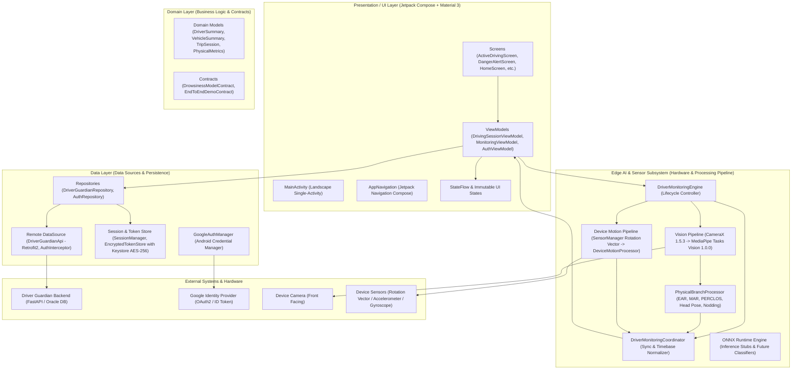
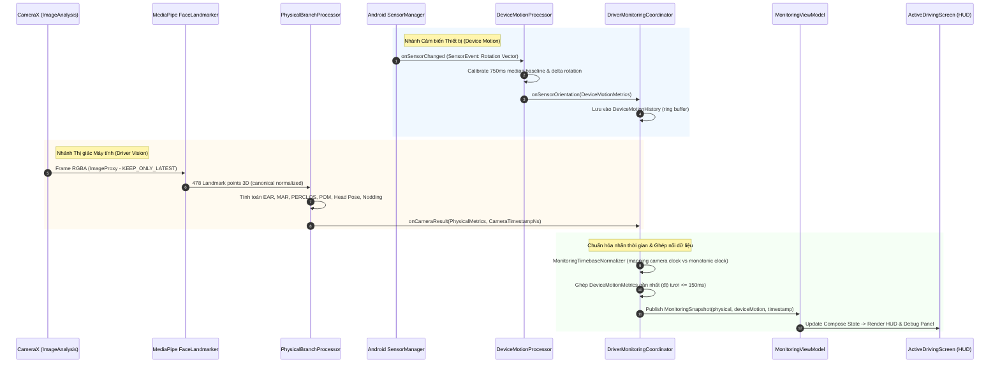
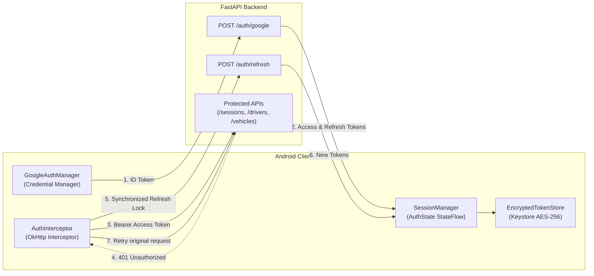
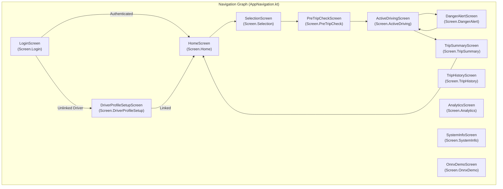

# Báo Cáo Phân Tích Kiến Trúc Hệ Thống - Driver Guardian Android

> **Dự án**: Driver Guardian - Android Automotive / Tablet Client  
> **Nền tảng**: Android 10+ (API 29 - 36), Tối ưu hóa giao diện Landscape & Automotive  
> **Ngôn ngữ & Công nghệ chính**: Kotlin, Jetpack Compose, Coroutines/Flow, Clean Architecture + MVVM, CameraX, MediaPipe Tasks Vision, ONNX Runtime, Retrofit2, Android Keystore & Credential Manager.

---

## 1. Tổng Quan Hệ Thống (System Overview)

**Driver Guardian Android** là phân hệ ứng dụng di động dành cho tài xế và phương tiện giao thông (hỗ trợ môi trường Android Automotive và máy tính bảng chuyên dụng trên xe). Ứng dụng đóng vai trò là một **Edge AI Sensing & Monitoring Node**, có nhiệm vụ:
1. **Thu nhận và xử lý đa cảm biến thời gian thực (Real-time Multi-sensor Pipeline)**: Kết hợp luồng hình ảnh camera góc rộng của tài xế và dữ liệu cảm biến chuyển động/xoay (IMU/Rotation Vector) của thiết bị.
2. **Trích xuất đặc trưng thị giác và tư thế (Edge Feature Extraction)**: Sử dụng MediaPipe Face Landmarker để nhận diện 478 điểm mốc khuôn mặt 3D, từ đó tính toán các chỉ số mỏi mắt (EAR, PERCLOS), mở miệng/ngáp (MAR, POM), tư thế đầu (Head Pose Pitch/Yaw/Roll) và hiện tượng gật đầu (Nodding).
3. **Đồng bộ hóa nhãn thời gian phần cứng (Hardware-level Timebase Synchronization)**: Ghép nối chặt chẽ giữa camera frames và sensor events mà không gây blocking luồng chính hay trôi lệch clock.
4. **Quản trị phiên lái xe và bảo mật (Session & Authentication Management)**: Tích hợp Google Identity thông qua Credential Manager API, mã hóa lưu trữ token qua Android Keystore (AES-256), tự động refresh JWT token khi hết hạn, kết nối đồng bộ dữ liệu phiên lái về Backend FastAPI và cơ sở dữ liệu trung tâm.

---

## 2. Mô Hình Kiến Trúc Tổng Thể (Architectural Style & Pattern)

Hệ thống được thiết kế tuân thủ chặt chẽ nguyên lý **Clean Architecture** kết hợp với mô hình **MVI/MVVM (Model-View-ViewModel with Unidirectional Data Flow - UDF)** và phân tách độc lập phân hệ **Edge AI / Multi-Sensor Monitoring Subsystem**.

### 2.1. Sơ đồ phân tầng tổng thể (High-Level Architecture Diagram)



---

## 3. Phân Tích Chi Tiết Từng Phân Hệ (Subsystem Deep-Dive)

### 3.1. Phân hệ Thị giác và Cảm biến Đa tầng (Edge Vision & Multi-Sensor Pipeline)

Đây là phân hệ trung tâm và phức tạp nhất của ứng dụng Android, nằm trong package `com.example.driverguardian.ai.*`.



#### Các thành phần cốt lõi:
1. **CameraX Analyzer (`CameraXFrameSource`)**:
   - Sử dụng chiến lược `STRATEGY_KEEP_ONLY_LATEST` để đảm bảo hệ thống không bị tồn đọng bộ đệm khung hình (buffer bloat), giữ độ trễ phân tích ở mức tối thiểu (< 30ms).
   - Tự động điều chỉnh góc xoay theo `ImageInfo.rotationDegrees` để chuyển đổi sang hệ tọa độ chuẩn mà không lật ngược ảnh (unmirrored algorithmic space).
2. **MediaPipe Face Landmarker (`MediaPipeFaceLandmarkerClient`)**:
   - Chạy ở chế độ `RunningMode.LIVE_STREAM` với `numFaces = 1`.
   - Sử dụng mô hình chính thức `face_landmarker.task` được lưu trữ trực tiếp trong Android Assets, loại bỏ hoàn toàn việc tải mô hình qua mạng runtime.
   - **Ranh giới AI nghiêm ngặt**: MediaPipe chỉ nhận diện điểm mốc khuôn mặt, tuyệt đối không tự ý phân loại trạng thái buồn ngủ.
3. **Xử lý đặc trưng sinh lý (`PhysicalBranchProcessor`)**:
   - **Ocular**: Tính tỷ lệ khung mắt $EAR$ (Eye Aspect Ratio), tỷ lệ nhắm mắt theo thời gian $PERCLOS$ (P80 threshold), tần suất chớp mắt (Blink Rate).
   - **Oral**: Tỷ lệ mở miệng $MAR$ (Mouth Aspect Ratio), tỷ lệ mở miệng theo cửa sổ thời gian $POM$ (Percentage of Mouth Opening), phát hiện chu kỳ ngáp.
   - **Head Pose & Kinematics**: Ước tính góc quay đầu (Pitch, Yaw, Roll) từ các điểm mốc giải phẫu khuôn mặt, trạng thái gật đầu (Nodding Detection) thông qua chuỗi trạng thái thời gian thực (`AdaptiveHmmFsm`).
4. **Xử lý cảm biến định hướng xe (`DeviceMotionProcessor`)**:
   - Nguồn dữ liệu ưu tiên: `TYPE_ROTATION_VECTOR` $\rightarrow$ `TYPE_GAME_ROTATION_VECTOR` $\rightarrow$ Accelerometer + Magnetic field sensor.
   - Áp dụng `SensorManager.remapCoordinateSystem` để bù trừ góc xoay hiển thị của thiết bị (`DisplayRotation`).
   - Cửa sổ tự hiệu chuẩn ban đầu (Startup Calibration Window) kéo dài **750 ms**, tính toán góc cơ sở trung vị (median baseline). Dữ liệu sau đó được chuẩn hóa thành góc nghiêng lệch delta trong khoảng $[-180^\circ, 180^\circ)$.
5. **Bộ điều phối và chuẩn hóa thời gian (`DriverMonitoringCoordinator` & `MonitoringTimebaseNormalizer`)**:
   - Tránh việc giả định camera timestamp và sensor timestamp dùng chung một gốc clock.
   - Theo dõi sự tương quan giữa capture timestamp và `SystemClock.elapsedRealtimeNanos()`.
   - Đồng bộ hóa với ngưỡng độ tươi `SENSOR_FRESHNESS_THRESHOLD_MS = 150.0ms`. Nếu cảm biến không có mẫu trong ngưỡng này, trường `deviceMotion` trong snapshot sẽ nhận giá trị `null` an toàn.

---

### 3.2. Phân hệ Dữ liệu và Xác thực (Data & Authentication Layer)

Nằm trong package `com.example.driverguardian.data.*`.



#### Đặc điểm kỹ thuật nổi bật:
- **Zero Raw Password / Google One-Tap**: Ứng dụng không lưu mật khẩu. Đăng nhập thực hiện qua Android Credential Manager API (`GetGoogleIdOption`), lấy Google ID Token và chuyển về backend FastAPI để xác thực chữ ký và sinh JWT.
- **Bảo mật phần cứng (Hardware-Backed Keystore)**: Refresh Token và thông tin UserProfile được lưu vào `EncryptedSharedPreferences`, sử dụng `MasterKey` với thuật toán mã hóa `AES256_GCM` cho giá trị và `AES256_SIV` cho khóa.
- **Đồng bộ hóa làm mới Token (Thread-Safe Token Refresh)**: `AuthInterceptor` tích hợp khóa luồng `synchronized(lock)`. Khi nhiều request đồng thời nhận phản hồi HTTP 401, chỉ có một luồng duy nhất gửi yêu cầu tới `/auth/refresh`, các luồng khác đợi và tái sử dụng token mới, ngăn chặn race-condition vô hiệu hóa refresh token.
- **Role & Driver Binding Resolution**: Tự động giải quyết quyền người dùng (`ROLE=DRIVER`). Nếu tài xế chưa được liên kết với xe/hồ sơ (`AuthState.UnlinkedDriver`), giao diện chuyển sang màn hình thiết lập/khóa an toàn để ngăn tài xế bắt đầu chuyến đi không hợp lệ.

---

### 3.3. Phân hệ Giao diện Người dùng (Presentation / UI Layer)

Nằm trong package `com.example.driverguardian.ui.*`.



#### Thiết kế tối ưu cho ô tô (Automotive / In-Cabin UX):
- **Cố định hướng ngang (`screenOrientation="landscape"`)**: Giao diện được thiết kế chuyên biệt cho màn hình đặt trên taplo hoặc màn hình tích hợp của ô tô.
- **Thanh điều hướng bên hông (`AppSidebar`)**: Tối ưu hóa việc thao tác một chạm của tài xế ở khoảng cách xa với các nút bấm kích thước lớn (touch targets $\ge 48\text{dp}$).
- **Bảng điều khiển giám sát thời gian thực (HUD & Debug Panel)**: `ActiveDrivingScreen` hiển thị camera preview nền cùng bảng overlay hiển thị các thông số tức thời (FPS, thời gian suy luận ms, EAR, MAR, Head Pitch/Yaw/Roll, Trạng thái cảm biến).
- **Trạng thái cảnh báo nguy hiểm độc lập (`DangerAlertScreen`)**: Luồng cảnh báo nguy cấp có thể phát âm thanh, hiển thị giao diện báo động đỏ toàn màn hình và yêu cầu xác nhận/tự động ghi nhận sự kiện buồn ngủ gửi về backend.

---

## 4. Mô Tả Chi Tiết Cấu Trúc Mã Nguồn (Source Tree Breakdown)

```
app/src/main/java/com/example/driverguardian/
├── MainActivity.kt                       # Entry activity duy nhất, khởi tạo Compose Theme & NavHost
├── ai/                                   # PHÂN HỆ AI & GIÁM SÁT CẢM BIẾN
│   ├── contract/                         # Contracts & Interfaces cho inference model
│   │   ├── demo/                         # Contract cho mô hình demo end-to-end
│   │   └── drowsiness/                   # Contract cho mô hình nhận diện buồn ngủ tương lai
│   ├── demo/                             # Sequence buffer, preprocessor và runner demo
│   ├── monitoring/                       # Bộ điều phối trung tâm giám sát tài xế
│   │   ├── DriverMonitoringCoordinator.kt # Ghép nối camera & cảm biến, quản lý trạng thái
│   │   ├── DriverMonitoringEngine.kt     # Facade quản lý lifecycle của camera và cảm biến
│   │   ├── camera/                       # CameraX frame acquisition, adapter, overlay
│   │   ├── device/                       # SensorManager orientation, lọc median, bù trục xoay
│   │   ├── model/                        # DTOs: MonitoringSnapshot, RuntimeState, Diagnostics
│   │   ├── sync/                         # Lịch sử cảm biến, kiểm tra độ tươi (freshness threshold)
│   │   └── time/                         # Chuẩn hóa timebase giữa camera và elapsed monotonic
│   ├── parity/                           # Bộ kiểm thử đối chiếu độ chính xác với thuật toán Python
│   ├── physical/                         # Trích xuất đặc trưng hình thái học & tư thế
│   │   ├── geometry/                     # AspectRatioCalculator (EAR, MAR), HeadPoseEstimator
│   │   ├── model/                        # PhysicalMetrics, LandmarkPoint, HeadPose
│   │   ├── pipeline/                     # PhysicalBranchProcessor: quản lý chuỗi xử lý đặc trưng
│   │   └── temporal/                     # HMM FSM, bộ đếm nhắm mắt, ngáp, gật đầu theo thời gian
│   ├── runtime/                          # Wrapper ONNX Runtime Engine (khởi tạo phiên, load model)
│   └── tensor/                           # Các lớp thao tác ma trận, FloatTensor phục vụ inference
├── data/                                 # TẦNG DỮ LIỆU & GIAO TIẾP
│   ├── auth/                             # Quản lý phiên, EncryptedTokenStore, AuthInterceptor
│   ├── remote/                           # ApiClient (Retrofit), DriverGuardianApi
│   │   └── dto/                          # DTOs request/response cho FastAPI backend
│   └── repository/                       # DriverGuardianRepository, AuthRepository
├── domain/                               # TẦNG DOANH NGHIỆP / DOMAIN
│   └── model/                            # Pure domain entities (Session, Driver, Vehicle, Alert)
└── ui/                                   # TẦNG HIỂN THỊ (JETPACK COMPOSE)
    ├── auth/                             # AuthViewModel
    ├── components/                       # Shared UI: DashboardCard, MetricCard, AppSidebar, Charts
    ├── history/                          # TripHistoryViewModel & Presentation models
    ├── mock/                             # Mock data phục vụ Compose Preview và demo offline
    ├── monitoring/                       # CameraPreview, MonitoringViewModel, DebugPanel
    ├── navigation/                       # Screen sealed class, AppNavigation routes
    ├── screens/                          # Các màn hình tính năng (ActiveDriving, Home, PreTrip...)
    ├── session/                          # DrivingSessionViewModel, DrivingSessionUiState
    └── theme/                            # Color palette, Material3 Theme, Typography
```

---

## 5. Đặc Tả Công Nghệ & Thư Viện (Technology Stack)

| Hạng mục | Thư viện / Công nghệ | Phiên bản | Mục đích sử dụng |
| :--- | :--- | :--- | :--- |
| **Ngôn ngữ** | Kotlin | 2.0+ (JVM 17) | Ngôn ngữ phát triển toàn bộ hệ thống |
| **UI Framework** | Jetpack Compose (BOM) | 2025.11.00 | Xây dựng UI phản ứng hiện đại, khai báo thuần túy |
| **Design System** | Material 3 & Icons Extended | Compose BOM | Hệ thống thiết kế giao diện cho ô tô |
| **Navigation** | Navigation Compose | 2.9.6 | Quản lý điều hướng màn hình và truyền tham số |
| **Lifecycle** | Lifecycle Runtime/ViewModel | 2.10.0 | Quản lý vòng đời màn hình và trạng thái ViewModel |
| **Camera Framework** | CameraX (Core, Camera2, Lifecycle, View) | 1.5.3 | Thu nhận luồng hình ảnh camera góc rộng độ trễ thấp |
| **Computer Vision** | Google MediaPipe Tasks Vision | 1.0.0 | Nhận diện 478 mốc khuôn mặt 3D theo thời gian thực |
| **On-device AI** | Microsoft ONNX Runtime Android | 1.30.0 | Sẵn sàng cho mô hình suy luận mạng nơ-ron đa biến |
| **Mạng & API** | Retrofit 2 & OkHttp3 | 2.11.0 | Kết nối RESTful API với FastAPI backend |
| **Chuyển đổi dữ liệu**| Gson Converter | 2.11.0 | Serialize/Deserialize JSON payloads |
| **Xác thực** | AndroidX Credentials & Google Identity | 1.3.0 / 1.1.1 | Đăng nhập Google One-Tap bảo mật cao |
| **Bảo mật cục bộ** | AndroidX Security Crypto | 1.1.0-alpha06 | EncryptedSharedPreferences với Android Keystore AES-256 |
| **Kiểm thử** | JUnit 4, MockWebServer, Coroutines Test | 4.13.2 / 1.10.2 | Kiểm thử đơn vị và mô phỏng mạng cho 145+ test cases |

---

## 6. Đánh Giá Điểm Mạnh & Khả Năng Mở Rộng (Evaluation & Extensibility)

### 6.1. Điểm mạnh kiến trúc (Architectural Strengths)
1. **Phân tách trách nhiệm rõ ràng (Decoupled Boundaries)**:
   - MediaPipe hoàn toàn không can thiệp vào tầng `ai.physical`.
   - `PhysicalBranchProcessor` và `DeviceMotionProcessor` không phụ thuộc vào Android UI framework hay Retrofit, cho phép viết Unit Test độc lập trên JVM thông thường cực nhanh mà không cần emulator.
2. **Xử lý bất đồng bộ và chống nghẽn luồng (Zero-Blocking Concurrency)**:
   - Các tác vụ nặng (nhận diện khuôn mặt, phân tích mốc hình học, lọc tín hiệu cảm biến) đều chạy trên các Background Executor chuyên dụng.
   - Luồng giao diện (Main/UI Thread) chỉ việc lắng nghe các `StateFlow` để render với tần số 30 - 60 FPS mượt mà.
3. **Độ tin cậy và Khả năng chịu lỗi (Resilience & Graceful Degradation)**:
   - Khi mất tín hiệu khuôn mặt, hệ thống đẩy `NO_FACE` nhưng vẫn duy trì chuỗi thời gian vật lý.
   - Khi thiết bị không có cảm biến Rotation Vector, hệ thống tự động fallback xuống gia tốc kế + từ kế; nếu hoàn toàn không có cảm biến, tính năng camera vẫn hoạt động độc lập bình thường.
4. **Bảo mật chuẩn công nghiệp (Enterprise-Grade Security)**:
   - Cơ chế bảo vệ khóa và token qua Android Keystore phần cứng ngăn chặn triệt để nguy cơ trích xuất token trên các thiết bị đã bị root.
   - Xử lý 401 tự động có lock đồng bộ tránh flood request lên backend.

### 6.2. Hướng mở rộng trong tương lai (Roadmap & Extensibility)
- **Tích hợp mô hình ONNX phân loại trạng thái buồn ngủ**: Hạ tầng kiến trúc đã thiết kế sẵn `ai.contract.drowsiness` và `ai.runtime.OnnxRuntimeEngine`. Khi quá trình huấn luyện mô hình mạng nơ-ron (như Temporal CNN/Transformer hoặc Bi-LSTM) hoàn tất, chỉ cần đưa file `.onnx` vào assets và implement `DrowsinessModelContract` mà không cần sửa đổi kiến trúc thu thập dữ liệu hiện tại.
- **Tích hợp Android Automotive OS (AAOS) Car API**: Dễ dàng thay thế hoặc bổ sung nguồn `DeviceMotionSource` bằng tín hiệu trực tiếp từ bus CAN của xe (Vehicle Speed, Steering Wheel Angle, Turn Signals) qua thư viện `androidx.car.app`.
- **Hỗ trợ chạy nền (Foreground Service)**: Đóng gói `DriverMonitoringEngine` vào một Android `ForegroundService` kết hợp thông báo liên tục để hệ thống tiếp tục giám sát ngay cả khi tài xế chuyển sang ứng dụng bản đồ dẫn đường (Google Maps / Waze).

---

## 7. Kết Luận (Conclusion)

Dự án Android **Driver Guardian** sở hữu một cấu trúc kiến trúc vững chắc, bài bản và tuân thủ các tiêu chuẩn kỹ thuật hiện đại nhất của hệ sinh thái Android (Jetpack Compose, Clean Architecture, Kotlin Coroutines, Hardware Security). Điểm sáng lớn nhất của dự án là việc thiết kế phân hệ giám sát đa cảm biến thời gian thực với tính trừu tượng hóa cao, phân định ranh giới AI rõ ràng, bảo đảm tính toàn vẹn thời gian của tín hiệu và khả năng sẵn sàng tích hợp mô hình học sâu toàn diện.
