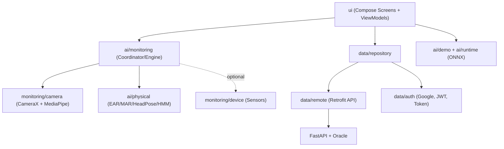

# Phân tích kiến trúc — Driver Guardian Android

## 1. Tổng quan
Ứng dụng Android (Kotlin, Jetpack Compose, minSdk 29 / targetSdk 36, JDK 17) dùng để **giám sát mức buồn ngủ của tài xế** theo thời gian thực.

- **Pipeline chính (production):** CameraX → MediaPipe Face Landmarker (478 điểm mốc) → `PhysicalBranchProcessor` → `PhysicalMetrics` (EAR, MAR, PERCLOS, POM, Head Pose, gật đầu).
- **Backend:** FastAPI + Oracle DB, gọi qua Retrofit; đăng nhập bằng Google (Credential Manager) để lấy JWT.
- **ONNX:** chỉ dùng trong màn hình demo, tách biệt khỏi phần cảnh báo khi đang lái.
- **Cấu hình build:** `API_BASE_URL` và `GOOGLE_SERVER_CLIENT_ID` đưa vào `BuildConfig` qua Gradle property.

Kiến trúc tổng thể là **MVVM phân tầng**: `ui` (View + ViewModel) → `data` (Repository / Remote / Auth) + `ai` (xử lý suy luận trên thiết bị), còn `domain/model` chứa model nghiệp vụ dùng chung.

---

## 2. Thư mục gốc
| File | Chức năng |
|---|---|
| `build.gradle.kts`, `settings.gradle.kts`, `gradle.properties` | Cấu hình Gradle gốc, plugin, khai báo module `app` |
| `gradlew`, `gradlew.bat`, `gradle/wrapper/*` | Gradle wrapper |
| `local.properties` | Đường dẫn SDK trên máy (riêng từng máy) |
| `README.md` | Hướng dẫn kiến trúc, auth, chạy Oracle/FastAPI, adb reverse, model ONNX |
| `snapdragon_680_v2.md` | Tài liệu lớn (~186KB) về tối ưu/benchmark cho chip Snapdragon 680 |
| `docs/superpowers/specs/...multi-sensor-monitoring-design.md` | Đặc tả thiết kế giám sát đa cảm biến |
| `docs/superpowers/plans/...multi-sensor-monitoring.md` | Kế hoạch triển khai tương ứng |

## 3. `app/`
| File | Chức năng |
|---|---|
| `build.gradle.kts` | Dependencies: Compose, Navigation, CameraX 1.5.3, MediaPipe tasks-vision, ONNX Runtime, Retrofit/Gson, Credentials/GoogleID, security-crypto; test: JUnit, MockWebServer, coroutines-test |
| `src/main/AndroidManifest.xml` | Khai báo Activity và quyền (Camera, Internet) |
| `src/debug/AndroidManifest.xml` | Bổ sung riêng cho bản debug (vd. cho phép cleartext HTTP) |
| `res/values/strings.xml`, `themes.xml` | Tên ứng dụng, theme gốc |

### Assets (`src/main/assets`)
| File | Chức năng |
|---|---|
| `face_landmarker.task` | Model MediaPipe phát hiện 478 điểm mốc khuôn mặt (không phải bộ phân loại buồn ngủ) |
| `drowsy_classifier_fp32/fp16/int8.onnx` | Bộ phân loại buồn ngủ ở 3 mức lượng tử hóa |
| `models/onnx_compatibility_vector.json` | Vector kiểm tra tính tương thích của model |
| `models/.gitkeep`, `onnx_test_vectors/.gitkeep` | Giữ chỗ cho thư mục (model demo không commit vào Git) |

---

## 4. Mã nguồn `com.example.driverguardian`

### `MainActivity.kt`
Điểm vào duy nhất: gọi `setContent` với Theme và `AppNavigation`.

### 4.1 `ai/contract` — Hợp đồng I/O của model
| File | Chức năng |
|---|---|
| `drowsiness/ModelContract.kt` | Interface chung mô tả tên, shape và kiểu tensor vào/ra |
| `drowsiness/DrowsinessModelContract.kt` | Contract cụ thể của model drowsiness |
| `drowsiness/DrowsinessInputMapping.kt` | Ánh xạ đặc trưng sang các vị trí trong tensor đầu vào |
| `demo/EndToEndDemoModelContract.kt` | Contract của model demo end-to-end (kích thước, SHA-256, shape) |

### 4.2 `ai/demo` — Pipeline ONNX demo
| File | Chức năng |
|---|---|
| `BoundedSequenceBuffer.kt` | Bộ đệm vòng giới hạn, gom chuỗi frame/đặc trưng theo thời gian |
| `EndToEndDemoPreprocessor.kt` | Tiền xử lý dữ liệu thành tensor cho model demo |
| `EndToEndDemoInferenceRunner.kt` | Chạy suy luận ONNX cho demo |
| `DemoOnnxOutput.kt` | Kiểu dữ liệu kết quả đầu ra của demo |

### 4.3 `ai/runtime` — Lớp bọc ONNX Runtime
| File | Chức năng |
|---|---|
| `OnnxRuntimeEngine.kt` | Quản lý `OrtEnvironment` và việc tạo session |
| `OnnxModelSession.kt` | Nạp model từ assets, chạy inference, giải phóng tài nguyên |
| `OrtTypeMapper.kt` | Ánh xạ kiểu tensor của ORT sang kiểu nội bộ |
| `RuntimeError.kt` / `RuntimeState.kt` / `RuntimeMetadata.kt` | Mô hình lỗi, trạng thái (idle/loading/ready/error) và metadata của model |

### 4.4 `ai/tensor`
| File | Chức năng |
|---|---|
| `TensorShape.kt`, `TensorData.kt` | Mô tả shape và dữ liệu tensor |
| `DummyTensorFactory.kt` | Sinh tensor giả để kiểm thử |
| `TensorPreviewFactory.kt` | Tạo bản xem trước tensor để hiển thị trên UI |

### 4.5 `ai/parity` — Kiểm tra khớp số học với Python
| File | Chức năng |
|---|---|
| `GoldenTestCase.kt` | Model của một test case "golden" |
| `GoldenVectorAssetLoader.kt` | Nạp các golden vector từ assets |
| `GoldenVectorRunner.kt` | Chạy model và so sánh với kết quả kỳ vọng |
| `NumericalTolerance.kt` | Ngưỡng sai số cho phép (atol/rtol) |

### 4.6 `ai/physical` — Nhánh vật lý (lõi thuật toán)
| File | Chức năng |
|---|---|
| `model/LandmarkPoint.kt` | Điểm mốc (x, y, z) |
| `model/HeadPose.kt` | Kết quả pitch/yaw/roll |
| `model/PhysicalMetrics.kt` | DTO đầu ra gồm EAR, PERCLOS, chớp mắt, MAR, POM, ngáp, góc đầu, gật đầu (giá trị có thể null, không tự gán giá trị mặc định giả) |
| `geometry/AspectRatioCalculator.kt` | Tính EAR (mắt) và MAR (miệng) từ landmark |
| `geometry/HeadPoseEstimator.kt` | Ước lượng tư thế đầu (dạng PnP từ landmark 3D) |
| `temporal/WindowRatio.kt` | Cửa sổ trượt theo thời gian để tính tỉ lệ (PERCLOS/POM/over-angle) |
| `temporal/TemporalStateMachine.kt` | Máy trạng thái phát hiện sự kiện (chớp mắt, ngáp, gật đầu) và thời lượng |
| `temporal/AdaptiveHmm.kt` | HMM thích nghi để làm mượt trạng thái mắt/miệng, kèm ngưỡng P80 |
| `temporal/AdaptiveHmmFsm.kt` | Kết hợp HMM với FSM |
| `pipeline/PhysicalBranch.kt` | Interface: `processLandmarks(...)` và `reset()` |
| `pipeline/PhysicalBranchConfig.kt` | Các ngưỡng và tham số cấu hình |
| `pipeline/PhysicalBranchProcessor.kt` | Hiện thực hoàn chỉnh: ghép geometry, temporal và calibration thành `PhysicalMetrics` |

### 4.7 `ai/monitoring` — Điều phối giám sát thời gian thực
| File | Chức năng |
|---|---|
| `DriverMonitoringCoordinator.kt` | Trung tâm điều phối: quản lý phiên (theo generation), nhận frame camera/sensor, chuẩn hóa thời gian, gọi PhysicalBranch, phát `StateFlow` snapshot/runtimeState/diagnostics |
| `DriverMonitoringEngine.kt` | Lắp ráp CameraX, FaceLandmarker và Coordinator; điều khiển vòng đời start/stop |
| `camera/CameraXFrameSource.kt` | Lấy frame qua ImageAnalysis của CameraX (camera trước) |
| `camera/CameraFrameGeometry.kt` | Kích thước và độ xoay của frame |
| `camera/FaceLandmarkerClient.kt` | Interface trừu tượng cho bộ phát hiện landmark |
| `camera/MediaPipeFaceLandmarkerClient.kt` | Hiện thực bằng MediaPipe (chế độ LIVE_STREAM) |
| `camera/MediaPipeLandmarkAdapter.kt` | Chuyển landmark MediaPipe sang `LandmarkPoint` |
| `device/AndroidDeviceOrientationSource.kt` | Đọc cảm biến quay/gia tốc (tùy chọn, chưa dùng trong production) |
| `device/DeviceMotionProcessor.kt`, `DeviceMotionConfig.kt`, `DeviceMotionMetrics.kt` | Xử lý chuyển động thiết bị thành các chỉ số |
| `device/DeviceOrientation.kt`, `OrientationMath.kt` | Model hướng thiết bị và các phép toán quaternion/góc |
| `device/SafeDisplayRotationProvider.kt` | Lấy độ xoay màn hình một cách an toàn |
| `device/SensorSelection.kt` | Chọn cảm biến khả dụng tốt nhất |
| `model/MonitoringSnapshot.kt` | Ảnh chụp tổng hợp tại một thời điểm (physical + device) |
| `model/MonitoringRuntimeState.kt` | Trạng thái Camera/Face/Sensor |
| `model/MonitoringDiagnostics.kt` | Thông tin chẩn đoán (FPS, timebase, lỗi) |
| `sync/DeviceMotionHistory.kt`, `MonitoringSyncConfig.kt` | Lịch sử mẫu sensor để đồng bộ theo timestamp với frame camera |
| `time/CameraTimestampSource.kt`, `MonitoringTimebaseConfig.kt`, `MonitoringTimebaseNormalizer.kt` | Chuẩn hóa timestamp camera về một trục thời gian đơn điệu |

### 4.8 `data` — Tầng dữ liệu
| File | Chức năng |
|---|---|
| `auth/GoogleAuthManager.kt` | Credential Manager (`GetGoogleIdOption`) lấy Google ID Token |
| `auth/TokenStore.kt` | Lưu refresh token và profile bằng EncryptedSharedPreferences (Keystore, AES-256-GCM) |
| `auth/SessionManager.kt` | Giữ access token trong bộ nhớ và trạng thái phiên |
| `auth/AuthInterceptor.kt` | OkHttp interceptor: gắn Bearer, xử lý 401, refresh token đồng bộ, retry một lần, đưa về Login khi thất bại |
| `remote/ApiClient.kt` | Dựng Retrofit/OkHttp với `BuildConfig.API_BASE_URL` |
| `remote/DriverGuardianApi.kt` | Khai báo endpoint (auth/google, auth/me, drivers, vehicles, trips, alerts...) |
| `remote/dto/ApiDtos.kt` | DTO request/response |
| `repository/AuthRepository.kt` | Luồng đăng nhập/đăng xuất/refresh và resolve tài xế từ `/auth/me` |
| `repository/DriverGuardianRepository.kt` | Nghiệp vụ chuyến đi, xe, cảnh báo; map DTO sang domain |

### 4.9 `domain/model/DriverGuardianModels.kt`
Model nghiệp vụ thuần (Driver, Vehicle, Trip, Alert...).

### 4.10 `ui` — Giao diện Compose
| File | Chức năng |
|---|---|
| `navigation/Screen.kt` | Các route: login, profile setup, home, selection, pre_trip_check, active_driving, danger_alert, trip_summary, trip_history, trip_detail/{id}, analytics, alert_history, settings, system_info, onnx_demo |
| `navigation/AppNavigation.kt` | NavHost, khởi tạo ViewModel và điều hướng theo trạng thái đăng nhập |
| `auth/AuthViewModel.kt` | Trạng thái đăng nhập |
| `session/DrivingSessionViewModel.kt` + `DrivingSessionUiState.kt` | Vòng đời chuyến đi: chọn xe, bắt đầu/kết thúc trip, gọi API, nhận dữ liệu giám sát |
| `monitoring/MonitoringViewModel(+Factory).kt` | Đưa `DriverMonitoringEngine` lên UI |
| `monitoring/CameraPreview.kt` | Hiển thị PreviewView của CameraX trong Compose |
| `monitoring/MonitoringPresentation.kt` | Định dạng số liệu để hiển thị |
| `monitoring/MonitoringDebugPanel.kt` | Bảng debug các chỉ số |
| `history/TripHistoryViewModel.kt`, `TripPresentation.kt` | Danh sách lịch sử chuyến đi và cách định dạng |
| `components/*` | `AppSidebar`, `DashboardCard`, `MetricCard`, `PrimaryActionButton`, `StatusIndicator`, `AiAnalyticsCharts` (biểu đồ) |
| `mock/*` | Dữ liệu giả cho UI và Analytics |
| `theme/Color, Theme, Type` | Theme Material3 |
| `screens/auth/LoginScreen` | Đăng nhập Google |
| `screens/auth/DriverProfileSetupScreen + ViewModel` | Thiết lập hồ sơ tài xế; chặn tài khoản chưa liên kết DRIVER_ID |
| `screens/home/HomeScreen` | Dashboard chính |
| `screens/selection/SelectionScreen` | Chọn tài xế/xe trước chuyến |
| `screens/pretrip/PreTripCheckScreen` | Kiểm tra camera và quyền trước khi chạy |
| `screens/driving/ActiveDrivingScreen` | Màn hình lái: preview kèm chỉ số thời gian thực |
| `screens/driving/DangerAlertScreen` | Cảnh báo nguy hiểm (nhãn DEMO) |
| `screens/summary/TripSummaryScreen` | Tổng kết sau chuyến |
| `screens/history/TripHistoryScreen`, `TripDetailScreen` | Lịch sử và chi tiết chuyến |
| `screens/analytics/AnalyticsScreen` | Thống kê và biểu đồ AI |
| `screens/alerts/AlertHistoryScreen` | Lịch sử cảnh báo |
| `screens/settings/SettingsScreen`, `system/SystemInfoScreen` | Cài đặt và thông tin hệ thống |
| `screens/onnxdemo/OnnxDemoScreen + ViewModel` | Demo suy luận ONNX tách biệt |

---

## 5. Kiểm thử (`app/src/test`)
Có độ phủ tương ứng với từng package:
- **ai/physical**: kiểm thử parity với Python bằng `physical_fixtures.json`, `long_run_physical_fixtures.json` (~10MB), `hmm_golden.json`, `head_pose_golden.json`.
- **ai/monitoring**: Coordinator, timebase, sync, device, camera config.
- **ai/demo, OnnxFoundationTest**: contract và parity của ONNX (tự skip nếu không có model).
- **data**: Interceptor, GoogleAuth, Session, API contract (MockWebServer), Repository.
- **ui**: các ViewModel (Auth, ProfileSetup, TripHistory, Monitoring, DrivingSession, VehicleManagement).

## 6. Nhận xét
> [!NOTE]
> Device Motion đã được hiện thực đầy đủ nhưng chưa đăng ký vào engine production. Cảnh báo nguy hiểm hiện mới là demo, chưa được kích hoạt tự động từ `PhysicalMetrics`.

> [!WARNING]
> Các file `drowsy_classifier_*.onnx` (khoảng 15MB) đang nằm trong assets, trong khi README ghi rằng `*.onnx` bị ignore. Cần kiểm tra lại xem chúng có thực sự được dùng không; nếu không dùng, chúng chỉ làm APK nặng thêm. Thư mục `ui/mock` vẫn được dùng cho Analytics, nghĩa là màn hình này chưa có dữ liệu thật.
